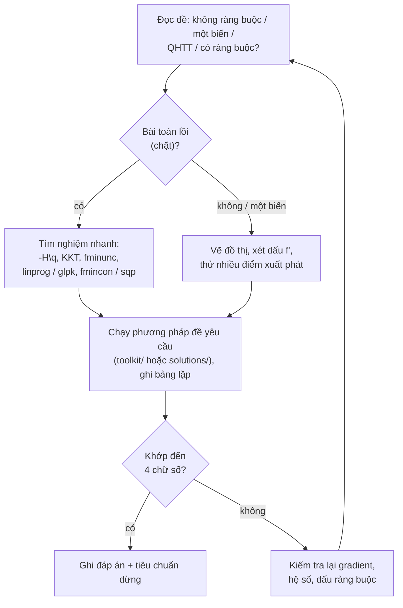

# Tài liệu ôn thi Tối ưu hóa

**Hình thức thi:** ngân hàng đề gồm 18 câu của bài tập lớn ([đề](../../problems/README.md)). Mỗi đề có **12 câu trắc nghiệm / điền đáp án (6 điểm, 0.5 điểm/câu)** và **phần tự luận (4 điểm)**. Thời gian 90 phút, được dùng Matlab trên máy không có mạng. Đề mẫu: [Đề số 1](../test1-paper1/).

Tài liệu gồm trang tổng quan này, 6 file theo nhóm chủ đề, đề luyện và các script kiểm chứng. Mỗi chủ đề có sáu mục: lý thuyết cốt lõi, thuật toán, dạng câu hỏi có thể gặp (kèm lệnh Matlab), câu hỏi mẫu có đáp án, gợi ý nếu ra tự luận, và các bẫy. Mọi con số trong đáp án đều lấy từ output của chương trình.

| Mục | Nội dung |
|---|---|
| [1](#1-bản-đồ-18-chủ-đề) | Bản đồ 18 chủ đề và file tương ứng |
| [2](#2-chiến-lược-làm-bài) | Chiến lược, phân bổ thời gian |
| [3](#3-quy-trình-làm-một-câu-trắc-nghiệm--điền-đáp-án) | Quy trình làm một câu trắc nghiệm / điền đáp án |
| [4](#4-nền-tảng-giải-tích-và-hàm-lồi) | Gradient, Hessian, xác định dương, hàm lồi (dùng cho mọi chủ đề) |
| [5](#5-phần-tự-luận-4-điểm) | Tự luận: các dạng, khung trả lời, ngân hàng bài |
| [6](#6-matlab-trong-phòng-thi) | Lệnh có sẵn, bộ hàm `toolkit/`, hàm của 18 câu |
| [7](#7-bẫy-thường-gặp-và-checklist) | Bẫy và checklist |
| [8](#8-lộ-trình-ôn-tập) | Lộ trình ôn tập |
| [9](#9-đề-luyện-và-kiểm-chứng) | Đề luyện, script kiểm chứng |

---

## 1. Bản đồ 18 chủ đề

| Câu | Chủ đề | File ôn | Dạng hay ra trong phần trắc nghiệm |
|---|---|---|---|
| 1 | Đơn hình | [lp-and-qp](topics/lp-and-qp.md) | Cơ sở / phương án là gì (thang A–D), một bước xoay, không bị chặn |
| 2 | Đơn hình hai pha | [lp-and-qp](topics/lp-and-qp.md) | Bài toán phụ, $`w^* \gt 0`$ thì vô nghiệm, điền $`x^*`$ |
| 3 | Hàm phạt (bài toán M) | [lp-and-qp](topics/lp-and-qp.md) | Bảng đầu theo $`M`$, biến vào, $`M`$ quá nhỏ |
| 4 | Chính quy, KKT | [kkt-duality-convex](topics/kkt-duality-convex.md) | LICQ/MFCQ tại một điểm, điểm có phải KKT, nhân tử |
| 5 | Đối ngẫu Lagrange | [kkt-duality-convex](topics/kkt-duality-convex.md) | Giá trị hàm đối ngẫu, đối ngẫu LP, đối ngẫu yếu/mạnh |
| 6 | Chia đôi | [line-search](topics/line-search.md) | Số bước, khoảng sau 1–2 bước, điền $`x^*`$ |
| 7 | Lát cắt vàng | [line-search](topics/line-search.md) | Số bước, điểm thử, điền $`x^*`$ (bẫy hàm không đơn mốt) |
| 8 | Gauss–Seidel | [unconstrained](topics/unconstrained.md) | Điền $`x^*`$, điểm sau vòng 1 |
| 9 | Hooke–Jeeves | [unconstrained](topics/unconstrained.md) | Bước dò, bước mẫu, điền $`x^*`$ |
| 10 | Gradient, quán tính | [unconstrained](topics/unconstrained.md) | Điền $`x^*`$, bước $`\alpha`$, tham số $`\alpha, \beta`$ |
| 11 | Newton | [unconstrained](topics/unconstrained.md) | Điền $`x^*`$, một bước Newton, tốc độ hội tụ |
| 12 | Tựa Newton | [unconstrained](topics/unconstrained.md) | Điền $`x^*`$, cập nhật BFGS/DFP |
| 13 | Quy hoạch lồi: chính quy, KKT | [kkt-duality-convex](topics/kkt-duality-convex.md) | Slater, KKT cần/đủ, water-filling |
| 14 | Frank–Wolfe | [constrained-methods](topics/constrained-methods.md) | Đỉnh $`y_0`$, khe, bước, điền $`x^*`$ |
| 15 | Rosen, Murtagh–Sargent | [constrained-methods](topics/constrained-methods.md) | Ma trận chiếu $`P`$, hướng $`d_0`$, nhân tử $`u`$, bỏ ràng buộc |
| 16 | Newton ràng buộc $`Ax = b`$ | [constrained-methods](topics/constrained-methods.md) | Hệ KKT của bước Newton, giảm lượng Newton, phần dư |
| 17 | Hàm chắn Newton | [constrained-methods](topics/constrained-methods.md) | Khe $`m/t`$, số bước ngoài, đường trung tâm, pha 1 |
| 18 | Đơn hình Beale (QP) | [lp-and-qp](topics/lp-and-qp.md) | $`\theta_1`$ so với $`\theta_2`$, biến tự do, điền $`x^*`$ |

Đề số 1 (8 câu điền/trắc nghiệm + tự luận) đã dùng câu 1, 4–8, 10–13. Đề 12 câu có thể lấy thêm từ các câu 2, 3, 9, 14–18.

---

## 2. Chiến lược làm bài

**Phân bổ 90 phút:** 12 câu trắc nghiệm khoảng 45 phút (trung bình gần 4 phút một câu; câu lý thuyết làm nhanh để dành thời gian cho câu phải chạy code), tự luận khoảng 40 phút, 5 phút soát.

**Nguyên tắc quan trọng nhất:** câu dạng "dùng phương pháp X giải bài toán ... cho nghiệm $`x^*`$ =" có đáp án là **nghiệm tối ưu của bài toán**, không phụ thuộc phương pháp X, điểm xuất phát hay $`\varepsilon`$ (khi bài toán lồi chặt, hoặc khi phương pháp hội tụ về cực tiểu duy nhất). Vì vậy:
1. Tìm nghiệm bằng cách nhanh và chắc nhất: giải tay ($`-H^{-1}q`$, KKT), hoặc dùng lệnh có sẵn (`fminunc`, `fmincon`/`sqp`, `linprog`/`glpk`, `quadprog`/`qp`).
2. Chạy phương pháp X (bằng `toolkit/` hoặc hàm của bài tập lớn) để có bảng lặp và đối chiếu.
3. Hai kết quả khớp đến 4 chữ số thì ghi đáp án.

**Câu lý thuyết** (thang A–D cho cơ sở/phương án, LICQ/Slater, tốc độ hội tụ, số bước, công thức cập nhật): đọc mục "Dạng câu hỏi có thể gặp" và "Bẫy" của từng chủ đề.

---

## 3. Quy trình làm một câu trắc nghiệm / điền đáp án



**Hai quy ước dấu ước lượng trong QHTT.** Giáo trình (và file [lp-and-qp](topics/lp-and-qp.md), cùng các chương trình câu 1–3) dùng $`\Delta_j = c_B^T B^{-1} A_j - c_j`$: bài **min** tối ưu khi mọi $`\Delta_j \le 0`$. Hàm `basis_check`/`point_check` của toolkit in $`c_j - y^T A_j`$, tức là **ngược dấu**: bài min tối ưu khi mọi giá trị in ra $`\ge 0`$, bài max tối ưu khi mọi giá trị in ra $`\le 0`$. Hai hàm này in sẵn kết luận nên không cần tự đổi dấu. Khi viết bài thì dùng quy ước của giáo trình.

---

## 4. Nền tảng giải tích và hàm lồi

### 4.1 Gradient, Hessian, khai triển Taylor

```math
\nabla f(x) = \Big(\frac{\partial f}{\partial x_1}, \dots, \frac{\partial f}{\partial x_n}\Big)^T,\qquad
\nabla^2 f(x) = \Big(\frac{\partial^2 f}{\partial x_i \partial x_j}\Big)_{i,j},\qquad
f(x + d) \approx f(x) + \nabla f(x)^T d + \tfrac12 d^T \nabla^2 f(x)\, d .
```

### 4.2 Hàm bậc hai

```math
f(x) = \tfrac12 x^T H x + q^T x + c,\qquad \nabla f = Hx + q,\qquad \nabla^2 f = H .
```

**Cách đọc $`H`$ từ đề (hay sai nhất):** với $`f = \sum_i a_{ii} x_i^2 + \sum_{i \lt j} a_{ij} x_i x_j + \dots`$ thì $`H_{ii} = 2a_{ii}`$ (nhân đôi hệ số bình phương) và $`H_{ij} = H_{ji} = a_{ij}`$ (giữ nguyên hệ số tích chéo). Ví dụ câu 1 Đề số 1: $`2x_1^2 - 2x_1x_2 + 4x_1x_3 + 3x_2^2 - 4x_2x_3 + 6x_3^2 + 3x_3`$ cho

```math
H = \begin{pmatrix} 4 & -2 & 4 \\ -2 & 6 & -4 \\ 4 & -4 & 12 \end{pmatrix},\qquad q = \begin{pmatrix} 0 \\ 0 \\ 3 \end{pmatrix}.
```

Nếu $`H \succ 0`$ thì $`x^* = -H^{-1} q`$ và $`f^* = c + \tfrac12 q^T x^*`$. Trong Matlab: `x = -H\q`.

### 4.3 Ma trận xác định dương

| Tiêu chuẩn | Nội dung | Matlab |
|---|---|---|
| Trị riêng | $`H \succ 0 \iff`$ mọi trị riêng $`\gt 0`$ | `eig(H)` |
| Sylvester | $`H \succ 0 \iff`$ các định thức con chính góc trên trái $`\Delta_1, \dots, \Delta_n \gt 0`$ | `det(H(1:k,1:k))` |
| Cholesky | $`H \succ 0 \iff`$ phân tích $`H = R^T R`$ thành công | `[~, p] = chol(H)`, $`p = 0`$ |

Nửa xác định dương ($`\succeq 0`$) thì cần **mọi** định thức con chính (không chỉ góc trên trái) $`\ge 0`$, hoặc mọi trị riêng $`\ge 0`$.

### 4.4 Hàm lồi

- **Định nghĩa:** $`f(\theta x + (1-\theta) y) \le \theta f(x) + (1-\theta) f(y)`$ với mọi $`x, y`$ trong miền lồi, $`\theta \in [0, 1]`$.
- **Bậc một:** $`f(y) \ge f(x) + \nabla f(x)^T (y - x)`$, nên nếu $`\nabla f(x^*) = 0`$ thì $`x^*`$ là cực tiểu toàn cục.
- **Bậc hai:** $`f`$ lồi $`\iff \nabla^2 f \succeq 0`$ trên miền. Nếu $`\nabla^2 f \succ 0`$ thì $`f`$ lồi chặt và cực tiểu (nếu có) là duy nhất. Hàm một biến: lồi $`\iff \varphi'' \ge 0`$.
- **Phép toán giữ tính lồi:** tổng các hàm lồi với hệ số không âm; hàm lồi của hàm affine; max của các hàm lồi; hàm tách biến $`\sum_i \varphi_i(x_i)`$ với từng $`\varphi_i`$ lồi.
- **Hàm bậc bốn cộng bậc hai:** $`\sum x_i^4`$ cộng phần bậc hai có ma trận $`Q \succ 0`$ thì Hessian bằng $`12\,\mathrm{diag}(x_i^2) + Q \succ 0`$, nên lồi chặt.

### 4.5 Điều kiện cực trị không ràng buộc

| Điều kiện | Nội dung |
|---|---|
| Cần bậc một | $`x^*`$ cực tiểu địa phương $`\Rightarrow \nabla f(x^*) = 0`$ |
| Cần bậc hai | $`\Rightarrow \nabla^2 f(x^*) \succeq 0`$ |
| Đủ bậc hai | $`\nabla f(x^*) = 0`$ và $`\nabla^2 f(x^*) \succ 0 \Rightarrow`$ cực tiểu địa phương chặt |
| Hàm lồi | $`\nabla f(x^*) = 0 \iff x^*`$ cực tiểu toàn cục |

**Mẹo khử biến:** nếu một phương trình của $`\nabla f = 0`$ tuyến tính theo một biến thì rút biến đó ra trước, để còn ít ẩn hơn (ví dụ $`2z + y - 3 = 0`$ cho $`z = (3 - y)/2`$).

---

## 5. Phần tự luận (4 điểm)

Có hai dạng chính.

**Dạng 1. Bài toán quy hoạch lồi, đối ngẫu, KKT** (Đề số 1 ra dạng này): "(P) có lồi không? Viết đối ngẫu và KKT. Giải với $`n = 2`$."
- Lời giải mẫu: [Đề số 1, Phần B](../test1-paper1/#phần-b) ($`\min \sum x_i \ln(a + x_i)`$ trên đơn hình, đối ngẫu qua hàm Lambert W) [đề luyện số 1, Phần B](practice.md#phần-b) (hàm bậc hai, chia trường hợp theo tháng sinh) và [đề luyện số 2, Phần B](practice.md#phần-b-đề-luyện-số-2) (KKT, đối ngẫu và đường trung tâm của hàm chắn).
- 7 bài có lời giải đầy đủ: [kkt-duality-convex](topics/kkt-duality-convex.md). Gồm giải KKT theo tập tích cực, chính quy và phản ví dụ, đối ngẫu QP, đối ngẫu LP với điều kiện bù, water-filling, hàm bậc hai trên đơn hình, chứng minh KKT đủ.

**Dạng 2. "Trình bày thuật toán X, viết chương trình, lấy ví dụ minh họa"** (đúng như đề bài tập lớn). Khung 5 phần, mỗi phần chỉ cần ngắn:
1. **Bài toán:** dạng bài toán, giả thiết (lồi, đơn mốt, ràng buộc tuyến tính...).
2. **Cơ sở lý thuyết:** định lý then chốt kèm chứng minh ngắn (ví dụ: bổ đề loại bỏ, hướng giảm nhanh nhất, phương trình cát tuyến, $`w^* = 0`$ của hai pha, khe Frank–Wolfe, khe $`m/t`$ của hàm chắn).
3. **Các bước thuật toán:** đánh số, có tiêu chuẩn dừng. Vẽ sơ đồ khối nếu có thời gian.
4. **Chương trình:** 10–20 dòng giả mã hoặc Matlab, chỉ phần vòng lặp chính (xem `toolkit/`).
5. **Ví dụ:** 2–3 bước tính tay thành bảng, đáp số, nhận xét tốc độ.

Dàn ý riêng cho từng câu nằm ở mục "Nếu ra tự luận" của từng chủ đề.

**Khuôn cho bài "hàm tách biến trên đơn hình"** $`\min \sum_i \varphi_i(x_i)`$ với $`\sum_i x_i = 1`$, $`x \ge 0`$:
1. Lồi: chỉ ra $`\varphi_i'' \gt 0`$; ràng buộc affine.
2. Slater: điểm $`x = (1/n, \dots, 1/n) \gt 0`$ thỏa, nên có đối ngẫu mạnh và KKT là điều kiện cần và đủ.
3. $`L = \nu + \sum_i [\varphi_i(x_i) - \mu_i x_i]`$ với $`\mu_i = \nu + \lambda_i`$.
4. $`g(\nu, \lambda) = \nu + \sum_i \psi_i(\nu + \lambda_i)`$, trong đó $`\psi_i(\mu) = \inf_t [\varphi_i(t) - \mu t]`$ (giải $`\varphi_i'(t) = \mu`$). Bài toán đối ngẫu (D) là $`\max_{\nu,\ \lambda \ge 0} g`$.
5. KKT: $`\varphi_i'(x_i) = \nu + \lambda_i`$; $`\sum x_i = 1`$; $`x, \lambda \ge 0`$; $`\lambda_i x_i = 0`$.
6. Giải theo trường hợp $`x_i \gt 0`$ hoặc $`x_i = 0`$, và kiểm tra $`\lambda_i \ge 0`$. Nếu các $`\varphi_i`$ giống nhau và $`\varphi'`$ tăng chặt thì $`x_i^* = 1/n`$.

| $`\varphi(t)`$ | $`\varphi''(t)`$ | $`\psi(\mu) = \inf_t [\varphi(t) - \mu t]`$ | $`f^*`$ khi các $`\varphi_i`$ giống nhau |
|---|---|---|---|
| $`t \ln t`$ | $`1/t`$ | $`-e^{\mu - 1}`$ | $`-\ln n`$ |
| $`t \ln(a + t)`$ | $`\frac{2a + t}{(a+t)^2}`$ | $`-a(w-1)^2/w`$, $`w = W(a e^{1-\mu})`$ | $`\ln(a + 1/n)`$ |
| $`(t - c)^2`$ | $`2`$ | $`-\mu c - \mu^2/4`$ | $`n(1/n - c)^2`$ |
| $`e^t`$ | $`e^t`$ | $`\mu - \mu\ln\mu`$ ($`\mu \gt 0`$) | $`n\,e^{1/n}`$ |
| $`-\ln(\alpha + t)`$ | $`\frac{1}{(\alpha+t)^2}`$ | water-filling ([câu 13](topics/kkt-duality-convex.md)) | — |

---

## 6. Matlab trong phòng thi

**Chuẩn bị:** chép cả repo (hoặc ít nhất `solutions/` và `exams/study-guide/`) sang máy thi. Chạy `cd exams/study-guide`, rồi `exam_setup`: lệnh này nạp `toolkit/` và cả 18 thư mục `solutions/q*`.

### 6.1 Lệnh có sẵn để tìm / kiểm tra đáp án

Các lệnh Octave đã chạy thử; các lệnh MATLAB chưa chạy thử (máy soạn tài liệu chỉ có Octave).

| Việc | MATLAB | GNU Octave |
|---|---|---|
| Xác định dương | `eig(H)`, `[~,p] = chol(H)` | như MATLAB |
| Hàm bậc hai | `x = -H\q` | như MATLAB |
| Cực tiểu không ràng buộc | `fminunc(f, x0)` (cần Optimization Toolbox), `fminsearch(f, x0)` | `fminunc`, `fminsearch` |
| Giải $`\nabla f = 0`$ | `fsolve(g, x0)` (Toolbox) | `fsolve(g, x0)` |
| Một biến trên đoạn | `fminbnd(f, a, b)`, `fzero(df, [a b])` | như MATLAB |
| QHTT (max $`c^Tx`$, $`Ax = b`$, $`x \ge 0`$) | `linprog(-c, [], [], A, b, zeros(n,1))` | `glpk(c, A, b, zeros(n,1), [], repmat('S',1,m), repmat('C',1,n), -1)` |
| QP $`\min \tfrac12 x^THx + f^Tx`$ | `quadprog(H, f, A, b, Aeq, beq, lb)` | `solve_qp(H, f, A, b, Aeq, beq, lb)` (repo) hoặc `qp` |
| Phi tuyến có ràng buộc | `fmincon(f, x0, [], [], Aeq, beq, lb, [])` | `sqp(x0, f, h, g)` với $`h(x) = 0`$, $`g(x) \ge 0`$; hoặc `solve_nlp` (repo) |

Tùy chọn độ chính xác: truyền `optimset('TolX', 1e-10, 'TolFun', 1e-12)` làm tham số cuối. Ví dụ đã chạy trên Octave:

```matlab
f = @(x) (x(2) - x(1)^2)^2 + 100*(1 - x(1))^2;          % cau 6 De so 1
x = fminsearch(f, [-0.5; 0.5], optimset('TolX', 1e-10, 'TolFun', 1e-12))   % -> (1, 1)
[x, F] = glpk([5 1 6 2 0 0]', [4 4 4 1 1 0; 8 6 4 3 0 1], [44; 36], ...
              zeros(6,1), [], 'SS', 'CCCCCC', -1)        % cau 5: x = (0,0,9,0,8,0), F = 54
a = 1;
[x, F] = sqp([0.9; 0.1], @(x) sum(x .* log(a + x)), @(x) sum(x) - 1, @(x) x)   % phan B: (0.5, 0.5)
```

### 6.2 Bộ hàm `toolkit/` (ngắn, in bảng lặp)

Mỗi hàm dài 10–30 dòng và chạy được trên cả MATLAB lẫn Octave. Script [`run_practice.m`](run_practice.m) dùng các hàm này giải lại cả 8 câu Đề số 1; kết quả khớp với [lời giải](../test1-paper1/). Nếu không được mang file vào phòng thi, hãy luyện tự viết lại `newton`, `golden`, `grad_desc`.

| Hàm | Dùng cho | Cách gọi (Đề số 1) |
|---|---|---|
| `gs_quad(H, q, x0, tol)` | Gauss–Seidel, hàm bậc hai | `gs_quad([4 -2 4; -2 6 -4; 4 -4 12], [0;0;3], [2;3;1], 1e-4)` |
| `gs_min(f, x0, tol)` | Gauss–Seidel, hàm bất kỳ | `gs_min(f, x0, 1e-4)` |
| `basis_check(A, b, c, B, sense)` | Thang A–D cho ma trận cơ sở | `basis_check(A, b, [2 1 -1 -1], [1 2 3], 'max')` |
| `point_check(A, b, c, x, sense)` | Thang A–D cho vector | `point_check(A, b, c, [0 0 9 0 8 0], 'max')` |
| `newton(g, h, x0, tol)` | Newton | `newton(g, h, [1;0;2], 1e-4)` |
| `golden(f, a, b, tol)` | Lát cắt vàng | `golden(f, 1, 5, 1e-4)` |
| `grad_desc(f, g, x0, tol [, H])` | Gradient, tìm kiếm chính xác | `grad_desc(f, g, [-0.5;0.5], 1e-3)` |
| `heavy_ball(g, x0, alpha, beta, tol)` | Gradient quán tính | $`\alpha, \beta`$ tính từ `eig(H)` |
| `bfgs(f, g, x0, tol)` | Tựa Newton BFGS | `bfgs(f, g, [2;0;1], 1e-4)` |

### 6.3 Hàm đầy đủ của 18 câu (có `display`, nhiều tùy chọn)

| Câu | Hàm | Ghi chú |
|---|---|---|
| 1 | `simplex(c, A, b, B, opts)` | bài **min**; bài max thì truyền `-c` |
| 2 | `two_phase_simplex(c, A, b, opts)` | không cần cơ sở xuất phát |
| 3 | `big_m_simplex(c, A, b, opts)` | `opts.M` |
| 4 | `kkt_check(prob, x)`, `solve_nlp(prob, x0)` | `prob.gradf, .g, .jacg, .h, .jach` |
| 5 | `lp_dual(c, A, b)`, `dual_qp(Q, c, A, b, Aeq, beq)`, `solve_lp`, `solve_qp` | |
| 6 | `bisection_min(f, a, b, opts)` | `'dichotomous'` / `'derivative'` |
| 7 | `golden_section(f, a, b, opts)` | |
| 8 | `gauss_seidel_min(f, x0, opts)` | `opts.coordMin` cho công thức đóng |
| 9 | `hooke_jeeves(f, x0, opts)` | `opts.delta, .beta, .tol` |
| 10 | `gradient_descent(f, g, x0, opts)`, `momentum_gradient(f, g, x0, opts)` | `'fixed'/'armijo'/'exact'` |
| 11 | `newton_method(f, g, h, x0, opts)` | `'pure'/'damped'/'modified'` |
| 12 | `quasi_newton(f, g, x0, opts)` | `'bfgs'/'dfp'`, `'wolfe'/'exact'` |
| 13 | `slater_check(prob, x0, isAffine)`, `water_filling(alpha, P)` | |
| 14 | `frank_wolfe(f, g, A, b, Aeq, beq, lb, x0, opts)` | bước chính xác / $`2/(k+2)`$, biến thể có bước lùi |
| 15 | `gradient_projection(prob, x0, opts)` | Rosen / Murtagh–Sargent |
| 16 | `newton_eq(f, g, h, A, b, x0, opts)` | `'feasible'/'infeasible'` |
| 17 | `barrier_method(prob, x0, opts)` | có pha 1 |
| 18 | `beale_qp(c, D, A, b, opts)` | $`\min c^Tx + \tfrac12 x^TDx`$, $`Ax = b`$, $`x \ge 0`$ |

Cách gọi cụ thể cho từng câu có trong các script `check_*.m` ([mục 9](#9-đề-luyện-và-kiểm-chứng)).

**Tránh sai khi viết hàm:** hàm nhận vector **cột**; hàm dùng với `linspace` phải dùng toán tử theo phần tử (`.^`, `.*`); kiểm tra gradient viết tay bằng sai phân `(f(x + 1e-6*e) - f(x - 1e-6*e))/2e-6`.

---

## 7. Bẫy thường gặp và checklist

| Bẫy | Gặp ở | Cách tránh |
|---|---|---|
| Quên nhân đôi hệ số bình phương khi lập $`H`$ | Câu 8, 10, 11, 18 | $`H_{ii} = 2a_{ii}`$; kiểm tra gradient bằng sai phân |
| Hàm một biến không đơn mốt, cực tiểu ở biên | Câu 6, 7 | Vẽ đồ thị, xét dấu $`f'`$ ở hai đầu |
| Nhầm dấu ước lượng min/max, nhầm quy ước $`\Delta_j`$ | Câu 1–3 | [Mục 3](#3-quy-trình-làm-một-câu-trắc-nghiệm--điền-đáp-án) |
| Kết luận "cực biên" chỉ vì $`x`$ thỏa ràng buộc | Câu 1 | Đếm thành phần dương, so sánh với $`m`$, kiểm tra hạng |
| $`M`$ quá nhỏ trong bài toán M | Câu 3 | $`M`$ phải lớn hơn mọi biến đối ngẫu; nghi ngờ thì dùng hai pha |
| Kết luận KKT từ nhân tử "gần nhất" của `kkt_check` | Câu 4, 13 | Giải tay hệ dừng, kiểm tra dấu $`\lambda`$ |
| Quên Slater khi kết luận đối ngẫu mạnh / KKT cần | Câu 5, 13, tự luận | Luôn có một dòng chỉ ra điểm Slater |
| Điểm xuất phát không chấp nhận được | Câu 14, 15, 16 (dạng feasible), 17 | Kiểm tra $`Ax_0 = b`$, $`g(x_0) \lt 0`$; nếu không thỏa thì dùng pha 1 / dạng infeasible |
| Đáp án gần đúng lệch nghiệm đúng ở chữ số thứ 3 | Câu 10 (thung lũng hẹp) | Ghi cả nghiệm đúng nếu suy ra được |
| Đề có lỗi đánh máy | Đề số 1 câu 3, 5 | Ghi rõ giả thiết mình dùng rồi làm tiếp |

**Checklist trước khi nộp:**
- [ ] Câu điền số: ghi phương pháp, $`x^0`$, tiêu chuẩn dừng, số bước, đáp án làm tròn 4 chữ số.
- [ ] Đã đối chiếu với lệnh có sẵn (`-H\q`, `fminunc`, `glpk`/`linprog`, `sqp`/`fmincon`).
- [ ] Câu một biến: đã vẽ đồ thị.
- [ ] QHTT: đã đi hết thang từ dưới lên, đúng quy ước dấu.
- [ ] Tự luận: lồi, Slater, $`L`$, $`g`$, (D), KKT đủ 4 nhóm, nghiệm, kiểm tra $`\lambda \ge 0`$, $`f^* = g^*`$.

---

## 8. Lộ trình ôn tập

| Buổi | Nội dung | Kiểm tra bằng |
|---|---|---|
| 1 | Mục 4 (nền tảng) + [unconstrained](topics/unconstrained.md) câu 8, 10, 11 | Làm lại câu 1, 3, 6, 7 Đề số 1 bằng `toolkit/` |
| 2 | [unconstrained](topics/unconstrained.md) câu 9, 12 + [line-search](topics/line-search.md) | Câu hỏi mẫu 6.x–12.x, câu 4, 8 Đề số 1 |
| 3 | [lp-and-qp](topics/lp-and-qp.md) câu 1, 2, 3 | Câu hỏi mẫu 1.x–3.x, câu 2, 5 Đề số 1 |
| 4 | [kkt-duality-convex](topics/kkt-duality-convex.md) câu 4, 5 | Câu hỏi mẫu, tự luận 4.1, 5.1, 5.2 |
| 5 | [kkt-duality-convex](topics/kkt-duality-convex.md) câu 13 + mục 5 (khuôn tự luận) | Phần B Đề số 1, tự luận 13.1, 13.2 |
| 6 | [constrained-methods](topics/constrained-methods.md) câu 14–17 + [lp-and-qp](topics/lp-and-qp.md) câu 18 | Câu hỏi mẫu 14.x–18.x |
| 7 | [Đề luyện số 1 và số 2](practice.md) làm mỗi đề đủ 90 phút, rồi soát với đáp án | Tự chấm, ôn lại phần sai |

Mỗi buổi: đọc lý thuyết cốt lõi, **gấp tài liệu tự làm câu hỏi mẫu**, rồi mới mở đáp án. Với các câu thuật toán, tự tính tay 1–2 bước rồi so với bảng in của chương trình.

---

## 9. Đề luyện và kiểm chứng

- [Đề luyện và ngân hàng tự luận](practice.md): đề luyện số 1 (8 câu, khuôn Đề số 1), đề luyện số 2 (đúng format 12 câu + tự luận, phủ câu 1–6, 9, 13–18), cả hai có lời giải, và danh sách bài tự luận có lời giải.
- **Bản đọc offline** [`study-guide.pdf`](study-guide.pdf) (và `study-guide.html`): toàn bộ tài liệu trong một file, công thức đã dựng sẵn, đáp án mở sẵn. Mang theo file này vào phòng thi, vì máy không có mạng thì file `.md` chỉ hiện mã LaTeX thô. Sửa tài liệu xong thì xuất lại bằng `bash export/make_pdf.sh` (cần pandoc và Google Chrome).
- Script kiểm chứng (chạy trong `exams/study-guide`, bằng `octave --no-gui --eval <tên>` hoặc trong MATLAB):

| Script | Kiểm chứng |
|---|---|
| [`run_practice.m`](run_practice.m) | `toolkit/` trên Đề số 1; đáp án đề luyện số 1 |
| [`run_practice2.m`](run_practice2.m) | Đáp án đề luyện số 2 (12 câu + Phần B) |
| [`check_lp_qp.m`](check_lp_qp.m) | Câu hỏi mẫu câu 1, 2, 3, 18 |
| [`check_kkt_duality.m`](check_kkt_duality.m) | Câu hỏi mẫu và tự luận câu 4, 5, 13 |
| [`check_unconstrained.m`](check_unconstrained.m) | Câu hỏi mẫu câu 6–12 |
| [`check_constrained.m`](check_constrained.m) | Câu hỏi mẫu câu 14–17 |
