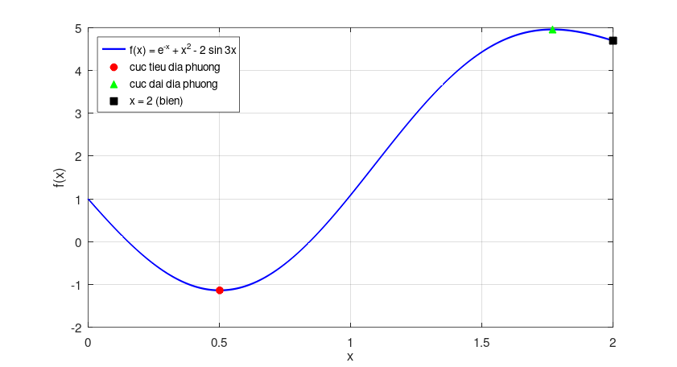

# Đề luyện và ngân hàng tự luận

[← Tài liệu ôn thi](README.md)

Đề luyện soạn theo khuôn [Đề số 1](../test1-paper1/) (phần điền đáp án/trắc nghiệm và một câu tự luận). Số liệu đáp án lấy từ output của [`run_practice.m`](run_practice.m). Câu hỏi mẫu cho từng chủ đề trong 18 câu nằm trong các file `topics/`; ngân hàng tự luận ở [cuối trang](#ngân-hàng-tự-luận).

## Đề luyện số 1

*Soạn theo khuôn Đề số 1, thời gian 90 phút.*

**Câu 1.** Dùng phương pháp Gauss–Seidel tìm cực trị địa phương của $`F(x) = 3x_1^2 + 2x_2^2 + 4x_3^2 + 2x_1x_2 - 2x_2x_3 + x_1 - 4x_3`$ với $`x^0 = (1, 1, 1)`$, $`\varepsilon = 10^{-4}`$.

**Câu 2.** Cho bài toán $`\max F = 2x_1 + x_2 + x_3`$ với $`x_1 + x_2 + x_3 = 2`$, $`x_1 - x_2 + x_4 = 4`$, $`x_j \ge 0`$. Ma trận $`B = (A_1, A_2)`$:
A. Là cơ sở tối ưu. B. Là cơ sở chấp nhận được. C. Là cơ sở. D. Không phải là cơ sở.

**Câu 3.** Dùng phương pháp Newton tìm cực tiểu của $`F(x) = x_1^4 + x_1^2 + 2x_2^2 + x_3^2 + x_1x_2 - x_2x_3 - 4x_1 + 2x_3`$ với $`x^0 = (1, 1, 1)`$, $`\varepsilon = 10^{-4}`$.

**Câu 4.** Bài toán $`f(x) = e^{-x} + x^2 - 2\sin 3x \to \min`$ có phương án xấp xỉ ($`\varepsilon = 10^{-4}`$) tối ưu địa phương trong đoạn $`[0, 2]`$ là $`x^* = \ ?`$

**Câu 5.** Cho bài toán $`\max F = x_1 + 2x_2 + x_3 + x_4`$ với $`x_1 + x_2 + x_3 + x_4 = 6`$, $`2x_1 + x_2 + 3x_3 + x_5 = 9`$, $`x_j \ge 0`$. Vector $`x = (1, 2, 1, 2, 2)`$:
A. Là phương án cực biên tối ưu. B. Là phương án cực biên. C. Là phương án. D. Không phải là phương án.

**Câu 6.** Dùng phương pháp Gradient tìm cực tiểu của $`f(x) = (x_1 - 1)^2 + 10(x_2 - x_1^2)^2`$ với $`x^0 = (0, 0)`$, $`\varepsilon = 10^{-3}`$.

**Câu 7.** Dùng phương pháp Gradient quán tính tìm cực tiểu của $`f(x) = 3x_1^2 + 2x_2^2 + x_3^2 + x_1x_2 - x_2x_3 + 2x_1 - x_2 + 3x_3`$ với $`x^0 = (1, 1, 1)`$, $`\varepsilon = 10^{-4}`$.

**Câu 8.** Dùng phương pháp tựa Newton tìm cực tiểu của $`F(x, y, z) = x^4 + y^4 + 2x^2 + 3y^2 + z^2 - xy + yz - 2x + y - 3z`$ với $`x^0 = (1, 1, 1)`$, $`\varepsilon = 10^{-4}`$.

**Phần B (tự luận).** Cho $`a`$ là tháng sinh của học viên. Xét bài toán (P):

```math
\min f(x) = \Big(x_1 - \frac a4\Big)^2 + \sum_{i=2}^n x_i^2\quad \text{s.t.}\quad x_1 + \dots + x_n = 1,\quad x_i \ge 0 .
```

a) (P) có phải bài toán tối ưu lồi không? Viết bài toán đối ngẫu và điều kiện KKT.
b) Giải (P) với $`n = 2`$ (theo $`a`$).

---

## Đáp án và lời giải đề luyện số 1

*Làm xong đề rồi mới đọc phần này.* Số liệu lấy từ output của `run_practice.m`.

| Câu | Đáp án |
|---|---|
| 1 | $`x^* \approx (-0.3235,\ 0.4706,\ 0.6176) = (-11/34,\ 8/17,\ 21/34)`$, $`F^* = -95/68 \approx -1.39706`$ |
| 2 | **C** (là cơ sở, nhưng $`x_B = (3, -1)`$ có phần tử âm) |
| 3 | $`x^* \approx (0.8846,\ -0.5385,\ -1.2692)`$ |
| 4 | $`x^* \approx 0.5015`$, $`f(x^*) \approx -1.13848`$ |
| 5 | **C** (là phương án, không cực biên) |
| 6 | $`x^* = (1, 1)`$ (phương pháp cho $`(0.9990,\ 0.9980)`$ sau 441 bước) |
| 7 | $`x^* = (-0.325,\ -0.05,\ -1.525) = (-13/40,\ -1/20,\ -61/40)`$ |
| 8 | $`x^* \approx (0.3632,\ -0.3558,\ 1.6779)`$, $`F^* \approx -3.091285`$ |
| B | $`a \le 4`$: $`x^* = \big(\frac{4 + a}{8}, \frac{4 - a}{8}\big)`$; $`a \ge 4`$: $`x^* = (1, 0)`$ |

**Câu 1.** Lập ma trận: $`H = [6\ 2\ 0;\ 2\ 4\ -2;\ 0\ -2\ 8]`$, $`q = (1, 0, -4)`$. Các định thức con chính $`6, 20, 136`$ đều dương. Công thức Gauss–Seidel:

```math
x_1 = -\frac{1 + 2x_2}{6},\qquad x_2 = \frac{x_3 - x_1}{2},\qquad x_3 = \frac{x_2 + 2}{4}.
```

Vòng 1: $`x_1 = -3/6 = -0.5`$, $`x_2 = (1 + 0.5)/2 = 0.75`$, $`x_3 = 2.75/4 = 0.6875`$. Sau 9 vòng, $`\Vert x_9 - x_8 \Vert = 5.5 \cdot 10^{-5}`$ và $`x_9 = (-0.323546, 0.470603, 0.617651)`$. Nghiệm đúng $`-H^{-1}q = (-11/34, 8/17, 21/34)`$.

**Câu 2.** $`A_B = [1\ 1;\ 1\ -1]`$ có $`\det = -2 \ne 0`$, nên là cơ sở. Giải $`A_B x_B = b`$: $`x_1 + x_2 = 2`$, $`x_1 - x_2 = 4`$ cho $`x_B = (3, -1)`$, có phần tử âm, nên không chấp nhận được. **Đáp án C.** Thêm: cơ sở $`(A_1, A_4)`$ cho $`x = (2, 0, 0, 2)`$, $`\Delta = (0, -1, -1, 0) \le 0`$, là cơ sở tối ưu với $`F = 4`$.

**Câu 3.** Phần hằng của Hessian là $`[2\ 1\ 0;\ 1\ 4\ -1;\ 0\ -1\ 2]`$ (định thức con chính $`2, 7, 12`$), cộng thêm $`12x_1^2 \ge 0`$, nên $`F`$ lồi chặt. Khử biến: từ $`\partial F/\partial x_3 = 2x_3 - x_2 + 2 = 0`$ và $`\partial F/\partial x_2 = x_1 + 4x_2 - x_3 = 0`$ được $`x_3 = (x_2 - 2)/2`$ và $`x_2 = -(x_1 + 1)/3.5`$. Thế vào $`\partial F/\partial x_1 = 0`$ được phương trình một ẩn $`4x_1^3 + \tfrac{12}{7}x_1 - \tfrac{30}{7} = 0`$, có nghiệm $`x_1 = 0.884636`$. Newton hội tụ trong 3 bước ($`\Vert g \Vert`$: $`5.83 \to 0.126 \to 1.3\cdot 10^{-3} \to 1.5 \cdot 10^{-7}`$).

**Câu 4.** $`f'(x) = -e^{-x} + 2x - 6\cos 3x`$, với $`f'(0) = -7`$ và $`f'(2) = -1.90`$. Các điểm dừng: $`0.501505`$ (cực tiểu, $`f = -1.138483`$) và $`1.769501`$ (cực đại, $`f = 4.9566`$). Vì $`f'(2) \lt 0`$ nên $`x = 2`$ là cực tiểu địa phương tại biên, nhưng $`f(2) = 4.694`$ lớn hơn nhiều. Lát cắt vàng trên $`[0, 2]`$ cần 21 bước ($`k \ge \ln(5\cdot 10^{-5})/\ln\tau = 20.6`$), cho $`x^* = 0.501502`$; `fminbnd` cho $`0.501504`$.



**Câu 5.** $`1 + 2 + 1 + 2 = 6`$ và $`2 + 2 + 3 + 2 = 9`$, $`x \ge 0`$, nên là phương án. Nó có 5 thành phần dương, nhiều hơn $`m = 2`$, nên các cột phụ thuộc tuyến tính và $`x`$ không cực biên. **Đáp án C** ($`F = 8`$). Thêm: phương án cực biên tối ưu là $`(0, 6, 0, 0, 3)`$ với $`F = 12`$.

**Câu 6.** $`f \ge 0`$, và $`f = 0`$ khi và chỉ khi $`x_1 = 1`$, $`x_2 = x_1^2 = 1`$. Gradient với tìm kiếm chính xác zic-zac theo hai trục (các bước đầu $`\alpha = 0.162,\ 0.05,\ 0.070,\ 0.05, \dots`$), dừng sau 441 bước tại $`(0.999012, 0.997975)`$ với $`\Vert g \Vert = 9.9\cdot 10^{-4}`$. Với $`\varepsilon = 10^{-3}`$ trên gradient, sai số theo $`x`$ vẫn khoảng $`2 \cdot 10^{-3}`$, nên ghi đáp án là $`(1, 1)`$ kèm giá trị xấp xỉ.

**Câu 7.** $`H = [6\ 1\ 0;\ 1\ 4\ -1;\ 0\ -1\ 2]`$, $`q = (2, -1, 3)`$, với trị riêng $`1.5505,\ 4,\ 6.4495`$. Tham số $`\alpha = 4/(\sqrt L + \sqrt\mu)^2 = 0.279241`$, $`\beta = 0.116963`$. Phương pháp quán tính dừng sau 14 bước tại $`(-0.324993, -0.049993, -1.52499)`$. Nghiệm đúng $`-H^{-1} q = (-13/40, -1/20, -61/40)`$.

**Câu 8.** Phần bậc hai có ma trận $`[4\ -1\ 0;\ -1\ 6\ 1;\ 0\ 1\ 2] \succ 0`$ (định thức con chính $`4, 23, 42`$), nên $`F`$ lồi chặt. Rút $`z = (3 - y)/2`$ từ $`\partial F/\partial z = 0`$. BFGS (Armijo, $`B_0 = I`$) dừng sau 7 bước tại $`(0.363156, -0.355765, 1.67788)`$; `fminsearch` cho $`(0.363162, -0.355767, 1.67788)`$, $`F^* = -3.0912851`$.

### Phần B

**a)** $`\nabla^2 f = 2I \succ 0`$, nên $`f`$ lồi chặt; ràng buộc affine; vậy (P) là bài toán lồi. Điểm $`x = (1/n, \dots, 1/n) \gt 0`$ thỏa Slater, nên có đối ngẫu mạnh và KKT là điều kiện cần và đủ. Đặt $`c = (a/4, 0, \dots, 0)`$ và $`L = \sum_i (x_i - c_i)^2 + \nu(1 - \sum_i x_i) - \sum_i \lambda_i x_i`$. Cực tiểu theo từng $`x_i \in \mathbb{R}`$ của $`(x_i - c_i)^2 - \mu_i x_i`$ đạt tại $`x_i = c_i + \mu_i/2`$, giá trị $`-\mu_i c_i - \mu_i^2/4`$. Do đó

```math
g(\nu, \lambda) = \nu - \frac a4 (\nu + \lambda_1) - \frac14 \sum_{i=1}^n (\nu + \lambda_i)^2,\qquad (D):\ \max_{\nu \in \mathbb{R},\ \lambda \ge 0} g(\nu, \lambda).
```

KKT: $`2(x_1 - a/4) - \nu - \lambda_1 = 0`$; $`2x_i - \nu - \lambda_i = 0`$ ($`i \ge 2`$); $`\sum x_i = 1`$; $`x \ge 0`$; $`\lambda \ge 0`$; $`\lambda_i x_i = 0`$.

**b)** Với $`n = 2`$, xét ba trường hợp:

| Trường hợp | Từ KKT | Điều kiện | Kết quả |
|---|---|---|---|
| $`x_1, x_2 \gt 0`$ ($`\lambda = 0`$) | $`x_1 = \frac a4 + \frac\nu2`$, $`x_2 = \frac\nu2`$, tổng bằng 1 nên $`\nu = 1 - \frac a4`$ | $`x_2 = \frac{4 - a}{8} \gt 0 \iff a \lt 4`$ | $`x^* = \big(\frac{4+a}{8}, \frac{4-a}{8}\big)`$, $`f^* = \frac{(4-a)^2}{32}`$ |
| $`x_2 = 0`$, $`x_1 = 1`$ | $`\lambda_1 = 0`$, $`\nu = 2 - \frac a2`$, $`\lambda_2 = -\nu = \frac a2 - 2`$ | $`\lambda_2 \ge 0 \iff a \ge 4`$ | $`x^* = (1, 0)`$, $`f^* = \big(1 - \frac a4\big)^2`$ |
| $`x_1 = 0`$, $`x_2 = 1`$ | $`\nu = 2`$, $`\lambda_1 = -\frac a2 - 2`$ | $`\lambda_1 \lt 0`$ | loại |

Như vậy với tháng sinh 1–3 nghiệm nằm trong, với tháng 4 thì $`x^* = (1, 0)`$ và $`f^* = 0`$, với tháng 5–12 nghiệm nằm trên biên với $`\lambda_2 = a/2 - 2 \gt 0`$.
Kiểm chứng bằng chương trình: $`a = 2`$ cho $`x^* = (0.75, 0.25)`$, $`f^* = 0.125 = g(\nu^*, \lambda^*)`$; $`a = 8`$ cho $`x^* = (1, 0)`$, $`\nu^* = -2`$, $`\lambda^* = (0, 2)`$, $`f^* = 1 = g`$. `sqp` cho cùng nghiệm, kể cả với $`n = 4`$ (khi $`a = 2`$: $`x^* = (0.625, 0.125, 0.125, 0.125)`$).

---

## Ngân hàng tự luận

Phần tự luận chiếm 4 điểm. Dưới đây là các bài có lời giải đầy đủ (dạng 1) và các dàn ý "trình bày thuật toán" (dạng 2); khung trả lời chung ở [mục 5 của tài liệu](README.md#5-phần-tự-luận-4-điểm).

**Dạng 1: quy hoạch lồi, đối ngẫu, KKT (lời giải đầy đủ)**

| Bài | Nội dung | Ở đâu |
|---|---|---|
| Đề số 1, Phần B | $`\min \sum x_i \ln(a + x_i)`$ trên đơn hình: lồi, đối ngẫu (Lambert W), KKT, $`n = 2`$ | [test1-paper1](../test1-paper1/#phần-b) |
| Đề luyện, Phần B | $`\min (x_1 - a/4)^2 + \sum_{i \ge 2} x_i^2`$ trên đơn hình: chia trường hợp theo $`a`$ | [trên trang này](#phần-b) |
| Tự luận 4.1 | Giải bài toán bằng KKT theo các tập tích cực | [kkt-duality-convex](topics/kkt-duality-convex.md) |
| Tự luận 4.2 | Các điều kiện chính quy; ví dụ cực tiểu không phải điểm KKT | [kkt-duality-convex](topics/kkt-duality-convex.md) |
| Tự luận 5.1 | Đối ngẫu của một QP, kiểm tra đối ngẫu mạnh | [kkt-duality-convex](topics/kkt-duality-convex.md) |
| Tự luận 5.2 | Đối ngẫu LP, khôi phục nghiệm gốc bằng điều kiện bù | [kkt-duality-convex](topics/kkt-duality-convex.md) |
| Tự luận 13.1 | Water-filling: lồi, Slater, KKT, đối ngẫu, giải | [kkt-duality-convex](topics/kkt-duality-convex.md) |
| Tự luận 13.2 | Hàm bậc hai tách biến trên đơn hình (xét trường hợp) | [kkt-duality-convex](topics/kkt-duality-convex.md) |
| Tự luận 13.3 | Chứng minh KKT đủ cho bài toán lồi; khi nào KKT cần | [kkt-duality-convex](topics/kkt-duality-convex.md) |

**Dạng 2: trình bày thuật toán và ví dụ (dàn ý ở mục "Nếu ra tự luận" của từng chủ đề)**

| Câu | Chủ đề | File |
|---|---|---|
| 1, 2, 3, 18 | Đơn hình, hai pha, bài toán M, Beale | [lp-and-qp](topics/lp-and-qp.md) |
| 6, 7 | Chia đôi, lát cắt vàng | [line-search](topics/line-search.md) |
| 8–12 | Gauss–Seidel, Hooke–Jeeves, gradient/quán tính, Newton, tựa Newton | [unconstrained](topics/unconstrained.md) |
| 14–17 | Frank–Wolfe, Rosen/Murtagh–Sargent, Newton có ràng buộc, hàm chắn | [constrained-methods](topics/constrained-methods.md) |
