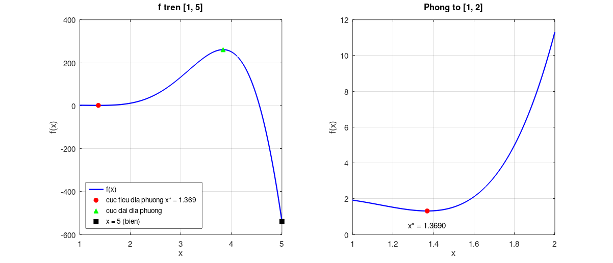
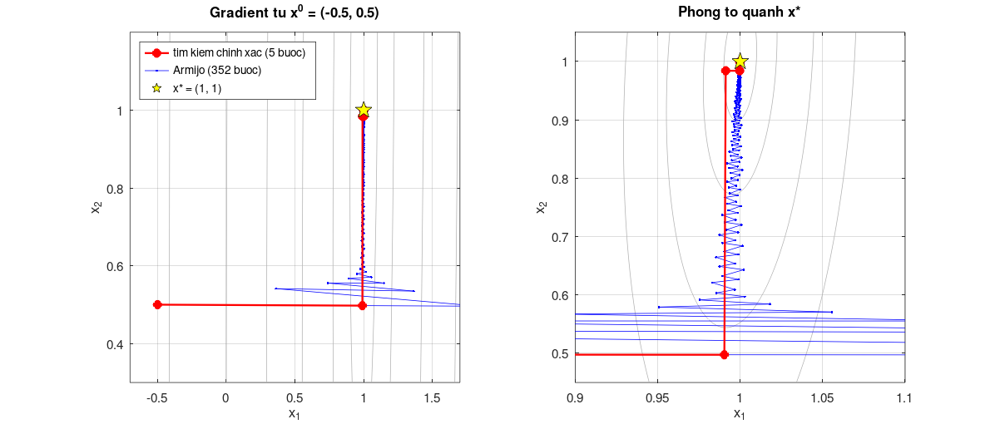
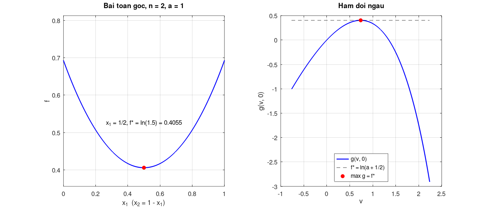

# Bài kiểm tra số 1 — Đề số 1

> Đề gốc: ảnh chụp [trang 1](../../problems/images/test1-page-1.jpg), [trang 2](../../problems/images/test1-page-2.jpg). Thời gian 90 phút, được dùng Matlab.

Tài liệu ôn thi theo khuôn đề này: [`exams/study-guide`](../study-guide/).

Lời giải dùng lại chương trình của bài tập lớn (`solutions/qNN-*`); mỗi câu gồm giải tay, kết quả chạy chương trình và đối chiếu với solver. Toàn bộ số liệu dưới đây lấy từ output của `run_examples.m`.

## Đáp án tóm tắt

| Câu | Phương pháp | Đáp án |
|---|---|---|
| 1 | Gauss–Seidel | $`x^* \approx (0.3333,\ -0.1667,\ -0.4167)`$, đúng là $`(1/3,\ -1/6,\ -5/12)`$, $`F^* = -0.625`$ |
| 2 | Cơ sở QHTT | **A** — cơ sở tối ưu ($`x = (3, 3, 1, 0)`$, $`F = 8`$) |
| 3 | Newton | $`x^* = (0, 0, 0)`$, $`F^* = 0`$ |
| 4 | Một biến trên $`[1, 5]`$ | $`x^* \approx 1.3690`$, $`f(x^*) \approx 1.31586`$ |
| 5 | Phương án QHTT | **A** — phương án cực biên tối ưu ($`F = 54`$) |
| 6 | Gradient | $`x^* \approx (1.0000,\ 0.9995)`$, đúng là $`(1, 1)`$, $`f^* = 0`$ |
| 7 | Gradient quán tính | $`x^* \approx (-0.2222,\ -0.4444,\ -1.0000)`$, đúng là $`(-2/9,\ -4/9,\ -1)`$, $`f^* = -44/9`$ |
| 8 | Tựa Newton (BFGS) | $`x^* \approx (-0.4505,\ 0.3970,\ 0.0609)`$, $`F^* \approx -1.478737`$ |
| B | Quy hoạch lồi | Lồi; $`x^* = (1/2,\ 1/2)`$, $`f^* = \ln(a + 1/2)`$ với mọi tháng sinh $`a`$ |

Về sai số $`\varepsilon`$: Gauss–Seidel dừng khi $`\|x_k - x_{k-1}\| \le \varepsilon`$; các phương pháp dùng đạo hàm (Newton, gradient, quán tính, tựa Newton) dừng khi $`\|\nabla f(x_k)\| \le \varepsilon`$; câu 4 dừng khi độ dài khoảng $`\le \varepsilon`$.

## Chương trình

| File | Nội dung |
|---|---|
| `run_examples.m` | Giải tất cả các câu, in bảng lặp, đối chiếu solver, vẽ hình |
| `dual_function_p.m` | Hàm đối ngẫu Lagrange của bài toán (P) ở phần B (dạng đóng qua hàm Lambert W) |
| `lambert_w0.m` | Nhánh chính hàm Lambert W bằng phương pháp Newton (Octave không có sẵn `lambertw`) |

Hàm dùng lại: `gauss_seidel_min` ([câu 8](../../solutions/q08-gauss-seidel/)), `simplex` ([câu 1](../../solutions/q01-simplex/)), `newton_method` ([câu 11](../../solutions/q11-newton-method/)), `golden_section` ([câu 7](../../solutions/q07-golden-section-search/)), `bisection_min` ([câu 6](../../solutions/q06-bisection-search/)), `gradient_descent`, `momentum_gradient` ([câu 10](../../solutions/q10-gradient-momentum/)), `quasi_newton` ([câu 12](../../solutions/q12-quasi-newton/)), `solve_lp` ([câu 5](../../solutions/q05-lagrange-duality/)), `solve_nlp` ([câu 4](../../solutions/q04-kkt-conditions/)).

```matlab
>> cd exams/test1-paper1
>> run_examples
```

Đã chạy trên GNU Octave; nhánh MATLAB (`linprog`, `fmincon` thay cho `glpk`, `sqp`) chưa được chạy thử.

---

## Phần A

### Câu 1. Gauss–Seidel

```math
F(x) = 2x_1^2 - 2x_1x_2 + 4x_1x_3 + 3x_2^2 - 4x_2x_3 + 6x_3^2 + 3x_3 = \tfrac12 x^T H x + q^T x,\quad
H = \begin{pmatrix} 4 & -2 & 4 \\ -2 & 6 & -4 \\ 4 & -4 & 12 \end{pmatrix},\quad q = \begin{pmatrix} 0 \\ 0 \\ 3 \end{pmatrix}.
```

Các định thức con chính của $`H`$ là $`4,\ 20,\ 144`$, đều dương, nên $`H \succ 0`$ (trị riêng $`2.29,\ 4,\ 15.71`$): $`F`$ lồi chặt, điểm dừng duy nhất là cực tiểu toàn cục. Đây cũng là "cực trị địa phương" mà đề hỏi.

**Giải tay.** Cực tiểu theo từng biến khi cố định các biến còn lại ($`\partial F / \partial x_i = 0`$):

```math
x_1 = \frac{x_2 - 2x_3}{2},\qquad x_2 = \frac{x_1 + 2x_3}{3},\qquad x_3 = \frac{4x_2 - 4x_1 - 3}{12}.
```

Vòng 1 từ $`x^0 = (2, 3, 1)`$: $`x_1 = (3 - 2)/2 = 0.5`$, $`x_2 = (0.5 + 2)/3 = 0.8333`$, $`x_3 = (3.3333 - 2 - 3)/12 = -0.1389`$.
Nghiệm đúng: $`Hx = -q`$, tức là $`x^* = (1/3,\ -1/6,\ -5/12)`$, và $`F^* = \tfrac12 q^T x^* = -5/8`$.

**Kết quả chạy** (`gauss_seidel_min` với công thức trên, dừng khi $`\|x_k - x_{k-1}\| \le 10^{-4}`$):

| $`k`$ | $`x_k`$ | $`F(x_k)`$ | $`\Vert x_k - x_{k-1}\Vert `$ |
|---|---|---|---|
| 0 | (2, 3, 1) | 28 | |
| 1 | (0.5, 0.833333, −0.138889) | 1.63426 | 2.871 |
| 2 | (0.555556, 0.0925926, −0.404321) | −0.44073 | 0.789 |
| 3 | (0.450617, −0.119342, −0.439986) | −0.60513 | 0.239 |
| … | | | |
| 10 | (0.333292, −0.166700, −0.416664) | −0.625 | 1.15e-4 |
| 11 | (0.333314, −0.166671, −0.416662) | −0.625 | 3.66e-5 |

Bản dùng tìm kiếm một chiều (lát cắt vàng) cũng cần 11 vòng và cho cùng kết quả. **Đáp án:** $`x^* \approx (0.3333,\ -0.1667,\ -0.4167)`$.

### Câu 2. Ma trận $`B = (A_1, A_2, A_3)`$

```math
\max F = 2x_1 + x_2 - x_3 - x_4,\qquad
A = \begin{pmatrix} 1 & -1 & 2 & -1 \\ 2 & 1 & -3 & 1 \\ 1 & 1 & 1 & 1 \end{pmatrix},\quad b = \begin{pmatrix} 2 \\ 6 \\ 7 \end{pmatrix},\quad x \ge 0.
```

1. **Là cơ sở:** $`\det B = 1\cdot(1+3) + 1\cdot(2+3) + 2\cdot(2-1) = 11 \ne 0`$.
2. **Chấp nhận được:** giải $`B x_B = b`$ được $`x_B = (3, 3, 1) \ge 0`$, tức phương án cơ sở $`x = (3, 3, 1, 0)`$ (thử lại: $`3 - 3 + 2 = 2`$, $`6 + 3 - 3 = 6`$, $`3 + 3 + 1 = 7`$).
3. **Tối ưu:** giải $`B^T y = c_B = (2, 1, -1)`$ được $`y = (2/11,\ 7/11,\ 6/11)`$. Ước lượng của biến phi cơ sở:
   $`\Delta_4 = c_4 - y^T A_4 = -1 - (-2 + 7 + 6)/11 = -2 \le 0`$.
   Với bài toán max, mọi $`\Delta_j \le 0`$ nên cơ sở tối ưu, $`F = 6 + 3 - 1 = 8`$.

Chương trình: `simplex(-c, A, b, [1 2 3])` dừng ngay ở bước 0 với $`x = (3, 3, 1, 0)`$, $`F = 8`$; `glpk` cho cùng kết quả. **Đáp án: A.**

### Câu 3. Newton

```math
F(x) = x_1^4 + x_2^2 + 4x_1^2 + \tfrac32 x_2^2 + 2x_3^2 - x_1x_2 - 2x_2x_3 + x_3x_1 .
```

> Đề viết $`x_2^2`$ hai lần (có thể là lỗi đánh máy). Ở đây gộp lại thành $`\tfrac52 x_2^2`$. Kết luận $`x^* = 0`$ không đổi với mọi hệ số dương của số hạng này, vì $`F`$ không có số hạng bậc nhất và vẫn lồi chặt.

```math
\nabla F = \begin{pmatrix} 4x_1^3 + 8x_1 - x_2 + x_3 \\ 5x_2 - x_1 - 2x_3 \\ 4x_3 - 2x_2 + x_1 \end{pmatrix},\qquad
\nabla^2 F = \begin{pmatrix} 12x_1^2 + 8 & -1 & 1 \\ -1 & 5 & -2 \\ 1 & -2 & 4 \end{pmatrix}.
```

Phần hằng của Hessian có các định thức con chính $`8,\ 39,\ 123`$, đều dương, và $`12x_1^2 \ge 0`$, nên $`\nabla^2 F \succ 0`$ trên toàn $`\mathbb{R}^3`$. Do đó $`F`$ lồi chặt, và vì $`\nabla F(0) = 0`$ nên $`x^* = 0`$ là cực tiểu toàn cục duy nhất, $`F^* = 0`$.

**Kết quả chạy** (`newton_method`, Newton thuần túy, $`\|\nabla F\| \le 10^{-4}`$):

| $`k`$ | $`x_k`$ | $`F(x_k)`$ | $`\Vert \nabla F(x_k)\Vert `$ |
|---|---|---|---|
| 0 | (1, 0, 2) | 15 | 17.38 |
| 1 | (0.40635, 0.05079, −0.07619) | 0.66194 | 3.39 |
| 2 | (0.05551, 0.00694, −0.01041) | 0.011856 | 0.427 |
| 3 | (1.8e-4, 2.2e-5, −3.3e-5) | 1.2e-7 | 1.36e-3 |
| 4 | (5.8e-12, 7.2e-13, −1.1e-12) | 1.3e-22 | 4.45e-11 |

Ba bước cuối cho thấy hội tụ bậc hai ($`\|\nabla F\|`$: $`0.43 \to 1.4\cdot 10^{-3} \to 4.5\cdot 10^{-11}`$). **Đáp án:** $`x^* = (0, 0, 0)`$.

### Câu 4. Cực tiểu địa phương trên $`[1, 5]`$

```math
f(x) = 3x + 2x^2 - 2x^3 - 2x^4\cos x,\qquad f'(x) = 3 + 4x - 6x^2 - 8x^3\cos x + 2x^4\sin x .
```

Trên $`[1, 5]`$, $`f'`$ đổi dấu hai lần: tại $`x \approx 1.3690`$ từ âm sang dương (cực tiểu địa phương) và tại $`x \approx 3.8359`$ từ dương sang âm (cực đại địa phương, $`f = 260.82`$). Ở hai đầu mút, $`f'(1) = -1.64`$ và $`f'(5) = -1609`$.



$`f`$ không đơn mốt trên $`[1, 5]`$. Dù vậy, lát cắt vàng trên cả đoạn $`[1, 5]`$ vẫn hội tụ đúng: ở bước 0 có $`f(2.528) = 54.8 \lt f(3.472) = 225.8`$ nên giữ $`[1, 3.472]`$. Đoạn này không chứa điểm cực đại 3.836, nên $`f`$ đơn mốt trên đó. Các bước 1–3 tiếp tục giữ nửa trái, thu về $`[1, 1.944]`$. Sau 23 bước, độ dài khoảng là $`6.2\cdot 10^{-5} \le 10^{-4}`$ và $`x^* = 1.369018`$. Chia đôi theo dấu $`f'`$ trên $`[1, 2]`$ (14 bước) cho $`x^* = 1.369049`$.

**Đáp án:** $`x^* \approx 1.3690`$, $`f(x^*) \approx 1.31586`$.
Lưu ý: nếu xét cả biên thì $`x = 5`$ cũng là cực tiểu địa phương của bài toán có ràng buộc (vì $`f'(5) \lt 0`$), và là cực tiểu toàn cục trên đoạn với $`f(5) = -539.58`$. Điểm cực tiểu địa phương nằm trong đoạn chỉ có $`x \approx 1.3690`$.

### Câu 5. Vector $`x = (0, 0, 9, 0, 8, 0)`$

```math
\max F = 5x_1 + x_2 + 6x_3 + 2x_4,\quad
\begin{cases} 4x_1 + 4x_2 + 4x_3 + x_4 + x_5 = 44 \\ 8x_1 + 6x_2 + 4x_3 + 3x_4 + x_6 = 36 \\ x_j \ge 0 \end{cases}
```

> Dòng ràng buộc thứ ba trong đề để trống (chỉ có dấu "="). Lời giải dùng hai ràng buộc có trong đề.

1. **Là phương án:** $`4\cdot 9 + 8 = 44`$, $`4\cdot 9 + 0 = 36`$, và $`x \ge 0`$.
2. **Cực biên:** các thành phần dương là $`x_3, x_5`$, ứng với các cột $`A_3 = (4, 4)^T`$, $`A_5 = (1, 0)^T`$. Hai cột này độc lập tuyến tính, nên $`x`$ là phương án cực biên với cơ sở $`\{x_3, x_5\}`$.
3. **Tối ưu:** $`B^T y = c_B = (6, 0)`$ cho $`y = (0,\ 3/2)`$. Các ước lượng $`\Delta_j = c_j - y^T A_j`$ là $`(-7, -8, 0, -2.5, 0, -1.5)`$, đều $`\le 0`$, nên $`x`$ tối ưu cho bài toán max, với $`F = 54`$.

Bảng đơn hình (`simplex` cho $`\min -F`$, xuất phát từ cơ sở $`\{x_5, x_6\}`$): ở bước 0, $`x_3`$ vào cơ sở ($`\Delta = 6`$) và $`x_6`$ ra ($`\theta = \min(44/4, 36/4) = 9`$). Ở bước 1, mọi $`\Delta_j \le 0`$, thuật toán dừng tại đúng $`x = (0, 0, 9, 0, 8, 0)`$, $`F = 54`$. `glpk` cho cùng kết quả. **Đáp án: A.**

### Câu 6. Gradient

```math
f(x) = (x_2 - x_1^2)^2 + 100(1 - x_1)^2,\qquad
\nabla f = \begin{pmatrix} -4x_1(x_2 - x_1^2) - 200(1 - x_1) \\ 2(x_2 - x_1^2) \end{pmatrix}.
```

$`f \ge 0`$, và $`f = 0`$ khi và chỉ khi $`x_1 = 1,\ x_2 = x_1^2 = 1`$. Vậy $`x^* = (1, 1)`$ là cực tiểu toàn cục, $`f^* = 0`$. Tại $`x^0 = (-0.5, 0.5)`$: $`\nabla f(x^0) = (-299.5,\ 0.5)`$.

**Kết quả chạy** (`gradient_descent`, tìm kiếm chính xác theo tia, $`\|\nabla f\| \le 10^{-3}`$):

| $`k`$ | $`x_k`$ | $`f(x_k)`$ | $`\Vert \nabla f(x_k)\Vert `$ | $`\alpha_k`$ |
|---|---|---|---|---|
| 0 | (−0.5, 0.5) | 225.06 | 299.5 | |
| 1 | (0.990416, 0.497512) | 0.24287 | 0.967 | 0.004976 |
| 2 | (0.991228, 0.984000) | 7.70e-3 | 1.760 | 0.5032 |
| 3 | (0.999692, 0.983986) | 2.47e-4 | 0.0308 | 0.004808 |
| 4 | (0.999718, 0.999483) | 7.97e-6 | 0.0566 | 0.5032 |
| 5 | (0.999990, 0.999482) | 2.58e-7 | 9.95e-4 | 0.004807 |

Bước 1 gần như chỉ đi theo $`x_1`$: $`x_1 = -0.5 + 0.004976\cdot 299.5 = 0.9904`$. Sau đó các bước luân phiên ngắn và dài (zic-zac vuông góc trong thung lũng hẹp $`x_1 \approx 1`$). Với bước Armijo, cũng đạt sai số đó nhưng cần 352 bước (hình dưới).



**Đáp án:** $`x^* \approx (1.0000,\ 0.9995)`$, tức nghiệm đúng $`x^* = (1, 1)`$.

### Câu 7. Gradient quán tính

```math
f(x) = \tfrac12 x^T H x + q^T x,\qquad
H = \begin{pmatrix} 4 & -2 & -2 \\ -2 & 10 & 1 \\ -2 & 1 & 8 \end{pmatrix},\quad q = \begin{pmatrix} -2 \\ 5 \\ 8 \end{pmatrix}.
```

Trị riêng của $`H`$ là $`\mu = 2.8499,\ 7.7702,\ L = 11.3799`$, đều dương. Nghiệm đúng $`x^* = -H^{-1}q = (-2/9,\ -4/9,\ -1)`$. Thử lại: $`4(-\tfrac29) - 2(-\tfrac49) - 2(-1) = 2`$, $`-2(-\tfrac29) + 10(-\tfrac49) - 1 = -5`$, $`-2(-\tfrac29) - \tfrac49 - 8 = -8`$. Giá trị tối ưu $`f^* = \tfrac12 q^T x^* = -44/9 \approx -4.888889`$.

Phương pháp quán tính (heavy-ball): $`x_{k+1} = x_k - \alpha \nabla f(x_k) + \beta (x_k - x_{k-1})`$, với tham số tối ưu cho hàm bậc hai

```math
\alpha = \frac{4}{(\sqrt{L} + \sqrt{\mu})^2} = 0.156131,\qquad \beta = \left(\frac{\sqrt{L} - \sqrt{\mu}}{\sqrt{L} + \sqrt{\mu}}\right)^2 = 0.110855 .
```

**Kết quả chạy** (`momentum_gradient`, $`\|\nabla f\| \le 10^{-4}`$):

| $`k`$ | $`x_k`$ | $`f(x_k)`$ | $`\Vert \nabla f(x_k)\Vert `$ |
|---|---|---|---|
| 0 | (2, 1, 3) | 61 | 32.26 |
| 1 | (2.31226, −1.18583, −1.52779) | 18.6456 | 20.75 |
| 2 | (0.367717, 0.603219, −0.463307) | 1.14025 | 10.71 |
| 3 | (0.278458, −0.733761, −0.995015) | −3.68563 | 4.83 |
| 4 | (−0.132909, −0.274695, −0.858669) | −4.68054 | 2.02 |
| 5 | (−0.137151, −0.483014, −1.018700) | −4.85511 | 0.816 |
| 15 | (−0.222219, −0.444447, −1.000000) | −4.888889 | 3.71e-5 |

So sánh: gradient với bước cố định tối ưu $`2/(L + \mu)`$ cần 25 bước. **Đáp án:** $`x^* \approx (-0.2222,\ -0.4444,\ -1.0000)`$.

### Câu 8. Tựa Newton

```math
F = x^4 + y^4 + z^4 + x^2 + 5y^2 + 2z^2 - 2xy + xz - 2yz + 2x - 5y + z,\qquad
\nabla F = \begin{pmatrix} 4x^3 + 2x - 2y + z + 2 \\ 4y^3 + 10y - 2x - 2z - 5 \\ 4z^3 + 4z + x - 2y + 1 \end{pmatrix}.
```

$`\nabla^2 F = 12\,\mathrm{diag}(x^2, y^2, z^2) + Q`$, với $`Q`$ là ma trận dưới đây (định thức con chính $`2,\ 16,\ 54`$, đều dương):

```math
Q = \begin{pmatrix} 2 & -2 & 1 \\ -2 & 10 & -2 \\ 1 & -2 & 4 \end{pmatrix} \succ 0 .
```

Do đó $`F`$ lồi chặt và có đúng một điểm dừng. Hệ $`\nabla F = 0`$ là hệ bậc ba không giải tay được, nên giải bằng BFGS (`quasi_newton`, tìm kiếm Wolfe, $`H_0 = I`$, $`\|\nabla F\| \le 10^{-4}`$):

| $`k`$ | $`x_k`$ | $`F(x_k)`$ | $`\Vert \nabla F(x_k)\Vert `$ | $`\alpha_k`$ |
|---|---|---|---|---|
| 0 | (2, 0, 1) | 30 | 41.99 | |
| 1 | (−1.9, 1.1, −0.1) | 19.3663 | 35.24 | 0.1 |
| 2 | (−0.18193, 0.42260, 0.22292) | −1.268247 | 1.45 | 1 |
| … | | | | |
| 10 | (−0.45048, 0.39659, 0.06144) | −1.478735 | 7.33e-3 | 1 |
| 11 | (−0.45057, 0.39703, 0.06105) | −1.478737 | 6.04e-4 | 1 |
| 12 | (−0.45053, 0.39705, 0.06093) | −1.478737 | 2.83e-5 | 1 |

DFP cần 17 bước, ra $`(-0.450529,\ 0.397045,\ 0.060924)`$. Lời giải tham chiếu (BFGS, sai số $`10^{-12}`$) là $`(-0.4505281,\ 0.3970434,\ 0.0609275)`$, $`F^* = -1.4787370376`$. Hessian tại đó có trị riêng $`3.21,\ 4.23,\ 12.93`$.
**Đáp án:** $`x^* \approx (-0.4505,\ 0.3970,\ 0.0609)`$.

---

## Phần B

```math
(P):\quad \min f(x) = \sum_{i=1}^n x_i \ln(a + x_i)\quad \text{s.t.}\quad \sum_{i=1}^n x_i = 1,\quad x_i \ge 0,
```

trong đó $`a \in \{1, \dots, 12\}`$ là tháng sinh. Lời giải dưới đây đúng với mọi $`a \gt 0`$. Chương trình đặt `a = 1` ở đầu phần B; sửa giá trị này theo tháng sinh của bạn và in bảng cho cả 12 tháng.

### a) Tính lồi, bài toán đối ngẫu, điều kiện KKT

**Tính lồi.** Miền chấp nhận được (một siêu phẳng giao với góc phần tám dương, tức đơn hình xác suất) là tập lồi. Hàm mục tiêu tách biến, $`f(x) = \sum_i \varphi(x_i)`$ với $`\varphi(t) = t\ln(a+t)`$, xác định trên $`t \gt -a`$:

```math
\varphi'(t) = \ln(a+t) + \frac{t}{a+t},\qquad \varphi''(t) = \frac{1}{a+t} + \frac{a}{(a+t)^2} = \frac{2a + t}{(a+t)^2} \gt 0\quad (t \gt -a).
```

Vậy $`f`$ lồi chặt, và **(P) là bài toán tối ưu lồi**: hàm mục tiêu lồi, ràng buộc đẳng thức affine, ràng buộc bất đẳng thức $`-x_i \le 0`$ affine. Điểm $`x = (1/n, \dots, 1/n)`$ thỏa chặt mọi ràng buộc bất đẳng thức, nên điều kiện Slater đúng. Hệ quả: đối ngẫu mạnh, và KKT là điều kiện cần và đủ.

**Hàm Lagrange** (nhân tử $`\nu \in \mathbb{R}`$ cho đẳng thức, $`\lambda_i \ge 0`$ cho $`x_i \ge 0`$):

```math
L(x, \nu, \lambda) = \sum_{i=1}^n x_i\ln(a + x_i) + \nu\Big(1 - \sum_{i=1}^n x_i\Big) - \sum_{i=1}^n \lambda_i x_i
= \nu + \sum_{i=1}^n \big[\varphi(x_i) - \mu_i x_i\big],\qquad \mu_i = \nu + \lambda_i .
```

**Hàm đối ngẫu.** Với mỗi $`i`$, hàm $`t \mapsto \varphi(t) - \mu_i t`$ lồi chặt trên $`(-a, \infty)`$, có đạo hàm $`\varphi'(t) - \mu_i`$ đi từ $`-\infty`$ (khi $`t \to -a^+`$) đến $`+\infty`$, nên đạt cực tiểu tại nghiệm duy nhất của $`\varphi'(t) = \mu_i`$. Đặt $`s = a + t = a/w`$:

```math
\ln s + 1 - \frac{a}{s} = \mu_i \iff \ln w + w = \ln a + 1 - \mu_i \iff w e^{w} = a e^{1 - \mu_i} \iff w = W\big(a e^{1-\mu_i}\big),
```

trong đó $`W`$ là hàm Lambert (nghịch đảo của $`w e^w`$). Tại đó $`t = a(1 - w)/w`$ và $`\ln s - \mu_i = a/s - 1 = w - 1`$, nên giá trị cực tiểu là $`t(w - 1) = -a(w-1)^2/w`$. Suy ra

```math
g(\nu, \lambda) = \inf_{x} L(x, \nu, \lambda) = \nu - a\sum_{i=1}^n \frac{(w_i - 1)^2}{w_i},\qquad w_i = W\big(a\, e^{1 - \nu - \lambda_i}\big).
```

**Bài toán đối ngẫu:**

```math
(D):\quad \max_{\nu \in \mathbb{R},\ \lambda \in \mathbb{R}^n}\ \nu - a\sum_{i=1}^n \frac{(w_i - 1)^2}{w_i}\quad \text{s.t.}\quad \lambda \ge 0,\qquad w_i = W\big(a\, e^{1-\nu-\lambda_i}\big).
```

Theo định lý bao hình, $`\partial g / \partial \lambda_i = -x_i(\mu_i)`$ và $`\partial g / \partial \nu = 1 - \sum_i x_i(\mu_i)`$, trong đó $`x_i(\mu_i) = a/w_i - a`$ là điểm đạt cực tiểu.

**Điều kiện KKT:**

```math
\begin{aligned}
&\ln(a + x_i) + \frac{x_i}{a + x_i} - \nu - \lambda_i = 0, && i = 1, \dots, n \quad \text{(dừng)}\\
&\textstyle\sum_{i} x_i = 1,\quad x_i \ge 0 && \text{(chấp nhận được)}\\
&\lambda_i \ge 0 && \text{(đối ngẫu chấp nhận được)}\\
&\lambda_i x_i = 0 && \text{(bù)}
\end{aligned}
```

**Giải hệ KKT với $`n`$ tổng quát.** Đặt $`h(t) = \varphi'(t) = \ln(a+t) + t/(a+t)`$; hàm này tăng chặt vì $`h' = \varphi'' \gt 0`$. Giả sử có $`x_j = 0`$. Vì $`\sum_i x_i = 1`$ nên phải có $`x_k \gt 0`$, kéo theo $`\lambda_k = 0`$ và $`h(x_k) = \nu`$. Khi đó $`h(0) = \nu + \lambda_j \ge \nu = h(x_k) \gt h(0)`$, mâu thuẫn. Vậy mọi $`x_i \gt 0`$, suy ra $`\lambda = 0`$ và $`h(x_i) = \nu`$ với mọi $`i`$. Do $`h`$ đơn ánh, mọi $`x_i`$ bằng nhau:

```math
x_i^* = \frac1n,\qquad \lambda^* = 0,\qquad \nu^* = \ln\Big(a + \frac1n\Big) + \frac{1}{na + 1},\qquad f^* = \ln\Big(a + \frac1n\Big).
```

Vì $`f`$ lồi chặt nên đây là nghiệm duy nhất. Kiểm tra số với $`a = 1`$, $`n = 5`$: `sqp` cho $`x = (0.2, \dots, 0.2)`$ và $`f = 0.18232156 = \ln 1.2`$.

### b) Giải (P) với $`n = 2`$

Từ phần a): $`x^* = (1/2,\ 1/2)`$, $`\lambda^* = (0, 0)`$, $`\nu^* = \ln(a + 1/2) + 1/(2a+1)`$, $`f^* = \ln(a + 1/2)`$.

**Cách trực tiếp.** Thế $`x_2 = 1 - x_1`$ với $`x_1 \in [0, 1]`$:

```math
\psi(x_1) = x_1\ln(a + x_1) + (1 - x_1)\ln(a + 1 - x_1),\qquad \psi'(x_1) = h(x_1) - h(1 - x_1).
```

Vì $`h`$ tăng chặt, $`\psi'(x_1) = 0 \iff x_1 = 1 - x_1 \iff x_1 = 1/2`$. Ngoài ra $`\psi'(0) = \ln a - \ln(a+1) - 1/(a+1) \lt 0`$ và $`\psi'(1) \gt 0`$, nên cực tiểu nằm trong khoảng, tại $`x_1 = 1/2`$.

**Kiểm chứng bằng chương trình** ($`a = 1`$):

- KKT: $`h(1/2) - \nu^* = 0`$ với $`\nu^* = 0.7387984414`$.
- Đối ngẫu: cực đại $`g(\nu, 0)`$ theo $`\nu`$ bằng lát cắt vàng đạt tại $`\nu = 0.73879845`$, với $`g = 0.4054651081 = \ln 1.5 = f^*`$. Khoảng cách đối ngẫu là $`1.7\cdot 10^{-16}`$ (đối ngẫu mạnh); tại đó $`x(\nu) = (0.5, 0.5)`$.
- Đối ngẫu yếu: $`g(\nu^*, (0.3, 0.7)) = -0.411 \le f^*`$.
- `sqp` xuất phát từ $`(0.9, 0.1)`$ cho $`x = (0.5, 0.5)`$, $`f = 0.4054651081`$.



Bảng theo tháng sinh (nghiệm luôn là $`x^* = (1/2, 1/2)`$; cột cuối là $`\max g`$ tính số qua `dual_function_p`):

| $`a`$ | $`f^* = \ln(a + 1/2)`$ | $`\nu^*`$ | $`\max g`$ |
|---|---|---|---|
| 1 | 0.40546511 | 0.73879844 | 0.40546511 |
| 2 | 0.91629073 | 1.11629073 | 0.91629073 |
| 3 | 1.25276297 | 1.39562011 | 1.25276297 |
| 4 | 1.50407740 | 1.61518851 | 1.50407740 |
| 5 | 1.70474809 | 1.79565718 | 1.70474809 |
| 6 | 1.87180218 | 1.94872525 | 1.87180218 |
| 7 | 2.01490302 | 2.08156969 | 2.01490302 |
| 8 | 2.14006616 | 2.19888969 | 2.14006616 |
| 9 | 2.25129180 | 2.30392338 | 2.25129180 |
| 10 | 2.35137526 | 2.39899430 | 2.35137526 |
| 11 | 2.44234704 | 2.48582530 | 2.44234704 |
| 12 | 2.52572864 | 2.56572864 | 2.52572864 |

## Nhận xét

- Câu 1, 3, 7, 8 đều là hàm lồi chặt. Kiểm tra Hessian xác định dương (bằng định thức con chính) trước khi chạy cho biết điểm dừng tìm được là cực tiểu toàn cục duy nhất. Với câu 1 và 7 (hàm bậc hai), nên giải đúng $`Hx = -q`$ để đối chiếu.
- Câu 2 và 5 không cần chạy đơn hình: chỉ cần ba phép thử là $`\det B \ne 0`$, $`B^{-1}b \ge 0`$, và dấu của $`c_j - y^T A_j`$ (với bài max: $`\le 0`$).
- Câu 4 là bẫy: $`f`$ không đơn mốt trên $`[1, 5]`$ và giá trị nhỏ nhất nằm ở biên $`x = 5`$. Lát cắt vàng trên $`[1, 5]`$ cho đúng $`1.3690`$ chỉ vì ngay bước đầu nó loại phần chứa điểm cực đại. Nên khảo sát dấu $`f'`$ trước rồi thu hẹp đoạn.
- Câu 6: tìm kiếm chính xác hội tụ nhanh (5 bước) vì hướng $`-\nabla f`$ ban đầu gần như song song trục $`x_1`$. Armijo cần 352 bước do zic-zac trong thung lũng hẹp (Hessian tại $`x^*`$ có $`\kappa \approx 100`$).
- Phần B: tính đối xứng cùng tính lồi chặt cho ngay $`x_i^* = 1/n`$ mà không phụ thuộc $`a`$; $`a`$ chỉ ảnh hưởng tới $`f^*`$ và $`\nu^*`$. Hàm đối ngẫu có dạng đóng nhờ hàm Lambert $`W`$.
