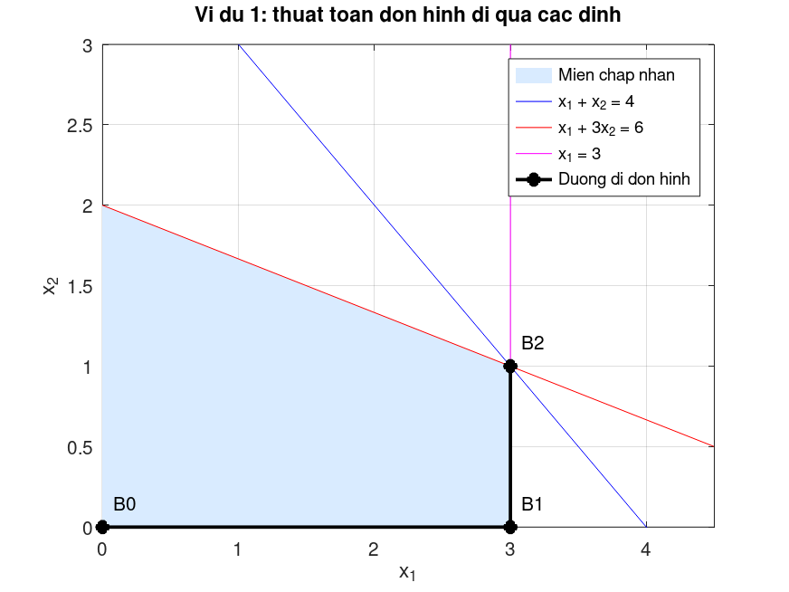

# Câu 1. Thuật toán đơn hình giải bài toán quy hoạch tuyến tính dạng chính tắc

## 1. Bài toán

Bài toán quy hoạch tuyến tính (QHTT) **dạng chính tắc**:

```math
\min\; f(x) = c^T x \quad \text{với}\quad Ax = b,\; x \ge 0,
```

trong đó $`A \in \mathbb{R}^{m\times n}`$, $`\mathrm{rank}\,A = m \lt n`$, $`b \in \mathbb{R}^m`$, $`b \ge 0`$ (nếu $`b_i \lt 0`$ thì nhân hai vế của ràng buộc thứ $`i`$ với $`-1`$).

## 2. Các khái niệm cơ sở

- **Cơ sở**: tập chỉ số $`J_B = \{j_1,\dots,j_m\}`$ sao cho ma trận $`B = [A_{j_1},\dots,A_{j_m}]`$ (gồm các cột $`A_j`$ của $`A`$) không suy biến. Các biến $`x_j,\ j\in J_B`$ gọi là **biến cơ sở**, các biến còn lại là **biến phi cơ sở** ($`j \in J_N`$).
- **Phương án cực biên** (phương án cơ sở chấp nhận được): $`x_B = B^{-1}b \ge 0`$, $`x_N = 0`$. Về mặt hình học, đây là **đỉnh** của tập lồi đa diện $`D = \{x : Ax=b, x\ge 0\}`$.
- **Định lý cơ bản của QHTT**: nếu bài toán có phương án tối ưu thì có phương án cực biên tối ưu. Vì số đỉnh là hữu hạn ($`\le \binom{n}{m}`$), ta chỉ cần tìm kiếm trên các đỉnh.

**Ý tưởng của thuật toán đơn hình**: xuất phát từ một phương án cực biên, mỗi bước đi sang một **đỉnh kề** có giá trị hàm mục tiêu không lớn hơn, cho đến khi gặp đỉnh tối ưu hoặc phát hiện bài toán không bị chặn.

## 3. Các công thức chính

Với cơ sở $`B`$, ký hiệu:

- $`z_j = B^{-1}A_j`$: hệ số khai triển của cột $`A_j`$ theo cơ sở. Phần tử $`z_{ij}`$ là thành phần thứ $`i`$ của $`z_j`$.
- $`\Delta_j = c_B^T z_j - c_j`$: **ước lượng** (số gia) của biến $`x_j`$. Với biến cơ sở, $`\Delta_j = 0`$.
- $`f(x) = c_B^T B^{-1} b`$: giá trị hàm mục tiêu tại phương án cực biên hiện tại.

Khi tăng một biến phi cơ sở $`x_s`$ từ $`0`$ lên $`\theta \gt 0`$ (các biến phi cơ sở khác giữ bằng 0), ta có $`x_B = B^{-1}b - \theta z_s`$ và

```math
f = f_0 - \theta\,\Delta_s .
```

Từ đó suy ra ba định lý sau:

1. **Dấu hiệu tối ưu**: nếu $`\Delta_j \le 0`$ với mọi $`j`$ thì phương án cực biên hiện tại là tối ưu.
2. **Dấu hiệu không bị chặn**: nếu tồn tại $`\Delta_s \gt 0`$ mà $`z_{is} \le 0`$ với mọi $`i`$ thì $`x_s`$ tăng được vô hạn mà vẫn chấp nhận được, nên $`f \to -\infty`$: bài toán không có phương án tối ưu.
3. **Cải tiến phương án**: nếu tồn tại $`\Delta_s \gt 0`$ và có $`z_{is} \gt 0`$ thì đổi cơ sở theo phép xoay dưới đây sẽ được phương án cực biên mới với $`f`$ không tăng (giảm thực sự nếu $`\theta \gt 0`$).

## 4. Giải thuật đơn hình

**Đầu vào**: $`A, b, c`$ và một cơ sở chấp nhận được ban đầu $`J_B`$ (thường là các cột đơn vị của biến bù).

**Bước 0.** Lập bảng đơn hình ban đầu: $`T = B^{-1}[A \mid b]`$.

**Bước 1. Kiểm tra tối ưu.** Tính $`\Delta_j = c_B^T z_j - c_j`$ với mọi $`j`$. Nếu $`\Delta_j \le 0`$ với mọi $`j`$ thì **dừng**: $`x^*`$ là phương án tối ưu, $`f^* = c_B^T x_B`$.

**Bước 2. Chọn biến vào cơ sở.** Chọn cột $`s`$ có $`\Delta_s \gt 0`$:
- *Quy tắc Dantzig*: $`\Delta_s = \max\{\Delta_j : \Delta_j \gt 0\}`$;
- *Quy tắc Bland*: $`s = \min\{j : \Delta_j \gt 0\}`$.

**Bước 3. Kiểm tra không bị chặn.** Nếu $`z_{is} \le 0`$ với mọi $`i`$ thì **dừng**: bài toán không bị chặn dưới. Khi đó hướng $`d`$ với $`d_s = 1`$, $`d_B = -z_s`$, các thành phần khác bằng 0, thỏa $`Ad = 0`$, $`d \ge 0`$ và $`c^Td = -\Delta_s \lt 0`$.

**Bước 4. Chọn biến ra khỏi cơ sở** theo quy tắc tỉ số nhỏ nhất:

```math
\theta = \min\left\{ \frac{x_{B_i}}{z_{is}} : z_{is} \gt 0 \right\} = \frac{x_{B_r}}{z_{rs}} .
```

Biến $`x_{B_r}`$ rời cơ sở. Phần tử $`z_{rs}`$ gọi là **phần tử trục**.

**Bước 5. Phép xoay** quanh phần tử trục $`z_{rs}`$:
- dòng trục: $`T_r \leftarrow T_r / z_{rs}`$;
- các dòng khác: $`T_i \leftarrow T_i - z_{is}\,T_r`$ với $`i \ne r`$;
- cập nhật cơ sở: $`j_r \leftarrow s`$.

Quay lại Bước 1.

### Tính hữu hạn và hiện tượng xoay vòng

- Nếu mọi phương án cực biên đều **không suy biến** (mọi $`x_{B_i} \gt 0`$) thì $`\theta \gt 0`$ ở mỗi bước, $`f`$ giảm thực sự, không đỉnh nào lặp lại. Do đó thuật toán dừng sau hữu hạn bước.
- Khi có phương án **suy biến**, có thể $`\theta = 0`$: cơ sở thay đổi nhưng điểm $`x`$ không đổi. Với quy tắc Dantzig, thuật toán có thể **xoay vòng** (lặp lại một dãy cơ sở mãi mãi). **Quy tắc Bland** (chọn chỉ số nhỏ nhất cho cả biến vào lẫn biến ra) bảo đảm thuật toán luôn dừng.

### Bảng đơn hình

| $`c_B`$ | Cơ sở | Phương án | $`x_1`$ | $`\cdots`$ | $`x_n`$ |
|---|---|---|---|---|---|
| | | | $`c_1`$ | $`\cdots`$ | $`c_n`$ |
| $`c_{j_1}`$ | $`x_{j_1}`$ | $`x_{j_1}`$ | $`z_{11}`$ | $`\cdots`$ | $`z_{1n}`$ |
| $`\vdots`$ | $`\vdots`$ | $`\vdots`$ | $`\vdots`$ | | $`\vdots`$ |
| $`c_{j_m}`$ | $`x_{j_m}`$ | $`x_{j_m}`$ | $`z_{m1}`$ | $`\cdots`$ | $`z_{mn}`$ |
| | $`\Delta`$ | $`f(x)`$ | $`\Delta_1`$ | $`\cdots`$ | $`\Delta_n`$ |

## 5. Chương trình Matlab

| File | Nội dung |
|---|---|
| `simplex.m` | Hàm `[x, fval, exitflag, out] = simplex(c, A, b, B, opts)` cài đặt thuật toán trên |
| `run_examples.m` | Ba ví dụ minh họa và hình vẽ |
| `check_solution.m` | Đối chiếu kết quả với `linprog` (MATLAB) hoặc `glpk` (Octave) |

Đặc điểm của `simplex.m`:

- Tự tìm cơ sở đơn vị trong $`A`$ nếu không truyền `B`. Nếu không tìm được thì báo lỗi và gợi ý dùng phương pháp hai pha (câu 2).
- Tự đổi dấu các ràng buộc có $`b_i \lt 0`$.
- Hỗ trợ hai quy tắc chọn biến: `opts.rule = 'dantzig'` (mặc định) hoặc `'bland'`.
- In bảng đơn hình ở mỗi bước (`opts.display`).
- Trả về `exitflag`: `1` tối ưu, `-3` không bị chặn (kèm hướng $`d`$ trong `out.direction`), `-4` phát hiện xoay vòng, `0` vượt quá số bước lặp.
- Lưu dãy phương án cực biên đã đi qua (`out.xHist`) để vẽ hình.

Cách chạy (trong thư mục `solutions/q01-simplex`):

```matlab
>> run_examples
```

## 6. Ví dụ minh họa

### Ví dụ 1: bài toán có phương án tối ưu

```math
\begin{aligned}
\min\; & f = -3x_1 - 2x_2 \\
& x_1 + x_2 + x_3 = 4 \\
& x_1 + 3x_2 + x_4 = 6 \\
& x_1 + x_5 = 3, \qquad x \ge 0
\end{aligned}
```

Cơ sở ban đầu là $`\{x_3, x_4, x_5\}`$ (các biến bù).

| Bước | Cơ sở | $`x`$ | $`f`$ | Biến vào | Biến ra | $`\theta`$ |
|---|---|---|---|---|---|---|
| 0 | $`x_3,x_4,x_5`$ | $`(0,0,4,6,3)`$ | $`0`$ | $`x_1`$ ($`\Delta_1=3`$) | $`x_5`$ | 3 |
| 1 | $`x_3,x_4,x_1`$ | $`(3,0,1,3,0)`$ | $`-9`$ | $`x_2`$ ($`\Delta_2=2`$) | $`x_3`$ | 1 |
| 2 | $`x_2,x_4,x_1`$ | $`(3,1,0,0,0)`$ | $`-11`$ | — mọi $`\Delta_j \le 0`$ | | |

**Kết quả**: $`x^* = (3, 1, 0, 0, 0)`$, $`f^* = -11`$, trùng với kết quả của `glpk`. Phương án tối ưu này **suy biến** ($`x_4 = 0`$ nằm trong cơ sở), vì ba đường thẳng biên cùng đi qua điểm $`(3,1)`$.



Trên mặt phẳng $`(x_1,x_2)`$, thuật toán đi theo các cạnh của đa giác chấp nhận được: $`(0,0) \to (3,0) \to (3,1)`$.

### Ví dụ 2: hàm mục tiêu không bị chặn

```math
\begin{aligned}
\min\; & f = -x_1 - x_2 \\
& -x_1 + x_2 + x_3 = 1 \\
& x_1 - 2x_2 + x_4 = 2, \qquad x \ge 0
\end{aligned}
```

Sau 1 bước lặp, ta có $`\Delta_2 = 3 \gt 0`$ nhưng cột $`z_2 = (-1, -2)^T \le 0`$. Chương trình trả về `exitflag = -3` và hướng giảm vô hạn $`d = (2, 1, 1, 0)`$, với $`Ad = 0`$, $`c^Td = -3 \lt 0`$. Như vậy $`x(t) = x^{(1)} + t\,d`$ chấp nhận được với mọi $`t \ge 0`$ và $`f \to -\infty`$.

### Ví dụ 3: bài toán suy biến gây xoay vòng (ví dụ của Beale)

```math
\begin{aligned}
\min\; & f = -\tfrac34 x_4 + 20x_5 - \tfrac12 x_6 + 6x_7 \\
& x_1 + \tfrac14 x_4 - 8x_5 - x_6 + 9x_7 = 0 \\
& x_2 + \tfrac12 x_4 - 12x_5 - \tfrac12 x_6 + 3x_7 = 0 \\
& x_3 + x_6 = 1, \qquad x \ge 0
\end{aligned}
```

- **Quy tắc Dantzig**: sau 6 bước, cơ sở quay lại $`\{x_1,x_2,x_3\}`$ ban đầu trong khi $`f`$ vẫn bằng $`0`$. Đây là hiện tượng **xoay vòng**, chương trình phát hiện và trả về `exitflag = -4`.
- **Quy tắc Bland**: thuật toán thoát khỏi đỉnh suy biến và dừng sau 6 bước tại $`x^* = (0.75, 0, 0, 1, 0, 1, 0)`$, $`f^* = -1.25`$, trùng với kết quả của `glpk`.

## 7. Nhận xét

- Thuật toán đơn hình cần một **phương án cực biên xuất phát**. Khi $`A`$ không chứa sẵn ma trận đơn vị, ta dùng phương pháp **hai pha** (câu 2) hoặc **hàm phạt / M lớn** (câu 3).
- Trong thực tế, số bước lặp thường chỉ cỡ $`O(m)`$. Tuy nhiên trong trường hợp xấu nhất (ví dụ Klee–Minty), độ phức tạp là hàm mũ.
- Khi bài toán suy biến, nên dùng quy tắc Bland để bảo đảm thuật toán dừng.
