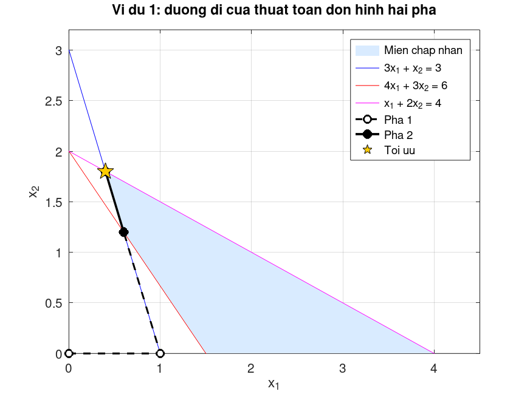

# Câu 2. Thuật toán đơn hình hai pha giải bài toán quy hoạch tuyến tính dạng chính tắc

## 1. Bài toán và vấn đề cơ sở xuất phát

Xét bài toán QHTT dạng chính tắc

```math
\min\; f(x) = c^T x \quad \text{với}\quad Ax = b,\; x \ge 0,
```

với $`A \in \mathbb{R}^{m\times n}`$, $`b \ge 0`$ (nếu $`b_i \lt 0`$ thì nhân hai vế của ràng buộc thứ $`i`$ với $`-1`$).

Thuật toán đơn hình ([câu 1](../q01-simplex/)) cần một **phương án cực biên xuất phát**, tức là một cơ sở $`B`$ với $`B^{-1}b \ge 0`$. Khi $`A`$ chứa sẵn $`m`$ cột đơn vị (ví dụ các biến bù của ràng buộc $`\le`$) thì có ngay cơ sở này. Nhưng với ràng buộc dạng $`=`$ hoặc $`\ge`$, thường không có sẵn cột đơn vị, và cũng chưa biết bài toán có phương án chấp nhận được hay không.

**Phương pháp hai pha** giải quyết cả hai việc:
- **Pha 1** giải một bài toán phụ để tìm phương án cực biên của bài toán gốc, hoặc kết luận bài toán gốc **không có phương án chấp nhận được**.
- **Pha 2** chạy thuật toán đơn hình trên bài toán gốc, xuất phát từ cơ sở tìm được ở pha 1.

## 2. Pha 1: bài toán phụ

Với mỗi dòng $`i`$ chưa có cột đơn vị, thêm một **biến giả** $`x^a_i \ge 0`$. Gọi $`I_a`$ là tập các dòng đó, bài toán phụ là

```math
\min\; w = \sum_{i \in I_a} x^a_i \quad \text{với}\quad Ax + \sum_{i\in I_a} e_i\, x^a_i = b,\; x \ge 0,\; x^a \ge 0,
```

trong đó $`e_i`$ là vector đơn vị thứ $`i`$ của $`\mathbb{R}^m`$. (Trường hợp đơn giản nhất: thêm biến giả cho mọi dòng, $`I_a = \{1,\dots,m\}`$.)

Bài toán phụ luôn có sẵn phương án cực biên xuất phát: $`x = 0`$, $`x^a_i = b_i`$, cơ sở gồm các cột đơn vị có sẵn và các cột biến giả. Hàm mục tiêu $`w \ge 0`$ bị chặn dưới bởi 0, nên thuật toán đơn hình luôn dừng với phương án tối ưu $`(x^*, x^{a*})`$, giá trị $`w^*`$.

**Định lý.** Bài toán gốc có phương án chấp nhận được khi và chỉ khi $`w^* = 0`$.

*Chứng minh.* Nếu $`\bar x`$ là phương án của bài toán gốc thì $`(\bar x, 0)`$ là phương án của bài toán phụ với $`w = 0`$, nên $`w^* = 0`$. Ngược lại, nếu $`w^* = 0`$ thì mọi $`x^{a*}_i = 0`$, do đó $`Ax^* = b`$, $`x^* \ge 0`$. $`\blacksquare`$

## 3. Chuyển từ pha 1 sang pha 2

Khi $`w^* = 0`$, mọi biến giả bằng 0. Nếu không còn biến giả nào trong cơ sở thì cơ sở cuối của pha 1 là một cơ sở chấp nhận được của bài toán gốc. Nếu còn biến giả $`x^a`$ trong cơ sở (ở dòng $`r`$, giá trị bằng 0, tức là phương án **suy biến**), xét dòng $`r`$ của bảng đơn hình trên các cột gốc:

- **Có $`z_{rj} \ne 0`$** với một biến gốc $`x_j`$ ngoài cơ sở: xoay quanh $`z_{rj}`$ để $`x_j`$ vào, $`x^a`$ ra. Vì $`x_{B_r} = 0`$ nên $`\theta = 0`$, phương án không đổi và vẫn chấp nhận được (phần tử trục có thể âm).
- **Mọi $`z_{rj} = 0`$** trên các cột gốc: dòng $`r`$ là tổ hợp tuyến tính của các dòng khác, tức là ràng buộc này **thừa** ($`\mathrm{rank}\,A \lt m`$). Bỏ dòng $`r`$.

Sau bước này, bảng đơn hình thu gọn trên các cột gốc, $`T = B^{-1}[A \mid b]`$, cho một hệ tương đương với $`Ax = b`$, có sẵn ma trận đơn vị ở các cột cơ sở. Pha 2 bắt đầu từ đây với hàm mục tiêu gốc $`c`$.

## 4. Giải thuật đơn hình hai pha

**Đầu vào**: $`A, b, c`$ (không cần cơ sở xuất phát, không cần $`\mathrm{rank}\,A = m`$).

**Bước 0.** Đổi dấu các dòng có $`b_i \lt 0`$. Tìm các cột đơn vị có sẵn trong $`A`$; thêm biến giả cho các dòng còn thiếu.

**Bước 1 (pha 1).** Giải bài toán phụ $`\min w`$ bằng thuật toán đơn hình, xuất phát từ cơ sở ở Bước 0.

**Bước 2.** Nếu $`w^* \gt 0`$: **dừng**, bài toán gốc không có phương án chấp nhận được.

**Bước 3.** Đưa các biến giả còn trong cơ sở ra ngoài, hoặc bỏ các dòng thừa (mục 3). Bỏ các cột biến giả.

**Bước 4 (pha 2).** Giải bài toán gốc $`\min c^T x`$ bằng thuật toán đơn hình, xuất phát từ cơ sở thu được. Kết quả: phương án tối ưu, hoặc kết luận hàm mục tiêu không bị chặn dưới.

```mermaid
flowchart TD
    S["Bài toán Ax = b, x ≥ 0"] --> P1["Pha 1: min w = tổng biến giả"]
    P1 --> Q{"w* > 0 ?"}
    Q -- "có" --> INF["Không có phương án chấp nhận được"]
    Q -- "không" --> CLEAN["Đưa biến giả ra khỏi cơ sở / bỏ dòng thừa"]
    CLEAN --> P2["Pha 2: min cᵀx từ cơ sở tìm được"]
    P2 --> OPT["Phương án tối ưu"]
    P2 --> UNB["Không bị chặn dưới"]
```



**Nhận xét.**
- Pha 1 không bao giờ kết thúc ở trạng thái "không bị chặn" vì $`w \ge 0`$.
- So với phương pháp **M lớn** (câu 3), phương pháp hai pha không cần chọn hằng số $`M`$, nên tránh được sai số làm tròn khi $`M`$ rất lớn so với các hệ số khác.

## 5. Chương trình Matlab

| File | Nội dung |
|---|---|
| `two_phase_simplex.m` | Hàm `[x, fval, exitflag, out] = two_phase_simplex(c, A, b, opts)` cài đặt thuật toán trên |
| `run_examples.m` | Ba ví dụ minh họa và hình vẽ |

Chương trình **dùng lại** `simplex.m` và `check_solution.m` của [câu 1](../q01-simplex/) cho cả hai pha, nên cần thêm thư mục đó vào đường dẫn (`run_examples.m` đã làm sẵn).

Đặc điểm của `two_phase_simplex.m`:

- Chỉ thêm biến giả cho những dòng chưa có cột đơn vị, nên số biến giả có thể ít hơn $`m`$. Biến giả được đánh số tiếp theo các biến gốc: $`x_{n+1}, x_{n+2}, \dots`$
- Tự đưa biến giả còn kẹt trong cơ sở ra ngoài, hoặc loại ràng buộc thừa (`out.removedRows`).
- Truyền `opts` (quy tắc `'dantzig'`/`'bland'`, `display`, `maxIter`, `tol`) cho `simplex.m` ở cả hai pha.
- Trả về `exitflag`: `1` tối ưu, `-2` không có phương án chấp nhận được, `-3` không bị chặn, `-4` xoay vòng, `0` vượt quá số bước lặp.
- Lưu kết quả từng pha (`out.phase1`, `out.phase2`) và dãy phương án qua cả hai pha (`out.xHist`) để vẽ hình.

Cách chạy (trong thư mục `solutions/q02-two-phase-simplex`):

```matlab
>> run_examples
```

## 6. Ví dụ minh họa

### Ví dụ 1: bài toán cần biến giả, có phương án tối ưu

```math
\begin{aligned}
\min\; & f = 4x_1 + x_2 \\
& 3x_1 + x_2 - x_3 = 3 \\
& 4x_1 + 3x_2 - x_4 = 6 \\
& x_1 + 2x_2 + x_5 = 4, \qquad x \ge 0
\end{aligned}
```

($`x_3, x_4`$ là biến bù của hai ràng buộc $`\ge`$, $`x_5`$ là biến bù của ràng buộc $`\le`$.) Chỉ cột $`x_5`$ là cột đơn vị, nên cần hai biến giả $`x_6, x_7`$ cho dòng 1 và dòng 2.

**Pha 1**: $`\min w = x_6 + x_7`$, cơ sở ban đầu $`\{x_6, x_7, x_5\}`$.

| Bước | Cơ sở | $`(x_1, x_2)`$ | $`w`$ | Biến vào | Biến ra | $`\theta`$ |
|---|---|---|---|---|---|---|
| 0 | $`x_6, x_7, x_5`$ | $`(0, 0)`$ | $`9`$ | $`x_1`$ ($`\Delta_1 = 7`$) | $`x_6`$ | 1 |
| 1 | $`x_1, x_7, x_5`$ | $`(1, 0)`$ | $`2`$ | $`x_2`$ ($`\Delta_2 = 5/3`$) | $`x_7`$ | 1.2 |
| 2 | $`x_1, x_2, x_5`$ | $`(0.6, 1.2)`$ | $`0`$ | — mọi $`\Delta_j \le 0`$ | | |

$`w^* = 0`$ và không còn biến giả trong cơ sở, nên $`\{x_1, x_2, x_5\}`$ là cơ sở chấp nhận được của bài toán gốc.

**Pha 2**: $`\min f = 4x_1 + x_2`$, xuất phát từ $`\{x_1, x_2, x_5\}`$.

| Bước | Cơ sở | $`(x_1, x_2)`$ | $`f`$ | Biến vào | Biến ra | $`\theta`$ |
|---|---|---|---|---|---|---|
| 0 | $`x_1, x_2, x_5`$ | $`(0.6, 1.2)`$ | $`3.6`$ | $`x_4`$ ($`\Delta_4 = 0.2`$) | $`x_5`$ | 1 |
| 1 | $`x_1, x_2, x_4`$ | $`(0.4, 1.8)`$ | $`3.4`$ | — mọi $`\Delta_j \le 0`$ | | |

**Kết quả**: $`x^* = (0.4,\ 1.8,\ 0,\ 1,\ 0)`$, $`f^* = 3.4`$, trùng với kết quả của `glpk`.



Trên mặt phẳng $`(x_1, x_2)`$: pha 1 (nét đứt) đi qua các điểm $`(0,0)`$ và $`(1,0)`$ **nằm ngoài** miền chấp nhận được, cho đến khi tới đỉnh $`(0.6, 1.2)`$. Pha 2 (nét liền) đi dọc cạnh của miền tới đỉnh tối ưu $`(0.4, 1.8)`$.

### Ví dụ 2: bài toán không có phương án chấp nhận được

```math
\begin{aligned}
\min\; & f = x_1 + x_2 \\
& x_1 + 2x_2 - x_3 = 6 \\
& x_1 + x_2 + x_4 = 2, \qquad x \ge 0
\end{aligned}
```

Ràng buộc thứ hai cho $`x_1 + x_2 \le 2`$, nên $`x_1 + 2x_2 \le 2(x_1 + x_2) \le 4 \lt 6`$: bài toán vô nghiệm. Chỉ dòng 1 cần biến giả $`x_5`$. Pha 1 dừng sau 1 bước với $`w^* = 2 \gt 0`$ (biến giả $`x_5 = 2`$ vẫn trong cơ sở). Chương trình trả về `exitflag = -2`; `glpk` cũng báo không có phương án chấp nhận được.

### Ví dụ 3: ràng buộc thừa ($`\mathrm{rank}\,A = 2 \lt m = 3`$)

```math
\begin{aligned}
\min\; & f = x_1 + 2x_2 + 3x_3 \\
& x_1 + x_2 + x_3 = 3 \\
& x_1 - x_2 + 2x_3 = 1 \\
& 2x_1 + 3x_3 = 4, \qquad x \ge 0
\end{aligned}
```

Dòng 3 bằng tổng của dòng 1 và dòng 2. Cần ba biến giả $`x_4, x_5, x_6`$. Pha 1 dừng sau 2 bước với $`w^* = 0`$, nhưng biến giả $`x_6`$ **vẫn ở trong cơ sở** với giá trị 0, và dòng của nó trên các cột gốc $`x_1, x_2, x_3`$ toàn bằng 0:

| Cơ sở | Phương án | $`x_1`$ | $`x_2`$ | $`x_3`$ |
|---|---|---|---|---|
| $`x_2`$ | $`5/3`$ | $`1/3`$ | $`1`$ | $`0`$ |
| $`x_3`$ | $`4/3`$ | $`2/3`$ | $`0`$ | $`1`$ |
| $`x_6`$ | $`0`$ | $`0`$ | $`0`$ | $`0`$ |

Chương trình nhận ra ràng buộc thứ 3 là thừa, bỏ dòng này, rồi chạy pha 2 với 2 ràng buộc từ cơ sở $`\{x_2, x_3\}`$. Sau 1 bước ($`x_1`$ vào, $`x_3`$ ra) thuật toán dừng tại $`x^* = (2, 1, 0)`$, $`f^* = 4`$, trùng với kết quả của `glpk`.

## 7. Nhận xét

- Phương pháp hai pha cho phép giải **mọi** bài toán QHTT dạng chính tắc mà không cần biết trước cơ sở xuất phát, đồng thời phát hiện được hai trường hợp đặc biệt: bài toán vô nghiệm (pha 1) và ràng buộc thừa (khi chuyển pha).
- Chi phí thêm là pha 1, với số bước lặp thường cỡ số biến giả. Chỉ thêm biến giả cho các dòng thiếu cột đơn vị (như ví dụ 1 và 2) giúp bài toán phụ nhỏ hơn.
- Khi bài toán suy biến, có thể truyền `opts.rule = 'bland'` để tránh xoay vòng ở cả hai pha.
