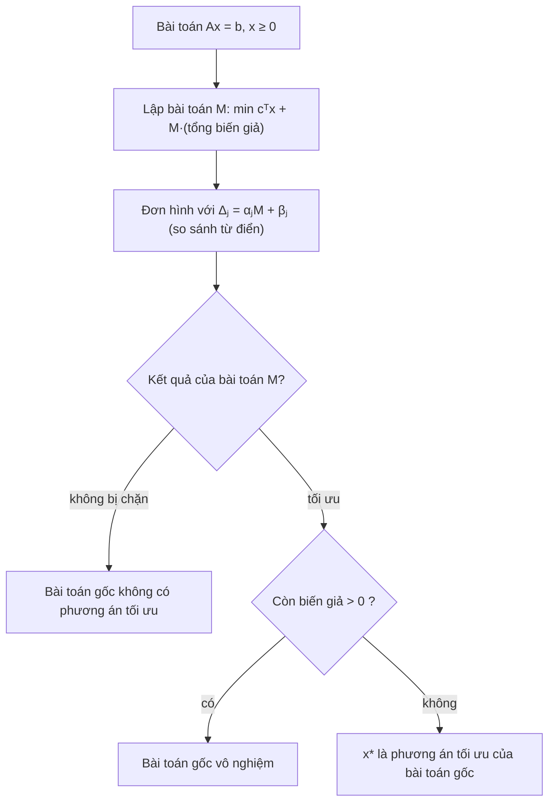
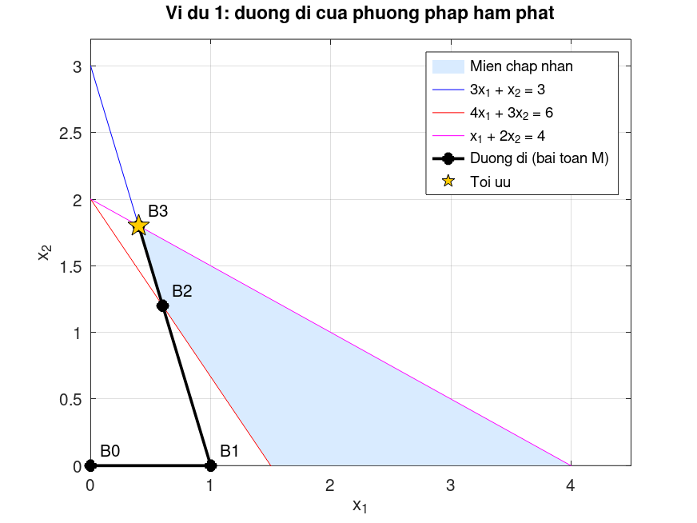

# Câu 3. Phương pháp hàm phạt (bài toán M) giải bài toán quy hoạch tuyến tính dạng chính tắc

## 1. Bài toán và ý tưởng

Xét bài toán QHTT dạng chính tắc (gọi là bài toán gốc)

```math
(P)\qquad \min\; f(x) = c^T x \quad \text{với}\quad Ax = b,\; x \ge 0,
```

với $`A \in \mathbb{R}^{m\times n}`$, $`b \ge 0`$. Giống [câu 2](../q02-two-phase-simplex/), khó khăn là $`A`$ thường không có sẵn $`m`$ cột đơn vị để làm cơ sở xuất phát cho thuật toán đơn hình.

**Ý tưởng của phương pháp hàm phạt**: vẫn thêm **biến giả** để có ngay cơ sở đơn vị, nhưng thay vì giải riêng một bài toán phụ (pha 1), ta đưa biến giả vào hàm mục tiêu với một hệ số phạt $`M`$ rất lớn. Khi cực tiểu hóa, thuật toán sẽ "tự động" đẩy các biến giả về 0 nếu có thể, rồi tiếp tục tối ưu $`c^T x`$, tất cả trong **một** lần chạy đơn hình.

## 2. Bài toán M

Với mỗi dòng $`i`$ chưa có cột đơn vị, thêm biến giả $`x^a_i \ge 0`$. Gọi $`I_a`$ là tập các dòng đó, $`e_i`$ là vector đơn vị thứ $`i`$. Bài toán M (bài toán phạt) là

```math
(P_M)\qquad \min\; F(x, x^a) = c^T x + M \sum_{i \in I_a} x^a_i \quad \text{với}\quad Ax + \sum_{i\in I_a} e_i\, x^a_i = b,\; x \ge 0,\; x^a \ge 0,
```

trong đó $`M \gt 0`$ là một số **đủ lớn** (lớn hơn mọi số mà ta cần so sánh với nó). Bài toán $`(P_M)`$ có sẵn phương án cực biên xuất phát $`x = 0`$, $`x^a_i = b_i`$.

**Định lý (quan hệ giữa $`(P_M)`$ và $`(P)`$).** Với $`M`$ đủ lớn:

1. Nếu $`(P_M)`$ có phương án tối ưu $`(x^*, x^{a*})`$ với $`x^{a*} = 0`$ thì $`x^*`$ là phương án tối ưu của $`(P)`$.
2. Nếu $`(P_M)`$ có phương án tối ưu với $`x^{a*} \ne 0`$ thì $`(P)`$ **không có phương án chấp nhận được**.
3. Nếu $`(P_M)`$ không bị chặn dưới thì $`(P)`$ **không có phương án tối ưu** (hoặc vô nghiệm, hoặc không bị chặn). Nếu khi đó mọi biến giả đều bằng 0 thì $`(P)`$ có phương án chấp nhận được, nên $`(P)`$ không bị chặn dưới.

*Chứng minh.*
1. Với mọi phương án $`x`$ của $`(P)`$, $`(x, 0)`$ là phương án của $`(P_M)`$, nên $`c^T x^* = F(x^*, 0) \le F(x, 0) = c^T x`$.
2. Giả sử $`(P)`$ có phương án $`\bar x`$. Khi đó $`c^T \bar x = F(\bar x, 0) \ge F(x^*, x^{a*}) = c^T x^* + M \sum_i x^{a*}_i`$. Vì $`\sum_i x^{a*}_i \gt 0`$ nên bất đẳng thức này sai khi $`M`$ đủ lớn: mâu thuẫn.
3. Nếu $`(P)`$ có phương án tối ưu thì theo định lý đối ngẫu ([câu 5](../q05-lagrange-duality/)), bài toán đối ngẫu $`\max\, b^Ty`$ với $`A^Ty \le c`$ có nghiệm $`\bar y`$. Với $`M \ge \max_i \bar y_i`$, $`\bar y`$ cũng thỏa ràng buộc đối ngẫu của $`(P_M)`$ (vì cột của $`x^a_i`$ là $`e_i`$ và $`e_i^T \bar y = \bar y_i \le M`$). Theo đối ngẫu yếu, $`F \ge b^T\bar y`$ với mọi phương án của $`(P_M)`$, tức là $`(P_M)`$ bị chặn dưới: mâu thuẫn. $`\blacksquare`$

Chứng minh ý 3 cũng gợi ý một ngưỡng cụ thể cho "$`M`$ đủ lớn": $`M`$ lớn hơn các biến đối ngẫu tối ưu $`\bar y_i`$ ứng với các dòng có biến giả (xem ví dụ 4).

## 3. Ước lượng chứa M

Hệ số hàm mục tiêu của $`(P_M)`$ có dạng $`c_j = c^{(0)}_j + c^{(M)}_j M`$ (với biến gốc $`c^{(M)}_j = 0`$, với biến giả $`c^{(0)}_j = 0`$, $`c^{(M)}_j = 1`$). Do đó mọi ước lượng cũng có dạng

```math
\Delta_j = \alpha_j M + \beta_j, \qquad \alpha_j = (c^{(M)}_B)^T z_j - c^{(M)}_j, \qquad \beta_j = (c^{(0)}_B)^T z_j - c^{(0)}_j .
```

Trong bảng đơn hình, dòng ước lượng được tách thành **hai dòng**: dòng hệ số của $`M`$ ($`\alpha_j`$) và dòng phần không chứa $`M`$ ($`\beta_j`$). Vì $`M`$ lớn hơn mọi số cần so sánh, dấu và thứ tự của $`\Delta_j`$ được xác định theo **thứ tự từ điển**:

- $`\Delta_j \gt 0`$ khi và chỉ khi $`\alpha_j \gt 0`$, hoặc $`\alpha_j = 0`$ và $`\beta_j \gt 0`$;
- $`\Delta_j \gt \Delta_k`$ khi và chỉ khi $`\alpha_j \gt \alpha_k`$, hoặc $`\alpha_j = \alpha_k`$ và $`\beta_j \gt \beta_k`$.

Như vậy **không cần chọn giá trị cụ thể cho $`M`$**. Khi mọi biến giả đã rời cơ sở thì $`\alpha_j \le 0`$ cho mọi biến gốc, và thuật toán chỉ còn dùng dòng $`\beta`$, giống hệt đơn hình thông thường trên bài toán gốc.

## 4. Giải thuật

**Đầu vào**: $`A, b, c`$ (không cần cơ sở xuất phát).

**Bước 0.** Đổi dấu các dòng có $`b_i \lt 0`$. Tìm các cột đơn vị có sẵn trong $`A`$; thêm biến giả cho các dòng còn thiếu. Lập bảng đơn hình của $`(P_M)`$ với cơ sở gồm các cột đơn vị và các biến giả.

**Bước 1.** Tính $`\alpha_j, \beta_j`$. Nếu $`\Delta_j \le 0`$ (theo thứ tự từ điển) với mọi $`j`$ thì $`(P_M)`$ đạt tối ưu, sang Bước 4.

**Bước 2.** Chọn $`s`$ có $`\Delta_s \gt 0`$ (quy tắc Dantzig: $`\Delta_s`$ lớn nhất theo thứ tự từ điển; quy tắc Bland: chỉ số nhỏ nhất). Nếu $`z_{is} \le 0`$ với mọi $`i`$ thì **dừng**: $`(P_M)`$ không bị chặn, nên $`(P)`$ không có phương án tối ưu.

**Bước 3.** Chọn dòng $`r`$ theo tỉ số nhỏ nhất, xoay quanh $`z_{rs}`$ như thuật toán đơn hình ([câu 1](../q01-simplex/)). Quay lại Bước 1.

**Bước 4.** Nếu mọi biến giả bằng 0: $`x^*`$ (phần biến gốc) là phương án tối ưu của $`(P)`$. Ngược lại: $`(P)`$ không có phương án chấp nhận được.



**So sánh với phương pháp hai pha** (câu 2):

| | Hai pha | Hàm phạt (bài toán M) |
|---|---|---|
| Số lần chạy đơn hình | 2 (pha 1, pha 2) | 1 |
| Hàm mục tiêu | Pha 1 chỉ có tổng biến giả, pha 2 chỉ có $`c^Tx`$ | Gộp $`c^Tx + M\sum x^a`$ |
| Chọn tham số | Không cần | Cần $`M`$ đủ lớn, hoặc tính $`\alpha M + \beta`$ hình thức |
| Sai số số học | Tốt | Kém nếu dùng $`M`$ là số rất lớn trên máy tính |

## 5. Chương trình Matlab

| File | Nội dung |
|---|---|
| `big_m_simplex.m` | Hàm `[x, fval, exitflag, out] = big_m_simplex(c, A, b, opts)` cài đặt thuật toán trên |
| `run_examples.m` | Bốn ví dụ minh họa và hình vẽ |

Đặc điểm của `big_m_simplex.m`:

- **Mặc định coi $`M`$ là số lớn tùy ý**: mỗi ước lượng được lưu thành hai thành phần $`(\alpha_j, \beta_j)`$ và so sánh theo thứ tự từ điển. Bảng đơn hình in ra có hai dòng ước lượng `Delta(M)` và `Delta`, giống cách trình bày trong giáo trình.
- **Tùy chọn `opts.M = <số>`**: dùng một giá trị $`M`$ cụ thể, khi đó chương trình gọi `simplex.m` của [câu 1](../q01-simplex/). Tùy chọn này dùng để minh họa ảnh hưởng của việc chọn $`M`$ (ví dụ 4).
- Chỉ thêm biến giả cho các dòng chưa có cột đơn vị. Biến giả được đánh số tiếp theo biến gốc và có dấu `*` trong bảng in ra.
- Hỗ trợ quy tắc `'dantzig'` (mặc định) và `'bland'`, phát hiện xoay vòng.
- Trả về `exitflag`: `1` tối ưu, `-2` bài toán gốc vô nghiệm, `-3` bài toán M không bị chặn, `-4` xoay vòng, `0` vượt quá số bước lặp. Giá trị các biến giả ở phương án cuối nằm trong `out.xa`.

Cách chạy (trong thư mục `solutions/q03-big-m-method`):

```matlab
>> run_examples
```

## 6. Ví dụ minh họa

### Ví dụ 1: bài toán cần biến giả, có phương án tối ưu

Đây là ví dụ 1 của câu 2, để tiện so sánh hai phương pháp:

```math
\begin{aligned}
\min\; & f = 4x_1 + x_2 \\
& 3x_1 + x_2 - x_3 = 3 \\
& 4x_1 + 3x_2 - x_4 = 6 \\
& x_1 + 2x_2 + x_5 = 4, \qquad x \ge 0
\end{aligned}
```

Thêm biến giả $`x_6, x_7`$ cho dòng 1 và dòng 2. Bài toán M: $`\min F = 4x_1 + x_2 + Mx_6 + Mx_7`$.

Bảng đơn hình ban đầu (cơ sở $`x_6, x_7, x_5`$):

| $`c_B`$ | Cơ sở | Phương án | $`x_1`$ | $`x_2`$ | $`x_3`$ | $`x_4`$ | $`x_5`$ | $`x_6^*`$ | $`x_7^*`$ |
|---|---|---|---|---|---|---|---|---|---|
| | | | $`4`$ | $`1`$ | $`0`$ | $`0`$ | $`0`$ | $`M`$ | $`M`$ |
| $`M`$ | $`x_6`$ | $`3`$ | $`3`$ | $`1`$ | $`-1`$ | $`0`$ | $`0`$ | $`1`$ | $`0`$ |
| $`M`$ | $`x_7`$ | $`6`$ | $`4`$ | $`3`$ | $`0`$ | $`-1`$ | $`0`$ | $`0`$ | $`1`$ |
| $`0`$ | $`x_5`$ | $`4`$ | $`1`$ | $`2`$ | $`0`$ | $`0`$ | $`1`$ | $`0`$ | $`0`$ |
| | $`\Delta`$ (hệ số $`M`$) | $`9`$ | $`7`$ | $`4`$ | $`-1`$ | $`-1`$ | $`0`$ | $`0`$ | $`0`$ |
| | $`\Delta`$ (không chứa $`M`$) | $`0`$ | $`-4`$ | $`-1`$ | $`0`$ | $`0`$ | $`0`$ | $`0`$ | $`0`$ |

Ví dụ $`\Delta_1 = 7M - 4 \gt 0`$ vì hệ số của $`M`$ dương. Các bước lặp:

| Bước | Cơ sở | $`(x_1, x_2)`$ | $`F`$ | Biến vào | Biến ra | $`\theta`$ |
|---|---|---|---|---|---|---|
| 0 | $`x_6, x_7, x_5`$ | $`(0, 0)`$ | $`9M`$ | $`x_1`$ ($`\Delta_1 = 7M - 4`$) | $`x_6`$ | 1 |
| 1 | $`x_1, x_7, x_5`$ | $`(1, 0)`$ | $`2M + 4`$ | $`x_2`$ ($`\Delta_2 = \tfrac53 M + \tfrac13`$) | $`x_7`$ | 1.2 |
| 2 | $`x_1, x_2, x_5`$ | $`(0.6, 1.2)`$ | $`3.6`$ | $`x_4`$ ($`\Delta_4 = 0.2`$) | $`x_5`$ | 1 |
| 3 | $`x_1, x_2, x_4`$ | $`(0.4, 1.8)`$ | $`3.4`$ | — mọi $`\Delta_j \le 0`$ | | |

Ở bước 0 và 1, hệ số của $`M`$ quyết định việc chọn biến vào, nên thuật toán ưu tiên đưa biến giả ra khỏi cơ sở (giống pha 1). Từ bước 2, mọi biến giả đã ra ngoài, dòng hệ số $`M`$ không còn số dương, và thuật toán chạy như đơn hình thông thường (giống pha 2).

**Kết quả**: $`x^* = (0.4,\ 1.8,\ 0,\ 1,\ 0)`$, $`f^* = 3.4`$, các biến giả bằng 0. Kết quả trùng với `glpk` và với phương pháp hai pha (câu 2). Tổng số bước lặp cũng bằng nhau: $`3 = 2 + 1`$.



Trên mặt phẳng $`(x_1, x_2)`$, đường đi $`B_0 \to B_1 \to B_2 \to B_3`$ trùng với đường đi của phương pháp hai pha: $`B_0, B_1`$ nằm ngoài miền chấp nhận được (biến giả còn dương), $`B_2, B_3`$ là các đỉnh của miền.

### Ví dụ 2: bài toán không có phương án chấp nhận được

```math
\begin{aligned}
\min\; & f = x_1 + x_2 \\
& x_1 + 2x_2 - x_3 = 6 \\
& x_1 + x_2 + x_4 = 2, \qquad x \ge 0
\end{aligned}
```

Thêm biến giả $`x_5`$ cho dòng 1. Sau 1 bước ($`x_2`$ vào, $`x_4`$ ra), mọi $`\Delta_j \le 0`$:

| | $`x_1`$ | $`x_2`$ | $`x_3`$ | $`x_4`$ | $`x_5^*`$ |
|---|---|---|---|---|---|
| $`\Delta`$ (hệ số $`M`$) | $`-1`$ | $`0`$ | $`-1`$ | $`-2`$ | $`0`$ |
| $`\Delta`$ (không chứa $`M`$) | $`0`$ | $`0`$ | $`0`$ | $`1`$ | $`0`$ |

Chú ý $`\Delta_4 = -2M + 1 \lt 0`$ dù phần không chứa $`M`$ dương. Bài toán M đạt tối ưu nhưng biến giả $`x_5 = 2 \gt 0`$, nên bài toán gốc vô nghiệm (`exitflag = -2`), giống kết luận của câu 2.

### Ví dụ 3: hàm mục tiêu không bị chặn dưới

```math
\begin{aligned}
\min\; & f = -x_1 - 2x_2 \\
& x_1 - x_2 - x_3 = 1 \\
& -x_1 + x_2 + x_4 = 2, \qquad x \ge 0
\end{aligned}
```

Thêm biến giả $`x_5`$ cho dòng 1. Bước 0: $`\Delta_1 = M + 1`$, $`x_1`$ vào, $`x_5`$ ra. Bước 1: cơ sở $`\{x_1, x_4\}`$, phương án $`x = (1, 0, 0, 3)`$ đã chấp nhận được; $`\Delta_2 = 3 \gt 0`$ nhưng cột $`z_2 = (-1, 0)^T \le 0`$. Bài toán M không bị chặn (`exitflag = -3`). Vì biến giả đã bằng 0, bài toán gốc có phương án chấp nhận được và **không bị chặn dưới**: thật vậy, $`x(t) = (1 + t,\ t,\ 0,\ 3)`$ chấp nhận được với mọi $`t \ge 0`$ và $`f = -1 - 3t \to -\infty`$. `glpk` cũng báo bài toán không bị chặn.

### Ví dụ 4: chọn giá trị M cụ thể

Nếu thay $`M`$ bằng một số cụ thể (như khi tính trên máy), số đó phải **đủ lớn**. Giải lại ví dụ 1 với `opts.M` khác nhau:

| $`M`$ | $`x^*`$ (phần biến gốc) | Biến giả $`(x_6, x_7)`$ | Kết luận của chương trình |
|---|---|---|---|
| 0.5 | $`(0, 2, 0, 0, 0)`$ | $`(1, 0)`$ | vô nghiệm ❌ |
| 1 | $`(0, 2, 0, 0, 0)`$ | $`(1, 0)`$ | vô nghiệm ❌ |
| 1.5 | $`(0.4, 1.8, 0, 1, 0)`$ | $`(0, 0)`$ | $`f^* = 3.4`$ ✅ |
| 2, 10, $`10^3`$, $`10^8`$ | $`(0.4, 1.8, 0, 1, 0)`$ | $`(0, 0)`$ | $`f^* = 3.4`$ ✅ |

Giải thích: điểm $`x = (0, 2, 0, 0, 0)`$, $`x_6 = 1`$, $`x_7 = 0`$ thỏa mãn các ràng buộc của bài toán M với $`F = 2 + M`$. Nó tốt hơn phương án tối ưu thật ($`F = 3.4`$) khi $`2 + M \lt 3.4`$, tức là $`M \lt 1.4`$. Với $`M`$ nhỏ như vậy, "phạt" không đủ nặng và thuật toán chấp nhận để biến giả dương, dẫn tới kết luận **sai** là bài toán vô nghiệm.

Ngưỡng $`1.4`$ này đúng bằng biến đối ngẫu tối ưu của bài toán gốc ứng với dòng có biến giả: tại phương án tối ưu (cơ sở $`x_1, x_2, x_4`$), $`\bar y = (B^{-1})^T c_B = (1.4,\ 0,\ -0.2)`$, và $`\max\{\bar y_1, \bar y_2\} = 1.4`$. Điều này khớp với nhận xét sau chứng minh ở mục 2.

Ngược lại, $`M`$ quá lớn cũng không tốt khi tính với số thực dấu phẩy động: trong $`\Delta_j = \alpha_j M + \beta_j`$, nếu $`M \approx 10^{17}`$ thì phần $`\beta_j`$ (cỡ vài đơn vị) nhỏ hơn sai số làm tròn của $`\alpha_j M`$ và bị mất. Đây là lý do chương trình mặc định lưu riêng $`(\alpha_j, \beta_j)`$ thay vì chọn một giá trị $`M`$.

## 7. Nhận xét

- Phương pháp hàm phạt giải bài toán chỉ trong **một** lần chạy đơn hình. Quá trình chạy tự chia thành hai giai đoạn: lúc đầu dòng hệ số $`M`$ chi phối và các biến giả bị đẩy ra (tương tự pha 1), sau đó thuật toán tối ưu $`c^Tx`$ (tương tự pha 2).
- Khi cài đặt, nên tách ước lượng thành $`(\alpha_j, \beta_j)`$ như trên. Nếu dùng $`M`$ cụ thể thì $`M`$ phải đủ lớn so với các hệ số của bài toán, nhưng không quá lớn để tránh sai số làm tròn. Phương pháp hai pha (câu 2) tránh được hoàn toàn việc chọn $`M`$.
- Ba kết luận có thể có (tối ưu, vô nghiệm, không có phương án tối ưu) được đọc trực tiếp từ kết quả của bài toán M và giá trị của các biến giả.
