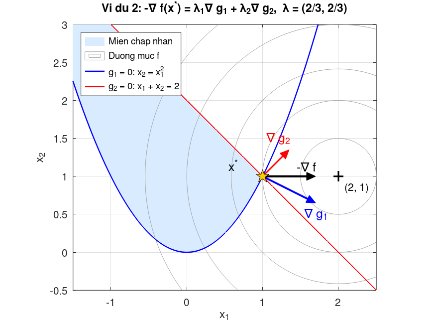
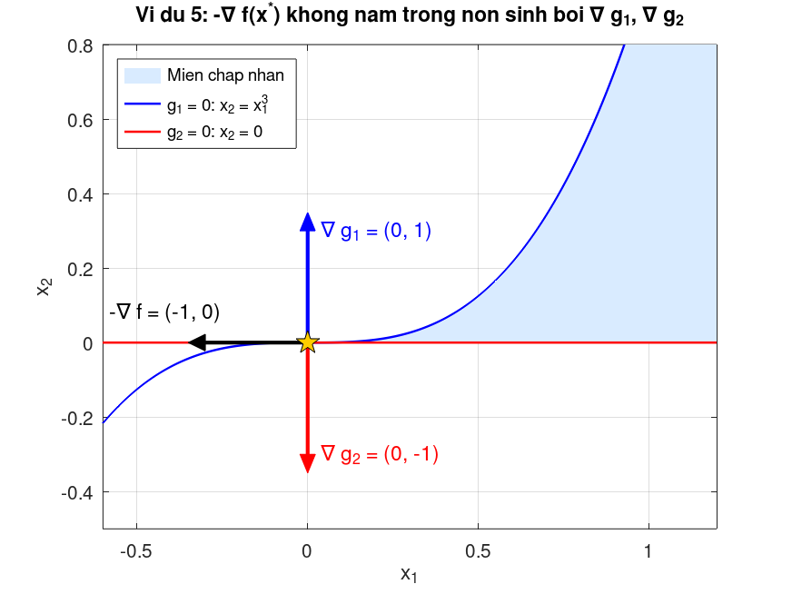

# Câu 4. Điều kiện chính quy và điều kiện KKT cho bài toán tối ưu trơn

## 1. Bài toán

Xét bài toán tối ưu trơn với ràng buộc bất đẳng thức và đẳng thức

```math
(P)\qquad \min\; f(x) \quad \text{với}\quad g_i(x) \le 0\ (i = 1,\dots,m),\qquad h_j(x) = 0\ (j = 1,\dots,p),
```

trong đó $`f, g_i, h_j : \mathbb{R}^n \to \mathbb{R}`$ khả vi liên tục ($`C^1`$). Ký hiệu:

- **Tập chấp nhận được**: $`D = \{x \in \mathbb{R}^n : g_i(x) \le 0\ \forall i,\ h_j(x) = 0\ \forall j\}`$.
- **Tập chỉ số tích cực** tại $`x \in D`$: $`I(x) = \{i : g_i(x) = 0\}`$. Ràng buộc đẳng thức luôn tích cực.

## 2. Nón tiếp tuyến, nón tuyến tính hóa và điều kiện cần hình học

**Nón tiếp tuyến** của $`D`$ tại $`x^* \in D`$ là tập các hướng $`d`$ sao cho tồn tại dãy $`x_k \in D`$, $`x_k \to x^*`$ và $`t_k \downarrow 0`$ với $`(x_k - x^*)/t_k \to d`$. Ký hiệu $`T(x^*)`$. Đây là tập các hướng "đi được" trong $`D`$, xét theo nghĩa giới hạn.

**Nón tuyến tính hóa** tại $`x^*`$ là tập các hướng thỏa các ràng buộc đã được tuyến tính hóa:

```math
L(x^*) = \{ d : \nabla g_i(x^*)^T d \le 0\ \ (i \in I(x^*)),\ \ \nabla h_j(x^*)^T d = 0\ \ (j = 1,\dots,p) \}.
```

Luôn có $`T(x^*) \subseteq L(x^*)`$, nhưng hai nón có thể khác nhau (ví dụ 5).

**Định lý (điều kiện cần hình học).** Nếu $`x^*`$ là cực tiểu địa phương của $`(P)`$ thì $`\nabla f(x^*)^T d \ge 0`$ với mọi $`d \in T(x^*)`$.

*Chứng minh.* Với $`d \in T(x^*)`$ và dãy $`x_k = x^* + t_k d_k`$, $`d_k \to d`$, ta có $`0 \le f(x_k) - f(x^*) = t_k \nabla f(x^*)^T d_k + o(t_k)`$. Chia cho $`t_k`$ rồi cho $`k \to \infty`$. $`\blacksquare`$

Nón $`T(x^*)`$ thường khó tính, còn $`L(x^*)`$ chỉ cần đạo hàm của các ràng buộc. Các **điều kiện chính quy** là các giả thiết bảo đảm có thể thay $`T(x^*)`$ bằng $`L(x^*)`$ (hoặc tương đương về mặt kết luận), từ đó dẫn tới điều kiện KKT.

## 3. Các điều kiện chính quy

Cho $`x^* \in D`$.

| Tên | Phát biểu |
|---|---|
| **LICQ** (độc lập tuyến tính) | Các vector $`\nabla g_i(x^*)`$, $`i \in I(x^*)`$, và $`\nabla h_j(x^*)`$, $`j = 1,\dots,p`$, độc lập tuyến tính. |
| **MFCQ** (Mangasarian–Fromovitz) | Các $`\nabla h_j(x^*)`$ độc lập tuyến tính, và tồn tại $`d`$ với $`\nabla h_j(x^*)^T d = 0`$ mọi $`j`$, $`\nabla g_i(x^*)^T d \lt 0`$ mọi $`i \in I(x^*)`$. |
| **Slater** (cho bài toán lồi) | $`g_i`$ lồi, $`h_j`$ affine, và tồn tại $`\hat x`$ với $`g_i(\hat x) \lt 0`$ mọi $`i`$, $`h_j(\hat x) = 0`$ mọi $`j`$. |
| **Ràng buộc tuyến tính** | Mọi $`g_i`$, $`h_j`$ là hàm affine. |
| **Abadie** | $`T(x^*) = L(x^*)`$. |

**Quan hệ giữa các điều kiện:**

```math
\text{LICQ} \;\Longrightarrow\; \text{MFCQ} \;\Longrightarrow\; \text{Abadie}, \qquad \text{Slater} \;\Longrightarrow\; \text{MFCQ tại mọi } x \in D, \qquad \text{ràng buộc tuyến tính} \;\Longrightarrow\; \text{Abadie}.
```

- *LICQ ⇒ MFCQ*: nếu các gradient tích cực độc lập tuyến tính thì hệ $`\nabla g_i^T d = -1`$ ($`i \in I`$), $`\nabla h_j^T d = 0`$ có nghiệm $`d`$.
- *Slater ⇒ MFCQ*: với $`d = \hat x - x^*`$, do $`g_i`$ lồi và $`g_i(x^*) = 0`$ ($`i \in I`$): $`\nabla g_i(x^*)^T d \le g_i(\hat x) - g_i(x^*) = g_i(\hat x) \lt 0`$; do $`h_j`$ affine: $`\nabla h_j^T d = h_j(\hat x) - h_j(x^*) = 0`$. (Nếu các $`\nabla h_j`$ phụ thuộc tuyến tính thì bỏ bớt các ràng buộc đẳng thức thừa.)
- Các điều kiện LICQ, MFCQ, Slater kiểm tra được trực tiếp; Abadie là điều kiện yếu nhất trong bảng nhưng khó kiểm tra.

**Ví dụ minh họa** (chi tiết ở mục 6):

- LICQ thỏa: ví dụ 2, tại $`x^* = (1, 1)`$ hai gradient tích cực $`(2, -1)`$ và $`(1, 1)`$ độc lập tuyến tính.
- MFCQ thỏa nhưng LICQ không thỏa: ví dụ 4, có 3 ràng buộc tích cực trong $`\mathbb{R}^2`$ (nên phụ thuộc tuyến tính), nhưng hướng $`d = (1, 1)`$ làm cả ba giảm thực sự.
- Không điều kiện nào thỏa: ví dụ 5 (miền có điểm nhọn) và ví dụ 6 ($`x^2 \le 0`$, Slater không thỏa vì không có $`x`$ nào với $`x^2 \lt 0`$).

## 4. Điều kiện KKT

**Hàm Lagrange** của $`(P)`$:

```math
\mathcal{L}(x, \lambda, \mu) = f(x) + \sum_{i=1}^m \lambda_i g_i(x) + \sum_{j=1}^p \mu_j h_j(x), \qquad \lambda \in \mathbb{R}^m,\ \mu \in \mathbb{R}^p .
```

Điểm $`x^*`$ là **điểm KKT** (Karush–Kuhn–Tucker) nếu tồn tại $`\lambda^*, \mu^*`$ (gọi là **nhân tử Lagrange**) thỏa:

```math
\begin{aligned}
&\text{(KKT1) Điều kiện dừng:} && \nabla f(x^*) + \sum_{i=1}^m \lambda_i^* \nabla g_i(x^*) + \sum_{j=1}^p \mu_j^* \nabla h_j(x^*) = 0, \\
&\text{(KKT2) Chấp nhận được:} && g_i(x^*) \le 0, \quad h_j(x^*) = 0, \\
&\text{(KKT3) Dấu của nhân tử:} && \lambda_i^* \ge 0 \quad (\mu_j^* \text{ tùy ý}), \\
&\text{(KKT4) Bù:} && \lambda_i^* g_i(x^*) = 0, \quad i = 1,\dots,m.
\end{aligned}
```

Điều kiện bù (KKT4) nghĩa là ràng buộc không tích cực có nhân tử bằng 0, nên (KKT1) chỉ gồm các ràng buộc tích cực.

**Định lý KKT (điều kiện cần cấp 1).** Nếu $`x^*`$ là cực tiểu địa phương của $`(P)`$ và tại $`x^*`$ thỏa một điều kiện chính quy (LICQ, MFCQ, Abadie; Slater với bài toán lồi; hoặc mọi ràng buộc tuyến tính), thì $`x^*`$ là điểm KKT.

*Ý chứng minh (với điều kiện Abadie).* Theo mục 2, $`\nabla f(x^*)^T d \ge 0`$ với mọi $`d \in T(x^*) = L(x^*)`$. Nghĩa là hệ

```math
\nabla g_i(x^*)^T d \le 0\ (i \in I),\qquad \nabla h_j(x^*)^T d = 0,\qquad \nabla f(x^*)^T d \lt 0
```

vô nghiệm. Theo **bổ đề Farkas**, khi đó tồn tại $`\lambda_i \ge 0`$ ($`i \in I`$) và $`\mu_j`$ sao cho $`-\nabla f(x^*) = \sum_{i\in I} \lambda_i \nabla g_i(x^*) + \sum_j \mu_j \nabla h_j(x^*)`$. Đặt $`\lambda_i = 0`$ với $`i \notin I`$ ta được (KKT1)–(KKT4). $`\blacksquare`$

**Ý nghĩa hình học.** $`-\nabla f(x^*)`$ (hướng giảm nhanh nhất của $`f`$) nằm trong nón sinh bởi gradient của các ràng buộc tích cực, cộng với không gian sinh bởi $`\nabla h_j`$. Mọi hướng làm $`f`$ giảm đều đi ra khỏi miền chấp nhận được.

**Các trường hợp riêng.**
- *Chỉ có ràng buộc đẳng thức*: (KKT1) trở thành $`\nabla f(x^*) + \sum_j \mu_j \nabla h_j(x^*) = 0`$, tức là **quy tắc nhân tử Lagrange** cổ điển, với $`\mu_j`$ không ràng buộc dấu.
- *Chỉ có ràng buộc bất đẳng thức*: $`\nabla f(x^*) + \sum_i \lambda_i \nabla g_i(x^*) = 0`$, $`\lambda \ge 0`$, $`\lambda_i g_i(x^*) = 0`$.
- *Không có ràng buộc*: $`\nabla f(x^*) = 0`$.

**Tính chất của tập nhân tử.**
- Nếu LICQ thỏa thì nhân tử $`(\lambda^*, \mu^*)`$ là **duy nhất** (vì các gradient trong (KKT1) độc lập tuyến tính).
- Tại một cực tiểu địa phương, MFCQ thỏa khi và chỉ khi tập nhân tử KKT khác rỗng và **bị chặn** (định lý Gauvin). Khi đó nhân tử có thể không duy nhất (ví dụ 4).

**Điều kiện Fritz John.** Không cần điều kiện chính quy, tại mọi cực tiểu địa phương luôn tồn tại $`(\lambda_0, \lambda, \mu) \ne 0`$ với $`\lambda_0 \ge 0`$, $`\lambda \ge 0`$ thỏa $`\lambda_0 \nabla f + \sum \lambda_i \nabla g_i + \sum \mu_j \nabla h_j = 0`$ và điều kiện bù. Nếu $`\lambda_0 = 0`$ thì điều kiện này không chứa thông tin gì về $`f`$. Vai trò của điều kiện chính quy chính là bảo đảm $`\lambda_0 \gt 0`$ (chia cho $`\lambda_0`$ được KKT). Ở ví dụ 5 và 6, chỉ có nhân tử Fritz John với $`\lambda_0 = 0`$.

**Điều kiện đủ.**
- *Bài toán lồi* ($`f, g_i`$ lồi, $`h_j`$ affine): mọi điểm KKT là **cực tiểu toàn cục** (xem câu 13).
- *Điều kiện đủ cấp 2*: nếu $`(x^*, \lambda^*, \mu^*)`$ thỏa KKT và

```math
d^T \nabla^2_{xx}\mathcal{L}(x^*, \lambda^*, \mu^*)\, d \gt 0 \quad \text{với mọi } d \ne 0,\ d \in C(x^*),
```

  trong đó $`C(x^*)`$ là **nón tới hạn**, gồm các $`d \in L(x^*)`$ có thêm $`\nabla g_i(x^*)^T d = 0`$ với mọi $`i`$ mà $`\lambda_i^* \gt 0`$, thì $`x^*`$ là cực tiểu địa phương chặt.

## 5. Chương trình Matlab

| File | Nội dung |
|---|---|
| `kkt_check.m` | Hàm `res = kkt_check(prob, x, opts)`: kiểm tra số tại điểm $`x`$: tính chấp nhận được, tập tích cực, LICQ, MFCQ, nhân tử, điều kiện KKT, tính duy nhất của nhân tử |
| `solve_nlp.m` | Giải $`(P)`$ bằng `sqp` (Octave) hoặc `fmincon` (MATLAB), dùng để đối chiếu với lời giải tay |
| `draw_arrow.m` | Vẽ mũi tên (gradient) trên hình |
| `run_examples.m` | Sáu ví dụ minh họa và hai hình vẽ |

Bài toán được mô tả bằng một `struct` chứa các hàm (handle): `gradf`, `g`, `jacg` (ma trận Jacobi của $`g`$, mỗi dòng là $`\nabla g_i^T`$), `h`, `jach`; thêm `f` nếu cần gọi `solve_nlp`.

Cách `kkt_check.m` kiểm tra:

- **LICQ**: hạng của ma trận các gradient tích cực bằng số cột.
- **MFCQ**: giải bài toán quy hoạch tuyến tính $`\max t`$ với $`\nabla g_i^T d + t \le 0`$ ($`i \in I`$), $`\nabla h_j^T d = 0`$, $`-1 \le d \le 1`$, $`0 \le t \le 1`$ (bằng `glpk` hoặc `linprog`). MFCQ thỏa khi và chỉ khi các $`\nabla h_j`$ độc lập tuyến tính và $`t^* \gt 0`$.
- **Nhân tử**: giải bài toán bình phương tối thiểu không âm (`lsqnonneg`) $`\min \lVert \nabla f + \sum_{i\in I} \lambda_i \nabla g_i + \sum_j \mu_j \nabla h_j \rVert`$ với $`\lambda \ge 0`$, viết $`\mu = \mu^+ - \mu^-`$. Điểm $`x`$ là điểm KKT khi giá trị nhỏ nhất bằng 0 (sai số `tol`).

Cách chạy (trong thư mục `solutions/q04-kkt-conditions`):

```matlab
>> run_examples
```

## 6. Ví dụ minh họa

### Ví dụ 1: chỉ có ràng buộc đẳng thức

```math
\min\; f = x_1 + x_2 \quad \text{với}\quad h(x) = x_1^2 + x_2^2 - 2 = 0 .
```

$`\nabla h = (2x_1, 2x_2) \ne 0`$ trên đường tròn, nên LICQ thỏa tại mọi điểm chấp nhận được. Điều kiện KKT:

```math
1 + 2\mu x_1 = 0,\qquad 1 + 2\mu x_2 = 0,\qquad x_1^2 + x_2^2 = 2
\;\Longrightarrow\; x_1 = x_2 = -\frac{1}{2\mu},\quad \frac{2}{4\mu^2} = 2 \;\Longrightarrow\; \mu = \pm \frac12 .
```

Có hai điểm KKT: $`\mu = \tfrac12`$ cho $`x = (-1, -1)`$, $`f = -2`$; $`\mu = -\tfrac12`$ cho $`x = (1, 1)`$, $`f = 2`$. Dấu của $`\mu`$ không bị ràng buộc vì đây là ràng buộc đẳng thức. Để phân biệt, xét điều kiện cấp 2: $`\nabla^2_{xx}\mathcal{L} = 2\mu I`$ xác định dương khi $`\mu = \tfrac12`$, nên $`(-1, -1)`$ là cực tiểu; xác định âm khi $`\mu = -\tfrac12`$, nên $`(1, 1)`$ là cực đại.

Chương trình xác nhận cả hai điểm là điểm KKT với $`\mu = -0.5`$ và $`\mu = 0.5`$; solver (xuất phát từ $`(0.5, -0.2)`$) cho $`x^* = (-1, -1)`$, $`f^* = -2`$.

### Ví dụ 2: chỉ có ràng buộc bất đẳng thức

```math
\min\; f = (x_1 - 2)^2 + (x_2 - 1)^2 \quad \text{với}\quad g_1 = x_1^2 - x_2 \le 0,\quad g_2 = x_1 + x_2 - 2 \le 0 .
```

Tâm $`(2, 1)`$ của các đường mức nằm ngoài miền chấp nhận được, nên nghiệm nằm trên biên. Thử trường hợp cả hai ràng buộc tích cực: $`x_2 = x_1^2`$, $`x_1 + x_2 = 2`$ cho $`x = (1, 1)`$ hoặc $`x = (-2, 4)`$.

- Tại $`(1, 1)`$: $`\nabla f = (-2, 0)`$, $`\nabla g_1 = (2, -1)`$, $`\nabla g_2 = (1, 1)`$. Điều kiện dừng $`-2 + 2\lambda_1 + \lambda_2 = 0`$, $`-\lambda_1 + \lambda_2 = 0`$ cho $`\lambda_1 = \lambda_2 = \tfrac23 \ge 0`$. Đây là **điểm KKT**.
- Tại $`(-2, 4)`$: $`\nabla f = (-8, 6)`$, $`\nabla g_1 = (-4, -1)`$, $`\nabla g_2 = (1, 1)`$. Điều kiện dừng cho $`\lambda_1 = -\tfrac{14}{3} \lt 0`$, vi phạm (KKT3): **không** phải điểm KKT.

Bài toán lồi ($`f`$, $`g_1`$, $`g_2`$ đều lồi) nên $`x^* = (1, 1)`$ là cực tiểu toàn cục, $`f^* = 1`$. Chương trình cho $`\lambda = (0.6667, 0.6667)`$, LICQ và MFCQ thỏa, solver cũng cho $`x^* = (1, 1)`$.

Một điểm chấp nhận được **không** phải điểm KKT, ví dụ $`(0, 0)`$: chỉ $`g_1`$ tích cực, $`\nabla f = (-4, -2)`$, $`\nabla g_1 = (0, -1)`$. Thành phần thứ nhất của điều kiện dừng là $`-4 = 0`$: vô lý. Chương trình báo $`\lVert\nabla_x \mathcal{L}\rVert = 4.47`$, không phải điểm KKT.



Tại $`x^*`$, $`-\nabla f = (2, 0)`$ (mũi tên đen) nằm giữa $`\nabla g_1`$ (xanh) và $`\nabla g_2`$ (đỏ): $`-\nabla f = \tfrac23 \nabla g_1 + \tfrac23 \nabla g_2`$. Mọi hướng làm $`f`$ giảm đều đi ra ngoài miền chấp nhận được.

### Ví dụ 3: ràng buộc hỗn hợp

```math
\min\; f = x_1^2 + x_2^2 + x_3^2 \quad \text{với}\quad h = x_1 + x_2 + x_3 - 3 = 0,\quad g = 2 - x_1 \le 0 .
```

Điều kiện dừng: $`2x + \mu(1, 1, 1) + \lambda(-1, 0, 0) = 0`$.

- Nếu $`\lambda = 0`$ (ràng buộc $`g`$ không tích cực): $`x_1 = x_2 = x_3 = -\mu/2`$, kết hợp $`h = 0`$ được $`x = (1, 1, 1)`$, vi phạm $`x_1 \ge 2`$. Loại.
- Nếu $`\lambda \gt 0`$ thì $`x_1 = 2`$: $`4 + \mu - \lambda = 0`$, $`2x_2 + \mu = 0`$, $`2x_3 + \mu = 0`$. Kết hợp $`h = 0`$: $`2 - \mu = 3`$, nên $`\mu = -1`$, $`x_2 = x_3 = \tfrac12`$, $`\lambda = 3 \ge 0`$.

Điểm KKT duy nhất là $`x^* = (2, \tfrac12, \tfrac12)`$, $`\lambda = 3`$, $`\mu = -1`$, $`f^* = 4.5`$. Bài toán lồi nên đây là cực tiểu toàn cục. Chương trình và solver cho cùng kết quả.

### Ví dụ 4: MFCQ thỏa, LICQ không thỏa: nhân tử không duy nhất

```math
\min\; f = x_1 + 2x_2 \quad \text{với}\quad g_1 = -x_1 \le 0,\quad g_2 = -x_2 \le 0,\quad g_3 = -x_1 - x_2 \le 0 .
```

Nghiệm là $`x^* = (0, 0)`$. Cả ba ràng buộc tích cực, với gradient $`(-1, 0)`$, $`(0, -1)`$, $`(-1, -1)`$: ba vector trong $`\mathbb{R}^2`$ nên phụ thuộc tuyến tính, **LICQ không thỏa**. Nhưng $`d = (1, 1)`$ cho $`\nabla g_i^T d = -1, -1, -2 \lt 0`$: **MFCQ thỏa**. Điều kiện dừng $`(1, 2) = \lambda_1 (1, 0) + \lambda_2 (0, 1) + \lambda_3 (1, 1)`$ có vô số nghiệm:

```math
\lambda = (1 - t,\ 2 - t,\ t), \qquad t \in [0, 1] .
```

Tập nhân tử khác rỗng và bị chặn, đúng như định lý Gauvin. Chương trình báo LICQ không thỏa, MFCQ thỏa, điểm KKT với nhân tử không duy nhất; kiểm tra với $`t = 0;\ 0.5;\ 1`$ đều cho $`\lVert\nabla_x \mathcal{L}\rVert = 0`$.

### Ví dụ 5: không thỏa điều kiện chính quy: cực tiểu nhưng không phải điểm KKT

```math
\min\; f = x_1 \quad \text{với}\quad g_1 = x_2 - x_1^3 \le 0,\quad g_2 = -x_2 \le 0 .
```

Từ $`0 \le x_2 \le x_1^3`$ suy ra $`x_1 \ge 0`$, nên cực tiểu toàn cục là $`x^* = (0, 0)`$, $`f^* = 0`$. Tại đó:

- $`\nabla g_1 = (0, 1)`$, $`\nabla g_2 = (0, -1)`$ phụ thuộc tuyến tính: LICQ không thỏa. Không có $`d`$ với $`d_2 \lt 0`$ và $`-d_2 \lt 0`$: MFCQ không thỏa.
- $`T(x^*) = \{d : d_1 \ge 0,\ d_2 = 0\}`$ nhưng $`L(x^*) = \{d : d_2 = 0\}`$: $`T \ne L`$, Abadie không thỏa.
- Điều kiện dừng $`(1, 0) + \lambda_1(0, 1) + \lambda_2(0, -1) = 0`$ có thành phần thứ nhất là $`1 = 0`$: **không tồn tại nhân tử KKT**.



Hai gradient $`\nabla g_1, \nabla g_2`$ cùng nằm trên trục $`x_2`$, nên nón chúng sinh ra không thể chứa $`-\nabla f = (-1, 0)`$. Chương trình báo LICQ và MFCQ đều không thỏa, $`\lVert\nabla_x \mathcal{L}\rVert = 1`$, không phải điểm KKT. Ví dụ này cho thấy **không có điều kiện chính quy thì định lý KKT có thể sai**.

### Ví dụ 6: bài toán lồi không thỏa Slater

```math
\min\; f = x \quad \text{với}\quad g = x^2 \le 0 .
```

Miền chấp nhận được chỉ gồm $`x^* = 0`$, nên đây là nghiệm. Bài toán lồi nhưng không có $`x`$ nào với $`x^2 \lt 0`$: **Slater không thỏa**. Tại $`x^* = 0`$, $`g'(0) = 0`$, nên điều kiện dừng $`1 + \lambda \cdot 0 = 0`$ vô nghiệm: không phải điểm KKT. Ngay cả với bài toán lồi, điều kiện KKT cũng cần một điều kiện chính quy.

## 7. Nhận xét

- Điều kiện KKT là điều kiện **cần** cho cực tiểu địa phương, nhưng chỉ khi có điều kiện chính quy (ví dụ 5, 6). Trong thực hành, LICQ và MFCQ là hai điều kiện dễ kiểm tra nhất; với bài toán lồi thường dùng Slater; với ràng buộc tuyến tính (như quy hoạch tuyến tính ở câu 1–3) thì không cần giả thiết thêm.
- Điều kiện KKT không phải là điều kiện **đủ** trong trường hợp tổng quát (ví dụ 1 có điểm KKT là cực đại). Cần thêm tính lồi (câu 13) hoặc điều kiện cấp 2.
- Cách giải tay thường dùng: liệt kê các trường hợp tập tích cực, giải hệ (KKT1) cùng các ràng buộc tích cực, rồi loại các nghiệm vi phạm tính chấp nhận được hoặc có $`\lambda_i \lt 0`$ (ví dụ 2, 3).
- Nhân tử Lagrange còn có ý nghĩa **độ nhạy**: nếu nới ràng buộc $`g_i(x) \le 0`$ thành $`g_i(x) \le \varepsilon`$ thì giá trị tối ưu thay đổi xấp xỉ $`-\lambda_i^* \varepsilon`$. Với quy hoạch tuyến tính, đây chính là biến đối ngẫu (xem câu 3, ví dụ 4 và [câu 5](../q05-lagrange-duality/)).
