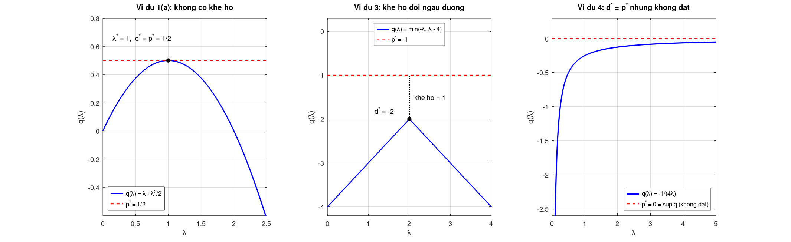

# Câu 5. Hàm đối ngẫu Lagrange, bài toán đối ngẫu Lagrange và các định lý đối ngẫu

## 1. Bài toán gốc

Xét bài toán (gọi là **bài toán gốc**)

```math
(P)\qquad \min\; f(x) \quad \text{với}\quad g_i(x) \le 0\ (i = 1,\dots,m),\qquad h_j(x) = 0\ (j = 1,\dots,p),\qquad x \in X,
```

trong đó $`X \subseteq \mathbb{R}^n`$ là một tập cho trước (thường $`X = \mathbb{R}^n`$, hoặc một tập "đơn giản" như hình hộp). Giá trị tối ưu của $`(P)`$ ký hiệu là $`p^*`$ (quy ước $`p^* = +\infty`$ nếu $`(P)`$ vô nghiệm, $`p^* = -\infty`$ nếu không bị chặn dưới). Ở câu này **không** cần giả thiết lồi hay khả vi.

## 2. Hàm Lagrange và hàm đối ngẫu

**Hàm Lagrange**:

```math
\mathcal{L}(x, \lambda, \mu) = f(x) + \sum_{i=1}^m \lambda_i g_i(x) + \sum_{j=1}^p \mu_j h_j(x), \qquad x \in X,\ \lambda \in \mathbb{R}^m,\ \mu \in \mathbb{R}^p .
```

**Hàm đối ngẫu Lagrange** là cận dưới đúng của $`\mathcal{L}`$ theo $`x`$:

```math
q(\lambda, \mu) = \inf_{x \in X} \mathcal{L}(x, \lambda, \mu) .
```

Hàm $`q`$ có thể nhận giá trị $`-\infty`$. Tập $`\mathrm{dom}\, q = \{(\lambda, \mu) : q(\lambda, \mu) \gt -\infty\}`$.

**Tính chất 1. $`q`$ là hàm lõm** (với mọi $`f, g_i, h_j`$, kể cả không lồi). Với mỗi $`x`$ cố định, $`(\lambda, \mu) \mapsto \mathcal{L}(x, \lambda, \mu)`$ là hàm affine; $`q`$ là cận dưới đúng của một họ hàm affine nên lõm.

**Tính chất 2. $`q`$ cho cận dưới của $`p^*`$.** Với mọi $`\lambda \ge 0`$, $`\mu`$ tùy ý và mọi phương án $`\bar x`$ của $`(P)`$:

```math
q(\lambda, \mu) \le \mathcal{L}(\bar x, \lambda, \mu) = f(\bar x) + \underbrace{\sum_i \lambda_i g_i(\bar x)}_{\le 0} + \underbrace{\sum_j \mu_j h_j(\bar x)}_{= 0} \le f(\bar x) .
```

Lấy cận dưới theo $`\bar x`$ được $`q(\lambda, \mu) \le p^*`$.

## 3. Bài toán đối ngẫu Lagrange

Để có cận dưới tốt nhất, ta giải **bài toán đối ngẫu**

```math
(D)\qquad \max\; q(\lambda, \mu) \quad \text{với}\quad \lambda \ge 0,\ (\lambda, \mu) \in \mathrm{dom}\, q .
```

Giá trị tối ưu ký hiệu là $`d^*`$. Biến $`(\lambda, \mu)`$ gọi là **biến đối ngẫu** (nhân tử Lagrange). Vì $`q`$ lõm và miền $`\lambda \ge 0`$ lồi, $`(D)`$ **luôn là bài toán lồi**, kể cả khi $`(P)`$ không lồi.

**Hai trường hợp có công thức quan trọng.**

*Quy hoạch tuyến tính dạng chính tắc* $`\min c^Tx`$ với $`Ax = b`$, $`x \ge 0`$. Đặt $`X = \mathbb{R}^n`$, nhân tử $`y`$ cho $`b - Ax = 0`$ và $`s \ge 0`$ cho $`-x \le 0`$:

```math
\mathcal{L} = c^Tx + y^T(b - Ax) - s^Tx = b^Ty + (c - A^Ty - s)^T x,\qquad
q(y, s) = \begin{cases} b^Ty & \text{nếu } c - A^Ty - s = 0, \\ -\infty & \text{ngược lại.} \end{cases}
```

Khử $`s = c - A^Ty \ge 0`$, ta được bài toán đối ngẫu quen thuộc của quy hoạch tuyến tính:

```math
(D_{LP})\qquad \max\; b^Ty \quad \text{với}\quad A^Ty \le c \quad (y \text{ tự do}).
```

*Quy hoạch toàn phương* $`\min \tfrac12 x^TQx + c^Tx`$ với $`Ax \le b`$, $`Q`$ xác định dương. Cực tiểu $`\mathcal{L}`$ theo $`x`$: $`\nabla_x \mathcal{L} = Qx + c + A^T\lambda = 0`$, nên $`x(\lambda) = -Q^{-1}(c + A^T\lambda)`$ và

```math
q(\lambda) = -\tfrac12 (c + A^T\lambda)^T Q^{-1} (c + A^T\lambda) - b^T\lambda .
```

Bài toán đối ngẫu là một quy hoạch toàn phương lõm với ràng buộc đơn giản $`\lambda \ge 0`$. Có ràng buộc đẳng thức $`A_{eq}x = b_{eq}`$ thì làm tương tự với nhân tử $`\mu`$ tự do.

## 4. Các định lý đối ngẫu

**Định lý 1 (đối ngẫu yếu).** $`d^* \le p^*`$.

*Chứng minh.* Theo tính chất 2, $`q(\lambda, \mu) \le p^*`$ với mọi $`\lambda \ge 0`$; lấy cận trên đúng theo $`(\lambda, \mu)`$. $`\blacksquare`$

**Hệ quả.**
- Nếu $`p^* = -\infty`$ ($`(P)`$ không bị chặn) thì $`(D)`$ không có phương án. Nếu $`d^* = +\infty`$ thì $`(P)`$ vô nghiệm.
- Nếu có phương án $`\bar x`$ của $`(P)`$ và $`(\bar\lambda, \bar\mu)`$, $`\bar\lambda \ge 0`$, với $`f(\bar x) = q(\bar\lambda, \bar\mu)`$ thì cả hai đều tối ưu và $`p^* = d^*`$.

Hiệu $`p^* - d^* \ge 0`$ gọi là **khe hở đối ngẫu**. Nếu $`p^* = d^*`$ ta nói có **đối ngẫu mạnh**. Với bài toán không lồi, khe hở có thể dương (ví dụ 3).

**Định lý 2 (đối ngẫu mạnh, điều kiện Slater).** Giả sử $`(P)`$ lồi: $`X`$ lồi, $`f`$ và $`g_i`$ lồi, $`h_j`$ affine. Nếu tồn tại $`\hat x \in \mathrm{ri}\, X`$ với $`g_i(\hat x) \lt 0`$ mọi $`i`$ và $`h_j(\hat x) = 0`$ mọi $`j`$ (**điều kiện Slater**), và $`p^*`$ hữu hạn, thì $`d^* = p^*`$ và bài toán đối ngẫu **đạt** giá trị tối ưu (có $`(\lambda^*, \mu^*)`$ với $`q(\lambda^*, \mu^*) = p^*`$).

*Ý chứng minh.* Xét tập lồi

```math
\mathcal{A} = \{ (u, v, t) : \exists x \in X,\ g(x) \le u,\ h(x) = v,\ f(x) \le t \} \subseteq \mathbb{R}^m \times \mathbb{R}^p \times \mathbb{R}.
```

Điểm $`(0, 0, p^*)`$ nằm trên biên của $`\mathcal{A}`$ (không có điểm nào của $`\mathcal{A}`$ với $`u = 0`$, $`v = 0`$, $`t \lt p^*`$). Theo định lý tách, có siêu phẳng $`(\lambda, \mu, \lambda_0) \ne 0`$ tựa $`\mathcal{A}`$ tại điểm này, với $`\lambda \ge 0`$, $`\lambda_0 \ge 0`$, sao cho $`\lambda^Tu + \mu^Tv + \lambda_0 t \ge \lambda_0 p^*`$ trên $`\mathcal{A}`$. Điều kiện Slater loại trừ trường hợp $`\lambda_0 = 0`$ (siêu phẳng "thẳng đứng"). Chia cho $`\lambda_0`$ được $`\mathcal{L}(x, \lambda/\lambda_0, \mu/\lambda_0) \ge p^*`$ với mọi $`x \in X`$, tức là $`q(\lambda/\lambda_0, \mu/\lambda_0) \ge p^*`$. Kết hợp đối ngẫu yếu suy ra đẳng thức. $`\blacksquare`$

**Định lý 3 (điểm yên ngựa).** Điểm $`(x^*, \lambda^*, \mu^*)`$ với $`x^* \in X`$, $`\lambda^* \ge 0`$ gọi là **điểm yên ngựa** của $`\mathcal{L}`$ nếu

```math
\mathcal{L}(x^*, \lambda, \mu) \le \mathcal{L}(x^*, \lambda^*, \mu^*) \le \mathcal{L}(x, \lambda^*, \mu^*) \qquad \forall x \in X,\ \lambda \ge 0,\ \mu .
```

$`(x^*, \lambda^*, \mu^*)`$ là điểm yên ngựa **khi và chỉ khi** $`x^*`$ là nghiệm của $`(P)`$, $`(\lambda^*, \mu^*)`$ là nghiệm của $`(D)`$ và $`p^* = d^*`$.

*Chứng minh.* (⇒) Vế trái với mọi $`\lambda \ge 0`$, $`\mu`$ buộc $`g(x^*) \le 0`$, $`h(x^*) = 0`$ (nếu không, cho $`\lambda_i`$ hoặc $`\mu_j`$ ra vô cùng) và $`\lambda^{*T} g(x^*) = 0`$ (lấy $`\lambda = 0`$). Do đó $`\mathcal{L}(x^*, \lambda^*, \mu^*) = f(x^*)`$. Vế phải cho $`q(\lambda^*, \mu^*) = \mathcal{L}(x^*, \lambda^*, \mu^*) = f(x^*)`$. Theo hệ quả của định lý 1, cả hai tối ưu và $`p^* = d^*`$. (⇐) Nếu $`f(x^*) = q(\lambda^*, \mu^*)`$ thì $`f(x^*) = q(\lambda^*, \mu^*) \le \mathcal{L}(x^*, \lambda^*, \mu^*) \le f(x^*)`$, nên mọi dấu bằng xảy ra, từ đó có hai bất đẳng thức yên ngựa. $`\blacksquare`$

**Định lý 4 (liên hệ với điều kiện KKT).** Giả sử đối ngẫu mạnh xảy ra, $`x^*`$ là nghiệm của $`(P)`$, $`(\lambda^*, \mu^*)`$ là nghiệm của $`(D)`$. Khi đó

```math
f(x^*) = q(\lambda^*, \mu^*) \le f(x^*) + \sum_i \lambda_i^* g_i(x^*) + \sum_j \mu_j^* h_j(x^*) \le f(x^*),
```

nên (i) $`\lambda_i^* g_i(x^*) = 0`$ với mọi $`i`$ (**điều kiện bù**), và (ii) $`x^*`$ cực tiểu hóa $`\mathcal{L}(\cdot, \lambda^*, \mu^*)`$ trên $`X`$. Nếu các hàm khả vi và $`X = \mathbb{R}^n`$ thì (ii) cho $`\nabla_x \mathcal{L}(x^*, \lambda^*, \mu^*) = 0`$: đây chính là **điều kiện KKT** ([câu 4](../q04-kkt-conditions/)), và nhân tử KKT chính là nghiệm đối ngẫu. Ngược lại, với bài toán lồi, mọi điểm KKT $`(x^*, \lambda^*, \mu^*)`$ cho $`x^*`$ tối ưu, $`(\lambda^*, \mu^*)`$ tối ưu đối ngẫu và $`p^* = d^*`$.

**Định lý 5 (đối ngẫu trong quy hoạch tuyến tính).** Với cặp $`(P_{LP})`$: $`\min c^Tx`$, $`Ax = b`$, $`x \ge 0`$ và $`(D_{LP})`$: $`\max b^Ty`$, $`A^Ty \le c`$:
- Nếu một trong hai bài toán có nghiệm tối ưu thì bài toán kia cũng có, và $`c^Tx^* = b^Ty^*`$ (không cần điều kiện Slater).
- Nếu một bài toán không bị chặn thì bài toán kia vô nghiệm.
- $`x`$, $`y`$ chấp nhận được là tối ưu khi và chỉ khi $`x_j (c - A^Ty)_j = 0`$ với mọi $`j`$ (**điều kiện bù**).

Liên hệ với thuật toán đơn hình ([câu 1](../q01-simplex/)): tại cơ sở $`B`$, đặt $`y = (B^{-1})^T c_B`$; khi đó ước lượng $`\Delta_j = c_B^T B^{-1} A_j - c_j = (A^Ty - c)_j`$. **Dấu hiệu tối ưu $`\Delta_j \le 0`$ chính là điều kiện $`y`$ chấp nhận được của bài toán đối ngẫu**, và tại cơ sở tối ưu $`y`$ là nghiệm đối ngẫu.

## 5. Chương trình Matlab

| File | Nội dung |
|---|---|
| `dual_qp.m` | `res = dual_qp(Q, c, A, b, Aeq, beq)`: lập hàm đối ngẫu $`q(\lambda, \mu)`$ của quy hoạch toàn phương, giải cả $`(P)`$ và $`(D)`$, khôi phục $`x`$ từ nghiệm đối ngẫu, tính khe hở |
| `lp_dual.m` | `res = lp_dual(c, A, b)`: giải cặp quy hoạch tuyến tính gốc/đối ngẫu, kiểm tra đối ngẫu mạnh và điều kiện bù |
| `solve_qp.m`, `solve_lp.m` | Gọi `qp`/`glpk` (Octave) hoặc `quadprog`/`linprog` (MATLAB) |
| `run_examples.m` | Bốn ví dụ minh họa và hình vẽ |

Trong `dual_qp.m`, bài toán đối ngẫu $`\max q`$ được đưa về quy hoạch toàn phương $`\min \tfrac12 y^TGy + h^Ty`$ theo $`y = (\lambda, \mu)`$, với $`G = MQ^{-1}M^T`$, $`h = MQ^{-1}c + (b, b_{eq})`$, $`M = \begin{pmatrix} A \\ A_{eq} \end{pmatrix}`$, ràng buộc $`\lambda \ge 0`$.

Cách chạy (trong thư mục `solutions/q05-lagrange-duality`):

```matlab
>> run_examples
```

## 6. Ví dụ minh họa

### Ví dụ 1: quy hoạch toàn phương: đối ngẫu mạnh

**(a)** $`\min x_1^2 + x_2^2`$ với $`x_1 + x_2 \ge 1`$, viết lại $`g = 1 - x_1 - x_2 \le 0`$.

```math
\mathcal{L} = x_1^2 + x_2^2 + \lambda(1 - x_1 - x_2),\qquad \nabla_x \mathcal{L} = 0 \Rightarrow x_1 = x_2 = \tfrac{\lambda}{2},\qquad q(\lambda) = \lambda - \tfrac{\lambda^2}{2} .
```

$`q`$ là parabol lõm, đạt cực đại tại $`\lambda^* = 1`$ với $`d^* = \tfrac12`$. Bài toán gốc có $`x^* = (\tfrac12, \tfrac12)`$, $`p^* = \tfrac12`$. Bài toán lồi và thỏa Slater (ví dụ $`\hat x = (1, 1)`$) nên không có khe hở, đúng như định lý 2. Từ nghiệm đối ngẫu khôi phục được nghiệm gốc: $`x(\lambda^*) = (\tfrac12, \tfrac12)`$.

**(b)** $`\min x_1^2 + x_2^2`$ với $`x_1 + 2x_2 = 5`$ (ràng buộc đẳng thức, $`\mu`$ tự do).

```math
x(\mu) = \left(-\tfrac{\mu}{2},\ -\mu\right),\qquad q(\mu) = -\tfrac54 \mu^2 - 5\mu,\qquad \mu^* = -2,\quad d^* = 5 .
```

Nghiệm gốc $`x^* = x(\mu^*) = (1, 2)`$, $`p^* = 5 = d^*`$. Nhân tử $`\mu^* = -2 \lt 0`$: với ràng buộc đẳng thức, dấu của nhân tử không bị ràng buộc.

Chương trình cho $`\lambda^* = 1`$, $`d^* = p^* = 0.5`$ ở (a) và $`\mu^* = -2`$, $`d^* = p^* = 5`$ ở (b), khe hở cỡ $`10^{-16}`$ (sai số làm tròn); giá trị $`q`$ tính bằng chương trình trùng với công thức ($`q(0.5) = 0.375`$, $`q(1) = 0.5`$, $`q(2) = 0`$).

### Ví dụ 2: quy hoạch tuyến tính (ví dụ 1 của câu 2 và câu 3)

```math
\begin{aligned}
(P)\quad \min\; & 4x_1 + x_2 & \qquad (D)\quad \max\; & 3y_1 + 6y_2 + 4y_3 \\
& 3x_1 + x_2 - x_3 = 3 & & 3y_1 + 4y_2 + y_3 \le 4 \\
& 4x_1 + 3x_2 - x_4 = 6 & & y_1 + 3y_2 + 2y_3 \le 1 \\
& x_1 + 2x_2 + x_5 = 4 & & -y_1 \le 0,\quad -y_2 \le 0,\quad y_3 \le 0 \\
& x \ge 0 & & y \text{ tự do}
\end{aligned}
```

| | Nghiệm | Giá trị |
|---|---|---|
| $`(P)`$ | $`x^* = (0.4,\ 1.8,\ 0,\ 1,\ 0)`$ | $`p^* = 3.4`$ |
| $`(D)`$ | $`y^* = (1.4,\ 0,\ -0.2)`$ | $`d^* = 3 \cdot 1.4 + 4 \cdot (-0.2) = 3.4`$ |

- **Đối ngẫu mạnh**: $`p^* = d^* = 3.4`$.
- **Điều kiện bù**: biến bù đối ngẫu $`c - A^Ty^* = (0, 0, 1.4, 0, 0.2)`$. Các $`x_j \gt 0`$ là $`x_1, x_2, x_4`$, và tương ứng $`(c - A^Ty^*)_j = 0`$; các ràng buộc đối ngẫu còn lỏng ($`j = 3, 5`$) có $`x_j = 0`$. Vậy $`x_j (c - A^Ty^*)_j = 0`$ với mọi $`j`$.
- **Liên hệ câu 1**: với cơ sở tối ưu $`\{x_1, x_2, x_4\}`$, $`y^* = (B^{-1})^T c_B`$ và $`\Delta = A^Ty^* - c \le 0`$, chính là dấu hiệu tối ưu của thuật toán đơn hình.
- **Liên hệ câu 3**: dòng 1 và dòng 2 là các dòng có biến giả trong phương pháp hàm phạt; $`\max\{y_1^*, y_2^*\} = 1.4`$ đúng bằng ngưỡng nhỏ nhất của $`M`$ tìm được ở [câu 3, ví dụ 4](../q03-big-m-method/).

### Ví dụ 3: bài toán không lồi: khe hở đối ngẫu dương

```math
\min\; f(x) = -x^2 \quad \text{với}\quad g(x) = x - 1 \le 0,\quad x \in X = [0, 2] .
```

Miền chấp nhận được là $`[0, 1]`$, nên $`x^* = 1`$, $`p^* = -1`$. Hàm đối ngẫu:

```math
q(\lambda) = \min_{x \in [0, 2]} \left(-x^2 + \lambda(x - 1)\right) .
```

Hàm cần cực tiểu lõm theo $`x`$, nên cực tiểu đạt tại đầu mút: $`x = 0`$ cho $`-\lambda`$, $`x = 2`$ cho $`\lambda - 4`$. Do đó $`q(\lambda) = \min(-\lambda,\ \lambda - 4)`$, đạt cực đại tại $`\lambda^* = 2`$ với $`d^* = -2`$.

**Khe hở đối ngẫu** $`p^* - d^* = -1 - (-2) = 1 \gt 0`$. Nguyên nhân: $`f = -x^2`$ không lồi, nên định lý 2 không áp dụng. Chương trình tính $`q`$ bằng cách cực tiểu trên lưới 2001 điểm của $`[0, 2]`$, được đúng $`d^* = -2`$ tại $`\lambda^* = 2`$, trùng công thức với sai lệch $`0`$.

### Ví dụ 4: bài toán lồi không thỏa Slater (ví dụ 6 của câu 4)

```math
\min\; f(x) = x \quad \text{với}\quad g(x) = x^2 \le 0 .
```

$`p^* = 0`$ ($`x^* = 0`$). Hàm đối ngẫu: với $`\lambda \gt 0`$, $`x + \lambda x^2`$ đạt cực tiểu tại $`x = -\tfrac{1}{2\lambda}`$, nên $`q(\lambda) = -\tfrac{1}{4\lambda}`$; với $`\lambda = 0`$, $`q(0) = \inf_x x = -\infty`$.

$`d^* = \sup_{\lambda \gt 0} \left(-\tfrac{1}{4\lambda}\right) = 0 = p^*`$: **không có khe hở**, nhưng giá trị này **không đạt được** tại $`\lambda`$ hữu hạn nào, tức là bài toán đối ngẫu không có nghiệm. Điều này khớp với câu 4: tại $`x^* = 0`$ không tồn tại nhân tử KKT, vì theo định lý 4, nếu có nghiệm đối ngẫu thì nó sẽ là nhân tử KKT. Điều kiện Slater trong định lý 2 bảo đảm cả "không có khe hở" lẫn "đạt được"; khi Slater không thỏa, có thể mất ý thứ hai (như ở đây) hoặc cả hai.



Hình trên: ví dụ 1(a), $`\max q = p^*`$; ví dụ 3, $`\max q`$ thấp hơn $`p^*`$ đúng bằng khe hở 1; ví dụ 4, $`q`$ tiến tới $`p^* = 0`$ khi $`\lambda \to \infty`$ nhưng không đạt.

## 7. Nhận xét

- Bài toán đối ngẫu **luôn lồi** và **luôn cho cận dưới** của $`p^*`$, nên hữu ích cả với bài toán không lồi hoặc bài toán nguyên: đây là cơ sở của phương pháp **nới lỏng Lagrange** (Lagrangian relaxation) và các phương pháp nhánh cận.
- Với bài toán lồi thỏa Slater, giải bài toán đối ngẫu (thường ít biến hơn, hoặc có ràng buộc đơn giản $`\lambda \ge 0`$ như ví dụ 1) rồi khôi phục nghiệm gốc qua $`x(\lambda^*)`$.
- Với quy hoạch tuyến tính, đối ngẫu mạnh luôn đúng khi bài toán có nghiệm. Biến đối ngẫu là **giá bóng** (shadow price) của các ràng buộc: tăng $`b_i`$ một lượng nhỏ $`\varepsilon`$ làm giá trị tối ưu thay đổi khoảng $`y_i^* \varepsilon`$.
- Nghiệm đối ngẫu và nhân tử KKT là một (định lý 4). Ví dụ 4 cho thấy khi điều kiện chính quy không thỏa, có thể không có nghiệm đối ngẫu, đúng như việc không có nhân tử KKT ở câu 4.
