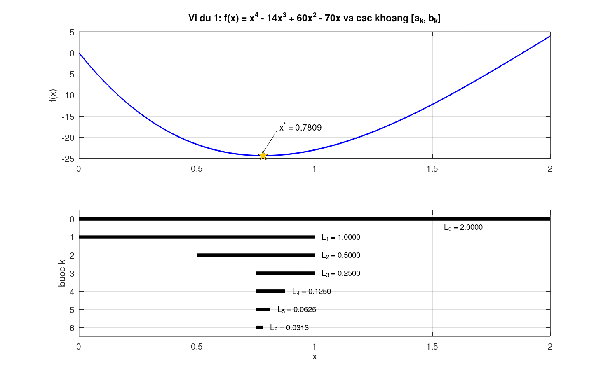
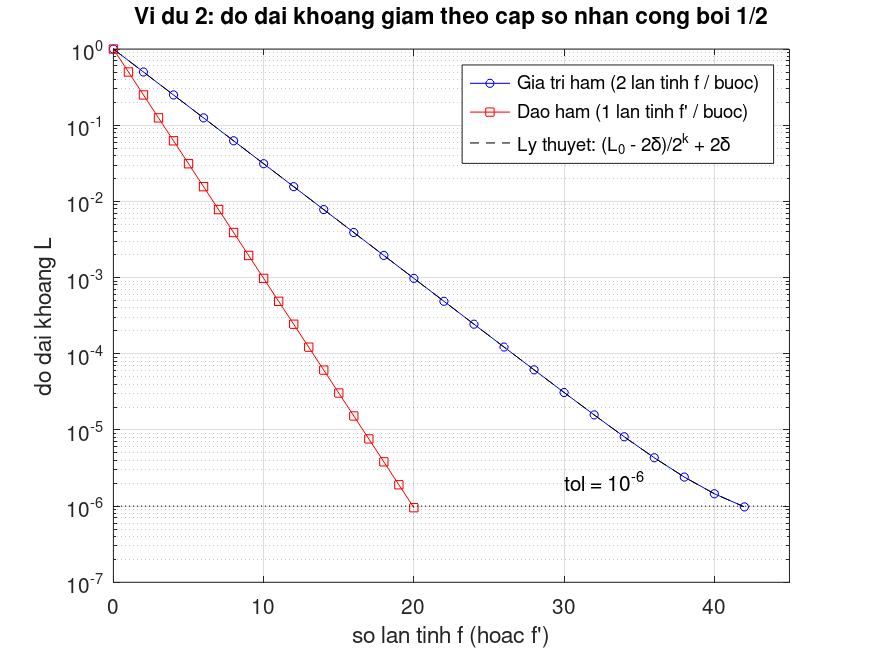
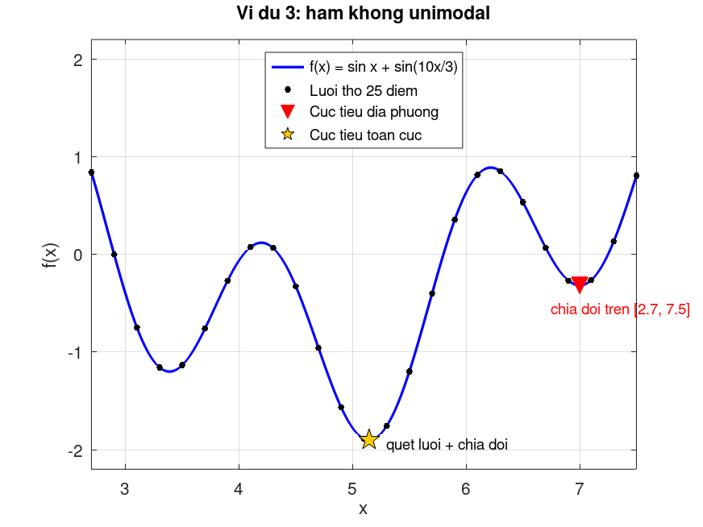

# Câu 6. Giải thuật chia đôi tìm cực tiểu hàm một biến trong một khoảng

## 1. Bài toán

```math
\min\; f(x) \quad \text{với}\quad x \in [a, b],
```

trong đó $`f : [a, b] \to \mathbb{R}`$. Các phương pháp tìm kiếm một chiều như chia đôi (câu này) và lát cắt vàng (câu 7) có vai trò quan trọng vì chúng là bước **tìm kiếm theo tia** (line search) bên trong các thuật toán tối ưu nhiều biến (câu 8–12): ở mỗi bước, chọn độ dài bước $`t`$ bằng cách cực tiểu hóa $`\varphi(t) = f(x_k + t d_k)`$.

## 2. Hàm unimodal và nguyên lý loại bỏ

**Định nghĩa.** Hàm $`f`$ gọi là **unimodal** (đơn cực) trên $`[a, b]`$ nếu tồn tại $`x^* \in [a, b]`$ sao cho $`f`$ giảm thực sự trên $`[a, x^*]`$ và tăng thực sự trên $`[x^*, b]`$. Khi đó $`x^*`$ là điểm cực tiểu duy nhất của $`f`$ trên $`[a, b]`$.

Ví dụ: mọi hàm lồi chặt có cực tiểu trên $`[a, b]`$ đều unimodal. Hàm unimodal không cần liên tục hay khả vi.

**Bổ đề (nguyên lý loại bỏ).** Cho $`f`$ unimodal trên $`[a, b]`$ và $`a \le x_1 \lt x_2 \le b`$.
- Nếu $`f(x_1) \lt f(x_2)`$ thì $`x^* \in [a, x_2]`$.
- Nếu $`f(x_1) \gt f(x_2)`$ thì $`x^* \in [x_1, b]`$.
- Nếu $`f(x_1) = f(x_2)`$ thì $`x^* \in [x_1, x_2]`$.

*Chứng minh.* Giả sử $`f(x_1) \lt f(x_2)`$ mà $`x^* \gt x_2`$. Khi đó $`x_1 \lt x_2 \lt x^*`$ đều nằm trong đoạn $`f`$ giảm thực sự, nên $`f(x_1) \gt f(x_2)`$: mâu thuẫn. Vậy $`x^* \le x_2`$. Hai trường hợp còn lại chứng minh tương tự. $`\blacksquare`$

Như vậy, chỉ cần so sánh giá trị hàm tại **hai điểm**, ta loại bỏ được một phần của khoảng mà chắc chắn không chứa cực tiểu. Các phương pháp tìm kiếm một chiều khác nhau ở cách chọn hai điểm này.

## 3. Giải thuật chia đôi dùng giá trị hàm

**Ý tưởng.** Đặt hai điểm thử **sát hai bên trung điểm** của khoảng, cách nhau $`2\delta`$ ($`\delta \gt 0`$ nhỏ). Theo bổ đề, mỗi bước loại bỏ được gần một nửa khoảng.

**Đầu vào**: $`f`$, $`[a, b]`$, độ chính xác $`\varepsilon \gt 0`$, tham số $`0 \lt \delta \lt \varepsilon/2`$.

**Bước 1.** Nếu $`b - a \le \varepsilon`$: dừng, lấy $`\bar x = (a + b)/2`$.

**Bước 2.** Đặt $`c = (a + b)/2`$, $`x_1 = c - \delta`$, $`x_2 = c + \delta`$. Tính $`f(x_1)`$, $`f(x_2)`$.

**Bước 3.** Nếu $`f(x_1) \lt f(x_2)`$ thì $`b \leftarrow x_2`$; ngược lại $`a \leftarrow x_1`$. Quay lại Bước 1.

**Định lý (tốc độ hội tụ).** Gọi $`L_k = b_k - a_k`$ là độ dài khoảng sau $`k`$ bước, $`L_0 = b - a`$. Khi đó

```math
L_{k+1} = \frac{L_k}{2} + \delta, \qquad L_k = \frac{L_0 - 2\delta}{2^k} + 2\delta .
```

*Chứng minh.* Khoảng mới là $`[a_k, c + \delta]`$ hoặc $`[c - \delta, b_k]`$, đều có độ dài $`L_k/2 + \delta`$. Công thức tường minh chứng minh bằng quy nạp: $`L_{k+1} = \tfrac12\left(\tfrac{L_0 - 2\delta}{2^k} + 2\delta\right) + \delta = \tfrac{L_0 - 2\delta}{2^{k+1}} + 2\delta`$. $`\blacksquare`$

**Hệ quả.**
- $`L_k \to 2\delta`$ (không về 0), nên phải chọn $`\delta \lt \varepsilon/2`$, nếu không thuật toán không bao giờ đạt độ chính xác $`\varepsilon`$.
- Số bước cần để $`L_k \le \varepsilon`$:

```math
k \ge \log_2 \frac{L_0 - 2\delta}{\varepsilon - 2\delta},
```

  mỗi bước tốn **2 lần tính** $`f`$.
- Sai số của nghiệm gần đúng: $`|\bar x - x^*| \le L_k / 2`$.

## 4. Giải thuật chia đôi dùng đạo hàm

Nếu $`f`$ khả vi và $`f'`$ đổi dấu đúng một lần trên $`[a, b]`$ (ví dụ $`f`$ lồi với $`f'(a) \lt 0 \lt f'(b)`$), thì dấu của $`f'`$ tại trung điểm cho biết cực tiểu nằm bên nào:

**Bước 2'.** Đặt $`c = (a + b)/2`$, tính $`f'(c)`$. Nếu $`f'(c) \gt 0`$ thì $`b \leftarrow c`$; nếu $`f'(c) \lt 0`$ thì $`a \leftarrow c`$; nếu $`f'(c) = 0`$ thì dừng, $`x^* = c`$.

Đây chính là phương pháp chia đôi tìm nghiệm của phương trình $`f'(x) = 0`$. Độ dài khoảng giảm **đúng một nửa** mỗi bước: $`L_k = L_0 / 2^k`$, cần $`k \ge \log_2(L_0/\varepsilon)`$ bước, mỗi bước **1 lần tính** $`f'`$.

**So sánh hai biến thể.**

| | Dùng giá trị hàm | Dùng đạo hàm |
|---|---|---|
| Giả thiết | $`f`$ unimodal | $`f`$ khả vi, $`f'`$ đổi dấu một lần |
| Mỗi bước | 2 lần tính $`f`$ | 1 lần tính $`f'`$ |
| Độ dài khoảng | $`(L_0 - 2\delta)/2^k + 2\delta`$ | $`L_0 / 2^k`$ |
| Hệ số giảm mỗi lần tính hàm | $`\approx 1/\sqrt2 \approx 0.707`$ | $`1/2`$ |

Phương pháp lát cắt vàng ([câu 7](../../problems/README.md)) chỉ dùng giá trị hàm nhưng tận dụng lại một điểm thử từ bước trước, nên mỗi lần tính $`f`$ giảm khoảng theo hệ số $`0.618`$, tốt hơn $`0.707`$ của chia đôi.

## 5. Chương trình Matlab

| File | Nội dung |
|---|---|
| `bisection_min.m` | Hàm `[xmin, fmin, out] = bisection_min(f, a, b, opts)` cài đặt cả hai biến thể |
| `run_examples.m` | Ba ví dụ minh họa và ba hình vẽ |

Đặc điểm của `bisection_min.m`:

- `opts.method = 'dichotomous'` (mặc định, chỉ dùng giá trị hàm) hoặc `'derivative'` (cần `opts.df` là đạo hàm $`f'`$).
- `opts.tol` là độ dài khoảng cuối cùng $`\varepsilon`$ (mặc định $`10^{-6}`$); `opts.delta` mặc định $`\varepsilon/4`$, và chương trình báo lỗi nếu $`\delta \ge \varepsilon/2`$.
- `opts.display = true` in bảng $`a_k, b_k, L_k`$ và quyết định ở từng bước.
- Trả về số bước, số lần tính $`f`$ và $`f'`$, và dãy các khoảng (`out.a`, `out.b`) để vẽ hình.

Cách chạy (trong thư mục `solutions/q06-bisection-search`):

```matlab
>> run_examples
```

## 6. Ví dụ minh họa

### Ví dụ 1: hàm bậc 4 trên $`[0, 2]`$

```math
f(x) = x^4 - 14x^3 + 60x^2 - 70x, \qquad x \in [0, 2],\quad \varepsilon = 10^{-5},\quad \delta = 2.5\cdot 10^{-6}.
```

$`f''(x) = 12x^2 - 84x + 120 \gt 0`$ trên $`[0, 2]`$ (hai nghiệm của $`f''`$ là $`2`$ và $`5`$), nên $`f`$ lồi chặt trên $`[0, 2)`$ và unimodal. Các bước đầu:

| $`k`$ | $`a_k`$ | $`b_k`$ | $`L_k`$ | So sánh |
|---|---|---|---|---|
| 0 | 0 | 2 | 2 | |
| 1 | 0 | 1.0000025 | 1.0000 | $`f(x_1) \lt f(x_2)`$ |
| 2 | 0.4999988 | 1.0000025 | 0.5000 | $`f(x_1) \ge f(x_2)`$ |
| 3 | 0.7499981 | 1.0000025 | 0.2500 | $`f(x_1) \ge f(x_2)`$ |
| 4 | 0.7499981 | 0.8750028 | 0.1250 | $`f(x_1) \lt f(x_2)`$ |
| $`\vdots`$ | | | | |
| 19 | 0.7808780 | 0.7808868 | $`8.8\cdot 10^{-6}`$ | |

Ở bước 1, $`c = 1`$ và $`f'(1) = 12 \gt 0`$, nên $`f`$ đang tăng tại $`c`$: $`f(x_1) \lt f(x_2)`$ và nửa phải bị loại. Sau 19 bước (39 lần tính $`f`$), $`x^* \approx 0.780882`$, $`f^* \approx -24.369602`$. Số bước khớp công thức: $`\log_2 \frac{2 - 5\cdot10^{-6}}{10^{-5} - 5\cdot10^{-6}} \approx 18.6`$, làm tròn lên 19. Sai lệch so với `fminbnd` là $`1.6\cdot 10^{-6} \lt \varepsilon/2`$.



### Ví dụ 2: so sánh hai biến thể

```math
f(x) = e^{-x} + x^2, \qquad x \in [0, 1], \qquad \varepsilon = 10^{-6} .
```

$`f''(x) = e^{-x} + 2 \gt 0`$ nên $`f`$ lồi chặt; $`f'(0) = -1 \lt 0`$, $`f'(1) = 2 - e^{-1} \gt 0`$, nên cả hai biến thể đều áp dụng được. Nghiệm tham chiếu là nghiệm của $`f'(x) = 2x - e^{-x} = 0`$: $`x^* \approx 0.35173371`$.

| Biến thể | $`x^*`$ | Số bước | Lý thuyết | Số lần tính | Sai số |
|---|---|---|---|---|---|
| Giá trị hàm ($`\delta = \varepsilon/4`$) | 0.35173352 | 21 | $`\lceil \log_2 \frac{1 - 5\cdot10^{-7}}{5\cdot10^{-7}} \rceil = 21`$ | 43 lần $`f`$ | $`1.9\cdot 10^{-7}`$ |
| Đạo hàm | 0.35173368 | 20 | $`\lceil \log_2 10^6 \rceil = 20`$ | 20 lần $`f'`$ | $`2.7\cdot 10^{-8}`$ |

Số bước thực tế trùng **chính xác** với lý thuyết. Hình dưới vẽ độ dài khoảng theo số lần tính hàm trên thang log: cả hai đều là đường thẳng (hội tụ tuyến tính), biến thể dùng đạo hàm dốc gấp đôi. Đường lý thuyết $`(L_0 - 2\delta)/2^k + 2\delta`$ (nét đứt) trùng với đường thực tế của biến thể dùng giá trị hàm.



### Ví dụ 3: hàm không unimodal

```math
f(x) = \sin x + \sin\frac{10x}{3}, \qquad x \in [2.7, 7.5] .
```

Hàm có ba cực tiểu địa phương trên đoạn này. Áp dụng chia đôi trên cả đoạn:

| $`k`$ | $`a_k`$ | $`b_k`$ | So sánh tại $`c`$ |
|---|---|---|---|
| 1 | 5.1 | 7.5 | $`c = 5.1`$: $`f`$ đang giảm, loại $`[2.7, 5.1]`$ |
| 2 | 6.3 | 7.5 | $`c = 6.3`$: $`f`$ đang giảm (đã qua cực đại địa phương $`\approx 6.2`$), loại $`[5.1, 6.3]`$ |
| 3 | 6.9 | 7.5 | |
| 4 | 6.9 | 7.2 | |

Sau bước 1, khoảng vẫn chứa cực tiểu toàn cục $`x^* \approx 5.1457`$ ($`f^* \approx -1.8996`$). Nhưng ở bước 2 khoảng $`[5.1, 6.3]`$ chứa $`x^*`$ bị loại, vì nguyên lý loại bỏ chỉ đúng với hàm unimodal. Thuật toán hội tụ tới cực tiểu **địa phương** $`x \approx 7.0001`$, $`f \approx -0.3170`$.

**Cách khắc phục**: tính $`f`$ trên một lưới thô (25 điểm), lấy khoảng giữa hai điểm lưới kề với điểm lưới tốt nhất ($`[4.9, 5.3]`$), rồi chia đôi trong khoảng đó. Kết quả $`x \approx 5.145735`$, $`f \approx -1.899599`$, khớp với tham chiếu trên lưới 200001 điểm. Cách này chỉ đúng khi lưới đủ mịn để mỗi khoảng con chứa nhiều nhất một cực tiểu.



## 7. Nhận xét

- Giải thuật chia đôi đơn giản, chắc chắn hội tụ với hàm unimodal, và biết trước số bước cần thiết. Tốc độ là **tuyến tính**: độ dài khoảng giảm theo cấp số nhân.
- Biến thể dùng giá trị hàm không cần đạo hàm, nhưng mỗi bước tốn 2 lần tính $`f`$ và không tái sử dụng điểm thử cũ. Lát cắt vàng (câu 7) khắc phục điều này.
- Tham số $`\delta`$ phải nhỏ hơn $`\varepsilon/2`$, nhưng cũng không được quá nhỏ: gần cực tiểu hàm rất phẳng, $`f(x_1) - f(x_2)`$ có thể nhỏ hơn sai số làm tròn, khi đó phép so sánh không còn đáng tin. Vì vậy các phương pháp chỉ dùng giá trị hàm thường chỉ đạt độ chính xác cỡ $`\sqrt{\epsilon_{\text{máy}}} \approx 10^{-8}`$ (tương đối), trong khi biến thể dùng đạo hàm có thể chính xác hơn.
- Giả thiết unimodal là then chốt. Với hàm nhiều cực tiểu, cần khoanh vùng trước (quét lưới, hoặc biết trước tính chất của hàm).
