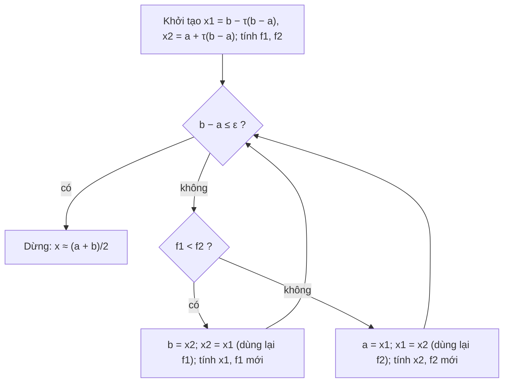
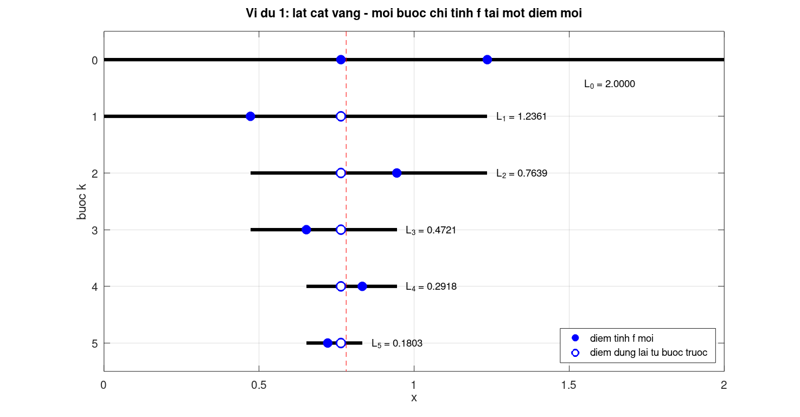
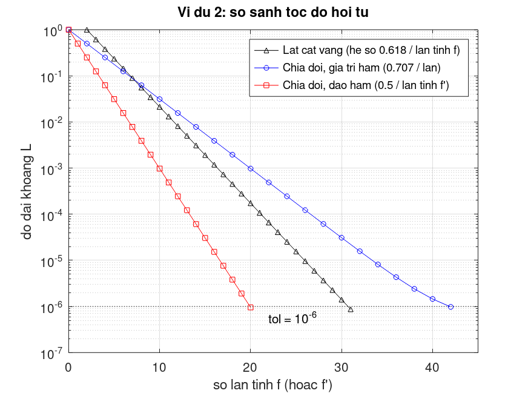
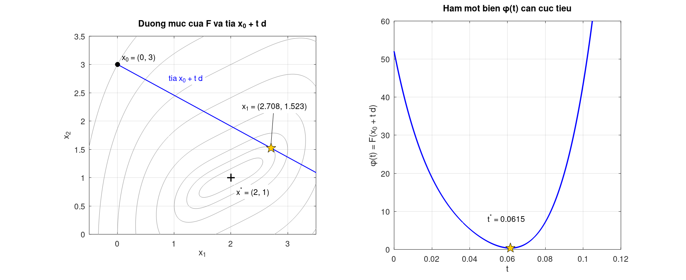

# Câu 7. Giải thuật lát cắt vàng tìm cực tiểu hàm một biến trong một khoảng

## 1. Bài toán và ý tưởng

Tìm cực tiểu của hàm **unimodal** $`f`$ trên đoạn $`[a, b]`$:

```math
\min\; f(x) \quad \text{với}\quad x \in [a, b].
```

Như ở [câu 6](../q06-bisection-search/), mỗi bước so sánh $`f`$ tại hai điểm thử $`x_1 \lt x_2`$ và dùng **nguyên lý loại bỏ**: nếu $`f(x_1) \lt f(x_2)`$ thì cực tiểu thuộc $`[a, x_2]`$, ngược lại thuộc $`[x_1, b]`$.

Phương pháp chia đôi đặt hai điểm thử sát trung điểm, nên sau mỗi bước cả hai điểm đều bị bỏ, phải tính $`f`$ tại **hai** điểm mới. **Lát cắt vàng** chọn vị trí hai điểm thử sao cho điểm thử còn lại trong khoảng mới **đúng là một trong hai điểm thử của bước sau**. Khi đó mỗi bước chỉ cần tính $`f`$ tại **một** điểm mới.

## 2. Suy ra tỉ lệ vàng

Gọi $`L = b - a`$. Đặt hai điểm thử đối xứng trong khoảng:

```math
x_1 = a + (1 - \tau) L, \qquad x_2 = a + \tau L, \qquad \tfrac12 \lt \tau \lt 1 .
```

Giả sử $`f(x_1) \lt f(x_2)`$, khoảng mới là $`[a, x_2]`$ với độ dài $`\tau L`$. Ở bước sau, hai điểm thử của khoảng mới là $`a + (1 - \tau)\tau L`$ và $`a + \tau \cdot \tau L`$. Muốn **dùng lại** $`x_1`$ làm điểm thử bên phải mới, cần

```math
a + \tau^2 L = a + (1 - \tau) L \quad\Longleftrightarrow\quad \tau^2 + \tau - 1 = 0 \quad\Longleftrightarrow\quad \tau = \frac{\sqrt5 - 1}{2} \approx 0.618 .
```

Trường hợp $`f(x_1) \ge f(x_2)`$ đối xứng: khoảng mới $`[x_1, b]`$, và $`x_2`$ trở thành điểm thử bên trái mới.

Số $`1/\tau = \frac{1 + \sqrt5}{2} \approx 1.618`$ là **tỉ lệ vàng**: điểm $`x_2`$ chia đoạn $`[a, b]`$ sao cho tỉ số "cả đoạn / đoạn lớn" bằng tỉ số "đoạn lớn / đoạn nhỏ", vì $`\frac{L}{\tau L} = \frac{\tau L}{(1 - \tau)L} = \frac{1}{\tau}`$ (do $`1 - \tau = \tau^2`$).

## 3. Giải thuật

**Đầu vào**: $`f`$ unimodal trên $`[a, b]`$, độ chính xác $`\varepsilon \gt 0`$. Đặt $`\tau = (\sqrt5 - 1)/2`$.

**Bước 0.** $`x_1 = b - \tau(b - a)`$, $`x_2 = a + \tau(b - a)`$; tính $`f_1 = f(x_1)`$, $`f_2 = f(x_2)`$.

**Bước 1.** Nếu $`b - a \le \varepsilon`$: dừng, lấy $`\bar x = (a + b)/2`$.

**Bước 2.**
- Nếu $`f_1 \lt f_2`$: $`b \leftarrow x_2`$; $`x_2 \leftarrow x_1`$, $`f_2 \leftarrow f_1`$; $`x_1 \leftarrow b - \tau(b - a)`$, tính $`f_1 = f(x_1)`$.
- Ngược lại: $`a \leftarrow x_1`$; $`x_1 \leftarrow x_2`$, $`f_1 \leftarrow f_2`$; $`x_2 \leftarrow a + \tau(b - a)`$, tính $`f_2 = f(x_2)`$.

Quay lại Bước 1.



**Định lý (tốc độ hội tụ).** Sau $`k`$ bước, $`L_k = \tau^k L_0`$. Để $`L_k \le \varepsilon`$ cần

```math
k \ge \frac{\ln(\varepsilon / L_0)}{\ln \tau},
```

với tổng cộng $`k + 2`$ lần tính $`f`$ (2 lần ở Bước 0, mỗi bước 1 lần). Sai số của nghiệm gần đúng: $`|\bar x - x^*| \le L_k / 2`$.

*Chứng minh.* Mỗi bước, khoảng mới là $`[a, x_2]`$ hoặc $`[x_1, b]`$, đều có độ dài $`\tau L`$. $`\blacksquare`$

## 4. So sánh với các phương pháp khác

Tính theo **số lần tính hàm** (thước đo chi phí thực tế), độ dài khoảng giảm sau mỗi lần tính:

| Phương pháp | Giảm mỗi lần tính hàm | Ghi chú |
|---|---|---|
| Chia đôi dùng giá trị hàm (câu 6) | $`1/\sqrt2 \approx 0.707`$ | 2 lần tính $`f`$ mỗi bước, không dùng lại điểm |
| **Lát cắt vàng** | $`\tau \approx 0.618`$ | 1 lần tính $`f`$ mỗi bước |
| Fibonacci | tối ưu với số lần tính cho trước | tỉ lệ thay đổi theo bước, cần biết trước số lần tính |
| Chia đôi dùng đạo hàm (câu 6) | $`0.5`$ | cần $`f'`$ |

**Phương pháp Fibonacci** chọn tỉ lệ ở bước $`k`$ là $`F_{N-k}/F_{N-k+1}`$ (dãy Fibonacci), và là phương pháp **tối ưu** trong các phương pháp chỉ so sánh giá trị hàm khi số lần tính $`N`$ cố định: sau $`N`$ lần tính, khoảng còn khoảng $`L_0 / F_N`$. Khi $`N \to \infty`$, $`F_{N-1}/F_N \to \tau`$, nên lát cắt vàng là dạng giới hạn của Fibonacci; khoảng cuối của lát cắt vàng chỉ dài hơn khoảng 17%, nhưng không cần biết trước $`N`$.

## 5. Chương trình Matlab

| File | Nội dung |
|---|---|
| `golden_section.m` | Hàm `[xmin, fmin, out] = golden_section(f, a, b, opts)` cài đặt giải thuật trên |
| `run_examples.m` | Bốn ví dụ minh họa và ba hình vẽ; so sánh với `bisection_min.m` của [câu 6](../q06-bisection-search/) |

Đặc điểm của `golden_section.m`:

- `opts.tol` là độ dài khoảng cuối cùng $`\varepsilon`$ (mặc định $`10^{-6}`$); `opts.display = true` in bảng $`a_k, b_k, x_1, x_2, f(x_1), f(x_2), L_k`$ ở từng bước.
- Mỗi bước chỉ gọi $`f`$ **một lần**; giá trị tại điểm dùng lại được lấy từ bước trước.
- Trả về số bước, số lần tính $`f`$ (`out.nfev`, gồm cả lần tính tại nghiệm cuối cùng) và dãy các khoảng (`out.a`, `out.b`).

`run_examples.m` thêm thư mục `../q06-bisection-search` vào đường dẫn để so sánh. Cách chạy (trong thư mục `solutions/q07-golden-section-search`):

```matlab
>> run_examples
```

## 6. Ví dụ minh họa

### Ví dụ 1: hàm bậc 4 trên $`[0, 2]`$ (ví dụ 1 của câu 6)

```math
f(x) = x^4 - 14x^3 + 60x^2 - 70x, \qquad [a, b] = [0, 2], \qquad \varepsilon = 10^{-5}.
```

Các bước đầu (lấy từ bảng in ra của chương trình):

| $`k`$ | $`a_k`$ | $`b_k`$ | $`x_1`$ | $`x_2`$ | $`f(x_1)`$ | $`f(x_2)`$ | Điểm tính mới |
|---|---|---|---|---|---|---|---|
| 0 | 0 | 2 | 0.763932 | 1.236068 | −24.360680 | −18.958161 | $`x_1`$, $`x_2`$ |
| 1 | 0 | 1.236068 | 0.472136 | 0.763932 | −21.098514 | −24.360680 | $`x_1`$ |
| 2 | 0.472136 | 1.236068 | 0.763932 | 0.944272 | −24.360680 | −23.592462 | $`x_2`$ |
| 3 | 0.472136 | 0.944272 | 0.652476 | 0.763932 | −23.837435 | −24.360680 | $`x_1`$ |

Ở bước 1, $`f(x_1) \lt f(x_2)`$ ở bước 0 nên khoảng còn $`[0, 1.236068]`$ và điểm $`x_1 = 0.763932`$ cũ trở thành $`x_2`$ mới (giá trị $`-24.360680`$ được dùng lại), chỉ cần tính $`f`$ tại $`x_1 = 0.472136`$. Độ dài khoảng $`2 \to 1.2361 \to 0.7639 \to 0.4721`$, mỗi bước nhân $`\tau`$.



Kết quả: sau **26 bước, 29 lần tính $`f`$**, $`x^* \approx 0.780882`$, $`f^* \approx -24.369602`$. Số bước khớp lý thuyết: $`\lceil \ln(10^{-5}/2) / \ln\tau \rceil = \lceil 25.4 \rceil = 26`$. Với cùng độ chính xác, chia đôi (câu 6) cần 19 bước nhưng **39 lần tính $`f`$**.

### Ví dụ 2: so sánh tốc độ với chia đôi

$`f(x) = e^{-x} + x^2`$ trên $`[0, 1]`$, $`\varepsilon = 10^{-6}`$ (ví dụ 2 của câu 6), nghiệm tham chiếu $`x^* \approx 0.35173371`$.

| Phương pháp | $`x^*`$ | Số bước | Số lần tính | Sai số |
|---|---|---|---|---|
| Lát cắt vàng | 0.35173387 | 29 | 32 lần $`f`$ | $`1.6\cdot 10^{-7}`$ |
| Chia đôi, giá trị hàm | 0.35173352 | 21 | 43 lần $`f`$ | $`1.9\cdot 10^{-7}`$ |
| Chia đôi, đạo hàm | 0.35173368 | 20 | 20 lần $`f'`$ | $`2.7\cdot 10^{-8}`$ |

Lý thuyết: $`\lceil \ln 10^{-6} / \ln \tau \rceil = \lceil 28.7 \rceil = 29`$ bước. Trong các phương pháp chỉ dùng giá trị hàm, lát cắt vàng tiết kiệm khoảng 25% số lần tính $`f`$ so với chia đôi. Trên đồ thị (thang log), cả ba đều là đường thẳng; độ dốc tương ứng với hệ số giảm $`0.618`$, $`0.707`$ và $`0.5`$ mỗi lần tính hàm.



### Ví dụ 3: tìm kiếm theo tia trong tối ưu nhiều biến

Đây là cách lát cắt vàng được dùng trong các thuật toán nhiều biến (câu 8–12). Xét

```math
F(x) = (x_1 - 2)^4 + (x_1 - 2x_2)^2, \qquad x_0 = (0, 3), \qquad d = -\nabla F(x_0) = (44, -24).
```

Bước tiếp theo của phương pháp gradient là $`x_1 = x_0 + t^* d`$, với $`t^*`$ cực tiểu hàm một biến

```math
\varphi(t) = F(x_0 + t d), \qquad t \in [0, 1] .
```

Lát cắt vàng với $`\varepsilon = 10^{-8}`$ cho $`t^* = 0.06153485`$ (42 lần tính $`F`$), trùng với `fminbnd`. Điểm mới $`x_1 = (2.70753,\ 1.52316)`$, $`F(x_1) = 0.365385`$, giảm mạnh từ $`F(x_0) = 52`$. Trên hình bên trái, tia $`x_0 + td`$ **tiếp xúc** với đường mức của $`F`$ tại $`x_1`$: đó là tính chất của tìm kiếm chính xác theo tia, vì $`\varphi'(t^*) = \nabla F(x_1)^T d = 0`$.



### Ví dụ 4: giới hạn độ chính xác khi chỉ dùng giá trị hàm

$`f(x) = (x - 1)^2 + 1`$ trên $`[0, 3]`$, $`x^* = 1`$. Giảm dần `tol`:

| `tol` | Sai số lát cắt vàng | Sai số chia đôi dùng $`f'`$ |
|---|---|---|
| $`10^{-4}`$ | $`1.86\cdot 10^{-5}`$ | $`1.53\cdot 10^{-5}`$ |
| $`10^{-6}`$ | $`8.77\cdot 10^{-8}`$ | $`1.19\cdot 10^{-7}`$ |
| $`10^{-8}`$ | $`7.78\cdot 10^{-9}`$ | $`9.31\cdot 10^{-10}`$ |
| $`10^{-10}`$ | $`1.05\cdot 10^{-8}`$ | $`1.46\cdot 10^{-11}`$ |
| $`10^{-12}`$ | $`1.05\cdot 10^{-8}`$ | $`1.14\cdot 10^{-13}`$ |

Sai số của lát cắt vàng **dừng lại ở khoảng $`10^{-8}`$** dù `tol` nhỏ hơn, trong khi chia đôi dùng đạo hàm vẫn tiếp tục chính xác hơn. Giải thích: gần cực tiểu, $`f(x) \approx f^* + \tfrac12 f''(x^*)(x - x^*)^2`$. Khi $`|x - x^*|`$ nhỏ tới mức $`\tfrac12 f''(x - x^*)^2 \lt \epsilon_{\text{máy}} |f^*|`$, máy tính không còn phân biệt được $`f(x_1)`$ với $`f(x_2)`$, nên phép so sánh không còn ý nghĩa. Ngưỡng đó là

```math
|x - x^*| \approx \sqrt{\frac{2\, \epsilon_{\text{máy}} |f^*|}{f''(x^*)}} = \sqrt{\epsilon_{\text{máy}}} \approx 1.49 \cdot 10^{-8} \quad (\text{ở đây } f^* = 1,\ f'' = 2),
```

khớp với kết quả trên. Đây là minh họa cho nhận xét ở câu 6: phương pháp chỉ dùng giá trị hàm chỉ đạt độ chính xác cỡ $`\sqrt{\epsilon_{\text{máy}}}`$; đặt `tol` nhỏ hơn mức này chỉ tốn thêm lần tính mà không chính xác hơn.

## 7. Nhận xét

- Lát cắt vàng là phương pháp tìm kiếm một chiều **không cần đạo hàm** hiệu quả nhất khi không biết trước số lần tính hàm: mỗi lần tính $`f`$ giảm khoảng theo hệ số $`0.618`$, so với $`0.707`$ của chia đôi.
- Hội tụ tuyến tính và **bảo đảm**: số bước cần thiết biết trước, không phụ thuộc vào hàm (miễn là unimodal).
- Giả thiết unimodal vẫn là then chốt (xem câu 6, ví dụ 3); với hàm nhiều cực tiểu cần khoanh vùng trước.
- Độ chính xác tối đa khoảng $`\sqrt{\epsilon_{\text{máy}}}`$ (ví dụ 4). Nếu có đạo hàm, hoặc cần nhanh hơn, có thể dùng nội suy bậc hai hoặc phương pháp Brent (kết hợp lát cắt vàng với nội suy, chính là thuật toán của `fminbnd`).
- Trong tối ưu nhiều biến, lát cắt vàng thường dùng làm bước tìm kiếm theo tia (ví dụ 3). Trên thực tế người ta hay dùng tìm kiếm **không chính xác** (điều kiện Armijo, Wolfe) để tiết kiệm số lần tính hàm.
