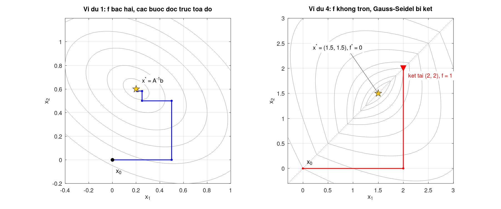
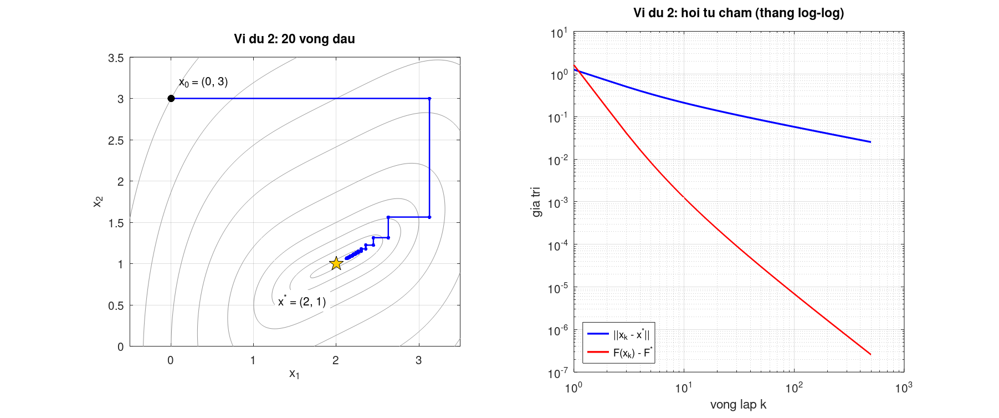
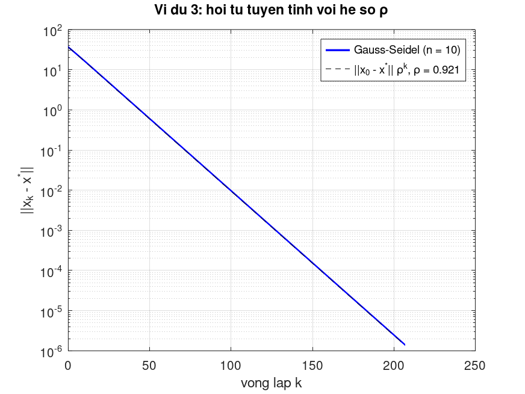

# Câu 8. Giải thuật Gauss–Seidel tìm cực tiểu của hàm n biến

## 1. Bài toán và ý tưởng

```math
\min\; f(x), \qquad x = (x_1, \dots, x_n) \in \mathbb{R}^n .
```

**Ý tưởng**: thay vì tối ưu đồng thời $`n`$ biến, ta lần lượt tối ưu **từng biến một**, giữ các biến còn lại cố định. Mỗi bước là một bài toán tối ưu **một biến**, giải được bằng các phương pháp ở [câu 6](../q06-bisection-search/) và [câu 7](../q07-golden-section-search/), hoặc bằng công thức nếu có. Vì mỗi bước đi dọc một trục tọa độ $`e_i`$, phương pháp còn gọi là **phương pháp tọa độ tuần hoàn** (cyclic coordinate descent).

Tên **Gauss–Seidel** xuất phát từ chỗ: với hàm bậc hai, phương pháp này trùng với phép lặp Gauss–Seidel giải hệ phương trình tuyến tính $`Ax = b`$ (mục 4). Giống phép lặp đó, khi tối ưu biến $`x_i`$ ta dùng ngay các giá trị **mới nhất** của $`x_1, \dots, x_{i-1}`$ vừa tính trong cùng vòng lặp.

## 2. Giải thuật

**Đầu vào**: $`f`$, điểm xuất phát $`x^{(0)}`$, độ chính xác $`\varepsilon \gt 0`$.

**Bước 1 (một vòng lặp).** Đặt $`y = x^{(k)}`$. Lần lượt với $`i = 1, 2, \dots, n`$:

```math
t_i^* = \arg\min_{t \in \mathbb{R}} f(y + t\, e_i), \qquad y \leftarrow y + t_i^* e_i ,
```

tức là $`y_i`$ được thay bằng giá trị tốt nhất khi các tọa độ khác giữ nguyên. Sau $`n`$ bước, đặt $`x^{(k+1)} = y`$.

**Bước 2 (dừng).** Nếu $`\lVert x^{(k+1)} - x^{(k)} \rVert \le \varepsilon`$ thì dừng. Ngược lại $`k \leftarrow k + 1`$, quay lại Bước 1.

Theo cách xây dựng, $`f(x^{(k+1)}) \le f(x^{(k)})`$: dãy giá trị hàm **không tăng**.

**Bài toán một chiều.** Hàm $`\varphi_i(t) = f(y + t e_i)`$ không có sẵn khoảng $`[a, b]`$ như ở câu 6, 7, nên làm hai bước:
1. **Tìm khoảng chứa cực tiểu**: thử $`t = h`$; nếu $`\varphi`$ tăng thì đổi hướng ($`t = -h`$); rồi nhân đôi bước $`t_{j+1} = t_j + 2(t_j - t_{j-1})`$ cho đến khi $`\varphi`$ tăng trở lại. Ba điểm cuối $`t_{j-1}, t_j, t_{j+1}`$ với $`\varphi(t_j)`$ nhỏ nhất cho khoảng $`[t_{j-1}, t_{j+1}]`$ chứa cực tiểu (nếu $`\varphi`$ unimodal).
2. **Lát cắt vàng** trên khoảng đó.

## 3. Sự hội tụ

**Định lý.** Giả sử $`f`$ khả vi liên tục, tập mức $`\{x : f(x) \le f(x^{(0)})\}`$ bị chặn, và với mỗi $`i`$ và mỗi $`y`$, hàm $`t \mapsto f(y + te_i)`$ có **duy nhất** một điểm cực tiểu. Khi đó mọi điểm giới hạn của dãy $`x^{(k)}`$ là **điểm dừng** ($`\nabla f = 0`$). Nếu thêm $`f`$ lồi thì đó là cực tiểu toàn cục.

Ý chứng minh: dãy $`f(x^{(k)})`$ giảm và bị chặn dưới nên hội tụ. Tại điểm giới hạn $`\bar x`$, nhờ tính duy nhất của cực tiểu theo từng tọa độ, ta có $`\bar x`$ cũng là cực tiểu của $`f`$ theo từng trục, nên $`\partial f / \partial x_i (\bar x) = 0`$ với mọi $`i`$.

**Hai giả thiết không bỏ được.**
- *Tính khả vi*: nếu $`f`$ không trơn, phương pháp có thể dừng ở điểm mà không trục nào làm $`f`$ giảm, nhưng một hướng chéo thì có. Đó không phải cực tiểu (ví dụ 4).
- *Tính duy nhất của cực tiểu theo tọa độ*: Powell (1973) đã xây dựng một hàm trơn mà phương pháp tọa độ đi vòng quanh mãi không hội tụ tới điểm dừng.

**Tốc độ.** Với hàm bậc hai, hội tụ **tuyến tính** với hệ số bằng bán kính phổ của ma trận lặp (mục 4). Khi đường mức là elip dẹt nằm chéo so với các trục, mỗi bước chỉ đi được một đoạn ngắn theo kiểu bậc thang, và phương pháp hội tụ rất chậm (ví dụ 2).

## 4. Trường hợp hàm bậc hai: phép lặp Gauss–Seidel

Xét $`f(x) = \tfrac12 x^TAx - b^Tx`$ với $`A`$ đối xứng xác định dương; cực tiểu duy nhất là nghiệm của $`Ax = b`$. Cực tiểu theo biến $`x_i`$:

```math
\frac{\partial f}{\partial x_i} = \sum_j a_{ij} x_j - b_i = 0 \quad\Longrightarrow\quad x_i = \frac{1}{a_{ii}}\Big(b_i - \sum_{j \lt i} a_{ij} x_j^{(k+1)} - \sum_{j \gt i} a_{ij} x_j^{(k)}\Big).
```

Đây chính là **phép lặp Gauss–Seidel** giải $`Ax = b`$. Viết $`A = D + L + U`$ (đường chéo, phần dưới, phần trên):

```math
(D + L)\, x^{(k+1)} = b - U x^{(k)}, \qquad x^{(k+1)} - x^* = G\,(x^{(k)} - x^*), \quad G = -(D + L)^{-1} U .
```

**Định lý (Ostrowski–Reich).** Nếu $`A`$ đối xứng xác định dương thì phép lặp Gauss–Seidel hội tụ với mọi $`x^{(0)}`$, và $`\lVert x^{(k)} - x^* \rVert`$ giảm cỡ $`\rho(G)^k`$, với $`\rho(G) \lt 1`$ là bán kính phổ của $`G`$.

Có thể thấy tính giảm của $`f`$ trực tiếp: với $`g = Ax - b`$, bước cực tiểu theo $`x_i`$ là $`t = -g_i/a_{ii}`$ và $`f`$ giảm đúng $`\tfrac{g_i^2}{2a_{ii}} \ge 0`$, bằng 0 chỉ khi $`g_i = 0`$.

## 5. Chương trình Matlab

| File | Nội dung |
|---|---|
| `gauss_seidel_min.m` | Hàm `[x, fval, out] = gauss_seidel_min(f, x0, opts)` cài đặt giải thuật trên |
| `bracket_minimum.m` | Tìm khoảng chứa cực tiểu của hàm một biến $`\varphi(t)`$ quanh $`t = 0`$ (nhân đôi bước) |
| `run_examples.m` | Bốn ví dụ minh họa và ba hình vẽ |

Đặc điểm của `gauss_seidel_min.m`:

- Mặc định giải bài toán một chiều bằng `bracket_minimum.m` + `golden_section.m` của [câu 7](../q07-golden-section-search/) (cần `addpath`, `run_examples.m` đã làm sẵn). Không cần đạo hàm.
- `opts.coordMin = @(x, i) ...`: nếu biết công thức cực tiểu theo $`x_i`$ (ví dụ hàm bậc hai) thì dùng công thức thay cho tìm kiếm một chiều.
- Dừng khi $`\lVert x^{(k)} - x^{(k-1)} \rVert \le \varepsilon`$ (`opts.tol`), hoặc khi lượng giảm của $`f`$ nhỏ hơn $`\mathrm{ftol}\cdot(1 + |f|)`$ (`opts.ftol`). Đặt `opts.ftol = 0` để chỉ dùng tiêu chuẩn theo $`x`$ (xem ví dụ 3).
- Lưu điểm sau mỗi vòng (`out.X`) và sau mỗi bước tọa độ (`out.path`, để vẽ đường bậc thang).

Cách chạy (trong thư mục `solutions/q08-gauss-seidel`):

```matlab
>> run_examples
```

## 6. Ví dụ minh họa

### Ví dụ 1: hàm bậc hai: trùng với phép lặp Gauss–Seidel

```math
f(x) = \tfrac12 x^TAx - b^Tx, \qquad A = \begin{pmatrix} 2 & 1 \\ 1 & 3 \end{pmatrix},\quad b = \begin{pmatrix} 1 \\ 2 \end{pmatrix},\quad x^{(0)} = (0, 0).
```

Giải tay vòng 1: cực tiểu theo $`x_1`$ với $`x_2 = 0`$: $`2x_1 - 1 = 0`$, $`x_1 = 0.5`$. Cực tiểu theo $`x_2`$ với $`x_1 = 0.5`$: $`0.5 + 3x_2 - 2 = 0`$, $`x_2 = 0.5`$. Vậy $`x^{(1)} = (0.5, 0.5)`$.

So sánh ba cách tính (lấy từ kết quả chạy):

| $`k`$ | (a) Lát cắt vàng | (b) Công thức theo tọa độ | (c) Gauss–Seidel cho $`Ax = b`$ |
|---|---|---|---|
| 0 | (0, 0) | (0, 0) | (0, 0) |
| 1 | (0.5, 0.5) | (0.5, 0.5) | (0.5, 0.5) |
| 2 | (0.25, 0.583333) | (0.25, 0.583333) | (0.25, 0.583333) |
| 3 | (0.208333, 0.597222) | (0.208333, 0.597222) | (0.208333, 0.597222) |
| 4 | (0.201389, 0.599537) | (0.201389, 0.599537) | (0.201389, 0.599537) |

(b) và (c) trùng nhau tới sai số làm tròn ($`10^{-16}`$); (a) lệch tối đa $`8.9 \cdot 10^{-9}`$, do sai số của tìm kiếm một chiều. Nghiệm $`x^* = A^{-1}b = (0.2, 0.6)`$, đạt sau 9 vòng. Ma trận lặp

```math
G = -(D + L)^{-1}U = \begin{pmatrix} 0 & -1/2 \\ 0 & 1/6 \end{pmatrix}
```

có $`\rho(G) = 1/6`$, nên mỗi vòng sai số giảm khoảng 6 lần: $`x_2^{(k)} - 0.6 = -0.1,\ -0.0167,\ -0.0028,\ -0.00046`$.



### Ví dụ 2: thung lũng hẹp: hội tụ rất chậm

Hàm của [câu 7, ví dụ 3](../q07-golden-section-search/) (ví dụ kinh điển trong sách của Bazaraa, Sherali và Shetty):

```math
F(x) = (x_1 - 2)^4 + (x_1 - 2x_2)^2, \qquad x^{(0)} = (0, 3), \qquad x^* = (2, 1),\ F^* = 0 .
```

| $`k`$ | $`x^{(k)}`$ | $`F(x^{(k)})`$ |
|---|---|---|
| 0 | (0, 3) | 52 |
| 1 | (3.12817, 1.56409) | 1.61996 |
| 2 | (2.62943, 1.31472) | 0.156962 |
| 3 | (2.44873, 1.22436) | 0.0405437 |
| 4 | (2.35741, 1.17871) | 0.0163183 |
| 5 | (2.30221, 1.15110) | 0.00834130 |
| 6 | (2.26499, 1.13250) | 0.00493105 |

Ở vòng 1: cực tiểu theo $`x_1`$ với $`x_2 = 3`$ cho $`x_1 = 3.128`$ (đi qua tâm $`x^* = (2, 1)`$ khá xa), rồi cực tiểu theo $`x_2`$ cho $`x_2 = x_1/2 = 1.564`$ (vì $`F`$ phụ thuộc $`x_2`$ chỉ qua $`(x_1 - 2x_2)^2`$). Từ đó mọi điểm $`x^{(k)}`$ nằm trên đường $`x_1 = 2x_2`$, và mỗi vòng chỉ tiến một đoạn ngắn dọc thung lũng.

| Vòng $`k`$ | 10 | 50 | 100 | 500 |
|---|---|---|---|---|
| $`\lVert x^{(k)} - x^* \rVert`$ | $`2.1\cdot10^{-1}`$ | $`8.3\cdot10^{-2}`$ | $`5.7\cdot10^{-2}`$ | $`2.5\cdot10^{-2}`$ |
| $`F(x^{(k)})`$ | $`1.2\cdot10^{-3}`$ | $`3.0\cdot10^{-5}`$ | $`6.9\cdot10^{-6}`$ | $`2.6\cdot10^{-7}`$ |

Sau 500 vòng (48009 lần tính $`F`$) vẫn còn cách $`x^*`$ khoảng $`0.025`$. Từ vòng 100 đến 500, sai số giảm $`2.27 \approx \sqrt5`$ lần và $`F`$ giảm khoảng 27 lần ($`\approx 5^2`$): sai số giảm cỡ $`k^{-1/2}`$, $`F`$ cỡ $`k^{-2}`$, tức là hội tụ **dưới tuyến tính** (trên đồ thị log–log là các đường thẳng có độ dốc khoảng $`-\tfrac12`$ và $`-2`$). Nguyên nhân: Hessian tại $`x^*`$,

```math
\nabla^2 F(x^*) = \begin{pmatrix} 2 & -4 \\ -4 & 8 \end{pmatrix},
```

**suy biến** (định thức bằng 0), nên quanh $`x^*`$ hàm phẳng theo hướng thung lũng, và thung lũng lại nằm chéo so với các trục.



### Ví dụ 3: hàm n = 10 biến

```math
f(x) = \tfrac12 x^TAx - b^Tx, \qquad A = \mathrm{tridiag}(-1, 2, -1) \in \mathbb{R}^{10\times 10}, \quad b = (1, \dots, 1), \quad x^{(0)} = 0 .
```

Nghiệm chính xác $`x_i^* = \tfrac{i(n + 1 - i)}{2}`$, tức là $`x^* = (5, 9, 12, 14, 15, 15, 14, 12, 9, 5)`$. Với $`\varepsilon = 10^{-8}`$ (chỉ dùng tiêu chuẩn theo $`x`$):

| Cách giải bài toán một chiều | Số vòng | $`\lVert x - x^* \rVert`$ | Số lần tính $`f`$ |
|---|---|---|---|
| Công thức theo tọa độ | 207 | $`1.4\cdot10^{-6}`$ | |
| Tìm khoảng + lát cắt vàng | 203 | $`3.6\cdot10^{-6}`$ | 97510 |

Bán kính phổ $`\rho(G) = \cos^2\frac{\pi}{n+1} = 0.9206`$ rất gần 1, nên mỗi vòng sai số chỉ giảm khoảng 8%. Trên đồ thị (thang log), sai số là đường thẳng trùng với $`\lVert x^{(0)} - x^* \rVert \rho^k`$ (nét đứt, bị che): hội tụ tuyến tính đúng như định lý. Khi $`n`$ tăng, $`\rho \to 1`$ và phương pháp càng chậm.

**Về tiêu chuẩn dừng**: nếu thêm tiêu chuẩn "$`f`$ giảm ít hơn $`10^{-12}(1 + |f|)`$", chương trình dừng sớm ở vòng 158 với sai số $`8\cdot10^{-5}`$. Lý do: gần cực tiểu, $`f(x) - f^* \approx \tfrac12 (x - x^*)^TA(x - x^*)`$ giảm theo **bình phương** sai số, nên lượng giảm của $`f`$ trở nên rất nhỏ khi $`x`$ còn khá xa $`x^*`$. Cũng vì $`\rho`$ gần 1, sai số $`\lVert x - x^* \rVert`$ lớn hơn nhiều so với bước cuối $`\lVert x^{(k)} - x^{(k-1)} \rVert`$.



### Ví dụ 4: hàm không trơn: Gauss–Seidel bị kẹt

```math
f(x) = 2\,|x_1 - x_2| + (x_1 + x_2 - 3)^2, \qquad x^{(0)} = (0, 0) .
```

$`f \ge 0`$ và $`f = 0`$ chỉ khi $`x_1 = x_2`$, $`x_1 + x_2 = 3`$, nên cực tiểu duy nhất là $`x^* = (1.5, 1.5)`$.

Giải tay vòng 1:
- Theo $`x_1`$ với $`x_2 = 0`$: $`2|x_1| + (x_1 - 3)^2`$; với $`x_1 \gt 0`$ đạo hàm $`2 + 2(x_1 - 3) = 0`$ cho $`x_1 = 2`$.
- Theo $`x_2`$ với $`x_1 = 2`$: $`2|2 - x_2| + (x_2 - 1)^2`$; với $`x_2 \lt 2`$ đạo hàm $`-2 + 2(x_2 - 1) = 0`$ cho $`x_2 = 2`$.

Tại $`(2, 2)`$, $`f = 1`$. Dịch theo trục nào cũng làm $`f`$ tăng: $`f(1.9, 2) = f(2, 1.9) = 1.01`$, $`f(2.1, 2) = f(2, 2.1) = 1.41`$. Do đó vòng 2 không thay đổi gì và chương trình dừng tại $`(2, 2)`$, **không phải cực tiểu**. Theo hướng chéo $`(-1, -1)`$ thì $`f(2 - t, 2 - t) = (1 - 2t)^2`$ giảm: hướng giảm tồn tại nhưng không nằm trên trục nào, vì $`f`$ không khả vi trên đường $`x_1 = x_2`$ (hình bên phải ở trên).

## 7. Nhận xét

- **Ưu điểm**: rất đơn giản; không cần đạo hàm (khi dùng lát cắt vàng); mỗi bước chỉ là bài toán một biến. Khi cực tiểu theo từng tọa độ có công thức (hàm bậc hai, hồi quy LASSO, …), mỗi bước rất rẻ, nên phương pháp tọa độ được dùng nhiều cho các bài toán lớn.
- **Nhược điểm**: hội tụ chậm khi các biến "liên kết" mạnh, tức là đường mức nằm chéo so với các trục (ví dụ 2, 3); có thể bị kẹt với hàm không trơn (ví dụ 4).
- Cải tiến tự nhiên: sau mỗi vòng, đi thêm theo hướng $`x^{(k+1)} - x^{(k)}`$ (hướng "tổng hợp" của cả vòng) để vượt thung lũng. Đó là ý tưởng của **phương pháp tìm kiếm trực tiếp** Hooke–Jeeves ([câu 9](../q09-hooke-jeeves/)).
- Tiêu chuẩn dừng theo lượng giảm của $`f`$ có thể dừng quá sớm; nên kết hợp với tiêu chuẩn theo $`x`$, hoặc theo $`\lVert \nabla f \rVert`$ nếu có đạo hàm.
