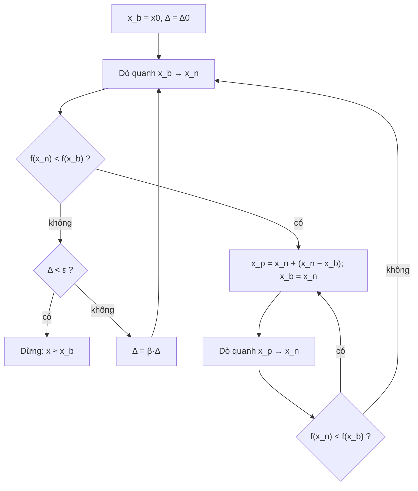
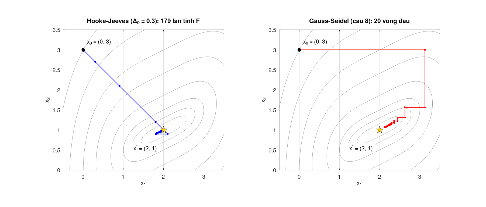
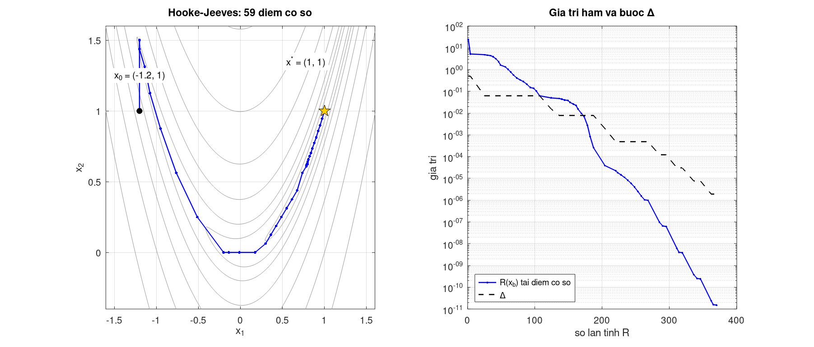
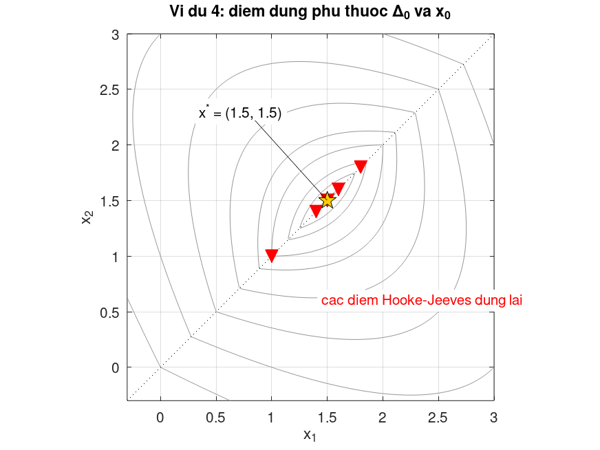

# Câu 9. Giải thuật tìm kiếm trực tiếp (Hooke–Jeeves) tìm cực tiểu của hàm n biến

## 1. Bài toán và ý tưởng

```math
\min\; f(x), \qquad x \in \mathbb{R}^n .
```

**Phương pháp tìm kiếm trực tiếp** (direct search) chỉ dùng **giá trị hàm**: không cần đạo hàm, cũng không cần giải bài toán tìm kiếm theo tia. Chúng hữu ích khi $`f`$ không khả vi, khi đạo hàm khó tính hoặc không có (ví dụ $`f`$ là kết quả của một mô phỏng, một "hộp đen"), hoặc khi giá trị hàm có nhiễu.

Câu này trình bày **phương pháp Hooke–Jeeves** (1961), phương pháp tìm kiếm theo mẫu (pattern search) kinh điển nhất. Ý tưởng gồm hai loại bước:

- **Bước dò** (exploratory move): đứng tại một điểm, thử dịch $`\pm\Delta`$ theo từng trục tọa độ, giữ lại những dịch chuyển làm $`f`$ giảm. Bước này giống phương pháp tọa độ ([câu 8](../q08-gauss-seidel/)), nhưng thay vì tìm kiếm chính xác theo trục, chỉ thử một bước cố định $`\Delta`$.
- **Bước theo mẫu** (pattern move): nếu bước dò đưa ta từ $`x_b`$ tới $`x_{\text{mới}}`$, thì $`x_{\text{mới}} - x_b`$ là một hướng "tốt". Ta nhảy thêm một đoạn như vậy, tới $`x_{\text{mới}} + (x_{\text{mới}} - x_b)`$, rồi dò tiếp quanh đó. Đây chính là cách khắc phục điểm yếu của phương pháp tọa độ khi thung lũng nằm chéo so với các trục (câu 8, ví dụ 2).

Khi bước dò không còn tìm được điểm tốt hơn, giảm bước $`\Delta`$.

## 2. Giải thuật

**Đầu vào**: $`f`$, $`x^{(0)}`$, bước ban đầu $`\Delta_0 \gt 0`$, hệ số giảm bước $`\beta \in (0, 1)`$ (thường $`\beta = 1/2`$), độ chính xác $`\varepsilon`$.

**Thủ tục dò** $`\mathrm{Dò}(y, \Delta)`$: lần lượt với $`i = 1, \dots, n`$: nếu $`f(y + \Delta e_i) \lt f(y)`$ thì $`y \leftarrow y + \Delta e_i`$; ngược lại, nếu $`f(y - \Delta e_i) \lt f(y)`$ thì $`y \leftarrow y - \Delta e_i`$. Trả về $`y`$. (Mỗi lần dò tốn từ $`n`$ đến $`2n`$ lần tính $`f`$.)

**Bước 0.** Điểm cơ sở $`x_b = x^{(0)}`$, $`\Delta = \Delta_0`$.

**Bước 1 (dò quanh điểm cơ sở).** $`x_n = \mathrm{Dò}(x_b, \Delta)`$. Nếu $`f(x_n) \lt f(x_b)`$ sang Bước 2. Ngược lại: nếu $`\Delta \lt \varepsilon`$ thì dừng; nếu không, $`\Delta \leftarrow \beta\Delta`$ và lặp lại Bước 1.

**Bước 2 (theo mẫu).** Đặt $`x_p = x_n + (x_n - x_b)`$, rồi $`x_b \leftarrow x_n`$. Dò quanh $`x_p`$: $`x_n = \mathrm{Dò}(x_p, \Delta)`$.
- Nếu $`f(x_n) \lt f(x_b)`$: mẫu thành công, lặp lại Bước 2 (bước nhảy tiếp theo dài hơn, vì $`x_n - x_b`$ đã gồm cả bước mẫu lẫn bước dò).
- Ngược lại: bỏ $`x_p`$, quay lại Bước 1 (dò quanh $`x_b`$).



**Nhận xét về lưới.** Với $`\beta = 1/2`$, mọi điểm thử khi bước bằng $`\Delta`$ đều nằm trên lưới $`x^{(0)} + \Delta\,\mathbb{Z}^n`$ (bước mẫu là tổng các bước dò, cũng là bội của $`\Delta`$), và các lưới lồng nhau khi $`\Delta`$ giảm. Vì thế nếu $`x^*`$ tình cờ nằm trên lưới, thuật toán có thể "rơi trúng" nghiệm chính xác; điều này xảy ra ở một số ví dụ dưới đây, và mình đã thử thêm $`\Delta_0`$ khác để có đánh giá khách quan.

## 3. Sự hội tụ

**Định lý.** Giả sử $`f`$ khả vi và $`\nabla f`$ liên tục Lipschitz với hằng số $`L`$. Nếu tại điểm $`x`$ bước dò thất bại với bước $`\Delta`$, tức là $`f(x \pm \Delta e_i) \ge f(x)`$ với mọi $`i`$, thì

```math
\lVert \nabla f(x) \rVert \le \frac{\sqrt{n}\, L\, \Delta}{2} .
```

*Chứng minh.* Theo khai triển Taylor với phần dư, $`f(x + \Delta e_i) \le f(x) + \Delta\, \partial_i f(x) + \tfrac{L}{2}\Delta^2`$. Kết hợp với $`f(x + \Delta e_i) \ge f(x)`$ được $`\partial_i f(x) \ge -\tfrac{L\Delta}{2}`$. Tương tự với $`-\Delta e_i`$ được $`\partial_i f(x) \le \tfrac{L\Delta}{2}`$. Vậy $`|\partial_i f(x)| \le \tfrac{L\Delta}{2}`$ với mọi $`i`$, suy ra bất đẳng thức. $`\blacksquare`$

**Hệ quả.** Nếu tập mức $`\{f \le f(x^{(0)})\}`$ bị chặn thì $`\Delta \to 0`$ (với một lưới cố định, $`f`$ chỉ giảm thực sự được hữu hạn lần), và tại các lần giảm bước $`\lVert \nabla f(x_b) \rVert \le \tfrac{\sqrt n L}{2}\Delta \to 0`$: có dãy con của các điểm cơ sở hội tụ tới **điểm dừng**. Đây là trường hợp riêng của lý thuyết hội tụ cho tìm kiếm theo mẫu tổng quát (Torczon, 1997).

**Ý nghĩa hình học.** Các hướng $`\{\pm e_1, \dots, \pm e_n\}`$ tạo thành một **tập sinh dương** của $`\mathbb{R}^n`$: với mọi $`v \ne 0`$ có một hướng $`d`$ trong tập với $`v^Td \ge \lVert v \rVert/\sqrt n`$. Do đó nếu $`\nabla f(x) \ne 0`$, luôn có một hướng trục là hướng giảm, và với $`\Delta`$ đủ nhỏ bước dò sẽ thành công.

**Khi $`f`$ không khả vi** thì lập luận trên sai: có thể không hướng trục nào là hướng giảm dù $`x`$ chưa phải cực tiểu, và thuật toán dừng sai chỗ (ví dụ 4).

## 4. Chương trình Matlab

| File | Nội dung |
|---|---|
| `hooke_jeeves.m` | Hàm `[x, fval, out] = hooke_jeeves(f, x0, opts)` cài đặt giải thuật trên |
| `run_examples.m` | Bốn ví dụ minh họa và ba hình vẽ; so sánh với `gauss_seidel_min.m` ([câu 8](../q08-gauss-seidel/)) và `fminsearch` (Nelder–Mead) |

Đặc điểm của `hooke_jeeves.m`:

- Tham số `opts.delta` ($`\Delta_0`$, mặc định 0.5), `opts.beta` (mặc định 0.5), `opts.tol` (dừng khi $`\Delta \lt`$ `tol`, mặc định $`10^{-6}`$), `opts.maxFev` (giới hạn số lần tính $`f`$).
- `opts.display = true` in các điểm cơ sở.
- Lưu dãy điểm cơ sở (`out.base`) cùng $`\Delta`$, $`f`$ và số lần tính $`f`$ tại mỗi điểm (để vẽ hình).
- **Chi tiết cài đặt quan trọng**: sau bước mẫu và bước dò, điểm tìm được có thể chính là $`x_b`$ cũ, chỉ lệch do sai số làm tròn, với $`f`$ "nhỏ hơn" một lượng cỡ $`10^{-16}`$. Nếu chỉ so sánh $`f`$, thuật toán lặp vô hạn quanh một điểm. Phiên bản đầu của chương trình đã gặp lỗi này (ví dụ 3b chạy hết $`10^5`$ lần tính $`f`$ mà không giảm được $`\Delta`$). Chương trình hiện chỉ chấp nhận khi $`\lVert x_n - x_b \rVert \gt \Delta/2`$.

Cách chạy (trong thư mục `solutions/q09-hooke-jeeves`):

```matlab
>> run_examples
```

## 5. Ví dụ minh họa

### Ví dụ 1: hàm Bazaraa: bước theo mẫu vượt thung lũng

Hàm của câu 8, ví dụ 2, nơi Gauss–Seidel hội tụ rất chậm:

```math
F(x) = (x_1 - 2)^4 + (x_1 - 2x_2)^2, \qquad x^{(0)} = (0, 3),\quad x^* = (2, 1).
```

**Giải tay với $`\Delta_0 = 0.5`$.**

1. Dò quanh $`x_b = (0, 3)`$, $`F = 52`$: thử $`x_1 + 0.5`$: $`F(0.5, 3) = 5.0625 + 30.25 = 35.3125 \lt 52`$, nhận. Thử $`x_2 + 0.5`$: $`F(0.5, 3.5) = 47.3125`$, không nhận; thử $`x_2 - 0.5`$: $`F(0.5, 2.5) = 5.0625 + 20.25 = 25.3125`$, nhận. Được $`x_n = (0.5, 2.5)`$.
2. Mẫu: $`x_p = (0.5, 2.5) + (0.5, -0.5) = (1, 2)`$, $`x_b = (0.5, 2.5)`$. Dò quanh $`(1, 2)`$: $`F(1.5, 2) = 6.3125`$ nhận, $`F(1.5, 2.5) = 12.3125`$ không, $`F(1.5, 1.5) = 2.3125`$ nhận. $`x_n = (1.5, 1.5)`$, $`F = 2.3125 \lt 25.3125`$: mẫu thành công.
3. Mẫu: $`x_p = (1.5, 1.5) + (1, -1) = (2.5, 0.5)`$, $`x_b = (1.5, 1.5)`$. Dò: $`F(3, 0.5) = 5`$ không, $`F(2, 0.5) = 1`$ nhận, $`F(2, 1) = 0`$ nhận. $`x_n = (2, 1) = x^*`$.

| Điểm cơ sở | $`x_b`$ | $`F(x_b)`$ |
|---|---|---|
| 0 | (0, 3) | 52 |
| 1 | (0.5, 2.5) | 25.3125 |
| 2 | (1.5, 1.5) | 2.3125 |
| 3 | (2, 1) | 0 |

Các bước mẫu dài dần: $`(0.5, -0.5)`$ rồi $`(1, -1)`$, đi thẳng dọc thung lũng. Ở đây $`x^*`$ nằm trên lưới $`x^{(0)} + 0.5\,\mathbb{Z}^2`$ nên thuật toán rơi trúng nghiệm, rồi chỉ còn giảm $`\Delta`$ tới $`\varepsilon`$ (tổng 92 lần tính $`F`$). Với $`\Delta_0`$ khác, nghiệm không nằm trên lưới:

| Phương pháp | $`x`$ | $`F(x)`$ | $`\lVert x - x^* \rVert`$ | Số lần tính $`F`$ |
|---|---|---|---|---|
| Hooke–Jeeves, $`\Delta_0 = 0.5`$ | (2, 1) | 0 | 0 | 92 |
| Hooke–Jeeves, $`\Delta_0 = 0.3`$ | (2.00625, 1.00312) | $`1.5\cdot10^{-9}`$ | $`7.0\cdot10^{-3}`$ | 179 |
| Hooke–Jeeves, $`\Delta_0 = 0.7`$ | (1.99687, 0.99844) | $`9.5\cdot10^{-11}`$ | $`3.5\cdot10^{-3}`$ | 279 |
| Gauss–Seidel (câu 8), 500 vòng | (2.0225, 1.01125) | $`2.6\cdot10^{-7}`$ | $`2.5\cdot10^{-2}`$ | 48009 |

Hooke–Jeeves đạt sai số nhỏ hơn Gauss–Seidel với số lần tính hàm **ít hơn khoảng 170–500 lần**. Sai số theo $`x`$ (cỡ $`10^{-3}`$) lớn hơn nhiều so với sai số theo $`F`$ (cỡ $`10^{-10}`$), vì $`F`$ rất phẳng quanh $`x^*`$ (Hessian suy biến, xem câu 8).



### Ví dụ 2: hàm Rosenbrock

```math
R(x) = 100\,(x_2 - x_1^2)^2 + (1 - x_1)^2, \qquad x^{(0)} = (-1.2,\ 1),\quad x^* = (1, 1).
```

Đây là hàm thử kinh điển: cực tiểu nằm trong một thung lũng hẹp, cong hình parabol.

| Phương pháp | $`x`$ | $`R(x)`$ | $`\lVert x - x^* \rVert`$ | Số lần tính $`R`$ |
|---|---|---|---|---|
| Hooke–Jeeves ($`\Delta_0 = 0.5`$, $`\varepsilon = 10^{-6}`$) | (1.0000008, 1.0000019) | $`1.5\cdot10^{-11}`$ | $`2.1\cdot10^{-6}`$ | 379 |
| Nelder–Mead (`fminsearch`) | (1, 1) | $`4.5\cdot10^{-18}`$ | $`4.7\cdot10^{-9}`$ | 200 |
| Gauss–Seidel (câu 8), 2000 vòng | (0.99842, 0.99683) | $`2.5\cdot10^{-6}`$ | $`3.5\cdot10^{-3}`$ | 192002 |

Hooke–Jeeves đi theo thung lũng cong nhờ các bước mẫu, với 59 điểm cơ sở. Trên đồ thị bên phải, mỗi bậc của đường $`\Delta`$ (nét đứt) là một lần giảm bước; $`R`$ giảm nhanh ngay sau mỗi lần giảm bước. Nelder–Mead, một phương pháp tìm kiếm trực tiếp khác (dùng một đơn hình $`n + 1`$ đỉnh co giãn theo hình dạng của hàm), hiệu quả hơn trên ví dụ này.



### Ví dụ 3: n = 10 biến

**(a)** Hàm bậc hai của câu 8, ví dụ 3: $`f = \tfrac12 x^TAx - b^Tx`$, $`A = \mathrm{tridiag}(-1, 2, -1)`$, $`b = (1, \dots, 1)`$, $`x^{(0)} = 0`$. Với $`\Delta_0 = 0.7`$, $`\varepsilon = 10^{-8}`$: sai số $`\lVert x - x^* \rVert = 1.6\cdot10^{-6}`$ sau 3409 lần tính $`f`$ (113 điểm cơ sở, 27 lần giảm bước). Gauss–Seidel với lát cắt vàng (câu 8) cần 97510 lần tính $`f`$ để đạt sai số $`3.6\cdot10^{-6}`$. (Với $`\Delta_0 = 1`$, nghiệm $`x^* = (5, 9, 12, \dots)`$ có tọa độ nguyên nằm trên lưới, nên Hooke–Jeeves rơi trúng nghiệm; trường hợp này không dùng để so sánh.)

**(b)** Hàm không trơn nhưng **tách biến**:

```math
g(x) = \sum_{i=1}^{10} |x_i - i| + \sum_{i=1}^{10} (x_i - i)^2, \qquad x^* = (1, 2, \dots, 10).
```

Với $`\Delta_0 = 0.7`$: sai số $`9.7\cdot10^{-9}`$ sau 1602 lần tính $`g`$. Dù $`g`$ không khả vi tại $`x^*`$, thuật toán vẫn hội tụ vì các "nếp gãy" của $`g`$ song song với các trục ($`g`$ là tổng các hàm một biến), nên hướng giảm luôn nằm trên một trục.

### Ví dụ 4: hàm không trơn, không tách biến

Hàm của câu 8, ví dụ 4:

```math
f(x) = 2\,|x_1 - x_2| + (x_1 + x_2 - 3)^2, \qquad x^* = (1.5, 1.5),\ f^* = 0 .
```

| $`x^{(0)}`$ | $`\Delta_0`$ | Hooke–Jeeves dừng tại | $`f`$ |
|---|---|---|---|
| (0, 0) | 0.5 | (1.5, 1.5) | 0 |
| (0, 0) | 0.3 | (1.5, 1.5) | $`2\cdot10^{-31}`$ |
| (0, 0) | 0.7 | (1.4, 1.4) | 0.04 |
| (0, 0) | 1.0 | (1, 1) | 1 |
| (0, 0.3) | 0.3 | (1.8, 1.8) | 0.36 |
| (0.1, 0.7) | 0.3 | (1.6, 1.6) | 0.04 |

Thuật toán dừng tại các điểm khác nhau trên đường chéo $`x_1 = x_2`$. Chỉ khi $`x^*`$ nằm trên lưới (hai dòng đầu) mới tới đúng nghiệm.

**Giải thích.** Tại điểm $`(t, t)`$, dịch theo trục $`x_1`$: $`\varphi(s) = f(t + s, t) = 2|s| + (2t - 3 + s)^2`$. Đạo hàm phải tại $`s = 0`$ là $`2 + 2(2t - 3)`$, đạo hàm trái là $`-2 + 2(2t - 3)`$. $`\varphi`$ tăng về **cả hai phía** khi đạo hàm phải $`\ge 0`$ và đạo hàm trái $`\le 0`$, tức là $`|2t - 3| \le 1`$, hay $`t \in [1, 2]`$; theo trục $`x_2`$ cũng vậy. Do đó **mọi điểm $`(t, t)`$ với $`1 \le t \le 2`$** đều là "cực tiểu theo từng trục" với mọi $`\Delta`$, và Hooke–Jeeves (cũng như Gauss–Seidel, dừng ở $`(2, 2)`$ trong câu 8) có thể dừng tại bất kỳ điểm nào trong đoạn này. Các điểm dừng trong bảng, $`t = 1;\ 1.4;\ 1.6;\ 1.8`$, đều thuộc $`[1, 2]`$. Hướng giảm thực sự là hướng chéo $`(1, 1)`$ hoặc $`(-1, -1)`$, không nằm trong tập hướng $`\{\pm e_1, \pm e_2\}`$.

Nelder–Mead (`fminsearch`) từ $`(0, 0)`$ cho $`(1.50016, 1.50016)`$, $`f = 5.7\cdot10^{-7}`$: đơn hình của nó có thể "xoay" theo hướng chéo, nên trên ví dụ này nó tới gần nghiệm hơn (nhưng Nelder–Mead cũng không có bảo đảm hội tụ tổng quát).



## 6. Nhận xét

- **Ưu điểm**: chỉ cần giá trị hàm; đơn giản; chịu được hàm không trơn có nếp gãy song song với các trục (ví dụ 3b); bước theo mẫu giúp vượt các thung lũng chéo, nhanh hơn hẳn phương pháp tọa độ (ví dụ 1, 2, 3a).
- **Nhược điểm**: hội tụ chậm hơn các phương pháp dùng đạo hàm (câu 10–12) khi $`f`$ trơn; mỗi lần dò tốn tới $`2n`$ lần tính hàm, nên chi phí tăng theo số chiều; phụ thuộc vào thang đo của các biến (cùng một $`\Delta`$ cho mọi tọa độ); có thể dừng sai chỗ với hàm không trơn (ví dụ 4).
- Kết quả có thể "may mắn" khi nghiệm nằm trên lưới $`x^{(0)} + \Delta\mathbb{Z}^n`$. Khi đánh giá phương pháp cần thử nhiều $`\Delta_0`$ hoặc $`x^{(0)}`$.
- Các phương pháp hiện đại như MADS (Mesh Adaptive Direct Search) dùng tập hướng thay đổi, trù mật dần theo mọi phương, để khắc phục việc bị kẹt với hàm không trơn như ví dụ 4.
