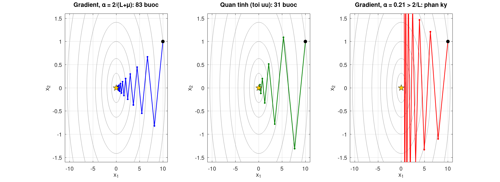
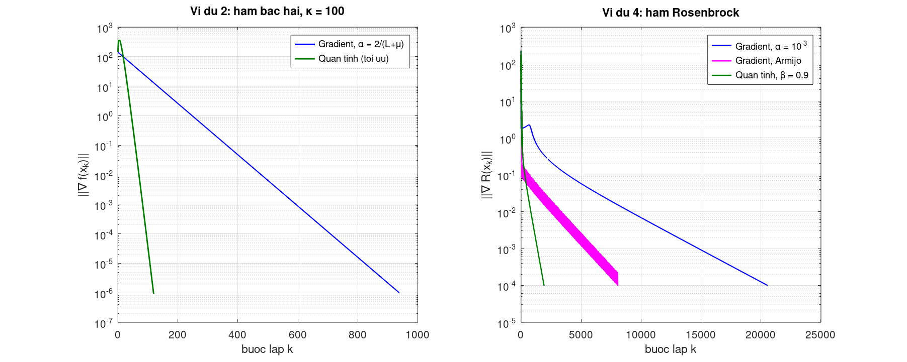
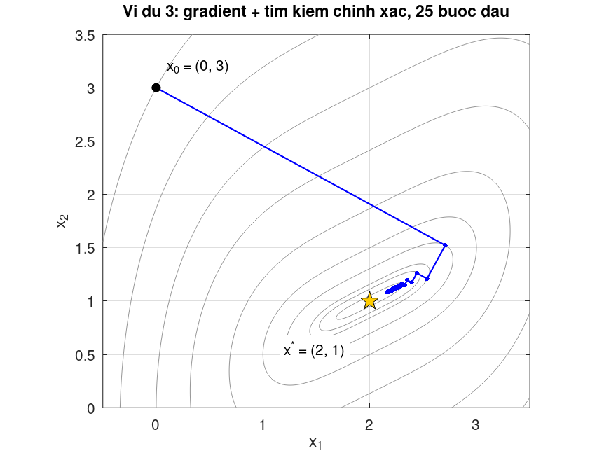

# Câu 10. Thuật toán Gradient và Gradient quán tính tìm cực tiểu của hàm n biến

## 1. Bài toán và hướng giảm nhanh nhất

```math
\min\; f(x), \qquad x \in \mathbb{R}^n, \qquad f \text{ khả vi liên tục}.
```

Khác với câu 8 và 9 (chỉ dùng giá trị hàm), câu này dùng **gradient** $`\nabla f(x)`$. Với hướng $`d`$, $`\lVert d \rVert = 1`$, đạo hàm theo hướng là $`\nabla f(x)^T d`$. Theo bất đẳng thức Cauchy–Schwarz, $`\nabla f(x)^T d \ge -\lVert \nabla f(x) \rVert`$, với dấu bằng khi

```math
d = -\frac{\nabla f(x)}{\lVert \nabla f(x) \rVert} .
```

Vậy $`-\nabla f(x)`$ là **hướng giảm nhanh nhất** (steepest descent) của $`f`$ tại $`x`$. Hơn nữa, mọi hướng $`d`$ với $`\nabla f(x)^T d \lt 0`$ đều là **hướng giảm**: $`f(x + \alpha d) \lt f(x)`$ với $`\alpha \gt 0`$ đủ nhỏ.

## 2. Thuật toán Gradient

```math
x_{k+1} = x_k - \alpha_k \nabla f(x_k), \qquad k = 0, 1, 2, \dots
```

Dừng khi $`\lVert \nabla f(x_k) \rVert \le \varepsilon`$. Ba cách chọn độ dài bước $`\alpha_k`$:

| Cách chọn | Công thức | Ghi chú |
|---|---|---|
| Bước cố định | $`\alpha_k = \alpha`$ | Cần biết hằng số $`L`$ (xem mục 3); $`\alpha`$ quá lớn thì phân kỳ |
| Tìm kiếm chính xác (Cauchy) | $`\alpha_k = \arg\min_{\alpha \ge 0} f(x_k - \alpha\nabla f(x_k))`$ | Bài toán một chiều, giải bằng lát cắt vàng ([câu 7](../q07-golden-section-search/)) |
| Armijo (quay lui) | thử $`\alpha = \bar\alpha, \rho\bar\alpha, \rho^2\bar\alpha, \dots`$ tới khi $`f(x_k - \alpha g_k) \le f(x_k) - c\,\alpha \lVert g_k \rVert^2`$ | Không cần $`L`$; luôn dừng sau hữu hạn lần thử |

## 3. Sự hội tụ của thuật toán Gradient

Giả sử $`\nabla f`$ **liên tục Lipschitz** với hằng số $`L`$: $`\lVert \nabla f(x) - \nabla f(y) \rVert \le L\lVert x - y \rVert`$. Khi đó có **bổ đề giảm**:

```math
f(y) \le f(x) + \nabla f(x)^T (y - x) + \frac{L}{2} \lVert y - x \rVert^2 .
```

**Định lý 1 (trường hợp tổng quát).** Với bước cố định $`0 \lt \alpha \lt 2/L`$:

```math
f(x_{k+1}) \le f(x_k) - \alpha\left(1 - \frac{L\alpha}{2}\right) \lVert \nabla f(x_k) \rVert^2 .
```

Nếu $`f`$ bị chặn dưới bởi $`f^*`$ thì $`\sum_k \lVert \nabla f(x_k) \rVert^2 \lt \infty`$, do đó $`\nabla f(x_k) \to 0`$. Với $`\alpha = 1/L`$: $`\displaystyle\min_{j \le k} \lVert \nabla f(x_j) \rVert \le \sqrt{\frac{2L\,(f(x_0) - f^*)}{k + 1}}`$.

*Chứng minh.* Thay $`y = x_k - \alpha \nabla f(x_k)`$ vào bổ đề giảm. Cộng các bất đẳng thức từ $`0`$ tới $`k`$: $`\alpha(1 - L\alpha/2)\sum_{j \le k} \lVert \nabla f(x_j) \rVert^2 \le f(x_0) - f^*`$. $`\blacksquare`$

**Định lý 2 (hàm bậc hai lồi mạnh).** Cho $`f(x) = \tfrac12 x^TAx - b^Tx`$ với các trị riêng của $`A`$ nằm trong $`[\mu, L]`$, $`\mu \gt 0`$, và **số điều kiện** $`\kappa = L/\mu`$. Với bước cố định:

```math
x_{k+1} - x^* = (I - \alpha A)(x_k - x^*), \qquad \lVert x_{k+1} - x^* \rVert \le \max_{\lambda \in [\mu, L]} |1 - \alpha\lambda| \cdot \lVert x_k - x^* \rVert .
```

- Hội tụ khi và chỉ khi $`0 \lt \alpha \lt 2/L`$ (với mọi $`x_0`$); nếu $`\alpha \gt 2/L`$ thì thành phần theo vector riêng của $`L`$ bị nhân với $`|1 - \alpha L| \gt 1`$ mỗi bước: **phân kỳ**.
- Bước tốt nhất $`\alpha = \tfrac{2}{L + \mu}`$ cho hệ số co

```math
q_{\text{GD}} = \frac{\kappa - 1}{\kappa + 1}, \qquad \text{số bước cần} \approx \frac{\kappa}{2}\ln\frac{1}{\varepsilon} .
```

**Định lý 3 (tìm kiếm chính xác).** Với tìm kiếm chính xác, hai hướng liên tiếp **vuông góc**: $`\nabla f(x_{k+1})^T \nabla f(x_k) = 0`$ (vì $`\tfrac{d}{d\alpha} f(x_k - \alpha g_k) = -\nabla f(x_{k+1})^T g_k = 0`$ tại $`\alpha_k`$). Đường đi vì thế có dạng **zic-zac**. Với hàm bậc hai, $`\alpha_k = \dfrac{g_k^T g_k}{g_k^T A g_k}`$ và (bất đẳng thức Kantorovich)

```math
f(x_{k+1}) - f^* \le \left(\frac{\kappa - 1}{\kappa + 1}\right)^2 \left(f(x_k) - f^*\right).
```

Như vậy trong trường hợp xấu nhất, tìm kiếm chính xác **không** nhanh hơn bước cố định tối ưu: cả hai đều cần cỡ $`\kappa`$ bước.

## 4. Thuật toán Gradient quán tính (heavy-ball)

Polyak (1964) thêm một **số hạng quán tính** vào bước gradient:

```math
x_{k+1} = x_k - \alpha \nabla f(x_k) + \beta\,(x_k - x_{k-1}), \qquad 0 \le \beta \lt 1,\quad x_{-1} = x_0 .
```

Viết dưới dạng "vận tốc": $`v_{k+1} = \beta v_k - \alpha \nabla f(x_k)`$, $`x_{k+1} = x_k + v_{k+1}`$. Như một hòn bi có khối lượng lăn trên mặt $`f`$: vận tốc là trung bình (có trọng số giảm dần) của các gradient đã qua. Theo hướng thung lũng, các gradient cùng dấu nên được **cộng dồn** (bước dài ra); theo hướng ngang thung lũng, các gradient đổi dấu liên tục nên **triệt tiêu** nhau (bớt zic-zac). $`\beta = 0`$ là thuật toán gradient bước cố định.

**Định lý 4 (Polyak).** Với hàm bậc hai như định lý 2, chọn

```math
\alpha = \frac{4}{(\sqrt{L} + \sqrt{\mu})^2}, \qquad \beta = \left(\frac{\sqrt\kappa - 1}{\sqrt\kappa + 1}\right)^2,
```

thì sai số giảm theo hệ số

```math
q_{\text{HB}} = \frac{\sqrt\kappa - 1}{\sqrt\kappa + 1}, \qquad \text{số bước cần} \approx \frac{\sqrt\kappa}{2}\ln\frac{1}{\varepsilon} .
```

*Ý chứng minh.* Phân tích theo từng vector riêng (trị riêng $`\lambda`$): sai số $`e_k`$ thỏa $`e_{k+1} = (1 + \beta - \alpha\lambda)e_k - \beta e_{k-1}`$, có phương trình đặc trưng $`r^2 - (1 + \beta - \alpha\lambda)r + \beta = 0`$. Với $`\alpha, \beta`$ như trên, mọi $`\lambda \in [\mu, L]`$ cho nghiệm phức (hoặc kép) với $`|r| = \sqrt\beta = q_{\text{HB}}`$. Tại $`\lambda = \mu`$ và $`\lambda = L`$, nghiệm là **nghiệm kép**, nên thành phần tương ứng giảm theo $`k\,q^k`$ thay vì $`q^k`$. $`\blacksquare`$

Khi $`\kappa`$ lớn, $`\sqrt\kappa \ll \kappa`$: ví dụ $`\kappa = 1000`$ thì gradient cần cỡ 1000 lần "đơn vị" bước, còn quán tính chỉ cần cỡ 32.

**Lưu ý.** Với hàm không bậc hai, heavy-ball không có bảo đảm hội tụ toàn cục tổng quát (có những hàm lồi mà heavy-ball với tham số trên không hội tụ); trong thực tế thường chọn $`\beta \approx 0.9`$ và $`\alpha`$ nhỏ. Phương pháp gia tốc **Nesterov**, một biến thể tính gradient tại điểm "nhìn trước" $`x_k + \beta(x_k - x_{k-1})`$, có bảo đảm $`f(x_k) - f^* = O(1/k^2)`$ cho mọi hàm lồi $`L`$-trơn, so với $`O(1/k)`$ của gradient.

## 5. Chương trình Matlab

| File | Nội dung |
|---|---|
| `gradient_descent.m` | `[x, fval, out] = gradient_descent(f, grad, x0, opts)`: thuật toán gradient, `opts.step = 'fixed'`, `'armijo'` hoặc `'exact'` |
| `momentum_gradient.m` | `[x, fval, out] = momentum_gradient(f, grad, x0, opts)`: gradient quán tính, tham số `opts.alpha`, `opts.beta` |
| `run_examples.m` | Bốn ví dụ minh họa và ba hình vẽ |

- Tìm kiếm chính xác dùng `bracket_minimum.m` ([câu 8](../q08-gauss-seidel/)) và `golden_section.m` ([câu 7](../q07-golden-section-search/)); `run_examples.m` đã thêm sẵn đường dẫn.
- Cả hai hàm dừng khi $`\lVert \nabla f \rVert \le`$ `opts.tol` (mặc định $`10^{-6}`$), lưu dãy điểm (`out.X`), giá trị hàm (`out.F`), chuẩn gradient (`out.G`), và báo `exitflag = -1` nếu dãy phân kỳ ra vô cùng.

Cách chạy (trong thư mục `solutions/q10-gradient-momentum`):

```matlab
>> run_examples
```

## 6. Ví dụ minh họa

### Ví dụ 1: hàm bậc hai, $`\kappa = 10`$

```math
f(x) = \tfrac12 (x_1^2 + 10 x_2^2), \qquad \nabla f(x) = (x_1,\ 10x_2), \qquad \mu = 1,\ L = 10,\ x_0 = (10, 1).
```

Bước tối ưu $`\alpha = 2/(L + \mu) = 2/11 \approx 0.1818`$. Bước đầu: $`\nabla f(x_0) = (10, 10)`$, $`x_1 = (10, 1) - \tfrac{2}{11}(10, 10) = (8.1818,\ -0.8182)`$. Theo trục $`x_1`$, sai số nhân $`1 - \tfrac{2}{11} = \tfrac{9}{11}`$; theo trục $`x_2`$, nhân $`1 - \tfrac{20}{11} = -\tfrac{9}{11}`$, nên $`x_2`$ đổi dấu mỗi bước (zic-zac).

| Phương pháp ($`\varepsilon = 10^{-6}`$) | Số bước |
|---|---|
| Gradient, $`\alpha = 2/(L + \mu)`$, từ $`(10, 1)`$ | 83 |
| Gradient, tìm kiếm chính xác, từ $`(10, 1)`$ | 83 |
| Gradient quán tính, $`\alpha = 0.2309`$, $`\beta = 0.2699`$ (tối ưu), từ $`(10, 1)`$ | 31 |
| Gradient, $`\alpha = 2/(L + \mu)`$, từ $`(1, 1)`$ | 81 |
| Gradient, tìm kiếm chính xác, từ $`(1, 1)`$ | 13 |

Từ $`(10, 1)`$, tìm kiếm chính xác cho đúng $`\alpha_k = 0.181818`$ ở mọi bước: $`\alpha_0 = \tfrac{g^Tg}{g^TAg} = \tfrac{200}{1100} = \tfrac{2}{11}`$, và các bước sau cũng vậy. Đây là **điểm xuất phát xấu nhất** của tìm kiếm chính xác, ứng với dấu bằng trong bất đẳng thức Kantorovich. Từ $`(1, 1)`$ thì tìm kiếm chính xác nhanh hơn hẳn (13 so với 81 bước).

Với $`\alpha = 0.21 \gt 2/L = 0.2`$: thành phần $`x_2`$ bị nhân với $`|1 - 0.21\cdot 10| = 1.1`$ mỗi bước, và sau 30 bước $`\lVert x_{30} \rVert = 17.5`$, **phân kỳ** (hình bên phải).



### Ví dụ 2: số bước theo số điều kiện $`\kappa`$

$`f(x) = \tfrac12(x_1^2 + \kappa x_2^2)`$, $`x_0 = (\kappa, 1)`$, dừng khi $`\lVert \nabla f \rVert \le 10^{-6}`$. Cột "lý thuyết" là $`\lceil \ln(10^{-6}/\lVert g_0 \rVert)/\ln q \rceil`$.

| $`\kappa`$ | Gradient | Lý thuyết ($`q_{\text{GD}}`$) | Quán tính | Lý thuyết ($`q_{\text{HB}}`$) | Tỉ số |
|---|---|---|---|---|---|
| 10 | 83 | 83 | 31 | 26 | 2.7 |
| 100 | 939 | 939 | 119 | 94 | 7.9 |
| 1000 | 10535 | 10535 | 435 | 334 | 24.2 |

- Số bước của gradient trùng **chính xác** lý thuyết và tăng khoảng **10 lần** khi $`\kappa`$ tăng 10 lần (tỉ lệ với $`\kappa`$).
- Số bước của quán tính tăng khoảng **3.7 lần** khi $`\kappa`$ tăng 10 lần, gần $`\sqrt{10} \approx 3.2`$ (tỉ lệ với $`\sqrt\kappa`$). Số bước thực tế lớn hơn công thức đơn giản khoảng 20–30%, do thừa số $`k`$ của nghiệm kép (định lý 4). Trên đồ thị, $`\lVert \nabla f \rVert`$ của quán tính còn **tăng lên** ở vài bước đầu (từ $`1.4\cdot 10^2`$ lên $`3.8\cdot 10^2`$ ở bước 4) trước khi giảm nhanh: quán tính không làm $`f`$ hay $`\lVert \nabla f \rVert`$ giảm đơn điệu.
- Tỉ số tốc độ ($`2.7 \to 7.9 \to 24.2`$) tăng theo $`\sqrt\kappa`$: bài toán càng "xấu", quán tính càng có lợi.

**n = 10 biến** (hàm bậc hai của câu 8, ví dụ 3, $`A = \mathrm{tridiag}(-1, 2, -1)`$, $`\kappa = 48.37`$), dừng khi $`\lVert \nabla f \rVert \le 10^{-8}`$: gradient cần **472** bước, quán tính **78** bước, cùng sai số $`1.2\cdot10^{-7}`$. Gauss–Seidel (câu 8) cần 207 vòng.



### Ví dụ 3: hàm Bazaraa, tìm kiếm chính xác

```math
F(x) = (x_1 - 2)^4 + (x_1 - 2x_2)^2, \qquad x_0 = (0, 3), \qquad \nabla F(x_0) = (-44,\ 24).
```

| $`k`$ | $`x_k`$ | $`F(x_k)`$ | $`\lVert \nabla F(x_k) \rVert`$ | $`\alpha_k`$ |
|---|---|---|---|---|
| 0 | (0, 3) | 52 | 50.12 | |
| 1 | (2.70753, 1.52316) | 0.365385 | 1.544 | 0.06153 |
| 2 | (2.53695, 1.21042) | 0.096604 | 0.970 | 0.2308 |
| 3 | (2.44193, 1.26225) | 0.044960 | 0.376 | 0.1116 |
| 4 | (2.39380, 1.17400) | 0.026147 | 0.383 | 0.2672 |
| 5 | (2.35195, 1.19682) | 0.017082 | 0.190 | 0.1246 |
| 6 | (2.32652, 1.15021) | 0.012049 | 0.218 | 0.2795 |

Bước đầu chính là ví dụ tìm kiếm theo tia của [câu 7, ví dụ 3](../q07-golden-section-search/) ($`\alpha_0 = 0.06153`$). Sau đó thuật toán zic-zac với các đoạn vuông góc trong thung lũng hẹp (hình dưới): với $`\varepsilon = 10^{-2}`$ cần 39 bước, với $`\varepsilon = 10^{-3}`$ cần 183 bước (10066 lần tính $`F`$) mà vẫn cách $`x^*`$ khoảng $`0.068`$. Hessian tại $`x^*`$ suy biến ($`\kappa = \infty`$), nên gradient hội tụ rất chậm, giống Gauss–Seidel (câu 8); Hooke–Jeeves (câu 9) hiệu quả hơn nhiều trên ví dụ này.



### Ví dụ 4: hàm Rosenbrock

```math
R(x) = 100\,(x_2 - x_1^2)^2 + (1 - x_1)^2, \qquad x_0 = (-1.2,\ 1), \qquad x^* = (1, 1).
```

Hessian tại $`x^*`$ có trị riêng $`0.3994`$ và $`1001.6`$: $`L \approx 1001.6`$, $`\kappa \approx 2508`$, $`2/L = 0.001997`$. Dừng khi $`\lVert \nabla R \rVert \le 10^{-4}`$:

| Phương pháp | Số bước | $`\lVert x - x^* \rVert`$ | Số lần tính $`R`$ | Số lần tính $`\nabla R`$ |
|---|---|---|---|---|
| Gradient, $`\alpha = 10^{-3}`$ | 20548 | $`2.5\cdot10^{-4}`$ | 20549 | 20549 |
| Gradient, Armijo ($`\bar\alpha = 1`$, $`\rho = 0.5`$) | 8058 | $`1.8\cdot10^{-4}`$ | 88103 | 8059 |
| Quán tính, $`\alpha = 10^{-3}`$, $`\beta = 0.9`$ | 1913 | $`2.5\cdot10^{-4}`$ | (không cần) | 1914 |

- Quán tính nhanh hơn gradient cùng bước khoảng **10 lần**, đúng với $`1/(1 - \beta) = 10`$: theo hướng thung lũng, bước hiệu dụng là $`\alpha/(1 - \beta)`$.
- Armijo ít bước hơn bước cố định, nhưng mỗi bước thử lại từ $`\bar\alpha = 1`$ nên tốn khoảng 11 lần tính $`R`$ mỗi bước.
- Với $`\alpha = 2.5\cdot 10^{-3} \gt 2/L`$: thuật toán **không hội tụ** dù không phân kỳ. Sau $`10^5`$ bước, dãy dao động giữa hai điểm $`(0.8821, 0.7386)`$ và $`(0.8478, 0.7583)`$ với $`R`$ xen kẽ $`0.1697`$ và $`0.1789`$ (một **chu trình chu kỳ 2**). Gần $`x^*`$, độ cong theo một hướng là $`L \approx 1002`$, nên bước $`\alpha \gt 2/L`$ làm thành phần đó bị khuếch đại: dãy không thể ở gần $`x^*`$, và bị "mắc" ở vùng có độ cong nhỏ hơn.

## 7. Nhận xét

- Thuật toán gradient đơn giản, mỗi bước rẻ (một lần tính gradient), có bảo đảm hội tụ tới điểm dừng khi bước đủ nhỏ hoặc dùng Armijo. Nhưng tốc độ tỉ lệ với $`\kappa`$: rất chậm khi bài toán có điều kiện xấu (thung lũng hẹp), và với Hessian suy biến còn chậm hơn nữa (ví dụ 3).
- Tìm kiếm chính xác theo tia không cải thiện được tốc độ trong trường hợp xấu nhất (ví dụ 1), và đắt hơn nhiều; trong thực tế dùng Armijo hoặc điều kiện Wolfe.
- Gradient quán tính chỉ tốn thêm một phép cộng vector mỗi bước nhưng giảm số bước từ cỡ $`\kappa`$ xuống cỡ $`\sqrt\kappa`$ (ví dụ 2, 4). Đây là ý tưởng nền tảng của các thuật toán tối ưu trong học máy (SGD với momentum, Nesterov, Adam).
- Bước quá lớn ($`\alpha \gt 2/L`$) làm thuật toán phân kỳ (ví dụ 1) hoặc dao động không hội tụ (ví dụ 4). Hằng số $`L`$ là độ cong lớn nhất, nên phải ước lượng được nó hoặc dùng tìm kiếm theo tia.
- Để vượt giới hạn $`\sqrt\kappa`$, cần dùng thông tin bậc hai: thuật toán Newton ([câu 11](../q11-newton-method/)) và tựa Newton (câu 12).
