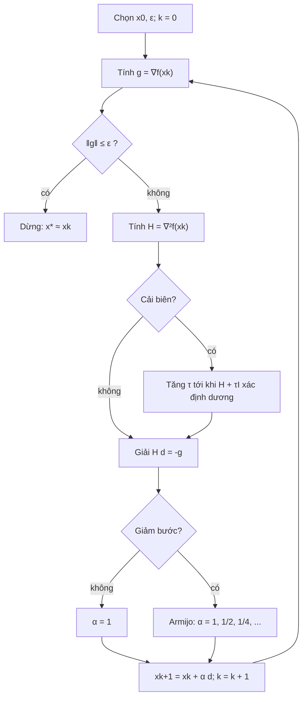
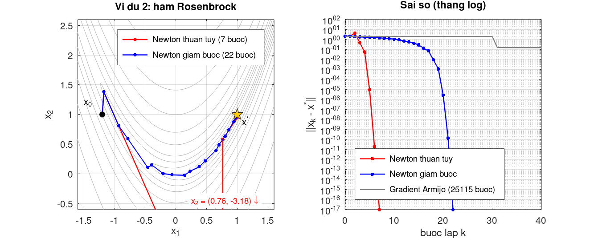
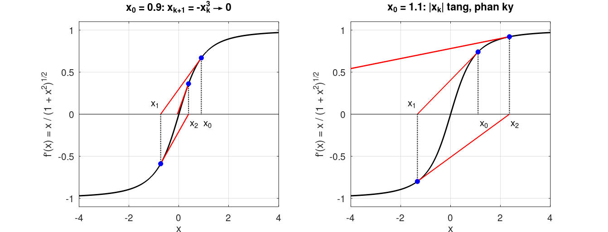
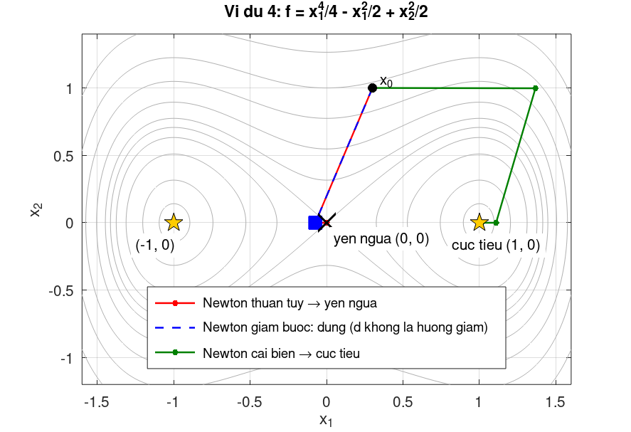
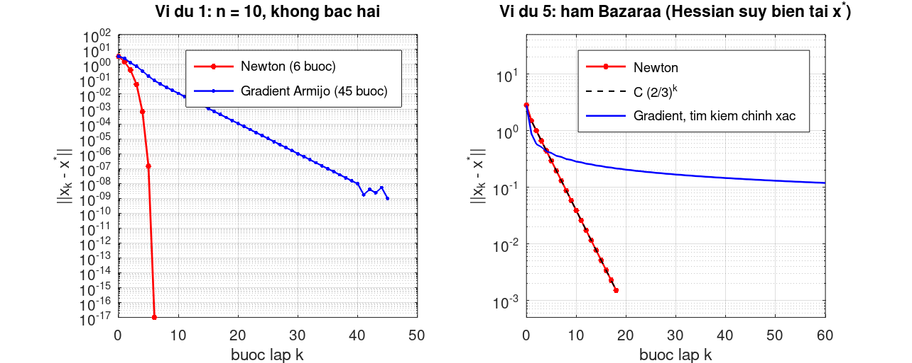

# Câu 11. Thuật toán Newton tìm cực tiểu của hàm n biến

## 1. Bài toán và ý tưởng

```math
\min\; f(x), \qquad x \in \mathbb{R}^n, \qquad f \text{ khả vi liên tục hai lần}.
```

Thuật toán gradient ([câu 10](../q10-gradient-momentum/)) chỉ dùng thông tin bậc nhất, nên tốc độ phụ thuộc số điều kiện $`\kappa`$ của bài toán. Thuật toán Newton dùng thêm **ma trận Hessian** $`\nabla^2 f(x)`$. Tại $`x_k`$, ký hiệu $`g_k = \nabla f(x_k)`$, $`H_k = \nabla^2 f(x_k)`$. Ta xấp xỉ $`f`$ bằng khai triển Taylor bậc hai

```math
f(x_k + d) \approx m_k(d) = f(x_k) + g_k^T d + \tfrac{1}{2}\, d^T H_k d .
```

Nếu $`H_k`$ xác định dương thì $`m_k`$ là hàm bậc hai lồi ngặt, có cực tiểu duy nhất tại nghiệm của $`\nabla m_k(d) = g_k + H_k d = 0`$:

```math
d_k = -H_k^{-1} g_k \qquad \text{(hướng Newton)}, \qquad x_{k+1} = x_k + d_k .
```

Cách nhìn thứ hai: điểm dừng $`x^*`$ là nghiệm của hệ phương trình $`\nabla f(x) = 0`$. Áp dụng phương pháp Newton giải hệ phi tuyến (tuyến tính hóa $`\nabla f(x_k + d) \approx g_k + H_k d = 0`$) cho đúng công thức trên. Trong một chiều, đó là phương pháp tiếp tuyến áp dụng cho $`f'`$ (hình ở ví dụ 3).

**Hướng giảm.** Nếu $`H_k`$ xác định dương và $`g_k \ne 0`$ thì

```math
g_k^T d_k = -g_k^T H_k^{-1} g_k \lt 0,
```

nên $`d_k`$ là hướng giảm. Nếu $`H_k`$ không xác định dương, $`d_k`$ có thể là hướng **tăng**, hoặc không xác định khi $`H_k`$ suy biến (ví dụ 4).

## 2. Thuật toán Newton

**Newton thuần túy.** Chọn $`x_0`$, sai số $`\varepsilon \gt 0`$. Với $`k = 0, 1, 2, \dots`$:

1. Tính $`g_k = \nabla f(x_k)`$. Nếu $`\lVert g_k \rVert \le \varepsilon`$ thì dừng.
2. Tính $`H_k = \nabla^2 f(x_k)`$, giải hệ tuyến tính $`H_k d_k = -g_k`$ (không tính ma trận nghịch đảo).
3. Đặt $`x_{k+1} = x_k + d_k`$.



**Chi phí mỗi bước:** một lần tính gradient ($`n`$ hàm), một lần tính Hessian ($`n(n+1)/2`$ hàm) và giải hệ $`n \times n`$ bằng phân tích Cholesky, khoảng $`n^3/3`$ phép nhân. Gradient chỉ cần $`O(n)`$ phép tính mỗi bước. Đổi lại, Newton cần rất ít bước (mục 3).

## 3. Sự hội tụ

**Định lý 1 (hàm bậc hai).** Nếu $`f(x) = \tfrac{1}{2} x^T A x - b^T x`$ với $`A`$ đối xứng xác định dương, Newton hội tụ tới $`x^* = A^{-1} b`$ sau **đúng một bước** từ mọi $`x_0`$, không phụ thuộc $`\kappa(A)`$.

*Chứng minh.* $`g_0 = A x_0 - b`$, $`H_0 = A`$, nên $`x_1 = x_0 - A^{-1}(A x_0 - b) = A^{-1} b = x^*`$. $`\square`$

**Định lý 2 (hội tụ bậc hai địa phương).** Giả sử $`\nabla f(x^*) = 0`$, $`\nabla^2 f(x^*)`$ xác định dương với trị riêng nhỏ nhất $`m \gt 0`$, và Hessian liên tục Lipschitz với hằng số $`L_H`$ trong lân cận của $`x^*`$:

```math
\lVert \nabla^2 f(x) - \nabla^2 f(y) \rVert \le L_H \lVert x - y \rVert .
```

Khi đó nếu $`\lVert x_0 - x^* \rVert \le r = \dfrac{m}{2 L_H}`$ thì dãy Newton thuần túy được xác định, ở lại trong hình cầu bán kính $`r`$, hội tụ tới $`x^*`$, và với $`e_k = x_k - x^*`$:

```math
\lVert e_{k+1} \rVert \le \frac{L_H}{m} \lVert e_k \rVert^2 .
```

*Chứng minh.* Giả sử $`\lVert e_k \rVert \le r`$.

(a) $`H_k`$ khả nghịch. Theo tính Lipschitz, $`\lVert H_k - \nabla^2 f(x^*) \rVert \le L_H \lVert e_k \rVert \le m/2`$. Do trị riêng của ma trận đối xứng thay đổi không quá chuẩn của nhiễu (định lý Weyl), $`\lambda_{\min}(H_k) \ge m - m/2 = m/2 \gt 0`$, nên $`\lVert H_k^{-1} \rVert \le 2/m`$.

(b) Dùng $`\nabla f(x^*) = 0`$ và công thức Newton–Leibniz cho $`\nabla f`$ trên đoạn $`[x^*, x_k]`$:

```math
g_k = \nabla f(x_k) - \nabla f(x^*) = \int_0^1 \nabla^2 f(x^* + t e_k)\, e_k \, dt .
```

Do đó

```math
e_{k+1} = e_k - H_k^{-1} g_k = H_k^{-1} \int_0^1 \big[ H_k - \nabla^2 f(x^* + t e_k) \big] e_k \, dt .
```

Vì $`\lVert H_k - \nabla^2 f(x^* + t e_k) \rVert \le L_H (1 - t) \lVert e_k \rVert`$ và $`\int_0^1 (1 - t)\, dt = \tfrac{1}{2}`$:

```math
\lVert e_{k+1} \rVert \le \frac{2}{m} \cdot \frac{L_H}{2} \lVert e_k \rVert^2 = \frac{L_H}{m} \lVert e_k \rVert^2 .
```

(c) Vì $`\lVert e_k \rVert \le r = m/(2L_H)`$ nên $`\lVert e_{k+1} \rVert \le \tfrac{1}{2} \lVert e_k \rVert \le r`$: dãy ở lại trong hình cầu, và quy nạp cho $`\lVert e_k \rVert \le 2^{-k} \lVert e_0 \rVert \to 0`$. $`\square`$

Hội tụ bậc hai nghĩa là **số chữ số đúng tăng gấp đôi** mỗi bước khi đã ở gần $`x^*`$: sai số $`10^{-3} \to 10^{-6} \to 10^{-12}`$. Định lý chỉ có tính **địa phương**: xa $`x^*`$, Newton thuần túy có thể phân kỳ (ví dụ 3), làm tăng $`f`$ (ví dụ 2), hoặc hội tụ tới điểm yên ngựa hay cực đại (ví dụ 4), vì nó chỉ tìm nghiệm của $`\nabla f = 0`$.

**Bất biến affine.** Đổi biến $`x = T y`$ với $`T`$ khả nghịch, $`\tilde f(y) = f(Ty)`$. Khi đó $`\nabla \tilde f(y) = T^T \nabla f(x)`$, $`\nabla^2 \tilde f(y) = T^T \nabla^2 f(x) T`$, nên hướng Newton theo $`y`$ là

```math
\tilde d = -\big(T^T H T\big)^{-1} T^T g = -T^{-1} H^{-1} g = T^{-1} d .
```

Vậy dãy Newton theo $`y`$ đúng bằng $`y_k = T^{-1} x_k`$: thuật toán **không bị ảnh hưởng bởi phép co giãn biến**, trong khi gradient thì có (zic-zac ở câu 10). Đây là lý do Newton không phụ thuộc $`\kappa`$.

**Hessian suy biến tại x\*.** Khi $`\nabla^2 f(x^*)`$ suy biến, định lý 2 không áp dụng và tốc độ thường chỉ còn **tuyến tính**. Ví dụ một chiều $`f(t) = t^p`$, $`p \ge 3`$ chẵn:

```math
t_{k+1} = t_k - \frac{p\, t_k^{p-1}}{p(p-1)\, t_k^{p-2}} = \Big(1 - \frac{1}{p-1}\Big) t_k ,
```

với $`p = 4`$ tỉ số là $`2/3`$ (xem ví dụ 5).

## 4. Các biến thể để hội tụ toàn cục

**Newton giảm bước (damped Newton).** Giữ hướng $`d_k`$ nhưng chọn độ dài bước $`\alpha_k`$ bằng quy tắc Armijo: thử $`\alpha = 1, \rho, \rho^2, \dots`$ cho tới khi

```math
f(x_k + \alpha d_k) \le f(x_k) + c\, \alpha\, g_k^T d_k , \qquad c = 10^{-4},\ \rho = 1/2 .
```

Khi $`H_k`$ xác định dương, $`d_k`$ là hướng giảm nên vòng thử luôn dừng, và $`f(x_k)`$ giảm đơn điệu. Với $`f`$ lồi mạnh, có thể chứng minh thuật toán hội tụ từ **mọi** $`x_0`$, và khi đã đủ gần $`x^*`$ thì bước $`\alpha = 1`$ luôn được chấp nhận, nên lấy lại tốc độ bậc hai (Boyd & Vandenberghe, *Convex Optimization*, mục 9.5). Thử $`\alpha = 1`$ đầu tiên là quan trọng: nó giữ nguyên bước Newton đầy đủ khi bước đó tốt.

Nếu $`H_k`$ không xác định dương, $`d_k`$ có thể không là hướng giảm ($`g_k^T d_k \ge 0`$). Khi đó không có $`\alpha \gt 0`$ nào thỏa Armijo; chương trình dừng với `exitflag = -2` (ví dụ 4).

**Newton cải biên (modified Newton).** Thay $`H_k`$ bằng $`H_k + \tau_k I`$ với $`\tau_k \ge 0`$ nhỏ nhất (theo dãy thử) sao cho ma trận xác định dương; kiểm tra bằng phân tích Cholesky:

- nếu $`\min_i (H_k)_{ii} \gt 0`$ thử $`\tau = 0`$, ngược lại thử $`\tau = -\min_i (H_k)_{ii} + \beta`$, $`\beta = 10^{-3}`$;
- nếu Cholesky thất bại thì nhân đôi $`\tau`$ và thử lại.

Khi đó $`d_k = -(H_k + \tau_k I)^{-1} g_k`$ luôn là hướng giảm, kết hợp với Armijo. Gần cực tiểu, nơi $`H_k`$ xác định dương, $`\tau_k = 0`$ và thuật toán trở lại Newton thuần túy. Khi $`\tau`$ rất lớn, $`d_k \approx -g_k/\tau`$, tức là gần với hướng gradient.

| Biến thể | Hướng | Bước | Ưu điểm | Hạn chế |
|---|---|---|---|---|
| Thuần túy | $`-H_k^{-1} g_k`$ | $`\alpha = 1`$ | Hội tụ bậc hai gần $`x^*`$ | Chỉ hội tụ địa phương; có thể tăng $`f`$, phân kỳ, tới điểm yên ngựa |
| Giảm bước | $`-H_k^{-1} g_k`$ | Armijo | $`f`$ giảm đơn điệu; hội tụ toàn cục với $`f`$ lồi | Bế tắc khi $`H_k`$ không xác định dương |
| Cải biên | $`-(H_k + \tau_k I)^{-1} g_k`$ | Armijo | Luôn là hướng giảm, dùng được với $`f`$ không lồi | Thêm vài lần phân tích Cholesky mỗi bước |

## 5. Chương trình Matlab

| File | Nội dung |
|---|---|
| `newton_method.m` | `[x, fval, out] = newton_method(f, grad, hess, x0, opts)`: thuật toán Newton, `opts.variant = 'pure'`, `'damped'` hoặc `'modified'` |
| `run_examples.m` | Năm ví dụ minh họa và bốn hình vẽ |

- Người dùng cung cấp hàm $`f`$, gradient và Hessian dưới dạng function handle.
- Dừng khi $`\lVert \nabla f \rVert \le`$ `opts.tol` (mặc định $`10^{-10}`$) hoặc sau `opts.maxIter` bước (mặc định 100). Hướng được tính bằng `H \ g` (giải hệ, không nghịch đảo).
- `exitflag`: 1 = đạt sai số; 0 = hết số bước; -1 = phân kỳ hoặc Hessian suy biến (`rcond(H) < 1e-14`); -2 = biến thể `'damped'` gặp hướng không giảm.
- Kết quả lưu dãy điểm (`out.X`), giá trị hàm (`out.F`), chuẩn gradient (`out.G`), các bước $`\alpha_k`$ (`out.alphas`) và các hệ số $`\tau_k`$ (`out.taus`); `opts.display = true` in bảng từng bước.
- Để so sánh, `run_examples.m` dùng lại `gradient_descent.m` của [câu 10](../q10-gradient-momentum/) (cùng `golden_section.m` của [câu 7](../q07-golden-section-search/) và `bracket_minimum.m` của [câu 8](../q08-gauss-seidel/)); đường dẫn đã được thêm sẵn.

Cách chạy (trong thư mục `solutions/q11-newton-method`):

```matlab
>> run_examples
```

Đã chạy kiểm tra bằng GNU Octave; chưa chạy trên MATLAB (chương trình chỉ dùng các hàm có ở cả hai: `chol`, `rcond`, `mat2str`, `contour`, `semilogy`).

## 6. Ví dụ minh họa

### Ví dụ 1: hàm n = 10 biến

**Hàm bậc hai** của câu 8 và câu 10: $`f(x) = \tfrac{1}{2} x^T A x - b^T x`$, $`A = \mathrm{tridiag}(-1, 2, -1)`$, $`b = (1, \dots, 1)`$, $`\kappa = 48.37`$, $`x_0 = 0`$. Newton đạt $`x^*`$ sau **1 bước** ($`\lVert x_1 - x^* \rVert = 2.2\cdot10^{-14}`$, chỉ còn sai số làm tròn), đúng như định lý 1. Trên cùng bài toán, Gauss–Seidel (câu 8) cần 207 vòng, gradient (câu 10) 472 bước, gradient quán tính 78 bước. Với các hàm bậc hai đường chéo có $`\kappa = 10^2, 10^4, 10^6`$, Newton vẫn chỉ cần 1 bước.

**Hàm không bậc hai**, lồi ngặt:

```math
f(x) = \tfrac{1}{2} x^T A x - b^T x + \tfrac{1}{4} \sum_{i=1}^{10} x_i^4, \qquad \nabla f = A x - b + x^3, \qquad \nabla^2 f = A + \mathrm{diag}(3 x_i^2),
```

với $`x_0 = (2, \dots, 2)`$. Kết quả Newton thuần túy (lấy $`x^*`$ là điểm cuối cùng, $`\lVert \nabla f \rVert = 2.2\cdot10^{-14}`$):

| $`k`$ | $`f(x_k)`$ | $`\lVert \nabla f(x_k) \rVert`$ | $`\lVert x_k - x^* \rVert`$ | $`\lVert e_k \rVert / \lVert e_{k-1} \rVert^2`$ |
|---|---|---|---|---|
| 0 | 24 | 23.5 | 3.37 | |
| 1 | -2.703303 | 6.32 | 1.45 | 0.13 |
| 2 | -6.467248 | 1.33 | 0.412 | 0.20 |
| 3 | -6.727321 | 0.131 | $`4.57\cdot10^{-2}`$ | 0.27 |
| 4 | -6.730306 | $`1.86\cdot10^{-3}`$ | $`6.56\cdot10^{-4}`$ | 0.31 |
| 5 | -6.730307 | $`4.16\cdot10^{-7}`$ | $`1.46\cdot10^{-7}`$ | 0.34 |
| 6 | -6.730307 | $`2.24\cdot10^{-14}`$ | 0 | |

```math
x^* = (0.75694,\ 0.94756,\ 0.98897,\ 0.99768,\ 0.99942,\ 0.99942,\ 0.99768,\ 0.98897,\ 0.94756,\ 0.75694).
```

Tỉ số $`\lVert e_k \rVert / \lVert e_{k-1} \rVert^2`$ bị chặn (khoảng 0.3): hội tụ bậc hai, số chữ số đúng tăng gấp đôi ở các bước 4 → 5 → 6. Gradient với Armijo cần 45 bước, gradient với tìm kiếm chính xác cần 28 bước để $`\lVert \nabla f \rVert \le 10^{-8}`$ (hình ở cuối mục).

### Ví dụ 2: hàm Rosenbrock, Newton thuần túy và giảm bước

```math
R(x) = 100\,(x_2 - x_1^2)^2 + (1 - x_1)^2, \qquad x_0 = (-1.2,\ 1), \qquad x^* = (1, 1),
```

```math
\nabla^2 R(x) = \begin{pmatrix} 1200 x_1^2 - 400 x_2 + 2 & -400 x_1 \\ -400 x_1 & 200 \end{pmatrix}.
```

**Newton thuần túy:**

| $`k`$ | $`x_k`$ | $`R(x_k)`$ | $`\lVert \nabla R(x_k) \rVert`$ | $`\lVert x_k - x^* \rVert`$ |
|---|---|---|---|---|
| 0 | (-1.2, 1) | 24.2 | 232.9 | 2.20 |
| 1 | (-1.17528, 1.38067) | 4.73 | 4.64 | 2.21 |
| 2 | (0.76311, -3.17503) | **1411.8** | 1370.8 | 4.18 |
| 3 | (0.76343, 0.58282) | 0.0560 | 0.473 | 0.480 |
| 4 | (0.99999531, 0.94402732) | **0.313** | 25.0 | 0.0560 |
| 5 | (0.9999957, 0.99999139) | $`1.9\cdot10^{-11}`$ | $`8.6\cdot10^{-6}`$ | $`9.6\cdot10^{-6}`$ |
| 6 | (1, 1) | $`3.4\cdot10^{-20}`$ | $`8.3\cdot10^{-9}`$ | $`1.9\cdot10^{-11}`$ |
| 7 | (1, 1) | 0 | 0 | 0 |

- Hội tụ trong 7 bước, nhưng $`R`$ **không giảm đơn điệu**: ở bước 2, $`R`$ tăng từ 4.73 lên 1411.8 (điểm $`x_2`$ nằm ngoài hình bên dưới), ở bước 4 tăng từ 0.056 lên 0.313. Newton thuần túy không phải là phương pháp hướng giảm.
- Ở các bước cuối, $`e_{k+1}/e_k^2`$ bằng $`0.243`$, $`0.003`$, $`0.2`$: bị chặn, tức là hội tụ bậc hai ($`0.056 \to 9.6\cdot10^{-6} \to 1.9\cdot10^{-11}`$). Bước 7 rơi đúng vào $`x^*`$ trong số học dấu phẩy động.

**Newton giảm bước (Armijo)** cần 22 bước. Các bước $`\alpha_k \lt 1`$ chỉ xuất hiện ở bước 2 ($`\alpha = 0.125`$), 6 ($`0.25`$), 10 và 14 ($`0.5`$); từ bước 15 luôn $`\alpha = 1`$, và 5 bước cuối có sai số $`9.2\cdot10^{-3} \to 1.2\cdot10^{-3} \to 2.7\cdot10^{-6} \to 1.4\cdot10^{-10} \to 0`$. $`R`$ giảm đơn điệu, dãy đi dọc theo đáy thung lũng (hình trái). Ở ví dụ này giảm bước chậm hơn thuần túy (22 so với 7 bước), vì bước nhảy "liều" của Newton thuần túy tình cờ có lợi. Ví dụ 3 cho thấy điều ngược lại.

Để so sánh: gradient với Armijo ([câu 10](../q10-gradient-momentum/)) cần **25115** bước để $`\lVert \nabla R \rVert \le 10^{-10}`$.



### Ví dụ 3: Newton thuần túy phân kỳ

```math
f(x) = \sqrt{1 + x^2}, \qquad f'(x) = \frac{x}{\sqrt{1 + x^2}}, \qquad f''(x) = (1 + x^2)^{-3/2} \gt 0 .
```

Hàm lồi ngặt, cực tiểu $`x^* = 0`$, $`f''(0) = 1`$. Công thức Newton:

```math
x_{k+1} = x_k - \frac{f'(x_k)}{f''(x_k)} = x_k - x_k (1 + x_k^2) = -x_k^3 .
```

Vậy $`\lvert x_{k+1} \rvert = \lvert x_k \rvert^3`$: hội tụ (bậc ba, vì $`f'''(0) = 0`$) nếu $`\lvert x_0 \rvert \lt 1`$, dao động $`1, -1, 1, \dots`$ nếu $`\lvert x_0 \rvert = 1`$, và **phân kỳ** nếu $`\lvert x_0 \rvert \gt 1`$. Kết quả chạy:

| $`x_0`$ | $`x_1, x_2, x_3, x_4`$ | Kết quả |
|---|---|---|
| 0.5 | -0.125, 0.001953, $`-7.5\cdot10^{-9}`$, 0 | 4 bước |
| 0.9 | -0.729, 0.3874, -0.05815, 0.0001966 | 5 bước |
| 1 | -1, 1, -1, 1 | dao động, hết 12 bước |
| 1.1 | -1.331, 2.358, -13.11, 2253 | phân kỳ, $`x_8 \approx 3.8\cdot10^{271}`$ |

Hình dưới giải thích bằng phương pháp tiếp tuyến cho $`f'`$: khi $`\lvert x \rvert \gt 1`$, $`f'`$ đã gần phẳng (gần tiệm cận $`\pm 1`$), tiếp tuyến cắt trục hoành ở rất xa.

Newton giảm bước sửa được: từ $`x_0 = 1.1`$, bước $`\alpha = 1`$ làm $`f`$ tăng ($`f(-1.331) = 1.666 \gt f(1.1) = 1.487`$) nên bị giảm còn $`\alpha = 0.5`$, cho $`x_1 = -0.1155`$; sau đó $`\alpha = 1`$ và hội tụ trong 4 bước ($`0.00154`$, $`-3.7\cdot10^{-9}`$, 0). Từ $`x_0 = 10`$, giảm bước cần 6 bước với $`\alpha = 1/64, 1/32, 1, 1, 1, 1`$.



### Ví dụ 4: hàm không lồi, Hessian không xác định dương

```math
f(x) = \tfrac{1}{4} x_1^4 - \tfrac{1}{2} x_1^2 + \tfrac{1}{2} x_2^2, \qquad \nabla f = \begin{pmatrix} x_1^3 - x_1 \\ x_2 \end{pmatrix}, \qquad \nabla^2 f = \begin{pmatrix} 3x_1^2 - 1 & 0 \\ 0 & 1 \end{pmatrix}.
```

Điểm dừng: hai cực tiểu $`(\pm 1, 0)`$ với $`f = -0.25`$, và điểm yên ngựa $`(0, 0)`$ (Hessian có trị riêng $`-1`$ và $`1`$). Hessian xác định dương khi và chỉ khi $`\lvert x_1 \rvert \gt 1/\sqrt{3} \approx 0.577`$. Xuất phát từ $`x_0 = (0.3, 1)`$, có $`\nabla^2 f(x_0) = \mathrm{diag}(-0.73, 1)`$.

- **Newton thuần túy** hội tụ (bậc hai) tới **điểm yên ngựa**: $`(-0.07397, 0) \to (0.000823, 0) \to (-1.1\cdot10^{-9}, 0) \to (0, 0)`$, $`f = 0`$. Theo thành phần $`x_1`$, Newton giải $`x_1^3 - x_1 = 0`$ mà không phân biệt cực đại hay cực tiểu.
- **Newton giảm bước**: bước 1 giống thuần túy (hướng tại $`x_0`$ vẫn là hướng giảm vì thành phần $`x_2`$ chiếm ưu thế: $`g_0^T d_0 = -0.898`$, và $`f`$ giảm từ $`0.457`$ xuống $`-0.0027`$). Tại $`x_1 = (-0.07397, 0)`$: $`g = (0.07357, 0)`$, $`d = (0.0748, 0)`$, $`g^T d = 5.5\cdot10^{-3} \gt 0`$, tức $`d`$ là **hướng tăng**. Không bước $`\alpha \gt 0`$ nào thỏa Armijo, chương trình dừng với `exitflag = -2`.
- **Newton cải biên**: ở bước 1, $`\tau = 0.73 + 10^{-3} = 0.731`$, $`H + \tau I = \mathrm{diag}(0.001, 1.731)`$. Ma trận gần suy biến nên bước Newton theo $`x_1`$ rất dài ($`d_1 = 273`$), Armijo giảm còn $`\alpha = 1/256`$, cho $`x_1 = (1.3664, 0.9977)`$. Từ đây Hessian xác định dương, $`\tau = 0`$, thuật toán là Newton thuần túy: $`(1.1089, 0) \to (1.0142, 0) \to (1.00029, 0) \to (1.0000001, 0) \to (1, 0)`$, **cực tiểu** với $`f = -0.25`$ sau 6 bước.

Hệ số nhỏ $`\beta = 10^{-3}`$ cho ma trận "vừa đủ" xác định dương, nên bước đầu quá dài và cần 8 lần chia đôi; chọn $`\beta`$ lớn hơn cho hướng gần gradient hơn. Đây là sự đánh đổi của phương pháp.



### Ví dụ 5: hàm Bazaraa, Hessian suy biến tại x\*

```math
F(x) = (x_1 - 2)^4 + (x_1 - 2x_2)^2, \qquad x_0 = (0, 3), \qquad x^* = (2, 1),
```

```math
\nabla^2 F(x) = \begin{pmatrix} 12 (x_1 - 2)^2 + 2 & -4 \\ -4 & 8 \end{pmatrix}, \qquad \nabla^2 F(x^*) = \begin{pmatrix} 2 & -4 \\ -4 & 8 \end{pmatrix} \ (\det = 0).
```

| $`k`$ | $`x_k`$ | $`F(x_k)`$ | $`\lVert \nabla F(x_k) \rVert`$ |
|---|---|---|---|
| 0 | (0, 3) | 52 | 50.12 |
| 1 | (0.666667, 0.333333) | 3.160494 | 9.48 |
| 2 | (1.111111, 0.555556) | 0.624295 | 2.81 |
| 3 | (1.407407, 0.703704) | 0.123318 | 0.832 |
| 4 | (1.604938, 0.802469) | 0.024359 | 0.247 |
| 5 | (1.736626, 0.868313) | 0.004812 | 0.0731 |
| 6 | (1.824417, 0.912209) | 0.000950 | 0.0217 |

Giải tay. Sau bước 1, $`x_1 - 2x_2 = 0`$. Trên đường thẳng $`x_1 = 2x_2`$, đặt $`t = x_1 - 2`$: $`\nabla F = (4t^3, 0)`$. Giải $`\nabla^2 F\, d = -\nabla F`$: dòng 2 cho $`-4 d_1 + 8 d_2 = 0`$, tức $`d_2 = d_1/2`$ (dãy ở lại trên đường thẳng). Dòng 1 cho $`(12t^2 + 2) d_1 - 2 d_1 = -4t^3`$, tức $`d_1 = -t/3`$. Vậy

```math
t_{k+1} = \tfrac{2}{3}\, t_k ,
```

đúng với mục 3 khi $`p = 4`$: $`t = -2, -1.3333, -0.88889, -0.59259, -0.39506, \dots`$ Kết quả chạy cho tỉ số sai số $`e_{k+1}/e_k`$ bằng $`0.527`$ ở bước đầu và **đúng $`0.6667`$** ở mọi bước sau. Với $`\lVert \nabla F \rVert \le 10^{-8}`$: 18 bước, $`x = (1.99865, 0.999323)`$, $`F = 3.4\cdot10^{-12}`$, nhưng $`\lVert x - x^* \rVert = 1.5\cdot10^{-3}`$. Vì $`\nabla F \sim t^3`$ nên gradient rất nhỏ trong khi $`x`$ còn xa $`x^*`$.

Hội tụ chỉ còn tuyến tính, nhưng vẫn nhanh hơn nhiều so với gradient với tìm kiếm chính xác ở câu 10: gradient cần 183 bước để $`\lVert \nabla F \rVert \le 10^{-3}`$ và vẫn cách $`x^*`$ khoảng $`0.068`$.



## 7. Nhận xét

- Gần một cực tiểu có Hessian xác định dương, Newton hội tụ **bậc hai** (ví dụ 1, 2): chỉ vài bước là đạt độ chính xác máy. Thuật toán bất biến affine nên không bị ảnh hưởng bởi số điều kiện; với hàm bậc hai chỉ cần một bước, so với hàng trăm bước của gradient.
- Cái giá: mỗi bước cần Hessian ($`O(n^2)`$ đạo hàm riêng) và giải hệ tuyến tính ($`O(n^3)`$). Với $`n`$ lớn (hàng nghìn biến trở lên) hoặc khi khó tính Hessian, chi phí này quá đắt.
- Newton thuần túy chỉ hội tụ **địa phương**: có thể làm tăng $`f`$ (ví dụ 2), phân kỳ ngay cả với hàm lồi ngặt (ví dụ 3), hoặc hội tụ tới điểm yên ngựa (ví dụ 4). Trong thực tế dùng Newton giảm bước (hàm lồi) hoặc Newton cải biên (hàm không lồi); cả hai giữ $`\alpha = 1`$ và $`\tau = 0`$ khi gần cực tiểu nên vẫn hội tụ bậc hai.
- Khi Hessian tại $`x^*`$ suy biến (ví dụ 5), tốc độ chỉ còn tuyến tính, và tiêu chuẩn dừng theo $`\lVert \nabla f \rVert`$ đánh giá quá lạc quan độ chính xác của $`x`$.
- Để giữ phần lớn tốc độ của Newton mà không cần tính Hessian và giải hệ $`O(n^3)`$, ta xấp xỉ Hessian (hoặc nghịch đảo của nó) từ các gradient đã tính: đó là thuật toán tựa Newton (câu 12).
