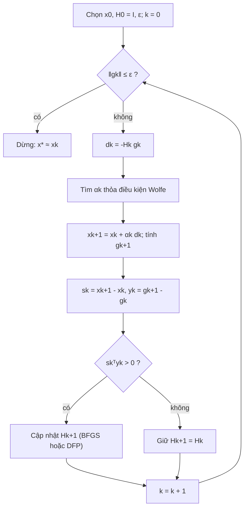
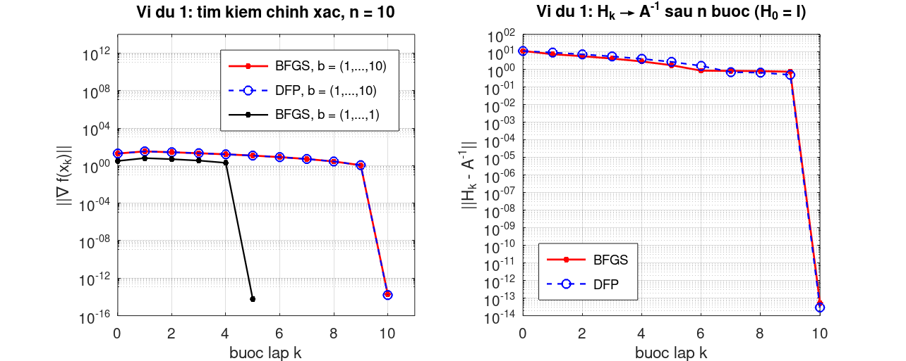
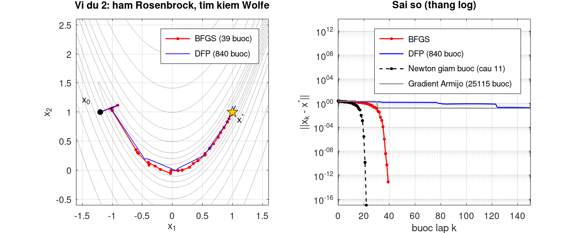
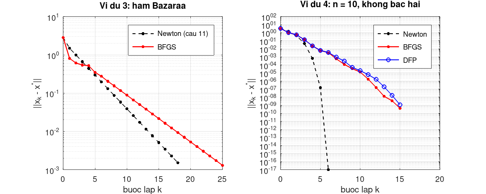

# Câu 12. Thuật toán tựa Newton tìm cực tiểu của hàm n biến

## 1. Bài toán và ý tưởng

```math
\min\; f(x), \qquad x \in \mathbb{R}^n, \qquad f \text{ khả vi liên tục}.
```

Thuật toán Newton ([câu 11](../q11-newton-method/)) hội tụ bậc hai nhưng mỗi bước phải tính ma trận Hessian $`\nabla^2 f(x_k)`$ và giải một hệ tuyến tính $`n \times n`$ (khoảng $`n^3/3`$ phép nhân). Thuật toán gradient ([câu 10](../q10-gradient-momentum/)) rẻ nhưng chậm. Thuật toán **tựa Newton** (quasi-Newton) đi giữa hai cách: dùng hướng

```math
d_k = -H_k \nabla f(x_k), \qquad x_{k+1} = x_k + \alpha_k d_k ,
```

trong đó $`H_k`$ là một **xấp xỉ của nghịch đảo Hessian**. Ma trận này được cập nhật sau mỗi bước chỉ từ các gradient đã tính, không cần đạo hàm bậc hai.

**Phương trình cát tuyến.** Ký hiệu $`g_k = \nabla f(x_k)`$ và

```math
s_k = x_{k+1} - x_k, \qquad y_k = g_{k+1} - g_k .
```

Theo khai triển Taylor của $`\nabla f`$, $`y_k \approx \nabla^2 f(x_{k+1})\, s_k`$; với hàm bậc hai $`f = \tfrac{1}{2} x^T A x - b^T x`$ thì $`y_k = A s_k`$ đúng tuyệt đối. Vì vậy ta đòi hỏi $`H_{k+1}`$ thỏa **phương trình cát tuyến** (secant equation)

```math
H_{k+1} y_k = s_k .
```

Với $`n = 1`$ điều này xác định duy nhất $`H_{k+1} = s_k / y_k`$ (phương pháp cát tuyến). Với $`n \gt 1`$, có vô số ma trận thỏa mãn; ta chọn ma trận **đối xứng, xác định dương** và **gần $`H_k`$ nhất**, bằng cách cộng thêm một ma trận hạng hai.

## 2. Hai công thức cập nhật: DFP và BFGS

Ký hiệu $`\rho_k = 1 / (y_k^T s_k)`$.

**DFP** (Davidon 1959, Fletcher và Powell 1963):

```math
H_{k+1} = H_k - \frac{H_k y_k y_k^T H_k}{y_k^T H_k y_k} + \frac{s_k s_k^T}{y_k^T s_k} .
```

**BFGS** (Broyden, Fletcher, Goldfarb, Shanno 1970):

```math
H_{k+1} = \big(I - \rho_k s_k y_k^T\big)\, H_k\, \big(I - \rho_k y_k s_k^T\big) + \rho_k s_k s_k^T .
```

Cả hai đều cộng vào $`H_k`$ một ma trận đối xứng hạng không quá hai, nên chi phí cập nhật là $`O(n^2)`$. BFGS là công thức "đối ngẫu" của DFP: viết DFP cho xấp xỉ Hessian $`B_k \approx \nabla^2 f`$ (thay vì nghịch đảo) và đổi vai trò $`s_k \leftrightarrow y_k`$, rồi lấy nghịch đảo bằng công thức Sherman–Morrison–Woodbury, ta được BFGS. Mỗi công thức là nghiệm của bài toán "tìm ma trận đối xứng thỏa phương trình cát tuyến và gần $`H_k`$ nhất" theo một chuẩn Frobenius có trọng số (Nocedal & Wright, *Numerical Optimization*, mục 6.1).

**Kiểm tra phương trình cát tuyến.**

- DFP: $`H_{k+1} y_k = H_k y_k - H_k y_k \cdot \dfrac{y_k^T H_k y_k}{y_k^T H_k y_k} + s_k \cdot \dfrac{s_k^T y_k}{y_k^T s_k} = s_k`$.
- BFGS: $`(I - \rho_k y_k s_k^T) y_k = y_k - \rho_k y_k (s_k^T y_k) = 0`$, nên $`H_{k+1} y_k = 0 + \rho_k s_k (s_k^T y_k) = s_k`$.

**Họ Broyden.** Mọi tổ hợp $`H_{k+1} = (1 - \phi) H^{\mathrm{DFP}}_{k+1} + \phi H^{\mathrm{BFGS}}_{k+1}`$ cũng thỏa phương trình cát tuyến.

## 3. Thuật toán

Chọn $`x_0`$, $`H_0`$ đối xứng xác định dương (thường là $`I`$), sai số $`\varepsilon`$. Với $`k = 0, 1, 2, \dots`$:

1. Nếu $`\lVert g_k \rVert \le \varepsilon`$ thì dừng.
2. Hướng $`d_k = -H_k g_k`$.
3. Tìm $`\alpha_k`$ bằng tìm kiếm theo tia (điều kiện Wolfe hoặc tìm kiếm chính xác); $`x_{k+1} = x_k + \alpha_k d_k`$.
4. Tính $`g_{k+1}`$, $`s_k`$, $`y_k`$ và cập nhật $`H_{k+1}`$ theo DFP hoặc BFGS.



**Điều kiện Wolfe.** Với $`0 \lt c_1 \lt c_2 \lt 1`$ (chương trình dùng $`c_1 = 10^{-4}`$, $`c_2 = 0.9`$), bước $`\alpha`$ phải thỏa:

```math
f(x_k + \alpha d_k) \le f(x_k) + c_1 \alpha\, g_k^T d_k \qquad \text{(giảm đủ, Armijo)},
```

```math
\big| \nabla f(x_k + \alpha d_k)^T d_k \big| \le c_2 \big| g_k^T d_k \big| \qquad \text{(độ cong, dạng mạnh)}.
```

Điều kiện thứ hai loại các bước quá ngắn, và quan trọng hơn, bảo đảm $`s_k^T y_k \gt 0`$ (định lý 2).

**Chi phí mỗi bước:** một gradient, vài lần tính $`f`$ trong tìm kiếm theo tia, một tích ma trận–vector và một cập nhật hạng hai, tổng cộng $`O(n^2)`$. Không cần Hessian, không giải hệ tuyến tính. Bộ nhớ $`O(n^2)`$; khi $`n`$ rất lớn, dùng L-BFGS (chỉ lưu vài cặp $`s_k, y_k`$ gần nhất).

## 4. Các tính chất

**Định lý 1 (giữ tính xác định dương).** Nếu $`H_k`$ đối xứng xác định dương và $`s_k^T y_k \gt 0`$ thì $`H_{k+1}`$ (DFP hoặc BFGS) đối xứng xác định dương. Do đó $`d_{k+1}`$ là hướng giảm.

*Chứng minh.* Lấy $`z \ne 0`$.

BFGS: đặt $`V = I - \rho_k y_k s_k^T`$, thì $`z^T H_{k+1} z = (Vz)^T H_k (Vz) + \rho_k (s_k^T z)^2 \ge 0`$ vì $`\rho_k \gt 0`$. Nếu bằng 0 thì $`s_k^T z = 0`$ và $`V z = 0`$; nhưng $`V z = z - \rho_k y_k (s_k^T z) = z \ne 0`$, mâu thuẫn.

DFP: với tích vô hướng $`\langle u, v \rangle = u^T H_k v`$, bất đẳng thức Cauchy–Schwarz cho $`(z^T H_k y_k)^2 \le (z^T H_k z)(y_k^T H_k y_k)`$, nên

```math
z^T H_{k+1} z = \Big[ z^T H_k z - \frac{(z^T H_k y_k)^2}{y_k^T H_k y_k} \Big] + \frac{(s_k^T z)^2}{y_k^T s_k} \ge 0 .
```

Nếu bằng 0 thì cả hai số hạng bằng 0; số hạng đầu bằng 0 khi $`z = c\, y_k`$, $`c \ne 0`$, và khi đó số hạng sau là $`c^2 y_k^T s_k \gt 0`$, mâu thuẫn. $`\square`$

**Định lý 2 (điều kiện Wolfe bảo đảm s'y > 0).** Nếu $`d_k`$ là hướng giảm và $`\alpha_k`$ thỏa điều kiện độ cong $`\nabla f(x_{k+1})^T d_k \ge c_2\, g_k^T d_k`$ (dạng yếu, suy ra từ dạng mạnh) thì $`s_k^T y_k \gt 0`$.

*Chứng minh.* $`s_k^T y_k = \alpha_k \big( \nabla f(x_{k+1})^T d_k - g_k^T d_k \big) \ge \alpha_k (c_2 - 1)\, g_k^T d_k \gt 0`$, vì $`\alpha_k \gt 0`$, $`c_2 \lt 1`$ và $`g_k^T d_k \lt 0`$. $`\square`$

Quy tắc Armijo một mình (câu 10, 11) không bảo đảm điều này. Nếu $`f`$ bị chặn dưới trên tia, luôn tồn tại bước thỏa điều kiện Wolfe mạnh (Nocedal & Wright, bổ đề 3.1). Chương trình vẫn kiểm tra $`s_k^T y_k \gt 0`$ và bỏ qua cập nhật nếu không thỏa, phòng sai số làm tròn.

**Định lý 3 (kết thúc hữu hạn trên hàm bậc hai).** Cho $`f(x) = \tfrac{1}{2} x^T A x - b^T x`$, $`A`$ xác định dương, $`H_0`$ xác định dương, và tìm kiếm chính xác theo tia. Với DFP hoặc BFGS, nếu $`g_0, \dots, g_k \ne 0`$ thì

```math
\text{(a)}\ \ s_i^T A s_j = 0 \ \ (i \ne j \le k), \qquad \text{(b)}\ \ H_{k+1} A s_j = s_j \ \ (j \le k).
```

Do đó thuật toán dừng sau nhiều nhất $`n`$ bước, và nếu đi đủ $`n`$ bước thì $`H_n = A^{-1}`$.

*Chứng minh* (cho BFGS; DFP tương tự). Với hàm bậc hai, $`y_j = A s_j`$. Quy nạp theo $`k`$. Với $`k = 0`$: (a) không có gì phải chứng minh, (b) là phương trình cát tuyến. Giả sử (a), (b) đúng tới $`k - 1`$.

- *Trực giao.* Tìm kiếm chính xác cho $`g_{j+1}^T s_j = 0`$. Với $`j \lt k`$: $`g_k = g_{j+1} + \sum_{i=j+1}^{k-1} A s_i`$, nên $`s_j^T g_k = 0 + \sum_i s_j^T A s_i = 0`$ theo (a). Vậy $`s_j^T g_k = 0`$ với mọi $`j \lt k`$.
- *(a) tới $`k`$.* Với $`j \lt k`$, dùng (b) và tính đối xứng của $`H_k`$: $`s_j^T A s_k = -\alpha_k\, (A s_j)^T H_k g_k = -\alpha_k\, (H_k A s_j)^T g_k = -\alpha_k\, s_j^T g_k = 0`$.
- *(b) tới $`k`$.* Với $`j = k`$ là phương trình cát tuyến. Với $`j \lt k`$: $`s_k^T y_j = s_k^T A s_j = 0`$, nên $`(I - \rho_k y_k s_k^T)\, y_j = y_j`$ và $`\rho_k s_k s_k^T y_j = 0`$. Do đó $`H_{k+1} y_j = (I - \rho_k s_k y_k^T) H_k y_j = (I - \rho_k s_k y_k^T) s_j = s_j - \rho_k s_k\, (s_k^T A s_j) = s_j`$.

Các vector $`s_0, \dots, s_{k}`$ khác 0 và $`A`$-liên hợp nên độc lập tuyến tính, do đó có nhiều nhất $`n`$ bước. Sau $`n`$ bước, $`g_n`$ trực giao với $`n`$ vector độc lập, nên $`g_n = 0`$. Theo (b), $`H_n A S = S`$ với $`S = [s_0, \dots, s_{n-1}]`$ khả nghịch, nên $`H_n = A^{-1}`$. $`\square`$

Với $`H_0 = I`$, các hướng $`s_k`$ chính là hướng của phương pháp gradient liên hợp. Định lý của Dixon (1972) còn mạnh hơn: với tìm kiếm chính xác, **mọi** công thức của họ Broyden (DFP, BFGS, …) sinh ra **cùng một dãy điểm** trên hàm bất kỳ (ví dụ 2 kiểm tra điều này).

**Hội tụ siêu tuyến tính (không chứng minh).** Giả sử $`x_k \to x^*`$, $`\nabla^2 f(x^*)`$ xác định dương và $`\alpha_k = 1`$ từ một bước nào đó. Định lý Dennis–Moré (1974): dãy hội tụ **siêu tuyến tính**, $`\lVert x_{k+1} - x^* \rVert / \lVert x_k - x^* \rVert \to 0`$, khi và chỉ khi

```math
\lim_{k \to \infty} \frac{\lVert (H_k^{-1} - \nabla^2 f(x^*))\, s_k \rVert}{\lVert s_k \rVert} = 0 ,
```

tức là $`H_k^{-1}`$ chỉ cần xấp xỉ đúng Hessian **theo các hướng $`s_k`$**, không cần $`H_k \to \nabla^2 f(x^*)^{-1}`$. Powell (1976) chứng minh BFGS với tìm kiếm Wolfe hội tụ toàn cục và siêu tuyến tính trên hàm lồi mạnh. BFGS có khả năng **tự sửa** một xấp xỉ $`H_k`$ tồi nhanh hơn nhiều so với DFP (Powell 1986; Byrd, Nocedal, Yuan 1987). Ví dụ 2 cho thấy điều này rõ rệt.

## 5. Chương trình Matlab

| File | Nội dung |
|---|---|
| `quasi_newton.m` | `[x, fval, out] = quasi_newton(f, grad, x0, opts)`: `opts.method = 'bfgs'` hoặc `'dfp'`; `opts.lineSearch = 'wolfe'` hoặc `'exact'` |
| `wolfe_line_search.m` | Tìm bước thỏa điều kiện Wolfe mạnh (thuật toán 3.5–3.6 của Nocedal & Wright: mở rộng bằng nhân đôi, rồi thu hẹp bằng nội suy bậc hai có bảo vệ) |
| `run_examples.m` | Bốn ví dụ minh họa và ba hình vẽ |

- Chỉ cần hàm $`f`$ và gradient, không cần Hessian.
- `H0` mặc định là $`I`$. Theo Nocedal & Wright (công thức 6.20), trước lần cập nhật đầu tiên $`H_0`$ được thay bằng $`\gamma I`$ với $`\gamma = s_0^T y_0 / y_0^T y_0`$ (ước lượng độ cong); tắt bằng `opts.scaleH0 = false`. Ví dụ 2 cho thấy lựa chọn này ảnh hưởng tới DFP.
- Tìm kiếm chính xác (`'exact'`) dùng `bracket_minimum.m` ([câu 8](../q08-gauss-seidel/)) để tìm khoảng chứa cực tiểu, rồi chia đôi theo dấu của $`\varphi'(\alpha) = \nabla f(x + \alpha d)^T d`$ bằng `bisection_min.m` ([câu 6](../q06-bisection-search/)) tới độ chính xác máy. Lát cắt vàng (câu 7) chỉ dùng giá trị hàm nên dừng ở độ chính xác khoảng $`\sqrt{\varepsilon_{\mathrm{máy}}}`$, không đủ để thấy định lý 3.
- Điều kiện giảm đủ được nới thêm $`10 \varepsilon_{\mathrm{máy}} \lvert f(x_k) \rvert`$. Lý do: khi chạy thử ví dụ 1 ($`f^* = -55`$), gần cực tiểu lượng giảm $`c_1 \alpha\, g^T d`$ nhỏ hơn sai số làm tròn của $`f`$, không bước nào được chấp nhận, và thuật toán kẹt ở $`\lVert g \rVert \approx 2\cdot 10^{-7}`$ với các bước $`\alpha \approx 10^{-24}`$. Đây là cách làm của Hager và Zhang (2005).
- Dừng khi $`\lVert \nabla f \rVert \le`$ `opts.tol` (mặc định $`10^{-8}`$). Kết quả lưu dãy điểm (`out.X`), các cặp $`s_k, y_k`$ (`out.S`, `out.Y`), ma trận cuối (`out.H`), số lần tính $`f`$ và gradient (`out.nfev`, `out.ngev`), số lần bỏ qua cập nhật (`out.skipped`).
- Để so sánh, `run_examples.m` dùng lại `newton_method.m` ([câu 11](../q11-newton-method/)) và `gradient_descent.m` ([câu 10](../q10-gradient-momentum/)); đường dẫn đã thêm sẵn.

Cách chạy (trong thư mục `solutions/q12-quasi-newton`):

```matlab
>> run_examples
```

Đã chạy kiểm tra bằng GNU Octave; chưa chạy trên MATLAB.

## 6. Ví dụ minh họa

### Ví dụ 1: hàm bậc hai n = 10, kết thúc hữu hạn

$`f(x) = \tfrac{1}{2} x^T A x - b^T x`$, $`A = \mathrm{tridiag}(-1, 2, -1)`$ (như câu 8, 10, 11), $`x_0 = 0`$, tìm kiếm chính xác.

| Vế phải | Phương pháp | Số bước | $`\lVert x - x^* \rVert`$ | $`\lVert H - A^{-1} \rVert`$ | $`\max_{i \ne j} \lvert s_i^T A s_j \rvert`$ |
|---|---|---|---|---|---|
| $`b = (1, 2, \dots, 10)`$ | BFGS | **10** | $`9.7\cdot10^{-14}`$ | $`3.8\cdot10^{-14}`$ | $`1.5\cdot10^{-12}`$ |
| $`b = (1, 2, \dots, 10)`$ | DFP | **10** | $`7.3\cdot10^{-14}`$ | $`6.0\cdot10^{-14}`$ | $`1.8\cdot10^{-12}`$ |
| $`b = (1, \dots, 1)`$ | BFGS | **5** | $`2.6\cdot10^{-14}`$ | 2.1 | $`2.5\cdot10^{-14}`$ |
| $`b = (1, \dots, 1)`$ | DFP | **5** | $`1.6\cdot10^{-14}`$ | 2.1 | $`9.3\cdot10^{-14}`$ |

- Với $`b = (1, \dots, 10)`$, cả hai phương pháp dừng sau đúng $`n = 10`$ bước, các bước $`A`$-liên hợp, và $`H_{10} = A^{-1}`$ tới sai số làm tròn, đúng định lý 3. Với $`H_0 = I`$, $`\lVert H_k - A^{-1} \rVert`$ giảm dần ($`11.3 \to 7.46 \to \dots \to 0.75`$ với BFGS) và rơi xuống $`5\cdot10^{-14}`$ ở bước thứ 10 (hình phải).
- Với $`b = (1, \dots, 1)`$ (bài toán chung của các câu trước), chỉ cần **5 bước**: $`\lVert g_k \rVert = 3.16, 6.32, 4.9, 3.46, 2, 5.9\cdot10^{-15}`$. Lý do: $`A`$ và $`b`$ đối xứng qua phép đảo thứ tự tọa độ $`(x_1, \dots, x_{10}) \mapsto (x_{10}, \dots, x_1)`$, nên mọi $`g_k`$, $`s_k`$ đều nằm trong không gian con 5 chiều các vector đối xứng. Định lý 3 cho kết thúc sau nhiều nhất 5 bước, và $`H_5`$ chỉ đúng bằng $`A^{-1}`$ trên không gian con đó ($`\lVert H_5 - A^{-1} \rVert = 2.1`$).
- Với tìm kiếm Wolfe (không chính xác) và $`b = (1, \dots, 1)`$, tới $`\lVert g \rVert \le 10^{-8}`$: BFGS 11 bước (13 lần tính $`f`$, 12 lần tính gradient), DFP 19 bước. Để so sánh trên cùng bài toán: Gauss–Seidel 207 vòng, gradient 472 bước, gradient quán tính 78 bước, Newton 1 bước (nhưng cần $`A`$).



### Ví dụ 2: hàm Rosenbrock, BFGS và DFP

$`R(x) = 100 (x_2 - x_1^2)^2 + (1 - x_1)^2`$, $`x_0 = (-1.2, 1)`$, $`x^* = (1, 1)`$, tìm kiếm Wolfe ($`c_1 = 10^{-4}`$, $`c_2 = 0.9`$). Các bước đầu của BFGS:

| $`k`$ | $`x_k`$ | $`R(x_k)`$ | $`\lVert \nabla R(x_k) \rVert`$ | $`\alpha_k`$ |
|---|---|---|---|---|
| 0 | (-1.2, 1) | 24.2 | 232.9 | |
| 1 | (-0.90890, 1.11882) | 12.213 | 118.1 | 0.00135 |
| 2 | (-1.00246, 1.07069) | 4.442 | 25.9 | 1 |
| 3 | (-1.02858, 1.05681) | 4.115 | 4.54 | 1 |
| 4 | (-1.02427, 1.05724) | 4.104 | 1.78 | 1 |
| 5 | (-1.02141, 1.05398) | 4.098 | 2.16 | 2 |
| 6 | (-0.99909, 1.02023) | 4.045 | 6.53 | 1 |
| 7 | (-0.60676, 0.35337) | 2.604 | 7.42 | 5.949 |

Bước đầu $`H_0 = I`$, $`d_0 = -g_0`$ có độ dài 233, nên bước $`\alpha_0 = 0.00135`$ rất nhỏ. Từ bước 2, $`H_k`$ đã chứa thông tin độ cong và $`\alpha = 1`$ thường được chấp nhận (77% số bước). Các bước $`\alpha = 2`$ và $`5.949`$ do tìm kiếm Wolfe mở rộng khi hướng còn quá ngắn.

| Phương pháp (tới $`\lVert \nabla R \rVert \le 10^{-10}`$) | Số bước | Lần tính $`R`$ | Lần tính $`\nabla R`$ | $`\lVert x - x^* \rVert`$ |
|---|---|---|---|---|
| BFGS, Wolfe | **39** | 56 | 45 | $`7.5\cdot10^{-14}`$ |
| DFP, Wolfe | **840** | 968 | 947 | $`1.7\cdot10^{-13}`$ |
| Newton giảm bước (câu 11) | 22 | | | 0 (cần thêm 22 lần tính Hessian) |
| Gradient Armijo (câu 10) | 25115 | 275057 | 25116 | $`1.7\cdot10^{-10}`$ |

- **BFGS hội tụ siêu tuyến tính**: tỉ số $`e_{k+1}/e_k`$ ở 8 bước cuối là $`0.68, 0.14, 0.31, 0.085, 0.0089, 0.0038, 0.0135, 0.0015`$, tiến về 0. Ma trận cuối có trị riêng $`(0.000998, 2.499)`$, rất gần trị riêng của $`\nabla^2 R(x^*)^{-1}`$ là $`(0.000998, 2.504)`$.
- **DFP rất chậm** với cùng thiết lập: $`R(x_k) = 0.872, 0.161, 1.4\cdot10^{-5}, 4.0\cdot10^{-6}, 1.3\cdot10^{-9}`$ tại $`k = 50, 100, 200, 400, 800`$. Không phải lỗi chương trình: đã kiểm tra cả 840 bước đều thỏa điều kiện Wolfe mạnh. Đây là nhược điểm đã biết của DFP: khả năng tự sửa $`H_k`$ kém (mục 4).
- Số bước theo $`c_2`$ và cách chọn $`H_0`$ ("co" = thay $`H_0`$ bằng $`\gamma I`$):

| $`c_2`$ | BFGS, $`H_0`$ co | BFGS, $`H_0 = I`$ | DFP, $`H_0`$ co | DFP, $`H_0 = I`$ |
|---|---|---|---|---|
| 0.9 | 39 | 37 | 840 | 42 |
| 0.5 | 32 | 32 | 105 | 36 |
| 0.1 | 23 | 26 | 29 | 22 |
| 0.01 | 23 | 24 | 22 | 24 |

  BFGS ổn định (23–39 bước) với mọi thiết lập. DFP nhạy: tìm kiếm càng lỏng ($`c_2`$ lớn) càng dễ hỏng. Tìm kiếm chặt ($`c_2 \le 0.1`$) gần với tìm kiếm chính xác, và khi đó DFP ngang BFGS.
- **Định lý Dixon:** với tìm kiếm chính xác, BFGS và DFP đều cần 14 bước và sinh ra cùng một dãy điểm (sai khác lớn nhất $`6.8\cdot10^{-13}`$, do làm tròn).



### Ví dụ 3: hàm Bazaraa, Hessian suy biến tại x\*

$`F(x) = (x_1 - 2)^4 + (x_1 - 2x_2)^2`$, $`x_0 = (0, 3)`$, $`x^* = (2, 1)`$, BFGS với tìm kiếm Wolfe:

| $`k`$ | $`x_k`$ | $`F(x_k)`$ | $`\lVert \nabla F(x_k) \rVert`$ | $`\alpha_k`$ |
|---|---|---|---|---|
| 0 | (0, 3) | 52 | 50.12 | |
| 1 | (2.26076, 1.76686) | 1.625 | 5.66 | 0.05138 |
| 2 | (2.40521, 1.45609) | 0.2840 | 2.16 | 1 |
| 3 | (2.47806, 1.25622) | 0.0534 | 0.393 | 1 |
| 4 | (2.46015, 1.24530) | 0.0458 | 0.351 | 1 |
| 5 | (2.31258, 1.15630) | 0.00955 | 0.122 | 1 |
| 6 | (2.24524, 1.12255) | 0.00362 | 0.0593 | 1 |

Tới $`\lVert \nabla F \rVert \le 10^{-8}`$: BFGS 25 bước (28 lần tính $`F`$, 27 gradient), $`x = (2.00116, 1.00058)`$, $`\lVert x - x^* \rVert = 1.3\cdot10^{-3}`$; DFP cũng 25 bước, cùng điểm cuối tới 6 chữ số ($`F = 1.83\cdot10^{-12}`$ so với $`1.81\cdot10^{-12}`$). Tỉ số $`e_{k+1}/e_k`$ ở các bước cuối không đổi bằng $`0.755`$: hội tụ **tuyến tính**, như Newton (tỉ số $`2/3`$, 18 bước, câu 11). Khi Hessian tại $`x^*`$ suy biến, định lý Dennis–Moré không áp dụng, và tựa Newton không thể tốt hơn Newton mà nó bắt chước. Tuy vậy, BFGS vẫn tốt hơn gradient với tìm kiếm chính xác rất nhiều (câu 10: 183 bước, còn cách $`x^*`$ khoảng 0.068).

### Ví dụ 4: hàm không bậc hai n = 10

Hàm của câu 11, ví dụ 1: $`f(x) = \tfrac{1}{2} x^T A x - b^T x + \tfrac{1}{4} \sum_i x_i^4`$, $`b = (1, \dots, 1)`$, $`x_0 = (2, \dots, 2)`$. Lấy $`x^*`$ là kết quả của Newton với $`\lVert \nabla f \rVert \le 10^{-12}`$.

| Phương pháp (tới $`\lVert \nabla f \rVert \le 10^{-8}`$) | Số bước | Lần tính $`f`$ | Lần tính $`\nabla f`$ | $`\lVert x - x^* \rVert`$ |
|---|---|---|---|---|
| BFGS, Wolfe | 15 | 17 | 16 | $`4.1\cdot10^{-10}`$ |
| DFP, Wolfe | 15 | 17 | 16 | $`1.1\cdot10^{-9}`$ |
| Newton (câu 11) | 6 | 7 | 7 | 0 (cần thêm 6 Hessian và 6 lần giải hệ $`10 \times 10`$) |
| Gradient Armijo (câu 10) | 45 | 181 | 46 | $`9.9\cdot10^{-10}`$ |

Sai số của BFGS: $`3.37 \to 1.02 \to 0.546 \to 0.134 \to \dots \to 1.3\cdot10^{-5} \to 1.7\cdot10^{-6} \to 1.6\cdot10^{-7} \to 1.3\cdot10^{-8} \to 3.6\cdot10^{-9} \to 4.1\cdot10^{-10}`$. Tỉ số $`e_{k+1}/e_k`$ dao động từ $`0.08`$ đến $`0.55`$, chưa thấy rõ xu hướng về 0 trong 15 bước: tính siêu tuyến tính là tiệm cận, và với $`n = 10`$ thì $`H_k`$ cần nhiều bước để học đủ độ cong. Ma trận cuối còn cách $`\nabla^2 f(x^*)^{-1}`$ khá xa ($`\lVert H - \nabla^2 f(x^*)^{-1} \rVert = 0.23`$ so với $`\lVert \nabla^2 f(x^*)^{-1} \rVert = 0.35`$), nhưng hội tụ vẫn nhanh: đúng như định lý Dennis–Moré, chỉ cần đúng theo các hướng $`s_k`$.



## 7. Nhận xét

- Tựa Newton chỉ dùng gradient, mỗi bước tốn $`O(n^2)`$, nhưng hội tụ siêu tuyến tính (ví dụ 2): số bước nhiều hơn Newton một ít, ít hơn gradient hàng trăm đến hàng nghìn lần. Đây là lựa chọn mặc định cho bài toán không ràng buộc cỡ vừa khi không có (hoặc khó tính) Hessian, ví dụ `fminunc` của MATLAB dùng BFGS.
- Trên hàm bậc hai với tìm kiếm chính xác, cả DFP và BFGS kết thúc sau nhiều nhất $`n`$ bước, các bước $`A`$-liên hợp và $`H_n = A^{-1}`$ (ví dụ 1). Số bước có thể ít hơn $`n`$ khi bài toán có cấu trúc (đối xứng).
- Tìm kiếm Wolfe là phần không thể thiếu: nó bảo đảm $`s_k^T y_k \gt 0`$, nên $`H_k`$ luôn xác định dương và hướng luôn là hướng giảm. Không có vấn đề "hướng tăng" như Newton trên hàm không lồi (câu 11, ví dụ 4).
- BFGS bền vững hơn DFP rất nhiều với tìm kiếm không chính xác (ví dụ 2: 39 so với 840 bước), dù với tìm kiếm chính xác hai phương pháp cho cùng dãy điểm. Vì vậy trong thực tế BFGS (hoặc L-BFGS cho $`n`$ lớn) được dùng gần như duy nhất.
- Khi Hessian tại $`x^*`$ suy biến (ví dụ 3), cả Newton và tựa Newton chỉ hội tụ tuyến tính.
