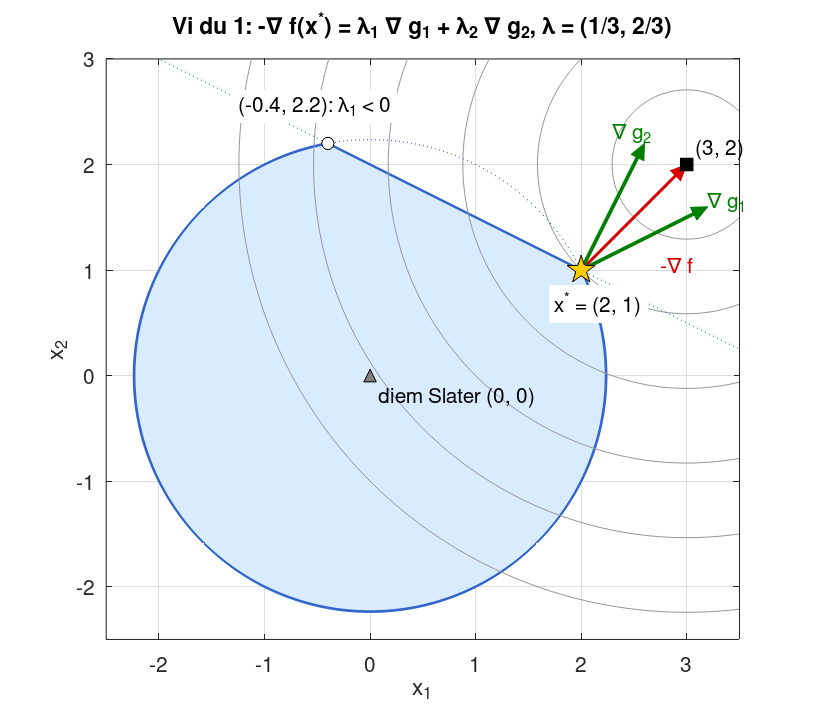
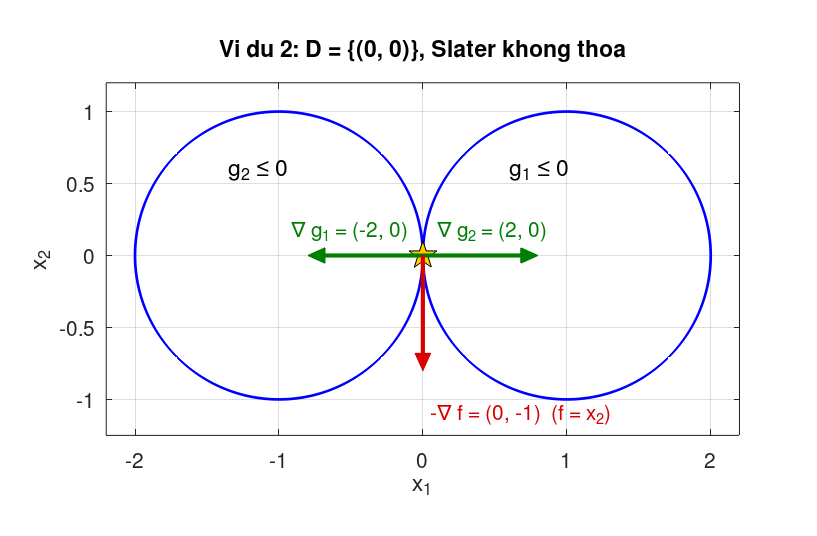
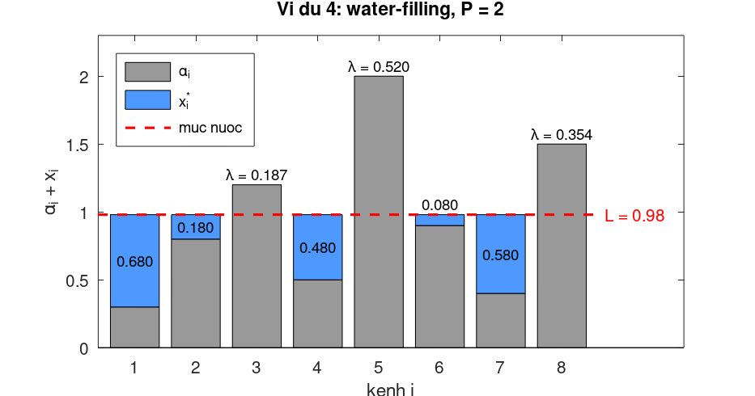

# Câu 13. Quy hoạch lồi: điều kiện chính quy, điều kiện KKT

## 1. Bài toán quy hoạch lồi

```math
(P)\qquad \min\; f(x) \quad \text{với}\quad g_i(x) \le 0\ (i = 1,\dots,m),\qquad h_j(x) = a_j^T x - b_j = 0\ (j = 1,\dots,p),
```

trong đó $`f`$ và các $`g_i : \mathbb{R}^n \to \mathbb{R}`$ là **hàm lồi**, các $`h_j`$ là **hàm affine**. Ký hiệu $`D`$ là tập chấp nhận được, $`f^*`$ là giá trị tối ưu, $`I(x) = \{i : g_i(x) = 0\}`$ là tập chỉ số tích cực.

Nhắc lại: $`C`$ là **tập lồi** nếu $`\theta x + (1 - \theta) y \in C`$ với mọi $`x, y \in C`$, $`\theta \in [0, 1]`$; $`f`$ là **hàm lồi** nếu $`f(\theta x + (1 - \theta) y) \le \theta f(x) + (1 - \theta) f(y)`$, **lồi chặt** nếu bất đẳng thức là chặt khi $`x \ne y`$, $`\theta \in (0, 1)`$.

Điều kiện chính quy và điều kiện KKT cho bài toán trơn tổng quát đã trình bày ở [câu 4](../q04-kkt-conditions/), lý thuyết đối ngẫu ở [câu 5](../q05-lagrange-duality/). Câu này tập trung vào những gì **tính lồi** mang lại: KKT trở thành điều kiện **đủ**, điều kiện chính quy có dạng đơn giản (Slater) không phụ thuộc điểm đang xét, và kết quả vẫn đúng khi các hàm không khả vi.

**Bổ đề 1 (bất đẳng thức gradient).** Nếu $`f`$ lồi và khả vi thì $`f(y) \ge f(x) + \nabla f(x)^T (y - x)`$ với mọi $`x, y`$.

*Chứng minh.* Với $`t \in (0, 1]`$, tính lồi cho $`f(x + t(y - x)) \le (1 - t) f(x) + t f(y)`$, tức là $`\dfrac{f(x + t(y - x)) - f(x)}{t} \le f(y) - f(x)`$. Cho $`t \to 0^+`$, vế trái tiến tới $`\nabla f(x)^T (y - x)`$. $`\square`$

**Định lý 1 (tính chất cơ bản).**
1. $`D`$ là tập lồi.
2. Mọi cực tiểu địa phương của $`(P)`$ là cực tiểu toàn cục.
3. Tập nghiệm tối ưu là tập lồi.
4. Nếu $`f`$ lồi chặt thì $`(P)`$ có nhiều nhất một nghiệm.

*Chứng minh.*
1. Tập mức dưới $`\{x : g_i(x) \le 0\}`$ của hàm lồi là tập lồi (nếu $`g_i(x), g_i(y) \le 0`$ thì $`g_i(\theta x + (1-\theta) y) \le \theta g_i(x) + (1 - \theta) g_i(y) \le 0`$), siêu phẳng $`\{h_j = 0\}`$ lồi, và giao của các tập lồi là tập lồi.
2. Giả sử $`x^*`$ là cực tiểu địa phương nhưng có $`y \in D`$ với $`f(y) \lt f(x^*)`$. Với $`\theta \in (0, 1]`$, điểm $`x_\theta = x^* + \theta (y - x^*) \in D`$ và $`f(x_\theta) \le (1 - \theta) f(x^*) + \theta f(y) \lt f(x^*)`$. Cho $`\theta \to 0`$, $`x_\theta`$ gần $`x^*`$ tùy ý, mâu thuẫn.
3. Nếu $`x, y`$ là nghiệm thì $`f(\theta x + (1 - \theta) y) \le f^*`$, nên điểm giữa cũng là nghiệm.
4. Nếu $`x \ne y`$ là hai nghiệm thì $`f(\tfrac{1}{2}(x + y)) \lt f^*`$, mâu thuẫn. $`\square`$

**Định lý 2 (điều kiện tối ưu dạng bất đẳng thức biến phân).** Với $`f`$ lồi khả vi, $`x^* \in D`$ là nghiệm của $`(P)`$ khi và chỉ khi

```math
\nabla f(x^*)^T (x - x^*) \ge 0 \qquad \forall x \in D .
```

*Chứng minh.* (⇐) Theo bổ đề 1, $`f(x) \ge f(x^*) + \nabla f(x^*)^T (x - x^*) \ge f(x^*)`$. (⇒) Nếu có $`x \in D`$ với $`\nabla f(x^*)^T (x - x^*) \lt 0`$ thì $`x - x^*`$ là hướng giảm, và $`x^* + t(x - x^*) \in D`$ (vì $`D`$ lồi) có giá trị nhỏ hơn $`f(x^*)`$ khi $`t`$ đủ nhỏ, mâu thuẫn. $`\square`$

Hình học: $`-\nabla f(x^*)`$ nằm trong **nón pháp tuyến** của $`D`$ tại $`x^*`$. Điều kiện KKT là cách viết nón pháp tuyến này qua gradient của các ràng buộc.

## 2. Điều kiện KKT

Điểm $`x^*`$ là **điểm KKT** nếu tồn tại $`\lambda^* \in \mathbb{R}^m`$, $`\mu^* \in \mathbb{R}^p`$ sao cho

```math
\begin{aligned}
&\nabla f(x^*) + \sum_{i=1}^m \lambda_i^* \nabla g_i(x^*) + \sum_{j=1}^p \mu_j^* a_j = 0, \\
&g_i(x^*) \le 0, \quad h_j(x^*) = 0, \quad \lambda_i^* \ge 0, \quad \lambda_i^* g_i(x^*) = 0 .
\end{aligned}
```

**Định lý 3 (KKT là điều kiện đủ).** Với bài toán lồi khả vi, mọi điểm KKT là **nghiệm tối ưu toàn cục**. Định lý này **không cần** điều kiện chính quy.

*Chứng minh.* Lấy $`x \in D`$. Theo bổ đề 1 cho $`f`$ và điều kiện dừng:

```math
f(x) - f(x^*) \ge \nabla f(x^*)^T (x - x^*) = -\sum_i \lambda_i^* \nabla g_i(x^*)^T (x - x^*) - \sum_j \mu_j^* a_j^T (x - x^*) .
```

- Với $`h_j`$ affine: $`a_j^T (x - x^*) = h_j(x) - h_j(x^*) = 0`$.
- Với $`\lambda_i^* \gt 0`$: theo điều kiện bù $`g_i(x^*) = 0`$, và theo bổ đề 1 cho $`g_i`$: $`\nabla g_i(x^*)^T (x - x^*) \le g_i(x) - g_i(x^*) = g_i(x) \le 0`$.

Vậy vế phải $`\ge 0`$, tức là $`f(x) \ge f(x^*)`$. $`\square`$

Không có tính lồi, điều này sai: ở câu 4, ví dụ 1 có điểm KKT là cực đại.

## 3. Điều kiện chính quy cho quy hoạch lồi

**Điều kiện Slater.** Tồn tại $`\hat x`$ (gọi là **điểm Slater**) sao cho

```math
g_i(\hat x) \lt 0 \ \ (i = 1, \dots, m), \qquad h_j(\hat x) = 0 \ \ (j = 1, \dots, p).
```

Khác với LICQ hay MFCQ (kiểm tra tại từng điểm $`x^*`$, cần biết trước $`x^*`$), điều kiện Slater là tính chất của **cả bài toán**: miền chấp nhận được có "điểm trong" đối với các ràng buộc bất đẳng thức.

**Mệnh đề 1.** Với bài toán lồi khả vi không có ràng buộc đẳng thức: Slater thỏa ⇔ MFCQ thỏa tại **một** điểm $`\bar x \in D`$ ⇔ MFCQ thỏa tại **mọi** điểm của $`D`$.

*Chứng minh.* Slater ⇒ MFCQ tại mọi điểm: đã chứng minh ở câu 4, mục 3 (lấy $`d = \hat x - x^*`$). MFCQ tại $`\bar x`$ ⇒ Slater: có $`d`$ với $`\nabla g_i(\bar x)^T d \lt 0`$ ($`i \in I(\bar x)`$). Với $`t \gt 0`$ đủ nhỏ, $`g_i(\bar x + td) = t \nabla g_i(\bar x)^T d + o(t) \lt 0`$ với $`i \in I(\bar x)`$, và $`g_i(\bar x + td) \lt 0`$ với $`i \notin I(\bar x)`$ do tính liên tục. Vậy $`\bar x + td`$ là điểm Slater. $`\square`$

**Định lý 4 (KKT là điều kiện cần, Kuhn–Tucker).** Giả sử $`(P)`$ lồi, thỏa Slater, và $`x^*`$ là nghiệm tối ưu. Khi đó tồn tại $`\lambda^* \ge 0`$ (và $`\mu^*`$) sao cho

```math
\text{(a)}\ \ \mathcal{L}(x, \lambda^*, \mu^*) \ge \mathcal{L}(x^*, \lambda^*, \mu^*) = f^* \ \ \forall x \in \mathbb{R}^n, \qquad \text{(b)}\ \ \lambda_i^* g_i(x^*) = 0 ,
```

với $`\mathcal{L}(x, \lambda, \mu) = f(x) + \lambda^T g(x) + \mu^T h(x)`$. Nếu các hàm khả vi thì $`x^*`$ là điểm KKT với nhân tử $`(\lambda^*, \mu^*)`$.

*Chứng minh* (trường hợp chỉ có ràng buộc bất đẳng thức; trường hợp có thêm ràng buộc affine chứng minh tương tự, xem Bertsekas, *Convex Optimization Theory*, mục 5.3). Đặt

```math
\mathcal{A} = \{ (u, t) \in \mathbb{R}^m \times \mathbb{R} : \exists x,\ g(x) \le u,\ f(x) \le t \}, \qquad \mathcal{B} = \{ (u, t) : u \lt 0,\ t \lt f^* \}.
```

1. *$`\mathcal{A}`$, $`\mathcal{B}`$ lồi và rời nhau.* $`\mathcal{B}`$ hiển nhiên lồi. Nếu $`(u, t), (u', t') \in \mathcal{A}`$ ứng với $`x, x'`$ thì do $`g, f`$ lồi, $`x_\theta = \theta x + (1 - \theta) x'`$ cho $`(\theta u + (1-\theta) u', \theta t + (1-\theta) t') \in \mathcal{A}`$. Nếu có $`(u, t) \in \mathcal{A} \cap \mathcal{B}`$ thì có $`x`$ với $`g(x) \lt 0`$ (chấp nhận được) và $`f(x) \lt f^*`$, mâu thuẫn.
2. *Tách.* Theo định lý tách hai tập lồi rời nhau, có $`(\lambda, \lambda_0) \ne 0`$ và số $`c`$ sao cho $`\lambda^T u + \lambda_0 t \ge c \ge \lambda^T u' + \lambda_0 t'`$ với mọi $`(u, t) \in \mathcal{A}`$, $`(u', t') \in \mathcal{B}`$. Vì $`u'_i`$ và $`t'`$ trong $`\mathcal{B}`$ có thể âm tùy ý, phải có $`\lambda \ge 0`$, $`\lambda_0 \ge 0`$. Cho $`(u', t') \to (0, f^*)`$ được $`c \ge \lambda_0 f^*`$. Lấy $`(u, t) = (g(x), f(x)) \in \mathcal{A}`$:

```math
\lambda_0 f(x) + \lambda^T g(x) \ge \lambda_0 f^* \qquad \forall x \in \mathbb{R}^n .
```

3. *Slater cho $`\lambda_0 \gt 0`$.* Nếu $`\lambda_0 = 0`$ thì $`\lambda \ge 0`$, $`\lambda \ne 0`$ và $`\lambda^T g(x) \ge 0`$ với mọi $`x`$. Nhưng tại điểm Slater, $`g(\hat x) \lt 0`$ nên $`\lambda^T g(\hat x) \lt 0`$, mâu thuẫn.
4. Chia cho $`\lambda_0`$, đặt $`\lambda^* = \lambda / \lambda_0 \ge 0`$: $`f(x) + \lambda^{*T} g(x) \ge f^*`$ với mọi $`x`$. Tại $`x = x^*`$: $`\lambda^{*T} g(x^*) \ge 0`$, mà mỗi số hạng $`\lambda_i^* g_i(x^*) \le 0`$, nên $`\lambda_i^* g_i(x^*) = 0`$, được (b), và $`\mathcal{L}(x^*, \lambda^*) = f^*`$, được (a).
5. Theo (a), $`x^*`$ là cực tiểu không ràng buộc của hàm lồi $`\mathcal{L}(\cdot, \lambda^*)`$. Nếu khả vi thì $`\nabla_x \mathcal{L}(x^*, \lambda^*) = 0`$: đó là điều kiện KKT. $`\square`$

Bước 3 là chỗ duy nhất dùng điều kiện Slater: nó loại trừ siêu phẳng tách "thẳng đứng" ($`\lambda_0 = 0`$). Khi đó điều kiện ở bước 2 chính là điều kiện Fritz John (câu 4) với $`\lambda_0 = 0`$, không chứa thông tin về $`f`$ (ví dụ 2).

**Hệ quả.** Với bài toán lồi khả vi thỏa Slater: $`x^*`$ tối ưu ⇔ $`x^*`$ là điểm KKT ⇔ $`(x^*, \lambda^*, \mu^*)`$ là điểm yên ngựa của $`\mathcal{L}`$ (câu 5, định lý 3).

**Định lý 5 (tập nhân tử bị chặn).** Nếu Slater thỏa với điểm $`\hat x`$, mọi nhân tử $`\lambda^*`$ thỏa (a) đều có

```math
\sum_{i=1}^m \lambda_i^* \le \frac{f(\hat x) - f^*}{\min_i \big(-g_i(\hat x)\big)} .
```

*Chứng minh.* Theo (a) tại $`x = \hat x`$ ($`h(\hat x) = 0`$): $`f^* \le f(\hat x) + \sum_i \lambda_i^* g_i(\hat x) \le f(\hat x) - \min_i(-g_i(\hat x)) \sum_i \lambda_i^*`$. $`\square`$

Nhân tử là "giá bóng" của ràng buộc (câu 5); định lý cho biết điểm Slater "càng sâu bên trong" thì nhân tử càng nhỏ. Không có Slater, tập nhân tử có thể **không bị chặn** (ví dụ 2b, 3) hoặc **rỗng** (ví dụ 2a).

**Slater dạng tinh (ràng buộc affine).** Các ràng buộc bất đẳng thức **affine** không cần thỏa chặt: định lý 4 vẫn đúng nếu tồn tại $`\hat x`$ với $`g_i(\hat x) \lt 0`$ cho các $`g_i`$ không affine, $`g_i(\hat x) \le 0`$ cho các $`g_i`$ affine, $`h(\hat x) = 0`$ (Rockafellar, *Convex Analysis*, định lý 28.2). Đặc biệt, nếu **mọi** ràng buộc là affine (ví dụ quy hoạch tuyến tính, quy hoạch toàn phương) thì không cần điều kiện chính quy nào: mọi nghiệm đều là điểm KKT.

**Bài toán không khả vi.** Định lý 4 không dùng đạo hàm cho tới bước 5. Với $`f, g_i`$ lồi nhưng không khả vi, bước 5 cho điều kiện KKT dạng **dưới vi phân** (định lý Moreau–Rockafellar về dưới vi phân của tổng):

```math
0 \in \partial f(x^*) + \sum_i \lambda_i^* \partial g_i(x^*) + \sum_j \mu_j^* a_j ,
```

trong đó $`\partial f(x) = \{ s : f(y) \ge f(x) + s^T (y - x)\ \forall y \}`$. Định lý 3 cũng đúng với dạng này (thay bổ đề 1 bằng định nghĩa dưới vi phân).

**Tóm tắt.**

| Điều kiện chính quy | Áp dụng cho | Kiểm tra |
|---|---|---|
| Không cần | KKT là điều kiện **đủ** (định lý 3) | |
| Slater | KKT là điều kiện **cần**, tập nhân tử khác rỗng và bị chặn | Tìm một điểm $`\hat x`$; chương trình `slater_check.m` |
| Slater dạng tinh | KKT là điều kiện cần (ràng buộc affine chỉ cần thỏa) | `slater_check.m` với cờ `isAffine` |
| Mọi ràng buộc affine | KKT là điều kiện cần | Không cần kiểm tra |

## 4. Chương trình Matlab

| File | Nội dung |
|---|---|
| `slater_check.m` | `[ok, xhat, sstar] = slater_check(prob, x0, isAffine)`: kiểm tra điều kiện Slater (dạng chặt hoặc dạng tinh) |
| `water_filling.m` | `[x, nu, lambda, level] = water_filling(alpha, P)`: giải bài toán phân bổ công suất bằng cách giải trực tiếp hệ KKT (ví dụ 4) |
| `run_examples.m` | Năm ví dụ minh họa và ba hình vẽ |

**Kiểm tra Slater** bằng bài toán phụ với biến $`(x, s)`$:

```math
\min\; s \quad \text{với}\quad g_i(x) \le s\ \ (g_i \text{ không affine}),\quad g_i(x) \le 0\ \ (g_i \text{ affine}),\quad h(x) = 0,\quad s \ge -1 .
```

Bài toán phụ lồi và luôn có phương án. Slater thỏa khi và chỉ khi giá trị tối ưu $`s^* \lt 0`$, và khi đó nghiệm $`\hat x`$ là một điểm Slater. Cận dưới $`s \ge -1`$ giữ cho bài toán phụ bị chặn. Bài toán phụ được giải bằng `solve_nlp.m` của câu 4 (`sqp` trên Octave, `fmincon` trên MATLAB).

- Kiểm tra điều kiện KKT, tính nhân tử, LICQ và MFCQ tại một điểm: dùng lại `kkt_check.m` của [câu 4](../q04-kkt-conditions/).
- Đối chiếu nghiệm: `solve_nlp.m` (câu 4) và `solve_lp.m` ([câu 5](../q05-lagrange-duality/)); hình vẽ dùng `draw_arrow.m` (câu 4). `run_examples.m` đã thêm sẵn các đường dẫn.

Cách chạy (trong thư mục `solutions/q13-convex-programming`):

```matlab
>> run_examples
```

Đã chạy kiểm tra bằng GNU Octave; chưa chạy trên MATLAB.

## 5. Ví dụ minh họa

### Ví dụ 1: chiếu một điểm lên tập lồi

```math
\min\; f(x) = (x_1 - 3)^2 + (x_2 - 2)^2 \quad \text{với}\quad g_1 = x_1^2 + x_2^2 - 5 \le 0,\quad g_2 = x_1 + 2x_2 - 4 \le 0 .
```

Đây là bài toán tìm điểm của $`D`$ (hình tròn cắt bởi nửa mặt phẳng) gần $`(3, 2)`$ nhất. $`f`$ lồi chặt, $`g_1, g_2`$ lồi.

**Slater:** $`\hat x = (0, 0)`$ cho $`g(\hat x) = (-5, -4) \lt 0`$. Chương trình cho $`s^* = -1`$ (chạm cận dưới) tại $`(0, 0)`$.

**Giải tay.** Điểm $`(3, 2)`$ vi phạm cả hai ràng buộc. Chiếu lên riêng đường tròn được $`(1.861, 1.240)`$, vi phạm $`g_2`$; chiếu lên riêng đường thẳng được $`(2.4, 0.8)`$, vi phạm $`g_1`$. Vậy cả hai ràng buộc tích cực: giải $`x_1 = 4 - 2x_2`$, $`(4 - 2x_2)^2 + x_2^2 = 5`$, tức $`5x_2^2 - 16x_2 + 11 = 0`$, được $`x_2 = 1`$ hoặc $`x_2 = 2.2`$.

- Tại $`(2, 1)`$: $`\nabla f = (-2, -2)`$, $`\nabla g_1 = (4, 2)`$, $`\nabla g_2 = (1, 2)`$. Hệ $`4\lambda_1 + \lambda_2 = 2`$, $`2\lambda_1 + 2\lambda_2 = 2`$ cho $`\lambda = (1/3, 2/3) \ge 0`$: **điểm KKT**. Theo định lý 3 đây là nghiệm toàn cục, và là nghiệm duy nhất vì $`f`$ lồi chặt. $`f^* = 2`$.
- Tại $`(-0.4, 2.2)`$: $`\nabla f = (-6.8, 0.4)`$, $`\nabla g_1 = (-0.8, 4.4)`$, hệ cho $`\lambda_1 = -7/3 \lt 0`$, $`\lambda_2 = 74/15`$: **không** là điểm KKT. `kkt_check` báo $`\lVert \nabla_x \mathcal{L} \rVert = 6.26`$ với nhân tử không âm gần nhất.

**Kết quả chạy:** `kkt_check` tại $`(2, 1)`$ cho LICQ thỏa, $`\lambda = (0.33333, 0.66667)`$, $`\lVert \nabla_x \mathcal{L} \rVert = 0`$; solver cho $`x^* = (2, 1)`$, $`f^* = 2`$.

- **Định lý 2:** trên 148967 điểm lưới của $`D`$, giá trị nhỏ nhất của $`\nabla f(x^*)^T (x - x^*)`$ là $`0`$ (tại chính $`x^*`$), không có giá trị âm.
- **Định lý 5:** với $`\hat x = (0, 0)`$: $`\lambda_1 + \lambda_2 \le (13 - 2)/4 = 2.75`$; thực tế $`\lambda_1 + \lambda_2 = 1`$.



### Ví dụ 2: Slater không thỏa, tập chấp nhận được chỉ có một điểm

```math
g_1 = (x_1 - 1)^2 + x_2^2 - 1 \le 0, \qquad g_2 = (x_1 + 1)^2 + x_2^2 - 1 \le 0 .
```

Hai hình tròn tiếp xúc tại gốc nên $`D = \{(0, 0)\}`$. Slater không thỏa: $`\tfrac{1}{2}(g_1 + g_2) = x_1^2 + x_2^2 \ge 0`$ nên không có điểm nào làm cả hai $`g_i \lt 0`$; giá trị đúng của bài toán phụ là $`s^* = 0`$. Chương trình cho $`s^* = -1.5\cdot10^{-7}`$ (sai số của `sqp`) và kết luận Slater không thỏa (ngưỡng $`-10^{-6}`$). Tại $`(0, 0)`$: $`\nabla g_1 = (-2, 0)`$, $`\nabla g_2 = (2, 0)`$, cùng phương, nên LICQ và MFCQ đều không thỏa.

**(a) $`f = x_2`$.** $`x^* = (0, 0)`$ hiển nhiên là nghiệm duy nhất. Điều kiện dừng $`(0, 1) + \lambda_1 (-2, 0) + \lambda_2 (2, 0) = 0`$ vô nghiệm (thành phần thứ hai là $`1 = 0`$): **nghiệm tối ưu nhưng không là điểm KKT**. Chỉ có nhân tử Fritz John với $`\lambda_0 = 0`$, $`\lambda_1 = \lambda_2 = 1`$. `kkt_check` báo $`\lVert \nabla_x \mathcal{L} \rVert = 1`$.

**(b) $`f = x_1`$.** Điều kiện dừng $`(1, 0) + \lambda_1 (-2, 0) + \lambda_2 (2, 0) = 0`$ cho $`\lambda_1 = \lambda_2 + \tfrac{1}{2}`$, $`\lambda_2 \ge 0`$: điểm KKT, nhưng tập nhân tử là một tia, **không bị chặn**. Chương trình kiểm tra $`\lambda = (0.5, 0)`$, $`(1.5, 1)`$, $`(10.5, 10)`$ đều cho $`\nabla_x \mathcal{L} = 0`$. Định lý 5 không áp dụng được vì không có điểm Slater.

Như vậy khi thiếu Slater, KKT có thể đúng hoặc sai tùy hàm mục tiêu: Slater là điều kiện **đủ** để KKT cần, không phải điều kiện cần.



### Ví dụ 3: Slater dạng tinh, ràng buộc affine không cần thỏa chặt

```math
\min\; (x_1 - 2)^2 + (x_2 - 2)^2 \quad \text{với}\quad g_1 = x_1 + x_2 - 1 \le 0,\quad g_2 = 1 - x_1 - x_2 \le 0,\quad g_3 = x_1^2 + x_2^2 - 1 \le 0 .
```

Hai ràng buộc đầu là đẳng thức $`x_1 + x_2 = 1`$ viết dưới dạng hai bất đẳng thức. Vì $`g_1 = -g_2`$, không điểm nào làm cả hai âm: **Slater dạng chặt không thỏa** ($`s^* = 0`$). Nhưng $`g_1, g_2`$ affine, nên chỉ cần $`g_3`$ thỏa chặt: $`\hat x = (0.5, 0.5)`$ cho $`g = (0, 0, -0.5)`$, **Slater dạng tinh thỏa** ($`s^* = -0.5`$). Do đó KKT là điều kiện cần.

**Giải tay.** Hình chiếu của $`(2, 2)`$ lên đường thẳng $`x_1 + x_2 = 1`$ là $`(0.5, 0.5)`$, nằm trong hình tròn ($`g_3 = -0.5`$, không tích cực, $`\lambda_3 = 0`$). $`\nabla f = (-3, -3)`$, điều kiện dừng $`(-3, -3) + (\lambda_1 - \lambda_2)(1, 1) = 0`$ cho $`\lambda_1 - \lambda_2 = 3`$: mọi $`\lambda = (t + 3, t, 0)`$, $`t \ge 0`$, đều là nhân tử. Tập nhân tử khác rỗng nhưng không bị chặn: định lý 5 cần Slater dạng chặt. Kết quả chạy: `kkt_check` cho $`\lambda = (3, 0, 0)`$ (nhân tử không duy nhất), solver cho $`x^* = (0.5, 0.5)`$, $`f^* = 4.5`$; kiểm tra $`t = 5`$, tức $`\lambda = (8, 5, 0)`$, cũng cho $`\nabla_x \mathcal{L} = 0`$.

### Ví dụ 4: phân bổ công suất (water-filling), n = 8 biến

Phân bổ tổng công suất $`P`$ cho $`n`$ kênh truyền có mức nhiễu $`\alpha_i \gt 0`$ để cực đại tổng dung lượng $`\sum_i \log(\alpha_i + x_i)`$ (Boyd & Vandenberghe, *Convex Optimization*, mục 5.5.3):

```math
\min\; -\sum_{i=1}^n \log(\alpha_i + x_i) \quad \text{với}\quad -x_i \le 0,\qquad \sum_{i=1}^n x_i = P .
```

Hàm mục tiêu lồi chặt, mọi ràng buộc affine: KKT là điều kiện cần và đủ, nghiệm duy nhất. Hệ KKT với nhân tử $`\lambda_i`$ (cho $`-x_i \le 0`$) và $`\nu`$ (cho đẳng thức):

```math
-\frac{1}{\alpha_i + x_i} - \lambda_i + \nu = 0, \qquad \lambda_i \ge 0, \qquad \lambda_i x_i = 0, \qquad x_i \ge 0, \qquad \sum_i x_i = P .
```

**Giải hệ KKT.** Nếu $`x_i \gt 0`$ thì $`\lambda_i = 0`$, nên $`x_i = 1/\nu - \alpha_i`$. Nếu $`x_i = 0`$ thì $`\lambda_i = \nu - 1/\alpha_i \ge 0`$, tức $`\alpha_i \ge 1/\nu`$. Gộp lại, với **mức nước** $`L = 1/\nu`$:

```math
x_i = \max(0,\ L - \alpha_i), \qquad \sum_i \max(0,\ L - \alpha_i) = P .
```

Hàm $`L \mapsto \sum_i \max(0, L - \alpha_i)`$ tăng chặt (khi $`L \gt \min \alpha_i`$), nên $`L`$ duy nhất. Tên gọi: đổ lượng nước $`P`$ vào các "bể" có đáy cao $`\alpha_i`$, nước dâng tới mức chung $`L`$; kênh có đáy cao hơn $`L`$ không được cấp công suất.

Với $`\alpha = (0.3, 0.8, 1.2, 0.5, 2.0, 0.9, 0.4, 1.5)`$, $`P = 2`$: sắp xếp $`\alpha`$ tăng dần là $`0.3, 0.4, 0.5, 0.8, 0.9, 1.2, \dots`$ Thử 5 kênh đáy thấp nhất: $`L = (2 + 0.3 + 0.4 + 0.5 + 0.8 + 0.9)/5 = 0.98 \gt 0.9`$, hợp lệ. Thử 6 kênh: $`L = (2 + 4.1)/6 = 1.0167 \lt 1.2`$, không hợp lệ. Vậy $`L = 0.98`$, $`\nu = 1.02041`$ và

| Kênh $`i`$ | 1 | 2 | 3 | 4 | 5 | 6 | 7 | 8 |
|---|---|---|---|---|---|---|---|---|
| $`\alpha_i`$ | 0.3 | 0.8 | 1.2 | 0.5 | 2.0 | 0.9 | 0.4 | 1.5 |
| $`x_i^*`$ | 0.68 | 0.18 | 0 | 0.48 | 0 | 0.08 | 0.58 | 0 |
| $`\lambda_i`$ | 0 | 0 | 0.1871 | 0 | 0.5204 | 0 | 0 | 0.3537 |

Kiểm tra: $`\sum x_i = 2`$; $`\lambda \ge 0`$; $`\lambda_i x_i = 0`$; $`\lVert \nabla_x \mathcal{L} \rVert = 0`$. Solver (`sqp`) cho cùng nghiệm, sai khác $`9.1\cdot10^{-9}`$, $`f^* = -1.1799203`$. Các nhân tử $`\lambda_i \gt 0`$ ở kênh 3, 5, 8 cho biết nếu buộc phải cấp một lượng nhỏ $`\varepsilon`$ cho kênh đó thì $`f^*`$ tăng khoảng $`\lambda_i \varepsilon`$.

Đây là ví dụ điển hình của quy hoạch lồi: điều kiện KKT không chỉ để kiểm tra mà còn cho **công thức nghiệm**, chương trình `water_filling.m` không dùng thuật toán lặp nào.



### Ví dụ 5: bài toán lồi không khả vi, KKT với dưới vi phân

```math
\min\; \lVert x \rVert_1 = |x_1| + |x_2| + |x_3| \quad \text{với}\quad a^T x = 1,\qquad a = (1, -3, 2).
```

Ràng buộc affine nên KKT dạng dưới vi phân là điều kiện cần và đủ: $`0 \in \partial \lVert x^* \rVert_1 + \mu a`$, với $`\partial |x_i| = \{\mathrm{sign}(x_i)\}`$ nếu $`x_i \ne 0`$ và $`[-1, 1]`$ nếu $`x_i = 0`$. Tức là cần có $`-\mu a_i = \mathrm{sign}(x_i^*)`$ khi $`x_i^* \ne 0`$ và $`\lvert \mu a_i \rvert \le 1`$ khi $`x_i^* = 0`$.

**Giải tay.** Dồn toàn bộ vào tọa độ có $`\lvert a_k \rvert`$ lớn nhất ($`k = 2`$, $`a_2 = -3`$): $`x^* = e_2 / a_2 = (0, -1/3, 0)`$. Vì $`\mathrm{sign}(x_2^*) = -1`$, điều kiện $`-\mu a_2 = -1`$ cho $`\mu = -1/3`$, và khi đó $`-\mu a = (1/3, -1, 2/3)`$: thành phần thứ hai đúng bằng $`-1`$, hai thành phần còn lại có trị tuyệt đối $`\le 1`$. Vậy $`x^* = (0, -1/3, 0)`$ là nghiệm, $`f^* = 1/3`$. Ý nghĩa: chuẩn $`\ell_1`$ ưu tiên nghiệm **thưa**, chỉ dùng tọa độ có hệ số lớn nhất.

**Đối chiếu:** viết lại thành quy hoạch tuyến tính ($`\min \sum t_i`$, $`-t \le x \le t`$, $`a^T x = 1`$) và giải bằng `solve_lp.m` (câu 5): $`x = (0, -0.3333, 0)`$, $`f^* = 0.333333`$.

## 6. Nhận xét

- Với quy hoạch lồi, điều kiện KKT là điều kiện **đủ** để tối ưu toàn cục mà không cần giả thiết gì thêm (định lý 3). Đây là khác biệt lớn nhất so với bài toán tổng quát của câu 4, nơi KKT chỉ là điều kiện cần và chỉ cho cực tiểu địa phương.
- Để KKT là điều kiện **cần**, cần điều kiện chính quy. Với bài toán lồi, điều kiện Slater đủ dùng, chỉ cần tìm **một** điểm chấp nhận được thỏa chặt các ràng buộc phi tuyến (kiểm tra được bằng một bài toán phụ, `slater_check.m`), không cần biết trước nghiệm. Slater còn bảo đảm tập nhân tử bị chặn (định lý 5) và đối ngẫu mạnh (câu 5).
- Thiếu Slater, nghiệm có thể không là điểm KKT (ví dụ 2a), hoặc tập nhân tử không bị chặn (ví dụ 2b, 3). Ràng buộc affine không bao giờ gây ra vấn đề này (ví dụ 3, 4, 5).
- Chứng minh định lý 4 chỉ dùng định lý tách tập lồi, không dùng đạo hàm, nên mở rộng ngay cho hàm lồi không khả vi qua dưới vi phân (ví dụ 5).
- Giải hệ KKT có thể cho công thức nghiệm (ví dụ 4), và là cơ sở của các thuật toán cho quy hoạch lồi: Frank–Wolfe ([câu 14](../q14-frank-wolfe/)), hàm phạt, điểm trong.
