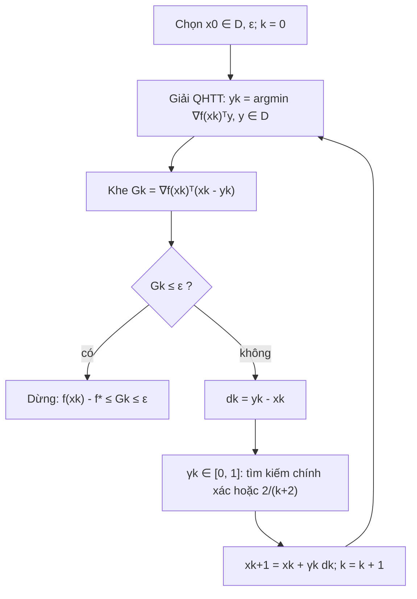
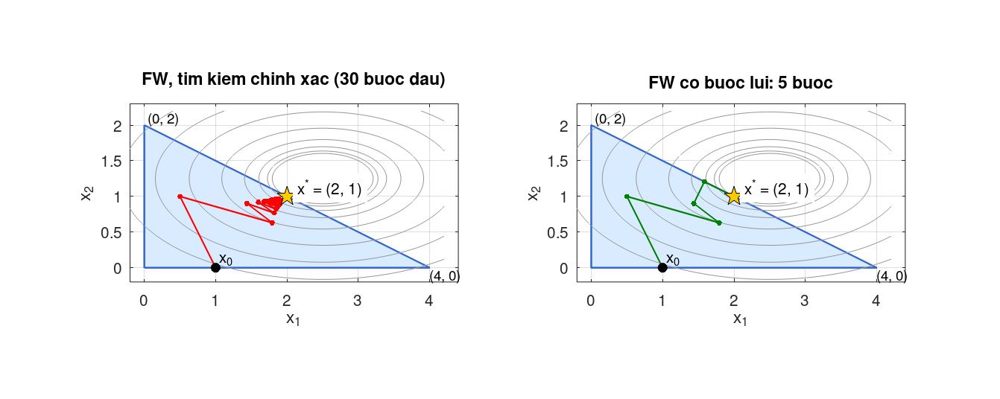
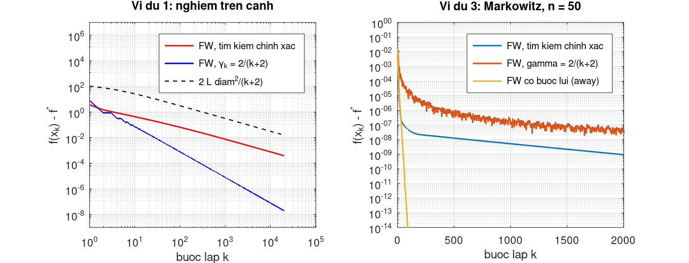

# Câu 14. Giải thuật Frank–Wolfe cho quy hoạch lồi ràng buộc tuyến tính

## 1. Bài toán

```math
(P)\qquad \min\; f(x) \quad \text{với}\quad x \in D = \{ x \in \mathbb{R}^n : A x \le b,\ A_{eq} x = b_{eq},\ x \ge l \},
```

trong đó $`f`$ lồi, khả vi liên tục, và $`D`$ là **đa diện lồi bị chặn** (khác rỗng). Theo [câu 13](../q13-convex-programming/), vì mọi ràng buộc đều affine nên không cần điều kiện chính quy: $`x^*`$ là nghiệm khi và chỉ khi nó là điểm KKT, tương đương với bất đẳng thức biến phân

```math
\nabla f(x^*)^T (y - x^*) \ge 0 \qquad \forall y \in D .
```

**Ý tưởng** (Frank và Wolfe, 1956). Tại $`x_k`$, thay $`f`$ bằng xấp xỉ tuyến tính $`f(x_k) + \nabla f(x_k)^T (y - x_k)`$ và cực tiểu nó trên $`D`$. Đây là một **bài toán quy hoạch tuyến tính**, giải được bằng đơn hình ([câu 1](../q01-simplex/)) và có nghiệm tại một **đỉnh** $`y_k`$ của $`D`$. Sau đó đi từ $`x_k`$ về phía $`y_k`$. Vì $`x_k`$ và $`y_k`$ đều thuộc $`D`$ lồi nên mọi điểm $`x_k + \gamma (y_k - x_k)`$, $`\gamma \in [0, 1]`$, đều chấp nhận được: thuật toán **không cần phép chiếu**, chỉ cần giải các bài toán tuyến tính.

## 2. Giải thuật

Chọn $`x_0 \in D`$, sai số $`\varepsilon \gt 0`$. Với $`k = 0, 1, 2, \dots`$:

1. Giải quy hoạch tuyến tính $`y_k \in \arg\min \{ \nabla f(x_k)^T y : y \in D \}`$.
2. Tính **khe Frank–Wolfe** $`G_k = \nabla f(x_k)^T (x_k - y_k)`$. Nếu $`G_k \le \varepsilon`$ thì dừng.
3. Hướng $`d_k = y_k - x_k`$; chọn bước $`\gamma_k \in [0, 1]`$:
   - **tìm kiếm chính xác**: $`\gamma_k = \arg\min_{\gamma \in [0, 1]} f(x_k + \gamma d_k)`$;
   - **bước mở** (open-loop): $`\gamma_k = 2/(k + 2)`$, không cần tính $`f`$.
4. $`x_{k+1} = x_k + \gamma_k d_k`$.



**Khe Frank–Wolfe là chứng chỉ sai số.** $`G_k \ge 0`$ (vì $`x_k \in D`$ nên $`\nabla f(x_k)^T y_k \le \nabla f(x_k)^T x_k`$), và theo bất đẳng thức gradient (câu 13, bổ đề 1):

```math
f^* = f(x^*) \ge f(x_k) + \nabla f(x_k)^T (x^* - x_k) \ge f(x_k) + \nabla f(x_k)^T (y_k - x_k) = f(x_k) - G_k .
```

Vậy $`f(x_k) - f^* \le G_k`$: dừng khi $`G_k \le \varepsilon`$ **bảo đảm** sai số giá trị hàm không quá $`\varepsilon`$, mà không cần biết $`f^*`$. Hơn nữa $`G_k = 0`$ khi và chỉ khi $`x_k`$ thỏa bất đẳng thức biến phân, tức là $`x_k`$ tối ưu.

## 3. Sự hội tụ

Giả sử $`\nabla f`$ liên tục Lipschitz với hằng số $`L`$ trên $`D`$, và $`\mathrm{diam}(D) = \max_{x, y \in D} \lVert x - y \rVert`$. Đặt $`C = L\, \mathrm{diam}(D)^2`$.

**Định lý 1.** Với bước $`\gamma_k = 2/(k+2)`$ hoặc tìm kiếm chính xác,

```math
f(x_k) - f^* \le \frac{2C}{k + 2}, \qquad k \ge 1 .
```

*Chứng minh.* Vì $`\nabla f`$ Lipschitz, $`f(x + \gamma d) \le f(x) + \gamma \nabla f(x)^T d + \tfrac{L}{2} \gamma^2 \lVert d \rVert^2`$. Với $`d_k = y_k - x_k`$, $`\lVert d_k \rVert \le \mathrm{diam}(D)`$ và $`\nabla f(x_k)^T d_k = -G_k \le -(f(x_k) - f^*)`$. Đặt $`h_k = f(x_k) - f^*`$:

```math
h_{k+1} \le (1 - \gamma) h_k + \frac{C}{2} \gamma^2 \qquad \forall \gamma \in [0, 1].
```

Với tìm kiếm chính xác, $`f(x_{k+1}) \le f(x_k + \gamma d_k)`$ với mọi $`\gamma`$, nên bất đẳng thức trên cũng đúng với $`\gamma = 2/(k+2)`$. Quy nạp:
- $`k = 0`$, $`\gamma_0 = 1`$: $`h_1 \le C/2 \le 2C/3`$.
- Nếu $`h_k \le 2C/(k+2)`$ thì $`h_{k+1} \le \dfrac{k}{k+2} \cdot \dfrac{2C}{k+2} + \dfrac{2C}{(k+2)^2} = \dfrac{2C (k+1)}{(k+2)^2} \le \dfrac{2C}{k+3}`$, vì $`(k+1)(k+3) \le (k+2)^2`$. $`\square`$

**Tốc độ $`O(1/k)`$ không cải thiện được trong trường hợp xấu.** Khi $`x^*`$ nằm trên một mặt của $`D`$ nhưng không phải đỉnh, các đỉnh $`y_k`$ luân phiên giữa các đầu mút của mặt đó và dãy $`x_k`$ **zic-zac** tiến dần về mặt. Canon và Cullum (1968) chứng minh khi đó Frank–Wolfe với tìm kiếm chính xác không thể hội tụ nhanh hơn $`O(1/k^{1+\delta})`$ với mọi $`\delta \gt 0`$ (ví dụ 1). Nếu $`x^*`$ nằm **trong** $`D`$ và $`f`$ lồi mạnh thì tìm kiếm chính xác hội tụ tuyến tính (Guélat và Marcotte, 1986; ví dụ 2).

**Frank–Wolfe với bước lùi (away-step).** Để tránh zic-zac, viết $`x_k`$ là tổ hợp lồi của các đỉnh đã dùng, $`x_k = \sum_{v \in S_k} w_v v`$, và ngoài hướng $`d^{FW} = y_k - x_k`$ xét thêm **hướng lùi** ra xa đỉnh xấu nhất:

```math
v_k = \arg\max_{v \in S_k} \nabla f(x_k)^T v, \qquad d^{A} = x_k - v_k, \qquad \gamma \in \Big[0,\ \frac{w_{v_k}}{1 - w_{v_k}}\Big].
```

Chọn hướng có $`\nabla f(x_k)^T d`$ nhỏ hơn. Bước lùi giảm trọng số của $`v_k`$; khi $`\gamma`$ đạt cận trên, $`v_k`$ bị loại khỏi $`S_k`$ (bước bỏ đỉnh). Nhờ vậy dãy có thể "rời" các đỉnh không thuộc mặt tối ưu. Với $`f`$ lồi mạnh trên đa diện, biến thể này hội tụ **tuyến tính** (Lacoste-Julien và Jaggi, 2015). Bước lùi cần tìm kiếm theo tia trên $`[0, \gamma_{\max}]`$, nên chương trình chỉ cho dùng với tìm kiếm chính xác.

**Tính thưa.** $`x_k`$ là tổ hợp lồi của $`x_0`$ và nhiều nhất $`k`$ đỉnh. Trên đơn hình $`\{x \ge 0, \sum x_i = 1\}`$, các đỉnh là vector đơn vị, nên $`x_k`$ có nhiều nhất $`k + 1`$ thành phần khác 0 (ví dụ 3). Đây là lý do Frank–Wolfe được dùng nhiều trong học máy (bài toán trên đơn hình, chuẩn $`\ell_1`$, chuẩn nhân).

**So sánh.** Mỗi bước Frank–Wolfe giải một bài toán tuyến tính, thường rẻ hơn phép chiếu lên $`D`$ (một bài toán toàn phương). Đổi lại tốc độ chỉ $`O(1/k)`$, chậm hơn nhiều so với các phương pháp dùng thông tin bậc hai (Newton, [câu 16](../q16-newton-equality-constrained/)).

## 4. Chương trình Matlab

| File | Nội dung |
|---|---|
| `frank_wolfe.m` | `[x, fval, out] = frank_wolfe(f, grad, A, b, Aeq, beq, lb, x0, opts)`: `opts.step = 'exact'` hoặc `'standard'` ($`2/(k+2)`$), `opts.variant = 'standard'` hoặc `'away'` |
| `run_examples.m` | Ba ví dụ minh họa và hai hình vẽ |

- Bài toán tuyến tính con giải bằng `solve_lp.m` của [câu 5](../q05-lagrange-duality/) (`glpk` trên Octave, `linprog` trên MATLAB). Hai solver này dùng phương pháp đơn hình nên trả về một đỉnh của $`D`$.
- Tìm kiếm chính xác: $`\varphi(\gamma) = f(x_k + \gamma d_k)`$ lồi, nên nếu $`\varphi'(\gamma_{\max}) \le 0`$ thì lấy $`\gamma = \gamma_{\max}`$; ngược lại chia đôi theo dấu $`\varphi'`$ bằng `bisection_min.m` của [câu 6](../q06-bisection-search/).
- Nếu không cho $`x_0`$, chương trình lấy một đỉnh của $`D`$ (nghiệm của một bài toán tuyến tính).
- Dừng khi khe $`G_k \le`$ `opts.tol` (mặc định $`10^{-6}`$). Kết quả lưu dãy điểm (`out.X`), giá trị hàm (`out.F`), khe (`out.gap`), các đỉnh $`y_k`$ (`out.Y`), các bước (`out.gammas`), số bước lùi và bước bỏ đỉnh.
- Ví dụ được đối chiếu với `solve_qp.m` của câu 5 (`qp` trên Octave, `quadprog` trên MATLAB).
- Khi chạy thử lần đầu, ví dụ 3 rất chậm vì lịch sử `out.X` được nối thêm cột mỗi bước (chi phí $`O(k^2)`$ với $`k = 20000`$, $`n = 50`$); chương trình hiện cấp phát trước các mảng.

Cách chạy (trong thư mục `solutions/q14-frank-wolfe`):

```matlab
>> run_examples
```

Đã chạy kiểm tra bằng GNU Octave (khoảng 1.5 phút, phần lớn là 20000 bước ở ví dụ 1 và 3); chưa chạy trên MATLAB.

## 5. Ví dụ minh họa

### Ví dụ 1: nghiệm nằm trên một cạnh, hiện tượng zic-zac

```math
\min\; f(x) = (x_1 - 2.5)^2 + 4 (x_2 - 1.25)^2 \quad \text{với}\quad x_1 + 2x_2 \le 4,\quad x_1, x_2 \ge 0, \qquad x_0 = (1, 0).
```

$`D`$ là tam giác với các đỉnh $`(0, 0)`$, $`(4, 0)`$, $`(0, 2)`$.

**Giải tay nghiệm.** Tâm $`(2.5, 1.25)`$ vi phạm $`x_1 + 2x_2 \le 4`$, nên ràng buộc này tích cực: $`2(x_1 - 2.5) + \lambda = 0`$, $`8(x_2 - 1.25) + 2\lambda = 0`$, $`x_1 + 2x_2 = 4`$ cho $`\lambda = 1`$, $`x^* = (2, 1)`$, $`f^* = 0.5`$. Nghiệm nằm **giữa cạnh** nối $`(4, 0)`$ và $`(0, 2)`$. Solver `qp` cho cùng kết quả.

**Giải tay bước đầu.** $`\nabla f(x_0) = (-3, -10)`$. Giá trị $`\nabla f(x_0)^T y`$ tại ba đỉnh là $`0, -12, -20`$, nên $`y_0 = (0, 2)`$, khe $`G_0 = (-3, -10)^T (1, -2) = 17`$. Với $`d_0 = (-1, 2)`$: $`\varphi(\gamma) = (1.5 + \gamma)^2 + 4(2\gamma - 1.25)^2`$, $`\varphi'(\gamma) = 34\gamma - 17 = 0`$, nên $`\gamma_0 = 0.5`$ và $`x_1 = (0.5, 1)`$. Kết quả chạy:

| $`k`$ | $`x_k`$ | $`y_k`$ | $`f(x_k)`$ | $`G_k`$ | $`\gamma_k`$ |
|---|---|---|---|---|---|
| 0 | (1, 0) | (0, 2) | 8.5 | 17 | 0.5 |
| 1 | (0.5, 1) | (4, 0) | 4.25 | 12 | 0.3692 |
| 2 | (1.79231, 0.630769) | (0, 2) | 2.0346 | 4.246 | 0.1982 |
| 3 | (1.43706, 0.902157) | (4, 0) | 1.6138 | 2.938 | 0.1495 |
| 4 | (1.8203, 0.767259) | (0, 2) | 1.3942 | 2.286 | 0.1217 |
| 5 | (1.59875, 0.917297) | (4, 0) | 1.2550 | 1.887 | 0.1033 |

Các đỉnh $`y_k`$ luân phiên $`(0, 2)`$, $`(4, 0)`$, bước $`\gamma_k`$ nhỏ dần: dãy zic-zac giữa hai đầu cạnh (hình trái).

| Phương pháp | Số bước tới $`G \le 10^{-3}`$ | Tới $`G \le 10^{-6}`$ | $`f - f^*`$ cuối | $`\lVert x - x^* \rVert`$ cuối |
|---|---|---|---|---|
| FW, tìm kiếm chính xác | 15944 | > 20000 | $`4.0\cdot10^{-4}`$ | $`1.9\cdot10^{-4}`$ |
| FW, $`\gamma_k = 2/(k+2)`$ | 16000 | > 20000 | $`2.0\cdot10^{-8}`$ | $`1.1\cdot10^{-4}`$ |
| FW với bước lùi | **5** | **5** | $`2.2\cdot10^{-16}`$ | $`2.0\cdot10^{-15}`$ |

Đối chiếu với định lý 1: $`L = 8`$, $`\mathrm{diam}(D) = \sqrt{20}`$, cận $`2C/(k+2) = 320/(k+2)`$.

| $`k`$ | 10 | 100 | 1000 | 10000 | 20000 |
|---|---|---|---|---|---|
| $`f - f^*`$, tìm kiếm chính xác | 0.445 | 0.0664 | $`7.71\cdot10^{-3}`$ | $`7.96\cdot10^{-4}`$ | $`3.99\cdot10^{-4}`$ |
| $`f - f^*`$, $`\gamma = 2/(k+2)`$ | 0.0661 | $`7.84\cdot10^{-4}`$ | $`7.98\cdot10^{-6}`$ | $`8.00\cdot10^{-8}`$ | $`2.00\cdot10^{-8}`$ |
| Cận $`320/(k+2)`$ | 26.7 | 3.14 | 0.319 | 0.032 | 0.016 |

- Cả hai đều thỏa định lý 1. Với tìm kiếm chính xác, $`(k+2)(f - f^*) = 6.78, 7.72, 7.96, 7.98`$ tại $`k = 10^2, 10^3, 10^4, 2\cdot10^4`$: sai số đúng là $`\Theta(1/k)`$, đúng như kết quả của Canon và Cullum.
- **Bất ngờ:** bước mở $`2/(k+2)`$ (không dùng thông tin về $`f`$) lại tốt hơn nhiều: $`(k+2)^2 (f - f^*) = 8.16, 8.02, 8.00, 8.00`$, tức là $`f - f^* \approx 8/(k+2)^2`$, tốc độ $`O(1/k^2)`$. Hiện tượng này đã được giải thích gần đây: khi nghiệm nằm trong phần trong tương đối của một mặt, bước mở cho tốc độ nhanh hơn $`O(1/k)`$ (Wirth, Kerdreux, Pokutta, *Acceleration of Frank–Wolfe algorithms with open-loop step-sizes*, AISTATS 2023). Tuy vậy khe $`G_k`$ của bước mở không giảm đơn điệu và vẫn cần 16000 bước để $`G_k \le 10^{-3}`$, nên tiêu chuẩn dừng theo khe không phản ánh được ưu điểm này.
- **Bước lùi** (hình phải): $`x_0 = (1, 0)`$ không phải đỉnh, chương trình dùng nó như một phần tử ban đầu của tập $`S_0`$ (mọi điểm của $`D`$ đều dùng được; lý thuyết hội tụ tuyến tính cần $`S_0`$ gồm các đỉnh). Bước 0–2 giống FW thường. Ở bước 3, hướng lùi ra xa $`x_0 = (1, 0)`$ tốt hơn hướng FW, với $`\gamma = 0.3385`$ là cận trên (trọng số của $`x_0`$ về 0, $`x_0`$ bị loại), đưa dãy tới $`(1.585, 1.2075)`$. Bước 4 là bước FW về phía $`(4, 0)`$ và rơi đúng vào $`x^* = (2, 1)`$ ($`G_5 = 1.5\cdot10^{-14}`$): khi chỉ còn hai đỉnh $`(0, 2)`$, $`(4, 0)`$ trong $`S`$, dãy nằm trên cạnh tối ưu và tìm kiếm chính xác của hàm bậc hai trên cạnh cho nghiệm đúng.



### Ví dụ 2: nghiệm nằm trong miền, hội tụ tuyến tính

Cùng tam giác, $`f(x) = (x_1 - 1)^2 + 4(x_2 - 0.5)^2`$, $`x^* = (1, 0.5)`$ nằm trong $`D`$ ($`1 + 2 \cdot 0.5 = 2 \lt 4`$). FW với tìm kiếm chính xác dừng sau 31 bước với khe $`\le 10^{-10}`$, $`\lVert x - x^* \rVert = 3.6\cdot10^{-8}`$. Tỉ số $`(f(x_{k+1}) - f^*)/(f(x_k) - f^*)`$ ở 10 bước đầu là $`0.059, 0.254, 0.304, 0.328, \dots, 0.359`$, ổn định quanh 0.36: hội tụ **tuyến tính**, đúng với kết quả của Guélat và Marcotte.

### Ví dụ 3: danh mục đầu tư Markowitz, n = 50

Chọn tỉ trọng $`x`$ của 50 tài sản (không bán khống, tổng bằng 1) để cân bằng rủi ro và lợi suất:

```math
\min\; x^T \Sigma x - \tau \mu^T x \quad \text{với}\quad \sum_{i=1}^{50} x_i = 1,\quad x \ge 0, \qquad \tau = 1 .
```

Dữ liệu tạo bằng công thức tất định (để MATLAB và Octave cho cùng kết quả): $`\mu_i = 0.05 + 0.1 \sin^2 i`$, $`\Sigma = F F^T + \mathrm{diag}(0.01 + 0.01(1 + \cos 3i))`$ với $`F_{ij} = \cos(ij)/\sqrt{50}`$, $`j = 1, 2, 3`$ (mô hình 3 nhân tố). $`D`$ là đơn hình, bài toán tuyến tính con có nghiệm tường minh: $`y_k = e_j`$ với $`j = \arg\min_i \partial_i f(x_k)`$.

Solver `qp`: $`f^* = -0.1272997914`$, danh mục tối ưu có **14** tài sản với tỉ trọng dương. Dừng khi $`G_k \le 10^{-8}`$, tối đa 20000 bước:

| Phương pháp | Số bước | $`f - f^*`$ | $`\lVert x - x_{qp} \rVert`$ | Số tài sản | Số bước lùi |
|---|---|---|---|---|---|
| FW, tìm kiếm chính xác | 6183 | $`8.2\cdot10^{-13}`$ | $`5.2\cdot10^{-6}`$ | 14 | |
| FW, $`\gamma_k = 2/(k+2)`$ | > 20000 | $`5.2\cdot10^{-10}`$ | $`1.4\cdot10^{-4}`$ | 15 | |
| FW với bước lùi | **90** | $`9.4\cdot10^{-15}`$ | $`7.9\cdot10^{-7}`$ | 14 | 30 |

- Tại mọi bước, $`G_k \ge f(x_k) - f^*`$ (chương trình kiểm tra trên toàn bộ dãy): khe là chứng chỉ sai số đúng.
- Tính thưa: với tìm kiếm chính xác, $`x_k`$ có 6, 11, 14 tài sản tại $`k = 5, 10, 20`$ (không quá $`k + 1`$).
- FW thường chậm vì nghiệm nằm trên một mặt 13 chiều của đơn hình 49 chiều (ví dụ 1 ở quy mô lớn). Bước lùi tránh được zic-zac, cần 90 bước. Với bước mở, nghiệm sau 20000 bước còn giữ một tài sản thừa với tỉ trọng nhỏ (15 thay vì 14).



## 6. Nhận xét

- Frank–Wolfe chỉ cần giải các bài toán **tuyến tính** trên $`D`$, mọi điểm lặp tự động chấp nhận được, không cần phép chiếu. Thuật toán rất đơn giản và rẻ khi bài toán tuyến tính con dễ (đơn hình, hình hộp, tập luồng trên mạng).
- Khe $`G_k`$ cho chứng chỉ sai số $`f(x_k) - f^* \le G_k`$ miễn phí ở mỗi bước, là tiêu chuẩn dừng tin cậy mà không cần biết $`f^*`$.
- Tốc độ chung là $`O(1/k)`$, và đúng là $`\Theta(1/k)`$ khi nghiệm nằm giữa một mặt (ví dụ 1). Để đạt độ chính xác cao nên dùng biến thể có bước lùi (hội tụ tuyến tính với $`f`$ lồi mạnh) hoặc phương pháp bậc hai ([câu 16](../q16-newton-equality-constrained/), câu 17).
- Biểu diễn $`x_k`$ qua ít đỉnh làm nghiệm gần đúng **thưa**, có ý nghĩa trong ứng dụng (danh mục ít tài sản).
