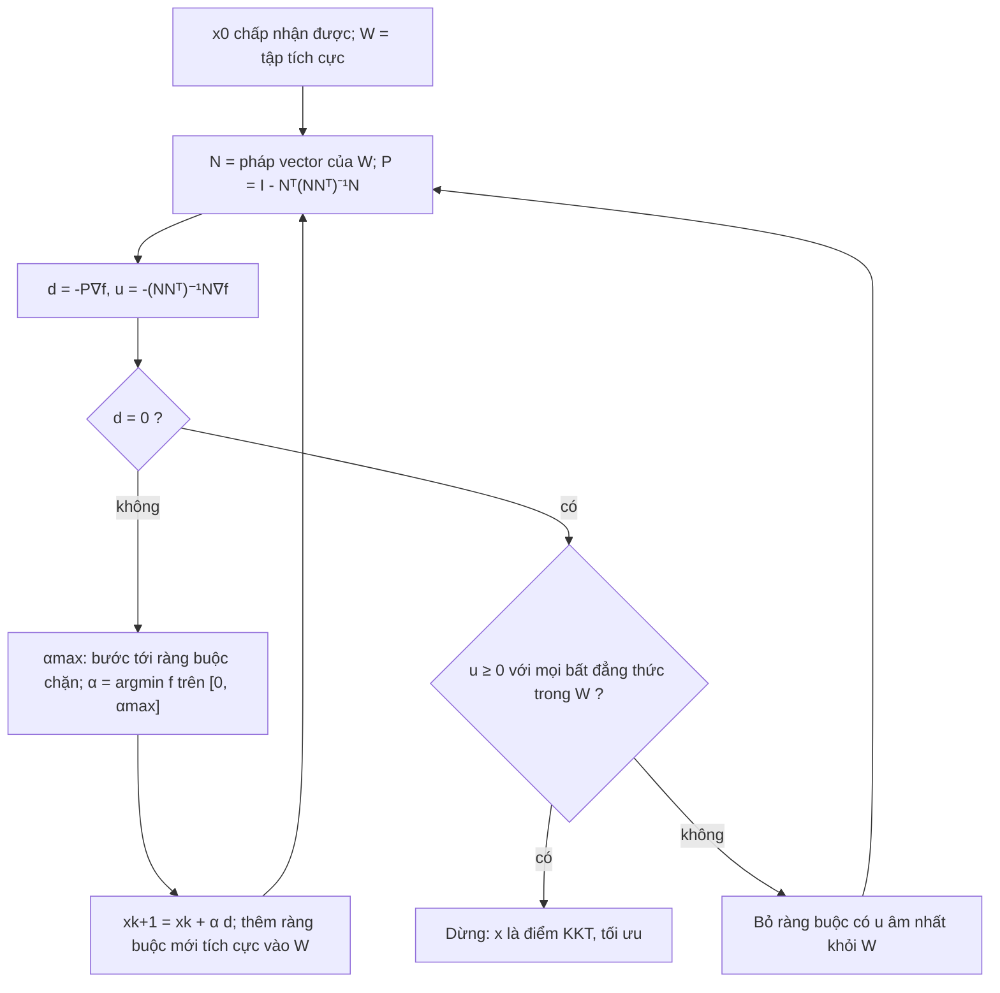
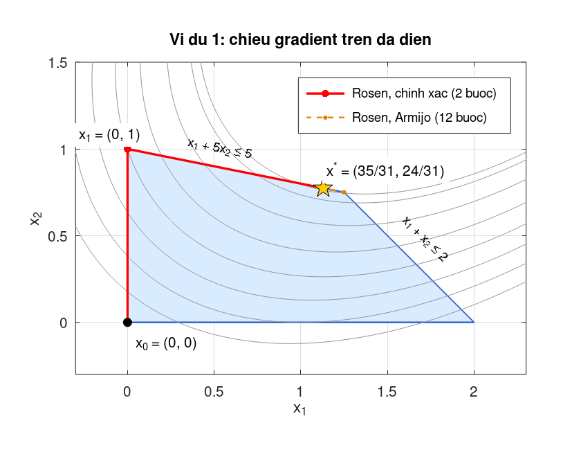
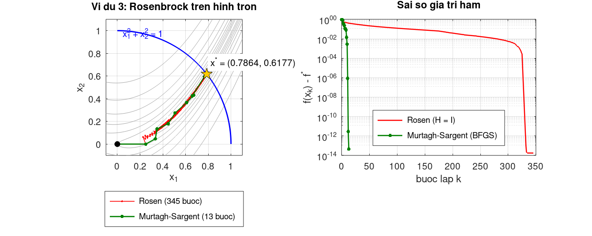

# Câu 15. Giải thuật Rosen, Murtagh và Sargent giải quy hoạch lồi dạng tổng quát

## 1. Bài toán

```math
(P)\qquad \min\; f(x) \quad \text{với}\quad g_i(x) \le 0\ (i = 1,\dots,m),\qquad h_j(x) = 0\ (j = 1,\dots,p),
```

$`f`$, $`g_i`$ lồi khả vi liên tục, $`h_j`$ affine. Theo [câu 13](../q13-convex-programming/), nếu thỏa điều kiện Slater thì $`x^*`$ là nghiệm khi và chỉ khi là điểm KKT.

Frank–Wolfe ([câu 14](../q14-frank-wolfe/)) chỉ áp dụng cho ràng buộc tuyến tính và hội tụ chậm. Các phương pháp của câu này thuộc họ **phương pháp hướng chấp nhận được** (feasible direction): mọi điểm lặp đều chấp nhận được, hướng đi là **gradient được chiếu** lên mặt các ràng buộc đang tích cực.

- **Rosen** (1960, ràng buộc tuyến tính; 1961, ràng buộc phi tuyến): chiếu $`-\nabla f`$ lên không gian tiếp xúc của các ràng buộc tích cực.
- **Murtagh và Sargent** (1969, 1973): thay phép chiếu trực giao bằng phép chiếu theo một **metric biến thiên** $`H_k`$ cập nhật như tựa Newton ([câu 12](../q12-quasi-newton/)), để có tốc độ hội tụ siêu tuyến tính.

Tài liệu gốc: J. B. Rosen, *The gradient projection method for nonlinear programming*, Part I: Linear constraints, J. SIAM 8 (1960) 181–217; Part II: Nonlinear constraints, J. SIAM 9 (1961) 514–532. B. A. Murtagh, R. W. H. Sargent, *A constrained minimization method with quadratic convergence*, trong R. Fletcher (ed.), *Optimization*, Academic Press, 1969; R. W. H. Sargent, B. A. Murtagh, *Projection methods for non-linear programming*, Math. Programming 4 (1973) 245–268.

## 2. Phương pháp chiếu gradient Rosen cho ràng buộc tuyến tính

Xét ràng buộc $`a_i^T x \le b_i`$ ($`i = 1, \dots, m`$) và $`c_j^T x = e_j`$. Tại điểm chấp nhận được $`x`$, **tập làm việc** $`W`$ gồm các ràng buộc đẳng thức và các bất đẳng thức tích cực. Gọi $`N`$ là ma trận mà mỗi dòng là một pháp vector $`a_i^T`$ ($`i \in W`$) hoặc $`c_j^T`$, giả sử $`N`$ có hạng đủ theo dòng (LICQ, [câu 4](../q04-kkt-conditions/)).

**Ma trận chiếu.**

```math
P = I - N^T (N N^T)^{-1} N .
```

$`P`$ đối xứng, $`P^2 = P`$ và $`N P = 0`$: $`P`$ là phép chiếu trực giao lên không gian con $`\{d : N d = 0\}`$ (các hướng giữ nguyên các ràng buộc trong $`W`$). Đặt $`g = \nabla f(x)`$ và

```math
d = -P g, \qquad u = -(N N^T)^{-1} N g \qquad\Longrightarrow\qquad g + N^T u = -d .
```

**Bổ đề 1.** Nếu $`d = -Pg \ne 0`$ thì $`d`$ là hướng giảm chấp nhận được: $`g^T d = -\lVert P g \rVert^2 \lt 0`$, $`N d = 0`$, và $`x + \alpha d`$ chấp nhận được với $`\alpha \gt 0`$ đủ nhỏ.

*Chứng minh.* $`g^T d = -g^T P g = -g^T P^T P g = -\lVert Pg \rVert^2`$. $`Nd = -NPg = 0`$ nên các ràng buộc trong $`W`$ vẫn thỏa với dấu bằng; các ràng buộc ngoài $`W`$ thỏa chặt tại $`x`$ nên vẫn thỏa khi $`\alpha`$ nhỏ. $`\square`$

**Định lý 1 (điều kiện dừng và quy tắc bỏ ràng buộc).** Giả sử $`d = -Pg = 0`$, tức là $`g + N^T u = 0`$.
1. Nếu $`u_i \ge 0`$ với mọi bất đẳng thức $`i \in W`$ thì $`x`$ là điểm KKT với nhân tử $`u`$ (và là nghiệm tối ưu, vì bài toán lồi).
2. Nếu có $`u_j \lt 0`$ ($`j`$ là bất đẳng thức trong $`W`$), bỏ $`j`$ khỏi $`W`$ và gọi $`\hat P`$ là ma trận chiếu mới. Khi đó $`\hat d = -\hat P g \ne 0`$, $`\hat d`$ là hướng giảm và $`a_j^T \hat d \lt 0`$: đi theo $`\hat d`$ làm ràng buộc $`j`$ thỏa chặt (rời khỏi biên $`j`$).

*Chứng minh.* (1) Đúng là các điều kiện KKT (dừng, dấu, bù: ràng buộc ngoài $`W`$ có nhân tử 0). (2) Từ $`g = -N^T u = -\sum_{i \in W} u_i n_i`$ và $`\hat P n_i = 0`$ với $`i \in W \setminus \{j\}`$: $`\hat P g = -u_j \hat P a_j`$. Vì $`N`$ có hạng đủ, $`a_j`$ không thuộc không gian sinh bởi các dòng còn lại, nên $`\hat P a_j \ne 0`$ và $`\hat d = u_j \hat P a_j \ne 0`$. Theo bổ đề 1, $`\hat d`$ là hướng giảm. Cuối cùng $`a_j^T \hat d = u_j\, a_j^T \hat P a_j = u_j \lVert \hat P a_j \rVert^2 \lt 0`$. $`\square`$

**Độ dài bước.** Bước lớn nhất giữ tính chấp nhận được là

```math
\alpha_{\max} = \min \Big\{ \frac{b_i - a_i^T x}{a_i^T d} : i \notin W,\ a_i^T d \gt 0 \Big\} \quad (= +\infty \text{ nếu không có } i \text{ nào}),
```

và $`\alpha = \arg\min_{0 \le \alpha \le \alpha_{\max}} f(x + \alpha d)`$. Nếu $`\alpha = \alpha_{\max}`$ thì ràng buộc chặn được thêm vào $`W`$.

**Giải thuật Rosen.**

1. Chọn $`x_0`$ chấp nhận được, $`W`$ = tập ràng buộc tích cực tại $`x_0`$.
2. Tính $`P`$, $`d = -P \nabla f(x_k)`$, $`u`$.
3. Nếu $`d = 0`$: nếu $`u_i \ge 0`$ với mọi bất đẳng thức trong $`W`$ thì dừng ($`x_k`$ tối ưu); nếu không, bỏ ràng buộc có $`u_i`$ âm nhất khỏi $`W`$ và quay lại bước 2.
4. Tìm $`\alpha_k \in [0, \alpha_{\max}]`$, $`x_{k+1} = x_k + \alpha_k d`$, thêm các ràng buộc vừa trở thành tích cực vào $`W`$.



Mỗi bước chỉ thêm hoặc bỏ một vài ràng buộc nên Rosen là một **phương pháp tập tích cực** (active set). Trong không gian con $`\{N d = 0\}`$, Rosen chính là thuật toán gradient ([câu 10](../q10-gradient-momentum/)), nên tốc độ là tuyến tính và phụ thuộc số điều kiện của Hessian thu hẹp trên không gian con.

## 3. Ràng buộc phi tuyến: chiếu lên không gian tiếp xúc và phục hồi

Với $`g_i`$ phi tuyến, $`N`$ là ma trận Jacobi của các ràng buộc trong $`W`$ tại $`x`$ (dòng $`\nabla g_i(x)^T`$). Hướng $`d = -P \nabla f(x)`$ nằm trong **không gian tiếp xúc** của mặt $`\{g_W = 0\}`$, nhưng mặt này cong nên đi theo $`d`$ sẽ rời khỏi mặt. Với $`g_i`$ lồi, $`g_i(x + \alpha d) \ge g_i(x) + \alpha \nabla g_i(x)^T d = 0`$ với $`i \in W`$: điểm mới **vi phạm** ràng buộc (hoặc nằm đúng trên mặt). Rosen (1961) thêm bước **phục hồi**: kéo điểm $`z = x + \alpha d`$ về mặt bằng lặp Newton với nghiệm chuẩn nhỏ nhất

```math
z \leftarrow z - N(z)^T \big( N(z) N(z)^T \big)^{-1} g_W(z),
```

cho tới khi $`\lVert g_W(z) \rVert \le 10^{-12}`$ (hội tụ bậc hai vì là phương pháp Newton). Độ dài bước được chọn trên "cung" $`\alpha \mapsto R(x + \alpha d)`$ ($`R`$ là phục hồi):
- nếu điểm phục hồi vi phạm ràng buộc ngoài $`W`$: chia đôi để tìm $`\alpha_{\max}`$ tại đó ràng buộc mới chạm biên (tương ứng $`\alpha_{\max}`$ ở trên);
- ngược lại thử nhân đôi $`\alpha`$ khi $`f`$ còn giảm, rồi quay lui cho tới khi thỏa Armijo $`f(R(x + \alpha d)) \le f(x) + 10^{-4} \alpha\, \nabla f(x)^T d`$.

Ước lượng nhân tử $`u`$ và quy tắc bỏ ràng buộc giữ nguyên như định lý 1, với $`N`$ là Jacobi tại $`x`$.

## 4. Biến thể metric biến thiên của Murtagh và Sargent

Thay phép chiếu trực giao bằng phép chiếu theo metric $`H`$ đối xứng xác định dương ($`H \approx`$ nghịch đảo Hessian của hàm Lagrange):

```math
P_H = H - H N^T (N H N^T)^{-1} N H, \qquad d = -P_H \nabla f(x), \qquad u = -(N H N^T)^{-1} N H \nabla f(x) .
```

Với $`H = I`$ ta lại được Rosen; với $`W = \varnothing`$, $`d = -H \nabla f`$ là hướng tựa Newton của câu 12.

**Tính chất.** $`N P_H = 0`$, nên $`d`$ vẫn nằm trong không gian tiếp xúc. Viết $`P_H = H^{1/2} (I - Q) H^{1/2}`$ với $`Q = H^{1/2} N^T (N H N^T)^{-1} N H^{1/2}`$ là một phép chiếu trực giao, nên $`P_H`$ nửa xác định dương và $`\nabla f^T d = -\lVert (I - Q) H^{1/2} \nabla f \rVert^2 \le 0`$, bằng 0 khi và chỉ khi $`d = 0`$. Khi $`d = 0`$ thì $`\nabla f + N^T u = 0`$, và định lý 1 (thay $`P`$ bằng $`P_H`$) vẫn đúng.

**Cập nhật $`H`$.** Sau mỗi bước, với $`s = x_{k+1} - x_k`$ và hiệu gradient của hàm Lagrange (nhân tử $`u`$ giữ nguyên)

```math
y = \big( \nabla f(x_{k+1}) + N(x_{k+1})^T u \big) - \big( \nabla f(x_k) + N(x_k)^T u \big),
```

$`H`$ được cập nhật bằng công thức BFGS của câu 12 nếu $`s^T y \gt 0`$. Gần nghiệm, $`H`$ học được độ cong của hàm Lagrange trên không gian tiếp xúc, và bước $`\alpha = 1`$ thường được chấp nhận: hội tụ **siêu tuyến tính**, thay vì tuyến tính như Rosen (ví dụ 3).

**Lưu ý về chương trình.** Bài báo gốc của Murtagh và Sargent cập nhật trực tiếp ma trận chiếu $`P_H`$ bằng các công thức hạng thấp khi thêm/bỏ ràng buộc, và dùng công thức cập nhật hạng một. Chương trình ở đây làm đơn giản hơn: lưu $`H`$ (BFGS), tính $`P_H`$ bằng cách giải hệ $`N H N^T`$ ở mỗi bước. Cách này tốn hơn khi $`n`$ lớn nhưng cho cùng hướng đi về mặt toán học, và dễ kiểm chứng.

## 5. Chương trình Matlab

| File | Nội dung |
|---|---|
| `gradient_projection.m` | `[x, fval, out] = gradient_projection(prob, x0, opts)`: `opts.metric = 'identity'` (Rosen) hoặc `'bfgs'` (Murtagh–Sargent); `opts.lineSearch = 'exact'` hoặc `'armijo'` |
| `run_examples.m` | Bốn ví dụ minh họa và hai hình vẽ |

- Bài toán cho bằng struct `prob` gồm `f`, `grad`, `g`, `jacg`, `h`, `jach` (giống `kkt_check.m` của câu 4). $`x_0`$ phải chấp nhận được.
- Ràng buộc $`i`$ được coi là tích cực khi $`g_i(x) \ge -10^{-8}`$ (`opts.tolActive`).
- `'exact'`: chỉ dùng khi các ràng buộc trong $`W`$ là affine (đường đi thẳng, không cần phục hồi). $`\alpha_{\max}`$ tìm bằng chia đôi theo tính chấp nhận được, rồi cực tiểu $`f`$ trên $`[0, \alpha_{\max}]`$ bằng chia đôi theo dấu đạo hàm (`bisection_min.m` của [câu 6](../q06-bisection-search/)).
- `'armijo'` (mặc định): có phục hồi Newton, dùng được cho ràng buộc phi tuyến (mục 3).
- Dừng khi $`\lVert d \rVert \le 10^{-8} \max(1, \lVert \nabla f \rVert)`$ và $`u \ge -10^{-8}`$ (`exitflag = 1`), hoặc khi bước đi nhỏ hơn sai số làm tròn (`exitflag = 2`, xem ví dụ 4).
- Kết quả: dãy điểm `out.X`, giá trị `out.F`, tập làm việc cuối `out.W`, nhân tử `out.lambda` (của $`g`$) và `out.mu` (của $`h`$), số lần bỏ ràng buộc `out.drops`. `opts.display = true` in từng bước gồm ràng buộc bị bỏ, $`W`$, $`u`$ và $`\alpha`$.
- Đối chiếu: `solve_qp.m` ([câu 5](../q05-lagrange-duality/)), `solve_nlp.m` và `kkt_check.m` (câu 4).

Cách chạy (trong thư mục `solutions/q15-gradient-projection`):

```matlab
>> run_examples
```

Đã chạy kiểm tra bằng GNU Octave; chưa chạy trên MATLAB.

## 6. Ví dụ minh họa

### Ví dụ 1: quy hoạch toàn phương, giải tay theo Rosen

```math
\min\; f = 2x_1^2 + 2x_2^2 - 2x_1 x_2 - 4x_1 - 6x_2 \quad \text{với}\quad \underbrace{x_1 + x_2 \le 2}_{(1)},\ \ \underbrace{x_1 + 5x_2 \le 5}_{(2)},\ \ \underbrace{-x_1 \le 0}_{(3)},\ \ \underbrace{-x_2 \le 0}_{(4)}, \qquad x_0 = (0, 0).
```

```math
\nabla f = (4x_1 - 2x_2 - 4,\ 4x_2 - 2x_1 - 6), \qquad \nabla^2 f = \begin{pmatrix} 4 & -2 \\ -2 & 4 \end{pmatrix} \succ 0 .
```

**Bước 0.** $`x_0 = (0, 0)`$, $`W = \{3, 4\}`$, $`N = -I`$, $`P = 0`$, $`d = 0`$. $`\nabla f(x_0) = (-4, -6)`$, $`u = -(NN^T)^{-1} N \nabla f = (-4, -6)`$: cả hai âm, bỏ ràng buộc (4) (âm nhất). $`W = \{3\}`$, $`P = \mathrm{diag}(0, 1)`$, $`d = (0, 6)`$. Bước chặn: (1) cho $`6\alpha \le 2`$, (2) cho $`30\alpha \le 5`$, nên $`\alpha_{\max} = 1/6`$. $`f(0, 6\alpha) = 72\alpha^2 - 36\alpha`$ có cực tiểu tại $`\alpha = 1/4 \gt 1/6`$, nên $`\alpha = 1/6`$, $`x_1 = (0, 1)`$ và (2) trở thành tích cực.

**Bước 1.** $`W = \{2, 3\}`$, $`N`$ (dưới đây) khả nghịch nên $`P = 0`$, $`d = 0`$. $`\nabla f(x_1) = (-6, -2)`$; giải $`N N^T u' = N \nabla f`$:

```math
N = \begin{pmatrix} 1 & 5 \\ -1 & 0 \end{pmatrix}, \qquad \begin{pmatrix} 26 & -1 \\ -1 & 1 \end{pmatrix} u' = \begin{pmatrix} -16 \\ 6 \end{pmatrix},
```

được $`u = -u' = (0.4, -5.6)`$ cho (2), (3). Bỏ (3). Với $`W = \{2\}`$:

```math
P = I - \frac{1}{26} \begin{pmatrix} 1 & 5 \\ 5 & 25 \end{pmatrix}, \qquad d = -P \nabla f = \frac{1}{26} (140, -28) \propto (5, -1).
```

Bước chặn: (1) cho $`\alpha_{\max} = 0.2321`$; cực tiểu của $`f`$ trên tia ở $`\alpha = 0.2097 \lt \alpha_{\max}`$, cho $`x_2 = (35/31, 24/31) = (1.12903, 0.774194)`$.

**Bước 2.** $`W = \{2\}`$, $`d = 0`$, $`u_2 = 32/31 = 1.032 \gt 0`$: dừng. $`x^* = (35/31, 24/31)`$, $`f^* = -222/31 = -7.16129`$, nhân tử $`\lambda = (0, 1.0323, 0, 0)`$.

Chương trình in đúng các bước trên (Rosen, tìm kiếm chính xác: 2 bước, sai số so với $`(35/31, 24/31)`$ là $`2.1\cdot10^{-13}`$); solver `qp` và `kkt_check` (LICQ thỏa, $`\lVert \nabla_x \mathcal{L} \rVert = 1.8\cdot10^{-15}`$) xác nhận.

| Biến thể | Số bước | Ghi chú |
|---|---|---|
| Rosen, tìm kiếm chính xác | 2 | đúng như giải tay |
| Murtagh–Sargent, tìm kiếm chính xác | 2 | cùng đường đi; ở bước 1 $`H`$ đã cập nhật nên $`\alpha = 0.5968`$, $`u = 1.459`$ |
| Rosen, Armijo | 12 | bước 1 đi tới đỉnh $`(1.25, 0.75)`$ ($`\alpha = \alpha_{\max} = 0.2321`$), bỏ (1), rồi dao động quanh $`x^*`$ trên cạnh (2) với $`\alpha = 0.25`$ cố định |



### Ví dụ 2: ràng buộc phi tuyến (ví dụ 1 của câu 13)

$`\min (x_1 - 3)^2 + (x_2 - 2)^2`$ với $`x_1^2 + x_2^2 \le 5`$, $`x_1 + 2x_2 \le 4`$, $`x_0 = (0, 0)`$. Rosen (Armijo):

| $`k`$ | $`x_k`$ | $`f(x_k)`$ | $`W`$ | $`u`$ | $`\alpha_k`$ |
|---|---|---|---|---|---|
| 0 | (0, 0) | 13 | ∅ | | 0.2857 |
| 1 | (1.71429, 1.14286) | 2.38776 | {2} | 1.2 | 0.2083 |
| 2 | (2, 1) | 2 | {1, 2} | (1/3, 2/3) | dừng |

Bước 0: không có ràng buộc tích cực, $`d = -\nabla f = (6, 4)`$, gặp đường thẳng (2) tại $`\alpha = 4/14 = 0.2857`$. Bước 1: chiếu lên đường thẳng, $`d \propto (2, -1)`$, đi tới khi chạm đường tròn tại $`(2, 1)`$. Bước 2: hai ràng buộc tích cực, $`d = 0`$, $`u = (1/3, 2/3) \ge 0`$: đúng nghiệm và nhân tử đã tìm ở câu 13. Ở ví dụ này đường đi là các đoạn thẳng nên không cần phục hồi.

### Ví dụ 3: hàm Rosenbrock trên hình tròn đơn vị, biên cong

```math
\min\; 100 (x_2 - x_1^2)^2 + (1 - x_1)^2 \quad \text{với}\quad x_1^2 + x_2^2 \le 1, \qquad x_0 = (0, 0).
```

Nghiệm nằm trên đường tròn. Solver `sqp`: $`x^* = (0.7864151538, 0.6176983130)`$, $`f^* = 0.04567480872`$.

| Phương pháp | Số bước | $`f`$ | $`\lVert x - x_{sqp} \rVert`$ | Nhân tử |
|---|---|---|---|---|
| Rosen ($`H = I`$) | 345 | 0.04567480872 | $`6.5\cdot10^{-10}`$ | 0.121497 |
| Murtagh–Sargent (BFGS) | **13** | 0.04567480872 | $`6.6\cdot10^{-10}`$ | 0.121497 |

- Rosen cần 325 bước trong miền (khi $`W = \varnothing`$, đó là thuật toán gradient với tìm kiếm Armijo trong thung lũng Rosenbrock, rất chậm như câu 10) và 20 bước trên biên.
- Murtagh–Sargent: 10 bước trong miền ($`k = 0, \dots, 9`$; $`\alpha`$ = 0.125, 0.0127, 0.5, 2, 4, …), bước thứ 10 bị chặn bởi đường tròn ($`\alpha_{\max} = 0.1006`$, tìm bằng chia đôi) và dừng tại $`(0.78457, 0.62004)`$ trên biên. Sau đó 3 bước trên biên với $`\alpha = 2, 1, 1`$, mỗi bước có phục hồi; sai số giảm siêu tuyến tính ($`f - f^* = 2.8\cdot10^{-3} \to 8.4\cdot10^{-7} \to 2.3\cdot10^{-12}`$, rồi tới giới hạn độ chính xác). Sau phục hồi, $`\lvert x_1^2 + x_2^2 - 1 \rvert \le 1.0\cdot10^{-10}`$.
- `kkt_check` tại nghiệm: LICQ thỏa, $`\lambda = 0.1215`$, $`\lVert \nabla_x \mathcal{L} \rVert = 2\cdot10^{-9}`$.



### Ví dụ 4: danh mục Markowitz n = 50 (ví dụ 3 của câu 14)

$`\min x^T \Sigma x - \mu^T x`$ với $`\sum x_i = 1`$ (ràng buộc đẳng thức $`h`$), $`x \ge 0`$ (50 ràng buộc $`-x_i \le 0`$), $`x_0 = (1/50, \dots, 1/50)`$ (điểm trong). Solver `qp`: $`f^* = -0.127299791426`$.

| Phương pháp | Số bước | exitflag | $`f - f_{qp}`$ | $`\lVert x - x_{qp} \rVert`$ | Số tài sản |
|---|---|---|---|---|---|
| Rosen, tìm kiếm chính xác | 66 | 2 | $`-4.7\cdot10^{-13}`$ | $`4.6\cdot10^{-7}`$ | 14 |
| Rosen, Armijo | 92 | 1 | $`-5.3\cdot10^{-15}`$ | $`2.6\cdot10^{-7}`$ | 14 |
| Murtagh–Sargent, tìm kiếm chính xác | 46 | 2 | $`-4.6\cdot10^{-13}`$ | $`2.8\cdot10^{-7}`$ | 14 |
| Murtagh–Sargent, Armijo | 70 | 1 | $`-8.0\cdot10^{-15}`$ | $`2.8\cdot10^{-8}`$ | 14 |

- Tại nghiệm có 36 ràng buộc $`x_i \ge 0`$ tích cực. Mỗi bước chỉ thêm một ràng buộc chặn ($`|W|`$ = 0, 1, 2, 5 tại $`k`$ = 0, 1, 2, 5), nên cần ít nhất 36 bước; số bước thực tế 46–92, so với 6183 bước của Frank–Wolfe và 90 bước của Frank–Wolfe với bước lùi (câu 14).
- $`f`$ âm hơn $`f_{qp}`$ một lượng rất nhỏ: nghiệm của `qp` có sai số khoảng $`10^{-7}`$.
- **Với tìm kiếm chính xác, chương trình dừng ở `exitflag = 2`.** Khi chạy thử lần đầu, hai trường hợp này chạy hết 5000 bước. Kiểm tra cho thấy $`\lVert d \rVert`$ dừng ở $`1.6\cdot10^{-8}`$, hơi trên ngưỡng $`10^{-8} \lVert \nabla f \rVert = 7\cdot10^{-9}`$, và bước đi đã nhỏ hơn sai số làm tròn: $`\alpha_{\max}`$ tìm bằng chia đôi cho $`x_i \approx -10^{-12}`$ thay vì 0, nên độ chính xác bị giới hạn. Chương trình hiện dừng khi bước đi nhỏ hơn sai số làm tròn và báo `exitflag = 2`, thay vì chạy vô ích. Biến thể Armijo không gặp vấn đề này.

## 7. Nhận xét

- Phương pháp chiếu gradient giữ mọi điểm lặp chấp nhận được và cho **ước lượng nhân tử** $`u`$ ở mỗi bước. Khi dừng, $`u`$ là nhân tử KKT, đồng thời chứng minh tính tối ưu (bài toán lồi).
- Rosen là "thuật toán gradient trên mặt các ràng buộc tích cực", nên kế thừa tốc độ tuyến tính và sự phụ thuộc vào số điều kiện của thuật toán gradient (ví dụ 3: 345 bước).
- Murtagh–Sargent thay phép chiếu trực giao bằng phép chiếu theo metric tựa Newton, tăng tốc độ lên siêu tuyến tính (ví dụ 3: 13 bước) với chi phí gần như không đổi. Đây là tiền thân của các phương pháp tập tích cực hiện đại (ví dụ phương pháp gradient rút gọn và MINOS của Murtagh và Saunders).
- Ràng buộc phi tuyến làm phát sinh bước phục hồi (lặp Newton về mặt cong) và cần tìm bước trên một cung thay vì một đoạn thẳng. Số bước tăng không đáng kể ở các ví dụ trên, nhưng mỗi bước tốn thêm vài lần tính Jacobi.
- Mỗi bước thay đổi tập làm việc nhiều nhất một vài ràng buộc, nên khi có rất nhiều ràng buộc tích cực tại nghiệm (ví dụ 4), số bước ít nhất bằng số ràng buộc đó. Các phương pháp điểm trong ([câu 17](../q17-barrier-method/)) không có hạn chế này.
