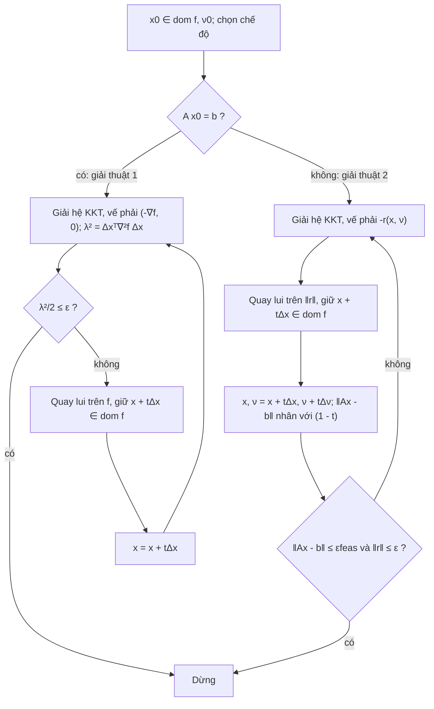
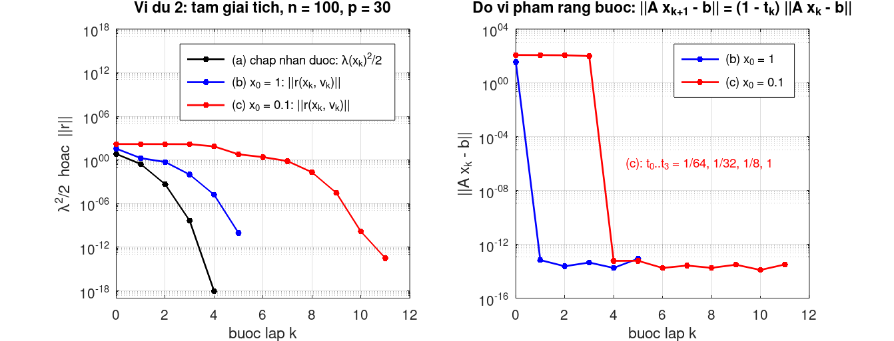
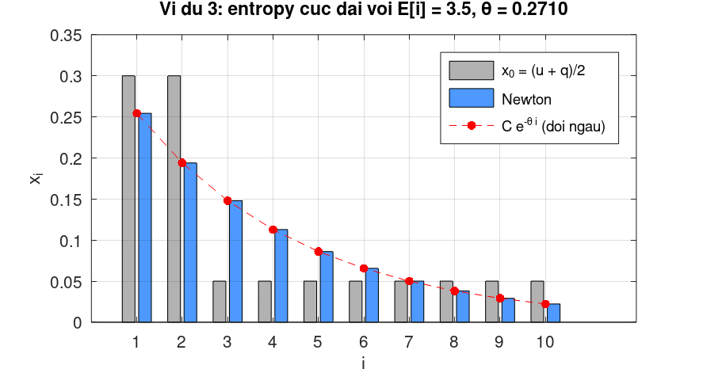

# Câu 16. Thuật toán Newton cho quy hoạch lồi với ràng buộc tuyến tính

## 1. Bài toán và điều kiện tối ưu

```math
(P)\qquad \min\; f(x) \quad \text{với}\quad A x = b,
```

trong đó $`f : \mathbb{R}^n \to \mathbb{R} \cup \{+\infty\}`$ lồi, khả vi hai lần trên miền xác định mở $`\mathrm{dom}\, f`$, $`A \in \mathbb{R}^{p \times n}`$ có hạng $`p \lt n`$. Ràng buộc bất đẳng thức tuyến tính được xử lý bằng hàm chắn ở [câu 17](../q17-barrier-method/), nên câu này xét ràng buộc đẳng thức (đó cũng là bài toán con mà câu 17 phải giải ở mỗi bước).

Vì mọi ràng buộc là affine, theo [câu 13](../q13-convex-programming/) không cần điều kiện chính quy: $`x^*`$ là nghiệm khi và chỉ khi tồn tại $`\nu^* \in \mathbb{R}^p`$ sao cho

```math
\nabla f(x^*) + A^T \nu^* = 0, \qquad A x^* = b .
```

**Trường hợp bậc hai.** Với $`f(x) = \tfrac{1}{2} x^T P x + q^T x`$, $`P \succeq 0`$, điều kiện tối ưu là hệ tuyến tính (**hệ KKT**)

```math
\begin{pmatrix} P & A^T \\ A & 0 \end{pmatrix} \begin{pmatrix} x^* \\ \nu^* \end{pmatrix} = \begin{pmatrix} -q \\ b \end{pmatrix} .
```

**Mệnh đề 1.** Ma trận hệ số $`K`$ của hệ KKT trên khả nghịch khi và chỉ khi $`v^T P v \gt 0`$ với mọi $`v \ne 0`$, $`A v = 0`$ (với $`A`$ hạng $`p`$).

*Chứng minh* (chiều "nếu"). Giả sử $`K (v, w) = 0`$: $`P v + A^T w = 0`$, $`A v = 0`$. Nhân trái phương trình đầu với $`v^T`$: $`v^T P v = -(Av)^T w = 0`$, nên $`v = 0`$. Khi đó $`A^T w = 0`$, và vì $`A`$ hạng $`p`$ nên $`w = 0`$. (Chiều ngược lại: nếu có $`v \ne 0`$, $`Av = 0`$, $`v^T P v = 0`$ thì $`Pv = 0`$ do $`P \succeq 0`$, và $`(v, 0)`$ thuộc hạt nhân của $`K`$.) $`\square`$

## 2. Newton với điểm xuất phát chấp nhận được

**Bước Newton.** Tại $`x`$ chấp nhận được ($`Ax = b`$), thay $`f`$ bằng xấp xỉ Taylor bậc hai và giữ ràng buộc:

```math
\min_v\; f(x) + \nabla f(x)^T v + \tfrac{1}{2} v^T \nabla^2 f(x)\, v \quad \text{với}\quad A (x + v) = b \ \ (\Leftrightarrow A v = 0).
```

Đây là bài toán bậc hai ở mục 1, nên bước Newton $`\Delta x`$ cùng nhân tử $`w`$ là nghiệm của

```math
\begin{pmatrix} \nabla^2 f(x) & A^T \\ A & 0 \end{pmatrix} \begin{pmatrix} \Delta x \\ w \end{pmatrix} = \begin{pmatrix} -\nabla f(x) \\ 0 \end{pmatrix} .
```

Không có ràng buộc ($`p = 0`$) thì đây là bước Newton $`-\nabla^2 f^{-1} \nabla f`$ của [câu 11](../q11-newton-method/).

**Giảm lượng Newton** (Newton decrement): $`\lambda(x) = \big( \Delta x^T \nabla^2 f(x) \Delta x \big)^{1/2}`$.

**Mệnh đề 2.**
1. $`A(x + t \Delta x) = b`$ với mọi $`t`$: mọi điểm lặp đều chấp nhận được.
2. $`\nabla f(x)^T \Delta x = -\lambda(x)^2`$: nếu $`\Delta x \ne 0`$ thì $`\Delta x`$ là hướng giảm.
3. $`f(x) - \min_{Av = 0} \hat f(x + v) = \lambda(x)^2 / 2`$, với $`\hat f`$ là xấp xỉ bậc hai.

*Chứng minh.* (1) $`A \Delta x = 0`$. (2) Nhân trái dòng đầu $`\nabla^2 f \Delta x + A^T w = -\nabla f`$ với $`\Delta x^T`$ và dùng $`A \Delta x = 0`$: $`\Delta x^T \nabla^2 f \Delta x = -\nabla f^T \Delta x`$. (3) $`\hat f(x + \Delta x) = f(x) + \nabla f^T \Delta x + \tfrac{1}{2} \lambda^2 = f(x) - \tfrac{1}{2} \lambda^2`$. $`\square`$

Theo (3), $`\lambda^2/2`$ ước lượng $`f(x) - f^*`$ khi $`x`$ gần nghiệm, nên được dùng làm tiêu chuẩn dừng.

**Giải thuật 1 (xuất phát chấp nhận được).** Cho $`x_0 \in \mathrm{dom}\, f`$, $`A x_0 = b`$, sai số $`\varepsilon`$, tham số $`\alpha \in (0, \tfrac{1}{2})`$, $`\beta \in (0, 1)`$. Lặp:

1. Giải hệ KKT được $`\Delta x`$; tính $`\lambda^2 = \Delta x^T \nabla^2 f \Delta x`$.
2. Nếu $`\lambda^2 / 2 \le \varepsilon`$ thì dừng.
3. Quay lui: $`t = 1`$; trong khi $`x + t\Delta x \notin \mathrm{dom}\, f`$ hoặc $`f(x + t \Delta x) \gt f(x) - \alpha t \lambda^2`$, đặt $`t \leftarrow \beta t`$.
4. $`x \leftarrow x + t \Delta x`$.

**Định lý 1 (tương đương với phép khử biến).** Gọi $`F \in \mathbb{R}^{n \times (n-p)}`$ có các cột là cơ sở của $`\mathrm{null}(A)`$, $`\hat x`$ là một nghiệm của $`Ax = b`$, và $`\tilde f(z) = f(F z + \hat x)`$ (bài toán không ràng buộc với $`n - p`$ biến). Nếu $`x = Fz + \hat x`$ thì bước Newton của $`(P)`$ tại $`x`$ bằng $`F \Delta z`$, với $`\Delta z`$ là bước Newton không ràng buộc của $`\tilde f`$ tại $`z`$.

*Chứng minh.* $`\nabla \tilde f = F^T \nabla f`$, $`\nabla^2 \tilde f = F^T \nabla^2 f F`$, nên $`\Delta z = -(F^T \nabla^2 f F)^{-1} F^T \nabla f`$. Đặt $`v = F \Delta z`$. Khi đó $`A v = 0`$, và $`F^T(\nabla^2 f\, v + \nabla f) = 0`$, tức $`\nabla^2 f\, v + \nabla f \in \mathrm{null}(F^T) = \mathrm{range}(A^T)`$, nên có $`w`$ với $`\nabla^2 f\, v + A^T w = -\nabla f`$. Vậy $`(v, w)`$ là nghiệm của hệ KKT, và theo mệnh đề 1 nghiệm này duy nhất. $`\square`$

**Hệ quả (hội tụ).** Dãy Newton của $`(P)`$ là ảnh qua $`z \mapsto Fz + \hat x`$ của dãy Newton không ràng buộc của $`\tilde f`$, và $`\lambda`$ cũng bằng giảm lượng Newton của $`\tilde f`$. Do đó mọi kết quả của câu 11 chuyển sang nguyên vẹn: hội tụ **bậc hai** khi gần nghiệm (câu 11, định lý 2) và bất biến affine. Với tìm kiếm quay lui, nếu $`\tilde f`$ lồi mạnh và có Hessian Lipschitz thì thuật toán có hai pha: pha **giảm bước** ($`t \lt 1`$, mỗi bước giảm $`f`$ ít nhất một hằng số), rồi pha **hội tụ bậc hai** ($`t = 1`$) (Boyd & Vandenberghe, *Convex Optimization*, mục 9.5.3 và 10.2.4). Trên thực tế không cần tính $`F`$: giải trực tiếp hệ KKT thường rẻ hơn và giữ được cấu trúc thưa.

## 3. Newton với điểm xuất phát bất kỳ

Khi chưa có điểm chấp nhận được, hoặc khó tìm (miền $`\mathrm{dom}\, f`$ là tập mở như $`x \gt 0`$), dùng Newton cho **hệ phương trình KKT**. Với $`y = (x, \nu)`$, đặt **phần dư nguyên – đối ngẫu**

```math
r(y) = \begin{pmatrix} r_{\mathrm{dual}} \\ r_{\mathrm{pri}} \end{pmatrix} = \begin{pmatrix} \nabla f(x) + A^T \nu \\ A x - b \end{pmatrix} .
```

$`y^*`$ tối ưu khi và chỉ khi $`r(y^*) = 0`$. Tuyến tính hóa $`r(y + \Delta y) \approx r(y) + Dr(y)\, \Delta y = 0`$ cho

```math
\begin{pmatrix} \nabla^2 f(x) & A^T \\ A & 0 \end{pmatrix} \begin{pmatrix} \Delta x \\ \Delta \nu \end{pmatrix} = - \begin{pmatrix} \nabla f(x) + A^T \nu \\ A x - b \end{pmatrix} .
```

Cùng ma trận KKT như mục 2, chỉ khác vế phải. $`\Delta x`$ cũng là nghiệm của bài toán bậc hai ở mục 2 với ràng buộc $`A(x + v) = b`$: bước đầy đủ $`t = 1`$ đưa điểm về đúng mặt $`Ax = b`$.

**Mệnh đề 3.**
1. $`\dfrac{d}{dt} \lVert r(y + t \Delta y) \rVert \Big|_{t=0} = -\lVert r(y) \rVert`$: chuẩn phần dư giảm theo hướng $`\Delta y`$, nên quy tắc quay lui $`\lVert r(y + t\Delta y) \rVert \le (1 - \alpha t) \lVert r(y) \rVert`$ luôn dừng sau hữu hạn lần thử.
2. $`A x^+ - b = (1 - t)(A x - b)`$ với $`x^+ = x + t \Delta x`$. Do đó nếu một bước có $`t = 1`$ thì mọi điểm lặp sau đều chấp nhận được.
3. Khi $`Ax = b`$, $`\Delta x`$ trùng với bước Newton của mục 2 (với $`w = \nu + \Delta \nu`$): thuật toán trở thành giải thuật 1 (chỉ khác tiêu chuẩn quay lui).

*Chứng minh.* (1) $`\dfrac{d}{dt} \tfrac{1}{2} \lVert r(y + t \Delta y) \rVert^2 \big|_{t=0} = r^T Dr(y) \Delta y = -\lVert r \rVert^2`$; chia cho $`\lVert r \rVert`$. (2) $`A \Delta x = -(Ax - b)`$ nên $`A x^+ - b = (Ax - b) + t A \Delta x = (1 - t)(Ax - b)`$. (3) Khi $`Ax = b`$, dòng thứ hai là $`A \Delta x = 0`$, dòng đầu là $`\nabla^2 f \Delta x + A^T(\nu + \Delta\nu) = -\nabla f`$, đúng hệ của mục 2. $`\square`$

**Giải thuật 2 (xuất phát bất kỳ).** Cho $`x_0 \in \mathrm{dom}\, f`$ (không cần $`Ax_0 = b`$), $`\nu_0`$ (ví dụ 0). Lặp:

1. Giải hệ trên được $`(\Delta x, \Delta \nu)`$.
2. Quay lui: $`t = 1`$; trong khi $`x + t \Delta x \notin \mathrm{dom}\, f`$ hoặc $`\lVert r(x + t \Delta x, \nu + t \Delta \nu) \rVert \gt (1 - \alpha t) \lVert r(x, \nu) \rVert`$, đặt $`t \leftarrow \beta t`$.
3. $`x \leftarrow x + t \Delta x`$, $`\nu \leftarrow \nu + t \Delta \nu`$.
4. Dừng khi $`\lVert Ax - b \rVert \le \varepsilon_{\mathrm{feas}}`$ và $`\lVert r(x, \nu) \rVert \le \varepsilon`$.

Lưu ý: $`f`$ có thể **tăng** trong giải thuật 2 (ví dụ 3b), vì mục tiêu của tìm kiếm là giảm $`\lVert r \rVert`$, không phải $`f`$; ban đầu ưu tiên đạt tính chấp nhận được.



**Chi phí.** Mỗi bước giải một hệ tuyến tính cỡ $`n + p`$, khoảng $`(n + p)^3/3`$ phép tính nếu đặc (có thể giảm bằng khử khối khi $`\nabla^2 f`$ có cấu trúc, ví dụ đường chéo như ở ví dụ 2, 3).

## 4. Chương trình Matlab

| File | Nội dung |
|---|---|
| `newton_eq.m` | `[x, nu, out] = newton_eq(f, grad, hess, A, b, x0, opts)`: Newton cho $`\min f`$, $`Ax = b`$; `opts.start = 'feasible'`, `'infeasible'` hoặc `'auto'` (mặc định: chọn theo $`\lVert A x_0 - b \rVert`$) |
| `run_examples.m` | Ba ví dụ minh họa và hai hình vẽ |

- Miền xác định: hàm `f` trả về `Inf` ngoài $`\mathrm{dom}\, f`$ (ví dụ `-sum(log(max(x, 0)))` cho $`-\sum \log x_i`$); tìm kiếm quay lui giảm $`t`$ cho tới khi $`f`$ hữu hạn.
- Hệ KKT giải bằng `\` trên ma trận đầy đủ cỡ $`n + p`$, sau khi cân bằng đường chéo $`DKD`$ với $`D = \mathrm{diag}(1/\sqrt{|H_{ii}|}, 1, \dots, 1)`$. Bước này cần cho câu 17: Hessian của hàm chắn có phần tử cỡ $`10^{16}`$, và khi chưa cân bằng thì `rcond` báo suy biến dù hệ giải được. Nếu ma trận sau cân bằng vẫn suy biến (`rcond` $`\lt 10^{-15}`$) thì dừng với `exitflag = -1`.
- Điều kiện Armijo trên $`f`$ được nới thêm $`10 \varepsilon_{\mathrm{máy}} \lvert f(x) \rvert`$ (như câu 12); nếu quay lui vẫn không tìm được bước thì dừng với `exitflag = 2` (giới hạn độ chính xác máy).
- Tham số mặc định: $`\alpha = 0.01`$, $`\beta = 0.5`$, $`\varepsilon = 10^{-10}`$, $`\varepsilon_{\mathrm{feas}} = 10^{-10} \max(1, \lVert b \rVert)`$.
- Kết quả: nghiệm $`x`$, nhân tử $`\nu`$ (thỏa $`\nabla f(x) + A^T \nu \approx 0`$), lịch sử `out.X`, `out.F`, `out.dec` ($`\lambda^2/2`$), `out.rnorm` ($`\lVert r \rVert`$), `out.feas` ($`\lVert Ax - b \rVert`$), `out.ts` (các bước $`t`$).
- Ví dụ 3 dùng `bisection_min.m` của [câu 6](../q06-bisection-search/) để giải bài toán đối ngẫu một biến, làm lời giải đối chiếu độc lập.

Cách chạy (trong thư mục `solutions/q16-newton-equality-constrained`):

```matlab
>> run_examples
```

Đã chạy kiểm tra bằng GNU Octave; chưa chạy trên MATLAB.

## 5. Ví dụ minh họa

### Ví dụ 1: hàm bậc hai, một bước Newton

```math
\min\; \tfrac{1}{2} \lVert x \rVert^2 \quad \text{với}\quad x_1 + x_2 + x_3 = 3,\quad x_1 - x_3 = 1 .
```

**Giải tay.** $`\nabla f = x`$, nên điều kiện tối ưu $`x + A^T \nu = 0`$, $`Ax = b`$ cho $`x = -A^T \nu`$ và $`A A^T \nu = -b`$. Với $`A A^T = \mathrm{diag}(3, 2)`$: $`\nu = (-1, -0.5)`$, $`x^* = (1.5, 1, 0.5)`$, $`f^* = 1.75`$.

- Xuất phát chấp nhận được $`x_0 = (2, 0, 1)`$: $`\lambda^2/2 = 0.75 = f(x_0) - f^*`$ (đúng mệnh đề 2(3), vì $`f`$ bậc hai), một bước $`t = 1`$ cho $`x^*`$.
- Xuất phát bất kỳ $`x_0 = 0`$ ($`\lVert A x_0 - b \rVert = 3.16`$): một bước $`t = 1`$ cho $`x^*`$ và $`\nu`$ đúng như giải tay.

### Ví dụ 2: tâm giải tích, n = 100, p = 30

```math
\min\; -\sum_{i=1}^{100} \log x_i \quad \text{với}\quad A x = b, \qquad \mathrm{dom}\, f = \{x \gt 0\}.
```

Dữ liệu tạo bằng công thức tất định: $`A_{ij} = \sin(ij + 0.5 i) + 0.3 \cos(2j)`$, riêng dòng đầu $`A_{1j} = 1 + 0.5 \sin j \gt 0`$; $`\hat x_j = 1 + 0.5 \sin^2 j`$, $`b = A \hat x`$. Dòng đầu dương bảo đảm tập $`\{Ax = b, x \ge 0\}`$ bị chặn, nên bài toán có nghiệm. Khi chạy thử lần đầu không có dòng này: null$`(A)`$ chứa vector dương, $`f \to -\infty`$ và cả hai giải thuật chạy hết số bước với $`f`$ giảm đều khoảng 69 mỗi bước. Đó là bài toán không có nghiệm, không phải lỗi của thuật toán.

**(a) Xuất phát chấp nhận được $`x_0 = \hat x`$:**

| $`k`$ | 0 | 1 | 2 | 3 | 4 |
|---|---|---|---|---|---|
| $`f(x_k)`$ | -21.414 | -28.973 | -29.2517 | -29.252142 | -29.252142 |
| $`\lambda^2/2`$ | 6.79 | 0.279 | $`4.6\cdot10^{-4}`$ | $`4.6\cdot10^{-9}`$ | $`9.6\cdot10^{-19}`$ |
| $`t_k`$ | 1 | 1 | 1 | 1 | |

Mọi bước đều là bước đầy đủ, $`\lambda^2/2`$ giảm bậc hai ($`4.6\cdot10^{-4} \to 4.6\cdot10^{-9} \to 10^{-18}`$).

**(b) Xuất phát bất kỳ $`x_0 = (1, \dots, 1)`$** ($`\lVert A x_0 - b \rVert = 35.5`$): bước đầu $`t = 1`$, nên từ $`x_1`$ đã chấp nhận được ($`\lVert Ax_1 - b \rVert = 6.8\cdot10^{-14}`$), sau đó $`\lVert r \rVert = 1.8, 0.53, 10^{-2}, 1.7\cdot10^{-5}, 9.2\cdot10^{-11}`$: 5 bước.

**(c) Xuất phát bất kỳ $`x_0 = (0.1, \dots, 0.1)`$** ($`\lVert A x_0 - b \rVert = 119.6`$): bước đầy đủ đưa $`x`$ ra khỏi miền $`x \gt 0`$ hoặc không giảm đủ $`\lVert r \rVert`$, nên ba bước đầu có $`t = 1/64, 1/32, 1/8`$. Độ vi phạm ràng buộc giảm đúng theo mệnh đề 3(2):

| $`k`$ | 0 | 1 | 2 | 3 | 4 |
|---|---|---|---|---|---|
| $`\lVert A x_k - b \rVert`$ | 119.63 | 117.76 | 114.08 | 99.817 | $`5.9\cdot10^{-14}`$ |
| Tỉ số với bước trước | | 0.98437 | 0.96875 | 0.875 | |
| $`1 - t_{k-1}`$ | | 0.98438 | 0.96875 | 0.875 | 0 |

Bước 3 có $`t = 1`$ nên từ $`x_4`$ trở đi mọi điểm chấp nhận được. Trong giai đoạn đầu $`f`$ giảm từ 230.3 xuống 137.5. Từ bước 3 trở đi luôn có $`t = 1`$ (8 bước, hội tụ bậc hai), tổng cộng 11 bước.

Cả ba cách cho cùng nghiệm (sai khác $`1.6\cdot10^{-9}`$, đúng cỡ $`\lambda`$ ở bước dừng của (a)); $`\lVert \nabla f + A^T \nu \rVert = 1.3\cdot10^{-9}`$, $`\min_i x_i = 0.798`$. Kiểm tra định lý 1: tại $`\hat x`$, bước Newton từ hệ KKT và từ phép khử biến (cơ sở $`F`$ của null$`(A)`$, cỡ $`100 \times 70`$) sai khác $`2.9\cdot10^{-14}`$.



### Ví dụ 3: phân phối có entropy cực đại

Tìm phân phối xác suất $`x`$ trên $`\{1, \dots, 10\}`$ có kỳ vọng 3.5 và entropy $`-\sum x_i \log x_i`$ lớn nhất:

```math
\min\; \sum_{i=1}^{10} x_i \log x_i \quad \text{với}\quad \sum_i x_i = 1,\quad \sum_i i\, x_i = 3.5 .
```

**Lời giải đối chiếu (qua đối ngẫu, [câu 5](../q05-lagrange-duality/)).** Điều kiện tối ưu $`\log x_i + 1 + \nu_1 + \nu_2 i = 0`$ cho $`x_i = C e^{-\theta i}`$ với $`\theta = \nu_2`$. Thay vào ràng buộc, $`\theta`$ là cực tiểu của hàm đối ngẫu lồi một biến

```math
q(\theta) = \log \sum_{i=1}^{10} e^{-\theta i} + 3.5\, \theta, \qquad q'(\theta) = 3.5 - \frac{\sum_i i\, e^{-\theta i}}{\sum_i e^{-\theta i}} .
```

Chia đôi theo dấu $`q'`$ trên $`[-5, 5]`$ (câu 6, 50 bước): $`\theta = 0.2709656564`$, $`x = (0.2543, 0.1939, 0.1479, 0.1128, 0.0860, 0.0656, 0.0500, 0.0382, 0.0291, 0.0222)`$.

**(a) Xuất phát chấp nhận được.** Phân phối đều $`u`$ có kỳ vọng 5.5, phân phối $`q = (0.5, 0.5, 0, \dots, 0)`$ có kỳ vọng 1.5 nhưng có thành phần 0 (ngoài miền). Hỗn hợp $`x_0 = (u + q)/2`$ có kỳ vọng 3.5 và mọi thành phần dương. Newton: $`\lambda^2/2 = 0.105, 9.2\cdot10^{-3}, 7.7\cdot10^{-5}, 9.6\cdot10^{-9}, 1.7\cdot10^{-16}`$, 4 bước, sai khác với lời giải đối ngẫu $`7.3\cdot10^{-9}`$.

**(b) Xuất phát bất kỳ $`x_0 = u`$** (kỳ vọng 5.5, $`\lVert A x_0 - b \rVert = 2`$): bước đầu $`t = 0.5`$ ($`\lVert Ax - b \rVert`$ giảm còn 1), bước sau $`t = 1`$ (chấp nhận được), tổng cộng 6 bước. $`f`$ **tăng** từ $`-2.3026`$ lên giá trị tối ưu $`-2.0467`$: phân phối đều có entropy lớn nhất ($`\log 10 = 2.3026`$) nhưng không thỏa ràng buộc kỳ vọng. Nhân tử thu được $`\nu = (0.098344741, 0.27096566)`$, với $`\nu_2 = \theta`$ tới sai số $`10^{-15}`$. Entropy cực đại là $`2.046725`$.



## 6. Nhận xét

- Ràng buộc đẳng thức tuyến tính được xử lý "miễn phí" trong Newton: chỉ cần thay hệ Newton $`\nabla^2 f \Delta x = -\nabla f`$ bằng hệ KKT có thêm $`p`$ dòng. Thuật toán tương đương với Newton không ràng buộc trên $`n - p`$ biến (định lý 1), nên giữ nguyên hội tụ bậc hai và bất biến affine của câu 11.
- Xuất phát chấp nhận được: mọi điểm lặp chấp nhận được, $`f`$ giảm đơn điệu, $`\lambda^2/2`$ cho tiêu chuẩn dừng tự nhiên. Nhưng cần có $`x_0 \in \mathrm{dom}\, f`$ với $`Ax_0 = b`$, mà việc tìm điểm này (ví dụ với $`x \gt 0`$) đã là một bài toán (pha 1).
- Xuất phát bất kỳ: chỉ cần $`x_0 \in \mathrm{dom}\, f`$. Độ vi phạm $`\lVert Ax - b \rVert`$ giảm theo hệ số $`(1 - t)`$ và bằng 0 ngay sau bước đầy đủ đầu tiên; từ đó thuật toán trùng với trường hợp xuất phát chấp nhận được. Đổi lại $`f`$ không giảm đơn điệu.
- Đây là bài toán con cốt lõi của phương pháp hàm chắn ([câu 17](../q17-barrier-method/)): mỗi bước ngoài giải một bài toán $`\min t f_0 + \phi`$ với $`Ax = b`$ bằng chính thuật toán này.
