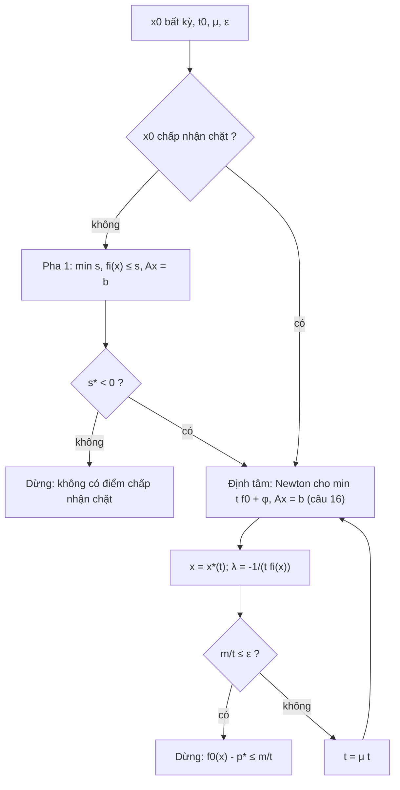
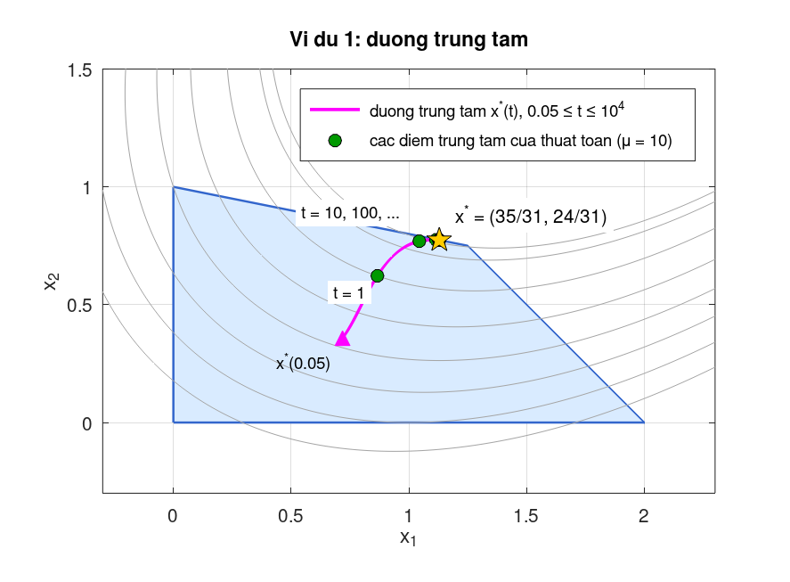
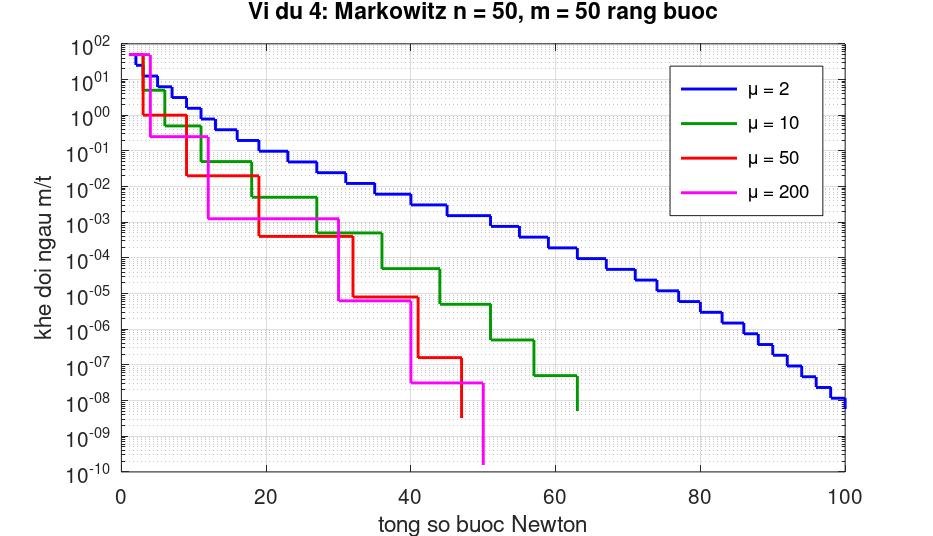

# Câu 17. Thuật toán hàm chắn Newton giải quy hoạch lồi tổng quát

## 1. Bài toán

```math
(P)\qquad \min\; f_0(x) \quad \text{với}\quad f_i(x) \le 0\ (i = 1, \dots, m),\qquad A x = b,
```

$`f_0, \dots, f_m`$ lồi, khả vi hai lần, $`A \in \mathbb{R}^{p \times n}`$ hạng $`p`$. Giả sử $`(P)`$ thỏa **điều kiện Slater** (có $`x`$ với $`f_i(x) \lt 0`$, $`Ax = b`$) và $`p^*`$ hữu hạn. Theo [câu 13](../q13-convex-programming/) và [câu 5](../q05-lagrange-duality/), khi đó có đối ngẫu mạnh và $`x^*`$ tối ưu khi và chỉ khi tồn tại $`\lambda^* \ge 0`$, $`\nu^*`$ thỏa KKT:

```math
\nabla f_0(x^*) + \sum_i \lambda_i^* \nabla f_i(x^*) + A^T \nu^* = 0, \qquad f_i(x^*) \le 0, \qquad A x^* = b, \qquad \lambda_i^* f_i(x^*) = 0 .
```

Newton ([câu 16](../q16-newton-equality-constrained/)) chỉ xử lý được ràng buộc đẳng thức. Ý tưởng của phương pháp **hàm chắn** là đưa các ràng buộc bất đẳng thức vào hàm mục tiêu, để mỗi bước chỉ còn một bài toán có ràng buộc đẳng thức.

## 2. Hàm chắn logarit

Bài toán $`(P)`$ tương đương với $`\min f_0(x) + \sum_i I_-(f_i(x))`$, $`Ax = b`$, trong đó $`I_-(u) = 0`$ nếu $`u \le 0`$ và $`+\infty`$ nếu $`u \gt 0`$. Hàm chỉ $`I_-`$ không khả vi; thay nó bằng xấp xỉ trơn $`-\tfrac{1}{t} \log(-u)`$, càng chính xác khi $`t`$ càng lớn. Được bài toán xấp xỉ

```math
\min\; t f_0(x) + \phi(x) \quad \text{với}\quad A x = b, \qquad \phi(x) = -\sum_{i=1}^m \log\big(-f_i(x)\big),
```

với $`\mathrm{dom}\, \phi = \{x : f_i(x) \lt 0\ \forall i\}`$. $`\phi`$ gọi là **hàm chắn logarit**: $`\phi(x) \to +\infty`$ khi $`x`$ tiến tới biên của miền chấp nhận được, nên các điểm lặp tự động ở **trong** miền.

**Tính chất.** $`\phi`$ lồi: hàm $`u \mapsto -\log(-u)`$ lồi và tăng trên $`u \lt 0`$, hợp với hàm lồi $`f_i`$ cho hàm lồi. Đạo hàm:

```math
\nabla \phi(x) = \sum_i \frac{1}{-f_i(x)} \nabla f_i(x), \qquad \nabla^2 \phi(x) = \sum_i \frac{1}{f_i(x)^2} \nabla f_i(x) \nabla f_i(x)^T + \sum_i \frac{1}{-f_i(x)} \nabla^2 f_i(x) .
```

## 3. Đường trung tâm và khe đối ngẫu

Với mỗi $`t \gt 0`$, gọi $`x^*(t)`$ là nghiệm (duy nhất, nếu $`t f_0 + \phi`$ lồi chặt trên $`\{Ax = b\}`$) của bài toán xấp xỉ. Tập $`\{x^*(t) : t \gt 0\}`$ gọi là **đường trung tâm** (central path). Theo câu 16, $`x^*(t)`$ được đặc trưng bởi: $`f_i(x^*(t)) \lt 0`$, $`A x^*(t) = b`$ và tồn tại $`\hat \nu`$ với

```math
t \nabla f_0(x^*(t)) + \sum_i \frac{1}{-f_i(x^*(t))} \nabla f_i(x^*(t)) + A^T \hat\nu = 0 .
```

**Định lý 1 (điểm đối ngẫu từ đường trung tâm).** Đặt

```math
\lambda_i^*(t) = -\frac{1}{t\, f_i(x^*(t))} \gt 0, \qquad \nu^*(t) = \frac{\hat \nu}{t} .
```

Khi đó $`(\lambda^*(t), \nu^*(t))`$ chấp nhận được cho bài toán đối ngẫu, và

```math
f_0(x^*(t)) - p^* \;\le\; f_0(x^*(t)) - q(\lambda^*(t), \nu^*(t)) \;=\; \frac{m}{t} .
```

*Chứng minh.* Chia điều kiện trung tâm cho $`t`$: $`\nabla f_0(x^*(t)) + \sum_i \lambda_i^*(t) \nabla f_i(x^*(t)) + A^T \nu^*(t) = 0`$. Vì $`\lambda^*(t) \gt 0`$, hàm Lagrange $`L(x, \lambda^*(t), \nu^*(t))`$ lồi theo $`x`$ và có gradient bằng 0 tại $`x^*(t)`$, nên $`x^*(t)`$ là cực tiểu của nó. Do đó

```math
q(\lambda^*(t), \nu^*(t)) = f_0(x^*(t)) + \sum_i \lambda_i^*(t) f_i(x^*(t)) + \nu^*(t)^T (A x^*(t) - b) = f_0(x^*(t)) - \frac{m}{t},
```

vì mỗi $`\lambda_i^*(t) f_i(x^*(t)) = -1/t`$ và $`Ax^*(t) = b`$. Theo đối ngẫu yếu (câu 5), $`q \le p^*`$. $`\square`$

**Hệ quả.** $`x^*(t) \to x^*`$ theo nghĩa giá trị, $`f_0(x^*(t)) - p^* \le m/t \to 0`$. Hơn nữa điểm trung tâm là một nghiệm "gần KKT": các điều kiện KKT đều đúng, trừ điều kiện bù được thay bằng $`-\lambda_i f_i = 1/t`$. Khi $`t \to \infty`$ ta lấy lại điều kiện bù, và $`\lambda^*(t)`$ cho ước lượng nhân tử miễn phí.

## 4. Thuật toán hàm chắn

Cho $`x`$ **chấp nhận chặt** ($`f_i(x) \lt 0`$, $`Ax = b`$), $`t = t^{(0)} \gt 0`$, $`\mu \gt 1`$, sai số $`\varepsilon`$. Lặp:

1. **Định tâm:** tính $`x^*(t)`$ bằng Newton có ràng buộc đẳng thức (câu 16, xuất phát chấp nhận được), khởi đầu từ $`x`$ hiện tại.
2. Cập nhật $`x \leftarrow x^*(t)`$.
3. Nếu $`m/t \le \varepsilon`$ thì dừng: $`f_0(x) - p^* \le \varepsilon`$.
4. $`t \leftarrow \mu t`$.



**Số bước.** Số bước ngoài là $`\lceil \log(m / (\varepsilon t^{(0)})) / \log \mu \rceil`$ (cộng bước đầu), xác định trước. Mỗi bước định tâm khởi đầu từ điểm trung tâm cũ, gần điểm trung tâm mới khi $`\mu`$ không quá lớn, nên Newton chỉ cần vài bước. Với các hàm **tự hòa hợp** (self-concordant, ví dụ hàm bậc hai, hàm chắn của ràng buộc tuyến tính và bậc hai lồi), có thể chứng minh số bước Newton mỗi lần định tâm bị chặn bởi một hằng số chỉ phụ thuộc $`m`$ và $`\mu`$, không phụ thuộc dữ liệu hay $`t`$ (Boyd & Vandenberghe, *Convex Optimization*, mục 11.5; câu này không chứng minh). Chọn $`\mu`$ là một sự đánh đổi: $`\mu`$ lớn thì ít bước ngoài nhưng mỗi lần định tâm cần nhiều bước Newton hơn. Trong thực tế $`\mu`$ từ 10 đến 100 cho tổng số bước Newton gần như không đổi (ví dụ 4).

**Pha 1: tìm điểm chấp nhận chặt.** Nếu $`x_0`$ không chấp nhận chặt, giải bài toán phụ với biến $`(x, s)`$:

```math
\min\; s \quad \text{với}\quad f_i(x) \le s\ (i = 1, \dots, m),\quad A x = b,\quad s \ge -1 .
```

Bài toán này có điểm chấp nhận chặt hiển nhiên: chiếu $`x_0`$ lên $`\{Ax = b\}`$ rồi lấy $`s_0 = \max_i f_i(x_0) + 1`$. Ràng buộc $`s \ge -1`$ giữ bài toán bị chặn (như `slater_check.m` của câu 13). Giải bằng chính thuật toán hàm chắn, rồi:
- $`s^* \lt 0`$: điểm tìm được chấp nhận chặt cho $`(P)`$. Chương trình dừng ngay khi $`s \lt 0`$, không cần giải tới tối ưu.
- $`s^* \gt 0`$: $`(P)`$ vô nghiệm.
- $`s^* = 0`$: $`(P)`$ có thể có nghiệm nhưng không có điểm chấp nhận chặt (Slater không thỏa), nên phương pháp hàm chắn không áp dụng được.

## 5. Chương trình Matlab

| File | Nội dung |
|---|---|
| `barrier_method.m` | `[x, fval, out] = barrier_method(prob, x0, opts)`: thuật toán hàm chắn có pha 1; `opts.t0`, `opts.mu`, `opts.tol` |
| `run_examples.m` | Bốn ví dụ minh họa và hai hình vẽ |

- Bài toán cho bằng struct `prob`: `f0`, `grad0`, `hess0`; `fi` (vector $`m`$ ràng buộc), `jac` (Jacobi $`m \times n`$), `hessc(x, w)` $`= \sum_i w_i \nabla^2 f_i(x)`$ (bỏ trống nếu mọi $`f_i`$ affine); `A`, `b` (có thể bỏ trống).
- Bước định tâm gọi `newton_eq.m` của câu 16 với hàm $`F_t = t f_0 + \phi`$; $`F_t = +\infty`$ ngoài miền chấp nhận chặt, nên tìm kiếm quay lui tự giữ điểm lặp ở trong.
- Pha 1 được gọi đệ quy (chính `barrier_method` với bài toán phụ, dừng khi $`s \lt 0`$). Nếu $`s^* \ge 0`$, trả về `exitflag = -2`.
- Kết quả: `out.X` (các điểm trung tâm), `out.F`, `out.t`, `out.gap` ($`m/t`$), `out.newton` (số bước Newton mỗi lần định tâm), nhân tử `out.lambda` ($`\lambda^*(t)`$) và `out.nu`.
- Mặc định $`t^{(0)} = 1`$, $`\mu = 10`$, $`\varepsilon = 10^{-8}`$, định tâm tới $`\lambda^2/2 \le 10^{-10}`$.

**Hai sửa đổi ở `newton_eq.m` (câu 16)** phát sinh khi chạy câu này, cả hai đều do $`F_t`$ có thang đo rất lớn khi $`t`$ lớn:
1. Khi $`t = 10^9`$, $`F_t \approx 7\cdot10^9`$. Điều kiện Armijo so sánh hai giá trị cỡ $`10^{10}`$ với lượng giảm $`\lambda^2 \approx 10^{-10}`$, nhỏ hơn sai số làm tròn; quay lui thất bại và bước định tâm chạy hết 200 bước. Đã nới điều kiện Armijo thêm $`10 \varepsilon_{\mathrm{máy}} \lvert F \rvert`$ (như câu 12). Thử nới **sai số dừng** thay vào đó thì không được: điểm trung tâm không đủ chính xác, nhân tử $`\lambda_2`$ ra 1.0452 thay vì $`32/31 = 1.0323`$.
2. Ở ví dụ 4, các $`x_i \to 0`$ làm Hessian của hàm chắn có phần tử $`1/x_i^2 \sim 10^{16}`$, và `rcond` của ma trận KKT báo suy biến (bước định tâm bị bỏ, $`f - f^*`$ chỉ còn $`10^{-5}`$). Đã thêm cân bằng đường chéo $`DKD`$ trước khi giải hệ.

Đã chạy lại câu 16 sau hai sửa đổi: kết quả chỉ khác ở các chữ số làm tròn ($`\lVert Ax - b \rVert`$ cỡ $`10^{-14}`$).

Cách chạy (trong thư mục `solutions/q17-barrier-method`):

```matlab
>> run_examples
```

Đã chạy kiểm tra bằng GNU Octave; chưa chạy trên MATLAB.

## 6. Ví dụ minh họa

### Ví dụ 1: quy hoạch toàn phương, đường trung tâm

Bài toán của [câu 15](../q15-gradient-projection/), ví dụ 1 ($`m = 4`$ ràng buộc tuyến tính):

```math
\min\; 2x_1^2 + 2x_2^2 - 2x_1 x_2 - 4x_1 - 6x_2 \quad \text{với}\quad x_1 + x_2 \le 2,\quad x_1 + 5x_2 \le 5,\quad x_1 \ge 0,\quad x_2 \ge 0 .
```

Nghiệm (câu 15, giải tay): $`x^* = (35/31, 24/31)`$, $`p^* = -222/31 = -7.161290323`$, nhân tử $`\lambda^* = (0, 32/31, 0, 0)`$. Xuất phát $`x_0 = (0.5, 0.5)`$ (chấp nhận chặt), $`t^{(0)} = 1`$, $`\mu = 10`$:

| Bước ngoài | $`t`$ | $`f_0(x^*(t))`$ | $`f_0 - p^*`$ | $`m/t`$ | Bước Newton |
|---|---|---|---|---|---|
| 1 | 1 | -6.002213 | 1.159 | 4 | 5 |
| 2 | 10 | -7.035579 | 0.1257 | 0.4 | 6 |
| 3 | 100 | -7.150626 | 0.01066 | 0.04 | 8 |
| 4 | 1000 | -7.160282 | $`1.01\cdot10^{-3}`$ | $`4\cdot10^{-3}`$ | 6 |
| … | … | … | … | … | 6 |
| 10 | $`10^9`$ | -7.161290322 | | $`4\cdot10^{-9}`$ | 6 |

- $`f_0(x^*(t)) - p^* \le m/t`$ ở mọi bước, đúng định lý 1 (thực tế gần $`1/t`$, nhỏ hơn cận $`m/t`$ khoảng 4 lần; cận $`m/t`$ là khe giữa $`f_0(x^*(t))`$ và giá trị đối ngẫu, không phải tới $`p^*`$).
- Kiểm tra định lý 1 trực tiếp tại $`t = 1`$: $`\lambda(1) = (1.9556, 0.97877, 1.1544, 1.6066) \ge 0`$; cực tiểu hàm Lagrange theo $`x`$ (giải hệ tuyến tính) cho $`q(\lambda) = -10.00221321`$, đúng bằng $`f_0(x^*(1)) - m/1`$.
- Kết quả cuối: sai số so với $`(35/31, 24/31)`$ là $`1.7\cdot10^{-9}`$, $`\lambda = (1.0\cdot10^{-8}, 1.03226, 8.9\cdot10^{-10}, 1.3\cdot10^{-9}) \to (0, 32/31, 0, 0)`$.
- 10 bước ngoài, đúng bằng $`\lceil \log_{10}(4/10^{-8}) \rceil = 9`$ cộng bước đầu. Mỗi bước 5–8 bước Newton, tổng 61.

Hình dưới: đường trung tâm (tính bằng định tâm với 80 giá trị $`t`$ từ 0.05 tới $`10^4`$) đi từ gần **tâm giải tích** của đa diện ($`x^*(0.05) = (0.718, 0.358)`$, cực tiểu của $`\phi`$ khi $`t \to 0`$) vào trong miền tới $`x^*`$, không chạm biên cho tới cuối.



### Ví dụ 2: ràng buộc phi tuyến, xuất phát không chấp nhận được

Bài toán của câu 13, ví dụ 1: $`\min (x_1 - 3)^2 + (x_2 - 2)^2`$ với $`x_1^2 + x_2^2 \le 5`$, $`x_1 + 2x_2 \le 4`$. Xuất phát $`x_0 = (3, 3)`$ với $`f(x_0) = (13, 5)`$, vi phạm cả hai ràng buộc.

- **Pha 1** dừng sau 2 bước ngoài (16 bước Newton) tại $`(-0.3556, -0.7112)`$ với $`f = (-4.368, -5.778)`$, $`s = -0.8948 \lt 0`$: điểm chấp nhận chặt.
- **Pha 2**: 10 bước ngoài, mỗi bước 5–7 bước Newton; $`x = (2, 0.9999999995)`$, $`f_0 = 2.000000002`$, $`\lambda = (0.333333, 0.666667)`$, đúng nghiệm và nhân tử của câu 13. Ràng buộc $`f_1`$ phi tuyến: Hessian của hàm chắn có thêm số hạng $`\tfrac{1}{-f_1} \nabla^2 f_1`$ (`prob.hessc`).

### Ví dụ 3: pha 1 phát hiện bài toán không có điểm chấp nhận chặt

**(a) Vô nghiệm:** $`x_1^2 + x_2^2 \le 1`$ và $`x_1 + x_2 \ge 2`$. Giải tay pha 1: do đối xứng, nghiệm nằm trên đường $`x_1 = x_2 = a`$ với $`2a^2 - 1 = 2 - 2a`$, tức $`a = (-2 + \sqrt{28})/4 = 0.822876`$, $`s^* = 2 - 2a = 0.354249 \gt 0`$. Chương trình: $`s^* = 0.354249`$ tại $`(0.822876, 0.822876)`$, `exitflag = -2`.

**(b) Không có điểm Slater:** hai hình tròn tiếp xúc (câu 13, ví dụ 2), miền chấp nhận được chỉ là $`\{(0, 0)\}`$. Pha 1 cho $`s^* = 2.0\cdot10^{-9} \approx 0`$ (đúng là 0), `exitflag = -2`. Bài toán có nghiệm nhưng không có điểm trong, nên không dùng được hàm chắn, đúng như câu 13 (không có nhân tử KKT khi $`f_0 = x_2`$).

### Ví dụ 4: danh mục Markowitz n = 50, ảnh hưởng của μ

Bài toán của câu 14 và 15: $`\min x^T \Sigma x - \mu^T x`$, $`x \ge 0`$ ($`m = 50`$ ràng buộc), $`\sum x_i = 1`$, $`x_0 = (1/50, \dots, 1/50)`$. Solver `qp`: $`f^* = -0.127299791426`$.

| $`\mu`$ | Bước ngoài | Tổng bước Newton | $`f - f_{qp}`$ | $`m/t`$ cuối | Số tài sản |
|---|---|---|---|---|---|
| 2 | 34 | 100 | $`4.2\cdot10^{-9}`$ | $`5.8\cdot10^{-9}`$ | 14 |
| 10 | 11 | 63 | $`3.6\cdot10^{-9}`$ | $`5.0\cdot10^{-9}`$ | 14 |
| 50 | 7 | 47 | $`2.3\cdot10^{-9}`$ | $`3.2\cdot10^{-9}`$ | 14 |
| 200 | 6 | 50 | $`1.1\cdot10^{-10}`$ | $`1.6\cdot10^{-10}`$ | 14 |

- $`f - f_{qp} \le m/t`$ ở mọi trường hợp. Danh mục tìm được có 14 tài sản, như các câu 14, 15.
- Với $`\mu = 10`$, số bước Newton mỗi lần định tâm là $`1, 2, 3, 5, 7, 9, 9, 8, 7, 6, 6`$: bị chặn, không tăng theo $`t`$.
- $`\mu`$ từ 10 tới 200 cho tổng số bước Newton gần như không đổi (47–63); $`\mu = 2`$ quá nhỏ, tốn 100 bước. Hình dưới vẽ khe $`m/t`$ theo tổng số bước Newton (dạng bậc thang, mỗi bậc là một lần định tâm).
- Với $`\mu = 200`$: $`\nu = 0.10876663`$; $`\lVert \nabla f_0 + A^T \nu - \lambda \rVert = 6.8\cdot10^{-9}`$, $`\min_i \lambda_i = 2.7\cdot10^{-11} \gt 0`$, $`\sum_i \lambda_i x_i = m/t = 1.6\cdot10^{-10}`$.
- So sánh số bước: Frank–Wolfe 6183 bước (câu 14), chiếu gradient 46–92 bước (câu 15), hàm chắn 47–63 bước Newton. Nhưng mỗi bước Newton giải một hệ $`51 \times 51`$, đắt hơn một bước của hai phương pháp kia.



## 7. Nhận xét

- Phương pháp hàm chắn biến bài toán có ràng buộc bất đẳng thức thành một dãy bài toán chỉ có ràng buộc đẳng thức, giải bằng Newton (câu 16). Mọi điểm lặp nằm **trong** miền chấp nhận được, nên đây là một **phương pháp điểm trong**.
- Mỗi điểm trung tâm cho một điểm đối ngẫu và một **chứng chỉ sai số** $`m/t`$ (định lý 1), nên số bước ngoài được biết trước. Số bước Newton mỗi lần định tâm nhỏ và gần như không phụ thuộc kích thước bài toán. Thực tế tổng số bước Newton thường chỉ vài chục.
- Khác với các phương pháp tập tích cực (câu 15), hàm chắn không bị chi phối bởi số ràng buộc tích cực tại nghiệm (ví dụ 4: 36 ràng buộc tích cực nhưng chỉ 47–63 bước Newton). Đó là lý do các phương pháp điểm trong là chuẩn mực cho quy hoạch lồi cỡ lớn.
- Cần một điểm chấp nhận chặt, tìm bằng pha 1; pha 1 đồng thời phát hiện bài toán vô nghiệm hoặc không thỏa Slater (ví dụ 3).
- Khi $`t`$ lớn, bài toán định tâm có thang đo rất lệch ($`F_t \sim 10^{10}`$, Hessian $`\sim 10^{16}`$). Cài đặt phải cẩn thận về số học (nới Armijo theo sai số làm tròn, cân bằng ma trận KKT); các phương pháp nguyên – đối ngẫu hiện đại xử lý vấn đề này tốt hơn.
