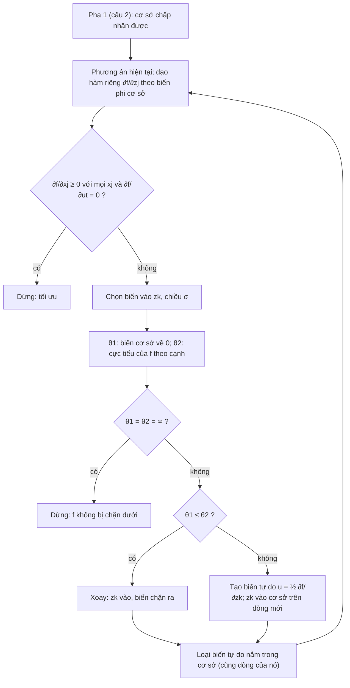
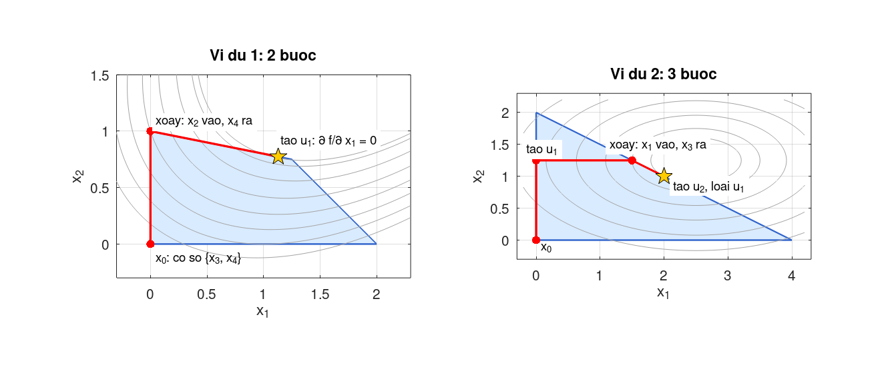

# Câu 18. Giải thuật đơn hình Beale giải quy hoạch toàn phương

## 1. Bài toán

**Quy hoạch toàn phương dạng chính tắc:**

```math
(QP)\qquad \min\; f(x) = c^T x + \tfrac{1}{2} x^T D x \quad \text{với}\quad A x = b,\quad x \ge 0,
```

trong đó $`D`$ đối xứng, **nửa xác định dương** (để $`f`$ lồi), $`A \in \mathbb{R}^{p \times n}`$ hạng $`p`$. Ràng buộc bất đẳng thức $`a^T x \le \beta`$ đưa về đẳng thức bằng biến bù như trong đơn hình ([câu 1](../q01-simplex/)).

**Điều kiện tối ưu.** Ràng buộc affine nên không cần điều kiện chính quy, và $`f`$ lồi nên KKT là điều kiện cần và đủ ([câu 13](../q13-convex-programming/)): $`x^*`$ tối ưu khi và chỉ khi có $`y \in \mathbb{R}^p`$, $`v \in \mathbb{R}^n`$ với

```math
c + D x^* - A^T y - v = 0, \qquad A x^* = b, \qquad x^* \ge 0, \qquad v \ge 0, \qquad v_j x_j^* = 0 .
```

Khác với quy hoạch tuyến tính, nghiệm của $`(QP)`$ **không nhất thiết là đỉnh** của miền chấp nhận được: nó có thể nằm giữa một cạnh, một mặt, hay trong miền. Do đó không thể chỉ đi từ đỉnh sang đỉnh như đơn hình.

## 2. Ý tưởng của Beale

Beale (1955, 1959) giữ nguyên khung của phương pháp đơn hình: cơ sở, biến cơ sở và phi cơ sở, phép xoay. Nhưng ông cho phép dừng **giữa một cạnh** khi $`f`$ đạt cực tiểu trên cạnh đó, bằng cách đưa vào các **biến tự do** (không ràng buộc dấu).

**Biểu diễn qua biến phi cơ sở.** Với cơ sở $`B`$ (ma trận khả nghịch gồm $`p`$ cột của $`A`$), các biến cơ sở được biểu diễn qua các biến phi cơ sở $`x_N`$:

```math
x_B = B^{-1} b - B^{-1} N x_N .
```

Thay vào $`f`$, ta được $`f`$ là hàm bậc hai của $`x_N`$. Tại phương án hiện tại $`\bar x`$ ($`x_N = 0`$), đạo hàm riêng theo biến phi cơ sở $`x_j`$ (các biến phi cơ sở khác giữ bằng 0) là

```math
\frac{\partial f}{\partial x_j} = d_j^T \nabla f(\bar x) = d_j^T (c + D \bar x), \qquad \frac{\partial^2 f}{\partial x_j^2} = d_j^T D\, d_j \ge 0,
```

với $`d_j`$ là hướng của cạnh: $`(d_j)_j = 1`$, $`(d_j)_B = -B^{-1} a_j`$, các thành phần khác bằng 0. Với $`D = 0`$, $`\partial f / \partial x_j`$ chính là ước lượng $`-\Delta_j`$ của đơn hình.

**Bước Beale.** Chọn biến vào $`x_k`$ có $`\partial f / \partial x_k \lt 0`$. Tăng $`x_k = \theta`$ (các biến phi cơ sở khác giữ bằng 0). Khi đó $`f(\theta) = f(\bar x) + \theta\, \partial_k f + \tfrac{1}{2} \theta^2\, \partial^2_{kk} f`$ giảm cho tới khi:

```math
\theta_1 = \min_{i \in B,\ (d_k)_i \lt 0} \frac{\bar x_i}{-(d_k)_i} \quad \text{(một biến cơ sở về 0)}, \qquad \theta_2 = \frac{-\partial_k f}{\partial^2_{kk} f} \quad \text{(cực tiểu của } f(\theta)\text{)} .
```

- **$`\theta_1 \le \theta_2`$**: xoay như đơn hình ($`x_k`$ vào, biến cơ sở chặn đi ra).
- **$`\theta_2 \lt \theta_1`$**: dừng giữa cạnh, tại điểm $`\partial f / \partial x_k = 0`$. Đưa vào một **biến tự do** mới

```math
u = \tfrac{1}{2} \frac{\partial f}{\partial x_k}\ (\text{viết như hàm tuyến tính của các biến phi cơ sở}) \quad\Longleftrightarrow\quad \tfrac{1}{2} d_k^T D x - u = -\tfrac{1}{2} d_k^T c ,
```

thêm phương trình này vào hệ ràng buộc, cho $`x_k`$ vào cơ sở trên dòng mới, còn $`u`$ là biến phi cơ sở bằng 0. Hệ số của $`x_k`$ trên dòng mới là $`\tfrac{1}{2} \partial^2_{kk} f \gt 0`$, nên cơ sở mới khả nghịch.

**Biến tự do.** $`u`$ không ràng buộc dấu, nên ở các bước sau:
- nếu $`u`$ phi cơ sở và $`\partial f / \partial u \ne 0`$, có thể cho $`u`$ vào theo chiều $`-\mathrm{sign}(\partial f/\partial u)`$ (ví dụ 2);
- nếu $`u`$ vào cơ sở, phương trình định nghĩa nó không còn hạn chế gì các biến khác: **loại** $`u`$ cùng dòng đó khỏi hệ.

Việc giữ $`u = 0`$ ở các bước sau buộc dãy đi theo các hướng **liên hợp** đối với $`D`$ trong mặt hiện tại, giống phương pháp hướng liên hợp ([câu 12](../q12-quasi-newton/), định lý 3). Nhờ đó trên một mặt chiều $`r`$, nhiều nhất $`r`$ bước là đạt cực tiểu.

## 3. Giải thuật

1. Tìm cơ sở chấp nhận được ban đầu (pha 1 của đơn hình hai pha, [câu 2](../q02-two-phase-simplex/)). Hệ mở rộng ban đầu là $`Ax = b`$, chưa có biến tự do.
2. Tính phương án hiện tại và các đạo hàm riêng $`\partial f / \partial z_j`$ theo mọi biến phi cơ sở $`z_j`$ (gồm $`x_j`$ và các biến tự do $`u_t`$).
3. **Dừng** nếu $`\partial f / \partial x_j \ge 0`$ với mọi $`x_j`$ phi cơ sở và $`\partial f / \partial u_t = 0`$ với mọi $`u_t`$ phi cơ sở.
4. Chọn biến vào có vi phạm lớn nhất: $`x_k`$ với $`-\partial f / \partial x_k`$ lớn nhất, hoặc $`u_t`$ với $`\lvert \partial f / \partial u_t \rvert`$ lớn nhất; chiều $`\sigma = +1`$ cho $`x_k`$, $`\sigma = -\mathrm{sign}(\partial f / \partial u_t)`$ cho $`u_t`$.
5. Tính $`\theta_1`$ (chỉ xét biến cơ sở $`x_i \ge 0`$) và $`\theta_2`$. Nếu cả hai bằng $`+\infty`$: $`f`$ không bị chặn dưới, dừng.
6. Nếu $`\theta_1 \le \theta_2`$: xoay. Ngược lại: tạo biến tự do mới như trên.
7. Biến tự do nào nằm trong cơ sở thì loại cùng dòng định nghĩa của nó. Quay lại bước 2.



## 4. Tính đúng đắn

**Định lý 1 (tiêu chuẩn tối ưu).** Nếu ở bước 3 điều kiện dừng thỏa mãn thì phương án hiện tại $`\bar x`$ là nghiệm tối ưu của $`(QP)`$. Hơn nữa $`v_j = \partial f / \partial x_j`$ ($`x_j`$ phi cơ sở), $`v_j = 0`$ ($`x_j`$ cơ sở) là nhân tử KKT của ràng buộc $`x_j \ge 0`$.

*Chứng minh.* Gọi $`z = (x, u)`$ là biến của hệ mở rộng $`M z = r`$ (gồm $`Ax = b`$ và các phương trình định nghĩa $`u_t`$). Mỗi $`x`$ với $`Ax = b`$ cho đúng một $`z`$ thỏa hệ (các $`u_t`$ là hàm tuyến tính của $`x`$). Vì ma trận cơ sở $`M_B`$ khả nghịch, $`z`$ được xác định bởi phần phi cơ sở $`z_N`$:

```math
z = \bar z + \sum_{j \in N} z_j\, \delta_j , \qquad \delta_j \text{ là hướng cạnh ứng với } z_j .
```

Với $`x`$ chấp nhận được, mọi $`x_j \ge 0`$, còn các $`u_t`$ tùy ý. Theo bất đẳng thức gradient cho hàm lồi $`f`$ (câu 13, bổ đề 1):

```math
f(x) \ge f(\bar x) + \nabla f(\bar x)^T (x - \bar x) = f(\bar x) + \sum_{x_j \in N} \frac{\partial f}{\partial x_j} x_j + \sum_{u_t \in N} \frac{\partial f}{\partial u_t} u_t \ge f(\bar x),
```

vì số hạng thứ nhất không âm và số hạng thứ hai bằng 0. Phần nhân tử: điều kiện $`\partial f / \partial z_j`$ ứng với hệ KKT với $`y`$ là nghiệm của $`B^T y = (c + D\bar x)_B`$ (tương tự câu 5, định lý 5); ở đây chỉ dùng $`v_j`$ để đối chiếu với các câu khác. $`\square`$

**Tính đơn điệu và hữu hạn.** Mỗi bước có $`\theta \gt 0`$ làm $`f`$ giảm thực sự (vì $`\partial f / \partial z_k \ne 0`$ theo chiều đi và $`\theta \le \theta_2`$). Beale chứng minh rằng, với giả thiết không suy biến, giải thuật kết thúc sau hữu hạn bước. Ý chính: số biến tự do không vượt quá số chiều của mặt hiện tại, và các biến tự do được tạo ra theo các hướng liên hợp, nên trên mỗi mặt chỉ có hữu hạn bước; $`f`$ giảm thực sự nên không quay lại một tổ hợp (cơ sở, biến tự do) cũ. Câu này không chứng minh chi tiết; xem E. M. L. Beale, *On minimizing a convex function subject to linear inequalities*, J. Roy. Statist. Soc. B 17 (1955) 173–184, và *On quadratic programming*, Naval Res. Logist. Quart. 6 (1959) 227–243. Khác với các phương pháp lặp của câu 14–17, Beale là phương pháp **hữu hạn**, cho nghiệm **chính xác** (tới sai số làm tròn).

**Không bị chặn.** Nếu $`\theta_1 = +\infty`$ (không biến cơ sở nào giảm) và $`\partial^2_{kk} f = 0`$ thì $`f(\theta) = f(\bar x) + \theta\, \partial_k f \to -\infty`$ trên một tia chấp nhận được.

## 5. Chương trình Matlab

| File | Nội dung |
|---|---|
| `beale_qp.m` | `[x, fval, exitflag, out] = beale_qp(c, D, A, b, opts)`: giải thuật đơn hình Beale; `opts.B0` (cơ sở xuất phát), `opts.display` |
| `run_examples.m` | Bốn ví dụ minh họa và một hình vẽ |

- Chương trình lưu hệ mở rộng $`M z = r`$ (ràng buộc gốc cộng các dòng định nghĩa biến tự do) và cơ sở $`B`$; mỗi bước giải hệ với $`M_B`$ để có phương án và các hướng cạnh. Cách này tương đương với cập nhật bảng đơn hình của Beale nhưng dễ kiểm chứng.
- Nếu không cho `opts.B0`, cơ sở ban đầu lấy từ pha 1 của `two_phase_simplex.m` ([câu 2](../q02-two-phase-simplex/)), bỏ các ràng buộc thừa nếu có.
- `exitflag`: 1 = tối ưu, 0 = hết số bước, -2 = không có phương án, -3 = $`f`$ không bị chặn dưới.
- Kết quả: lịch sử phương án `out.X`, `out.F`, các sự kiện mỗi bước (`out.events`: `'xoay'`, `'tao u1'`, `'..., loai u1'`), số biến tự do đã tạo `out.nFree`, nhân tử `out.lambda` ($`\partial f / \partial x_j`$ tại nghiệm).
- Đối chiếu bằng `solve_qp.m` ([câu 5](../q05-lagrange-duality/)).
- Khi làm câu này phát hiện một lỗi ở `two_phase_simplex.m` (câu 2) và `big_m_simplex.m` (câu 3): với $`A`$ chỉ có một dòng và không cần biến giả, `find` trả về mảng $`0 \times 0`$, làm `sub2ind` báo lỗi. Đã sửa bằng `reshape`. Chạy lại ví dụ của câu 2 và 3: kết quả không đổi.

Cách chạy (trong thư mục `solutions/q18-beale-quadratic-programming`):

```matlab
>> run_examples
```

Đã chạy kiểm tra bằng GNU Octave; chưa chạy trên MATLAB.

## 6. Ví dụ minh họa

### Ví dụ 1: giải tay (bài toán của câu 15, 17)

```math
\min\; -4x_1 - 6x_2 + 2x_1^2 + 2x_2^2 - 2x_1 x_2 \quad \text{với}\quad x_1 + x_2 + x_3 = 2,\quad x_1 + 5x_2 + x_4 = 5,\quad x \ge 0 .
```

**Bước 0.** Cơ sở $`\{x_3, x_4\}`$, $`\bar x = (0, 0, 2, 5)`$, $`f = 0`$. $`\partial f/\partial x_1 = -4`$, $`\partial f/\partial x_2 = -6`$: chọn $`x_2`$. Tỉ số: $`x_3 = 2 - x_2`$, $`x_4 = 5 - 5x_2`$, nên $`\theta_1 = 1`$; $`\partial f / \partial x_2 = 4x_2 - 6 = 0`$ khi $`\theta_2 = 1.5`$. Vì $`\theta_1 \lt \theta_2`$: **xoay**, $`x_2`$ vào, $`x_4`$ ra.

**Bước 1.** $`x_2 = 1 - 0.2x_1 - 0.2x_4`$, $`x_3 = 1 - 0.8x_1 + 0.2x_4`$, $`\bar x = (0, 1, 1, 0)`$, $`f = -4`$. Với $`d_1 = (1, -0.2, -0.8, 0)`$:

```math
\frac{\partial f}{\partial x_1} = d_1^T (c + D\bar x) = (1, -0.2)\begin{pmatrix} -6 \\ -2 \end{pmatrix} = -5.6, \qquad \frac{\partial f}{\partial x_4} = 0.4 \ge 0, \qquad \frac{\partial^2 f}{\partial x_1^2} = 4.96 .
```

Chọn $`x_1`$: $`\theta_1 = \min(1/0.8,\ 1/0.2) = 1.25`$, $`\theta_2 = 5.6/4.96 = 35/31 = 1.129`$. Vì $`\theta_2 \lt \theta_1`$: **tạo biến tự do** $`u_1 = \tfrac{1}{2}\, \partial f / \partial x_1 = \tfrac{1}{2}(-5.6 + 4.96x_1 + 0.56x_4)`$; $`x_1 = (2u_1 + 5.6 - 0.56x_4)/4.96`$ vào cơ sở. Phương án mới: $`x_1 = 35/31`$, $`x_2 = 24/31`$, $`x_3 = 3/31`$, $`x_4 = 0`$.

**Bước 2.** Biến phi cơ sở $`x_4`$, $`u_1`$: $`\partial f / \partial u_1 = 0`$ (theo cách tạo), $`\partial f / \partial x_4 = 32/31 \gt 0`$. **Tối ưu**: $`x^* = (35/31, 24/31, 3/31, 0)`$, $`f^* = -222/31`$, và $`\partial f / \partial x_4 = 32/31`$ đúng bằng nhân tử của ràng buộc thứ hai tìm được ở câu 15 và 17.

Kết quả chạy trùng từng bước:

| $`k`$ | $`x_k`$ | $`f(x_k)`$ | Vào | Ra | $`\theta_1`$ | $`\theta_2`$ | Bước |
|---|---|---|---|---|---|---|---|
| 0 | (0, 0, 2, 5) | 0 | $`x_2`$ | $`x_4`$ | 1 | 1.5 | xoay |
| 1 | (0, 1, 1, 0) | -4 | $`x_1`$ | | 1.25 | 1.129 | tạo $`u_1`$ |
| 2 | (1.12903, 0.774194, 0.0967742, 0) | -7.1612903 | | | | | tối ưu |

Nhân tử $`\partial f/\partial x_j = (0, 0, 0, 1.0323)`$. Với cơ sở ban đầu tìm bằng pha 1 (câu 2) cũng được cùng nghiệm sau 2 bước. Solver `qp` (dạng 2 biến): $`x^* = (1.1290323, 0.77419355)`$, $`f^* = -7.161290323`$.

### Ví dụ 2: biến tự do được dùng lại rồi bị loại (bài toán của câu 14)

```math
\min\; (x_1 - 2.5)^2 + 4(x_2 - 1.25)^2 = -5x_1 - 10x_2 + x_1^2 + 4x_2^2 + 12.5 \quad \text{với}\quad x_1 + 2x_2 + x_3 = 4,\quad x \ge 0 .
```

| $`k`$ | $`x_k`$ | $`f(x_k) + 12.5`$ | Vào | Ra | $`\theta_1`$ | $`\theta_2`$ | Bước |
|---|---|---|---|---|---|---|---|
| 0 | (0, 0, 4) | 12.5 | $`x_2`$ | | 2 | 1.25 | tạo $`u_1`$ |
| 1 | (0, 1.25, 1.5) | 6.25 | $`x_1`$ | $`x_3`$ | 1.5 | 2.5 | xoay |
| 2 | (1.5, 1.25, 0) | 1 | $`u_1`$ | | 5 | 1 | tạo $`u_2`$, loại $`u_1`$ |
| 3 | (2, 1, 0) | 0.5 | | | | | tối ưu |

Giải tay bước 2: cơ sở $`\{x_1, x_2\}`$ với $`x_2 = (2u_1 + 10)/8`$ (dòng của $`u_1`$) và $`x_1 = 4 - 2x_2 - x_3`$. Theo $`u_1`$: $`dx_2/du_1 = 1/4`$, $`dx_1/du_1 = -1/2`$, nên $`\partial f / \partial u_1 = (8x_2 - 10)\tfrac{1}{4} + (2x_1 - 5)(-\tfrac{1}{2}) = 0 + 1 = 1 \ne 0`$. Biến tự do $`u_1`$ được giảm ($`\sigma = -1`$): hướng $`(0.5, -0.25, 0)`$, độ cong $`2 \cdot 0.25 + 8 \cdot 0.0625 = 1`$, nên $`\theta_2 = 1`$, nhỏ hơn $`\theta_1 = 5`$ ($`x_2 \ge 0`$). Tạo $`u_2`$, cho $`u_1`$ vào cơ sở, và vì $`u_1`$ là biến tự do trong cơ sở nên bị loại cùng dòng của nó. Phương án mới $`(2, 1, 0)`$ là nghiệm, nhân tử của $`x_3 \ge 0`$ là $`\partial f / \partial x_3 = 1`$, khớp với $`\lambda = 1`$ ở câu 14.



### Ví dụ 3: hàm mục tiêu không bị chặn dưới

```math
\min\; -x_1 + \tfrac{1}{2}(x_1 - x_2)^2 \quad \text{với}\quad x_1 - x_2 + x_3 = 1,\quad x \ge 0 .
```

$`D`$ nửa xác định dương nhưng suy biến. Bước 0 (cơ sở $`\{x_3\}`$): $`x_1`$ vào, $`\theta_1 = \theta_2 = 1`$, xoay, được $`(1, 0, 0)`$, $`f = -0.5`$. Bước 1: $`x_2`$ có $`\partial f / \partial x_2 = -1`$; theo hướng $`(1, 1, 0)`$, biến cơ sở $`x_1`$ tăng ($`\theta_1 = \infty`$) và độ cong $`(1 - 1)^2 = 0`$ ($`\theta_2 = \infty`$). Chương trình báo `exitflag = -3`: thật vậy $`f(t, t, 0) = -t \to -\infty`$.

### Ví dụ 4: danh mục Markowitz n = 50

Bài toán của câu 14, 15, 17: $`\min -\mu^T x + x^T \Sigma x`$ (tức $`c = -\mu`$, $`D = 2\Sigma`$) với $`\sum x_i = 1`$, $`x \ge 0`$. Cơ sở ban đầu từ pha 1 là $`\{x_1\}`$ (danh mục chỉ gồm tài sản 1).

- Beale dừng sau **20 bước**: 1 lần xoay và 19 lần tạo biến tự do, trong đó 6 biến tự do bị loại sau đó.
- $`f = -0.127299791425599`$, trùng với `qp` tới $`f - f_{qp} = -2.8\cdot10^{-17}`$ và $`\lVert x - x_{qp} \rVert = 3.8\cdot10^{-15}`$. Đây là nghiệm **chính xác** tới sai số làm tròn, không phải gần đúng.
- Danh mục có 14 tài sản. Số tài sản có tỉ trọng dương tăng dần theo bước: 1, 2, 3, …, 7, (giữ 7 trong 6 bước), 8, …, 13, 13, 14. Mỗi lần tạo biến tự do, một tài sản mới vào cơ sở mà không cần chạm đỉnh.
- Nhân tử của 36 ràng buộc $`x_j \ge 0`$ phi cơ sở đều dương (nhỏ nhất $`9.2\cdot10^{-4}`$), đúng định lý 1.
- So sánh (cùng bài toán): Frank–Wolfe 6183 bước (câu 14), chiếu gradient 46–92 bước (câu 15), hàm chắn 47–63 bước Newton (câu 17). Beale cần 20 bước và cho nghiệm chính xác, vì nó khai thác cấu trúc bậc hai của $`f`$ và tuyến tính của ràng buộc.

## 7. Nhận xét

- Beale mở rộng đơn hình cho quy hoạch toàn phương lồi: cùng cơ sở, phép xoay và tỉ số, cộng thêm một khả năng mới là dừng giữa cạnh tại cực tiểu của $`f`$, nhờ các biến tự do $`u = \tfrac{1}{2}\, \partial f/\partial x_k`$. Khi $`D = 0`$ không bao giờ có $`\theta_2 \lt \infty`$, và giải thuật trở về đơn hình của câu 1.
- Tiêu chuẩn tối ưu là dấu của các đạo hàm riêng theo biến phi cơ sở, giống ước lượng $`\Delta_j`$ của đơn hình. Các đạo hàm này tại nghiệm chính là nhân tử KKT (ví dụ 1, 2).
- Là phương pháp **hữu hạn** và **chính xác** (ví dụ 4: sai số $`10^{-15}`$ sau 20 bước), rất hiệu quả cho bài toán cỡ vừa với ít biến ở nghiệm (số biến tự do nhỏ).
- Hạn chế: kích thước hệ tăng thêm một dòng mỗi khi tạo biến tự do; cần xử lý suy biến như đơn hình (chương trình dùng quy tắc chỉ số nhỏ nhất khi hòa tỉ số); và chỉ áp dụng cho $`f`$ bậc hai lồi với ràng buộc tuyến tính. Với quy hoạch lồi tổng quát cần các phương pháp của câu 15–17.
